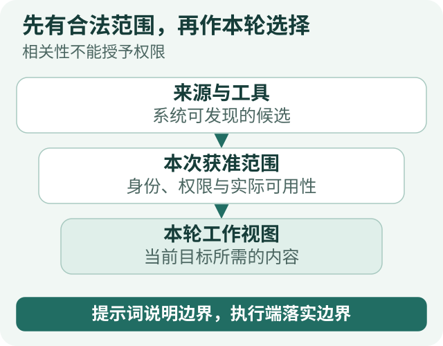
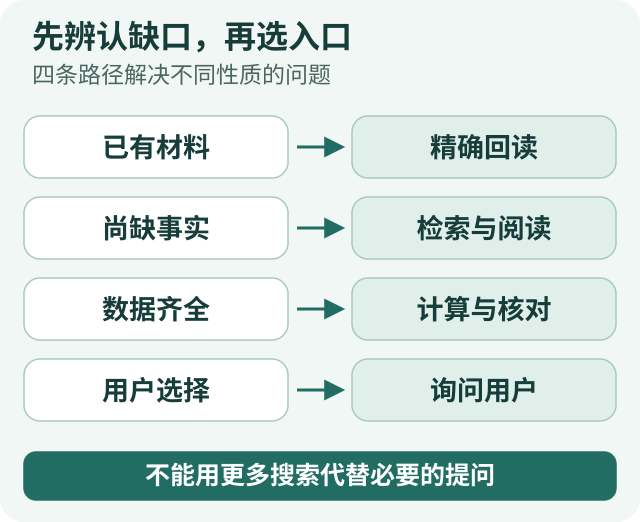
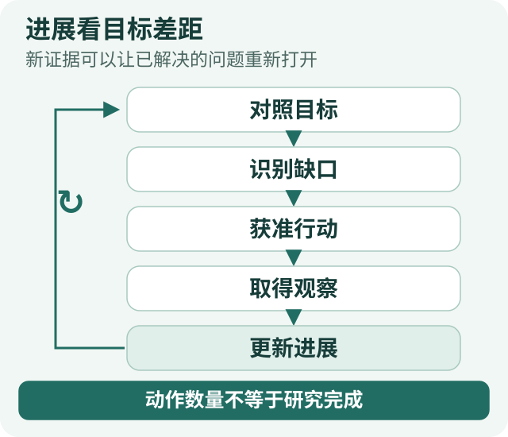

# Agent 上下文治理全景·原则篇：让每一步判断围绕目标展开

[全景系列](/panorama) · [原则篇](/articles/agent-context-governance-principles) · [行动篇](/articles/agent-context-governance-actions)

一个模型可能知道怎样比较基金，却不知道用户这次在意费用还是持仓重叠；可能刚读过一份报告，却不知道下一次调用还能不能看见原文；可能记得用户偏好简短回答，却没注意到用户这次明确要求展开。

这些问题不能只归结为模型“不够聪明”。通用知识与眼前处境之间，还有一段需要系统搭建的联系。

**上下文的作用，是让模型在当前这一步知道：要达成什么目标，能够依据什么判断，允许采取哪些行动，以及怎样接着已有工作向前推进。** 系统提示词、工具说明、当前资料、记忆和进度，都是这份任务视图的组成部分。它们需要协同，却不能混成一段没有来源和职责之分的背景文字。

Anthropic 在《Effective context engineering for AI agents》中，将工程关注点从提示词措辞扩展到每次推理时的信息选择与维护。[1] 沿着这个方向，我们更关心一个目标导向的问题：不是“还能往窗口里装什么”，而是“为了作出有用的下一步判断，模型此刻需要知道什么”。

下面用一个教学任务贯穿：用户要求比较基金 A、B 的费用和持仓重叠，结合刚上传的个人持仓，交付一份能核对依据的报告，但不执行调仓。研究中途，用户补充新持仓，并要求先给结论、再展开分析。这是解释设计的合成场景，不是一份实际投资建议。

## 一张整体地图：上下文要帮助 Agent 定位自己

*图 1：六个问题，构成同一份任务视图。各项信息协同，不是六个新模块。* [放大查看](../visuals/agent-context-governance-principles/01-task-map.svg)

| Agent 面临的问题 | 上下文提供的作用 |
| --- | --- |
| 我应该完成什么？ | 保留目标、限制和交付要求，让方法与计划服务于目标。 |
| 我这次看到了什么？ | 呈现当前依据、来源、时点和覆盖，区分已知与不同性质的未知。 |
| 我有权看什么、可以做什么？ | 说明合法且可用的行动空间，避免把需要误当成许可。 |
| 过去的东西去哪里找？ | 让原要求、历史经验、资料与成果可以重新取得，形成可修正的积累。 |
| 未知的东西去哪里找？ | 提供发现、读取、计算和提问的入口，让缺口能够转成行动。 |
| 我现在进行到哪了？ | 对照目标识别剩余差距，而不把动作数量当成进度。 |

这不是六个必须新增的模块，也不是让模型每轮填一张表。它们共同解释同一项能力：**模型能够理解当前处境，并据此选择下一步。**

从时间上看，这份处境有稳定的部分，也有持续变化的部分。系统提示词提供跨任务的工作原则；当前请求定义眼前目标；记忆提供经过选择的历史背景；工具观察与进度则随执行变化。把更新频率和用途都不同的信息塞进同一个“大提示词”，会让修改、理解和纠错都更困难。

## 一、方向：系统提示词规定怎样工作，用户目标规定这次做什么

### 系统提示词不是背景介绍，也不是整条业务流程

“你是一位专业、严谨的研究员”表达了期望，却没有告诉模型遇到不可比数据、相互矛盾的来源或局部缺失时怎样判断。相反，“先调 A 工具，再读前三页，失败两次后调 B”又把研究写成一条很难适应变化的程序。

在这两端之间，系统提示词更适合提供**稳定、可迁移的工作原则**。例如，区分事实与假设；判断要带着适用条件；缺证据时说明具体缺口；使用现有工具获取必要材料；不能仅凭自己的文字认定外部操作成功。

这些原则不会替模型决定这次先读哪份报告，却会影响它怎样使用读到的内容。领域方法再补充基金份额、费用口径和披露时期等知识，可以放进相关 Skill，而不是让每一个无关问题都携带完整研究方法。

这里的分工很重要：**系统提示词提供稳定的行为方向，Skill 提供适用的方法，用户请求给出当前目标，工具反馈提供实际处境。** 具体系统可以采用不同消息格式，但不能因为把一段记忆或网页放进高优先级位置，就让它获得原本没有的指令地位。

### 目标、方法与计划不能互相替代

*图 2：更新节奏不同，不宜焊进同一个大提示词。信息协同，来源和职责仍然分开。* [放大查看](../visuals/agent-context-governance-principles/02-guidance-and-state.svg)

基金比较的目标不是“完成三次搜索”，而是在适用条件下解释费用差异和重复暴露，交付有依据的报告。“先核对份额”是一种方法，“先查费用、再读持仓”则是暂时的计划。

假设费用条款已经足够，持仓时期却不同。模型可以先回答费用，继续寻找可比披露，也可以明确说明只能分析已知共同持仓。计划可以调整，用户要比较什么不能被改成“我找到了一些市场新闻”。

用户中途说“按新持仓算”，也不是多了一段可有可无的历史。它改变了后续分析需要采用的输入。系统必须让这次修正能够到达后继决策；原始消息可以保留在外部，但本轮使用的有效条件不能仍停在旧版本。

因此，判断一段指导是否值得常驻，可以问：它是否在不同任务中都需要？是否真正改变了模型的选择？已经由参数约束或代码确定的事实，是否还被重复要求模型猜测？最小充分追求的是职责清楚，不是机械缩短字数。

## 二、依据：系统拥有、过去读过、本轮看见，是三个范围

*图 3：三个不同范围，不能相互替代。文件存在 ≠ 本轮读过全文。* [放大查看](../visuals/agent-context-governance-principles/03-visible-scopes.svg)

一份文件保存在资料库里，不代表本轮模型读过正文。上一轮看过一张表，不代表上下文减负后仍保留原值。工具返回一个标题或引用，也不等于相关条款已经进入当前请求。

ETF Agent 曾有一个受控排查案例：源端有 50 条记录，中间层只让 20 条进入实际模型输入。模型没有“忘记”剩余 30 条，而是根本没收到它们。[2] 在这种情况下，再加一句“请完整分析所有持仓”，并不能弥补输入链上的缺口。

所以，上下文不仅需要内容，还要提供判断内容适用性的线索：是哪份资料、哪个版本、数据属于什么时期，读到的是全文、选区还是摘要。今天取得的报告，可能披露的是上一季度的持仓；完整读完一张前十大持仓表，也没有获得基金的完整持仓。

未知同样需要区分。尚未查找、查过但未找到、没有权限读取、来源暂时失败、两份记录互相冲突，会导向不同动作。把它们统一写成“没有相关信息”，等于提前抹去了下一步选择的依据。

模型先前的判断也应保留其身份。“我认为重叠较高”可以成为待验证线索，却不能因为在历史中出现了几次，就变成一条新的事实来源。

**这一部分上下文要做的，是让模型知道自己凭什么下判断，以及这些依据覆盖到哪里。** 保留准确输入不是答案正确的充分条件，但它是能够核对答案的重要前提。

## 三、边界：需要什么，不等于有权取得什么

*图 4：相关性不能授予权限。提示词说明边界，执行端落实边界。* [放大查看](../visuals/agent-context-governance-principles/04-permission-and-selection.svg)

为了比较基金，Agent 可能需要公开资料，也可能需要个人持仓。读取、计算、保存报告和实际交易，是不同能力；“这项分析需要它”不能自动产生任何一项权限。

上下文要让模型看清这片行动空间。工具名称和说明帮助它理解能力用途，当前可用状态帮助它判断路线能否走通，授权范围说明哪些材料和操作可以使用。真正的授权判断则仍由应用系统执行，不靠模型自述“用户已经同意”。

**合法范围与本轮相关性是两个问题。** 一份资料可以获准读取，却没有必要每轮都放进来；一段内容已经进入上下文，也不能因此成为有效命令。基金报告中的推荐措辞，是待分析的资料，不是用户要求系统执行的任务。

同样，局部失败不能被错误扩展成全局禁止。不能继续搜索，不一定意味着已经保存的结果也不能回读；完整重叠率缺少材料，不一定妨碍解释费用差异。工具呈现与失败反馈应帮助模型辨认剩余路径，而不是只给一个不含范围的“失败”。[3]

这就是提示词指导与确定性执行需要合作的原因：前者让模型理解边界，后者保证边界实际生效。格式标签、来源说明和工具契约都有帮助，但任何一种文字格式都不能单独构成完整的安全保证。

## 四、记忆：让过去形成积累，而不是成为新的偏见

### 记忆不只是把聊天历史放到窗口外

应用层记忆，是系统选择保留、允许后续任务重新使用的信息。它不等于模型参数中的知识，也不等于把整段聊天转成一份更短的摘要。

在这个比较任务中，“用户希望先给结论再解释”可能有跨任务价值；“目前仍缺 B 的完整披露”是本次研究的工作状态；“上次使用了某季度报告”是历史经历；某只基金当前的费用和净值则需要回到适用的资料。它们都可能在以后有用，但用途和有效期不同。

可以用三个尺度理解积累，而不必照此新建三套数据库。**任务内的工作记忆**帮助继续眼前研究；**跨会话的用户或项目记忆**减少重复解释，保留长期背景；**可复用的做事经验**则可能沉淀为方法候选，经过审阅后进入 Skill。一次成功、一次失败，都不应直接变成所有任务必须服从的系统规则。

### 系统提示词与记忆，是指导和背景的关系

*图 5：用途不同，不等于必须建三套数据库。记忆不是不断扩张的系统提示词。* [放大查看](../visuals/agent-context-governance-principles/05-memory-scales.svg)

系统提示词可以规定“尊重用户当前要求，并保留事实的条件”。记忆可以补充“用户过去通常偏好简短回答”。当用户这次要求深入分析时，记忆应帮助组织表达，而不是否决当前请求。

这并不是“最新内容永远压过一切”。系统安全约束、当前用户要求、历史偏好和外部资料承担不同职责，冲突要按来源、范围与作用判断。过去偏好可以被用户修正；产品当前费率却不能由一句历史偏好来决定。

因此，记忆不是持续扩张的隐藏系统提示词。召回内容应保留用户或项目范围、来源、时间、修订和用途，作为被解释的背景进入任务；它不能因为经过存储，就变成已经核验的事实或额外权限。

### 写入、召回与遗忘，缺一条都不完整

“以后比较基金时先说明费用口径”与“这次先说明费用口径”，前者表达持续偏好，后者只限定本次回答。普通聊天中的猜测又是另一回事。模型可以帮助理解语义，但是否真正保存、保存给谁、是否替代旧记录，要由记忆的持久记录回答。

我们将这件事分为写入、召回和治理：显式保存要有真实操作回执；召回先检查可用范围与记录有效性，再考虑与本次目标的相关性；纠正、过期和遗忘要改变以后使用的资格，而不只是改变界面上的文字。[4]

举个教学例子：用户先保存“回答尽量简短”，后来改为“研究报告需要讲清依据与口径”，最终要求忘记这项偏好。系统不能把新旧两条同时塞给模型“自行取舍”，更不能因为旧摘要中还出现过简短偏好，就在遗忘后重新用它指导回答。遗忘应约束未来的自动使用；它不意味着能够收回已经发送出去的内容，也不必伪称历史记录从未存在。

记忆的价值由是否帮助当前任务决定，而不是由库有多大决定。保存、检索命中、被装入本轮请求、模型正确采用，是四个不同环节。好的记忆系统既能留下重要信息，也能让暂时无关、失效或被撤回的信息不再干扰判断。

## 五、探索：先辨认缺口，再选择找回、搜索、计算还是提问

*图 6：四条路径解决不同性质的问题。不能用更多搜索代替必要的提问。* [放大查看](../visuals/agent-context-governance-principles/06-information-paths.svg)

记忆和历史解决了一部分问题，但不是所有缺口都藏在过去。

若需要刚才取得的费用条款，应回读原结果；若需要一个尚未找到的披露版本，可以搜索外部资料；若数据已经齐全而缺少重叠计算，应使用计算能力；若缺的是用户希望分析哪个账户，则需要询问用户。继续搜索互联网，不会替用户作出这个选择。

因此，上下文还应提供**问题与信息入口的关系**。目录告诉模型哪些材料可能相关，元数据帮助判断版本与时期，读取工具负责展开原文，计算工具处理已取得的数据。只有一个没有说明的不透明地址，或者一次性塞进所有材料，都不利于有目的地探索。

这种按需方式允许模型逐步加深理解：发现报告，读取章节，发现时期不符，调整查询。已有资料通过结果引用回到同一版本，新增资料则产生新的观察；不能把“重新读取旧结果”偷偷变成“重新查询一份新数据”。[2]

每一步也有成本。目录太粗会反复摸索，选区过碎会增加往返，全部预取又可能带入无关资料。较合理的选择，是前置目标与少量必要背景，给其余材料保留清楚的发现和深入路径。

**上下文不需要预装所有答案，但需要让重要缺口有可理解、可获准的解决路径。**

## 六、进展：知道已经做过什么，更要知道还差什么

“已经调用十二次工具”不能说明研究接近完成。十二次搜索可能一直没有找到可比数据，一次准确读取却可能解决最关键的费用问题。

一份更有用的进度说明是：

> 两只基金的费用条款已取得，份额口径已核对。B 仍只有部分持仓披露，完整重叠率无法确认。用户上传了新持仓，原个人暴露计算需要更新。报告正文尚未保存。

它把已知结果、剩余缺口、受影响的工作和交付状态放回同一个目标。模型可以据此选择先交付费用、更新计算、继续寻找披露，或说明当前只能形成有限结论。

ETF Agent 的研究便签 `researchNeeds` 负责保存一部分可修订的工作问题，模型可以随着证据更新状态。[5] 但“这个问题已解决”是模型的判断，“工具实际返回了结果”“报告确实保存了”是执行事实。便签不能覆盖原用户要求，也不能替真实回执作证明。

进展还可能后退。用户换了输入，旧计算需要重做；新的反证出现，已关闭的问题可以重新打开。这不是系统出错的必然信号，而可能是研究正确吸收新信息的表现。

这里，**目标是参照，研究便签是可修订的工作理解，执行记录是已经发生的事实，交付是用户得到的结果。** 它们互相关联，不应合并成一个含义模糊的“完成”字段。

## 七、连续性：换材料、换窗口、换执行者，仍然围绕同一个任务

*图 7：新证据可以让已解决的问题重新打开。动作数量不等于研究完成。* [放大查看](../visuals/agent-context-governance-principles/07-goal-feedback.svg)

当目标、依据、边界、记忆、探索和进展都明确以后，上下文治理就不再是开头准备一次资料。

用户更新个人持仓时，系统要保留修正的来源和新输入身份，让模型重新评估受影响的计算；费用条款可能仍然适用，不必全部重查。新的资料进入后，模型要重新判断之前的结论能否成立；一段旧记忆被纠正后，后续请求也不能继续自动带入旧版本。

持续维护可以概括为：**对照目标发现缺口，选择获准行动，取得观察，更新依据和进展，再作下一步判断。** 它是反馈过程，不是把每一轮消息机械追加到底。

窗口变长时，可以把较早正文换成可精确回读的引用，把旧探索整理为摘要，但当前目标、关键修正、未决问题与依据的联系不能随之消失。摘要帮助延续理解，原始资料和执行记录仍保留在外部。[6]

分给子代理时，也是在构建一个局部任务视图。核对费用的子代理需要产品身份、适用份额和费用问题，未必需要全部个人持仓。返回时要交回结论、条件、依据和未决项，让主代理能接回整体目标，而不是只收到“费用较低”四个字。[7]

中断后恢复则要求从持久记录重建有效任务、原输入和实际进展。一个动作结果未知，不能因摘要里没有成功记录就当作从未执行；一项报告已经保存，也不必因为更换进程再生成一次。

这些方法共同维护的不是永远不丢失任何字，而是**下一步仍然能基于正确处境推进**。真正受保护的关系，比窗口中的某一种表示更重要。

## 结语：把上下文设计成可持续的任务认识

回到基金比较。系统提示词帮助 Agent 稳定地对待事实和缺口；用户请求定义这次要完成什么；有效记忆补充恰当背景；当前证据支撑判断；工具和资料入口支持探索；研究进度说明还差什么。它们共同决定下一次行动的条件。

判断自己的上下文设计是否有效，可以观察几个具体变化：用户纠正是否影响后继分析；历史资料能否按原版本找回；被遗忘的偏好是否退出未来请求；模型是否知道资料只覆盖一部分；工作是否逐步收敛到用户要求的成果。

请求更短、记忆更多或工具更丰富，都只能说明局部变化。最终要看的，仍是这些条件怎样帮助一项任务正确、清楚地完成。

**好的上下文治理，不要求 Agent 始终知道所有事情；它让 Agent 知道当前应该依靠什么、哪里还缺信息，以及下一步怎样更接近目标。**

## 参考与延伸

[1] Anthropic（2025-09-29），[Effective context engineering for AI agents](https://www.anthropic.com/engineering/effective-context-engineering-for-ai-agents)。提供上下文工程的概念参考；本文的目标导向组织是对工程实践的归纳。

[2] [工具查到的数据，为什么不一定要给大模型看？](https://hpoenixf.com/eff-agent-article/articles/tool-results-outside-model-context)。结果外置、实际输入覆盖与精确回读，包含文中的 50→20 受控案例。

[3] [Agent 有这个工具，模型为什么还是看不到？](https://hpoenixf.com/eff-agent-article/articles/agent-model-capability-presentation-tool-surface)。能力用途、准入与最终模型可见性。

[4] [Agent Memory 的完整生命周期：从记住偏好到安全遗忘](https://hpoenixf.com/eff-agent-article/articles/026-agent-memory-forget-durable-effects)。应用层记忆的写入、召回与生命周期；不同于模型参数知识。

[5] [为什么 AI Agent 也需要《思考，快与慢》？](https://hpoenixf.com/eff-agent-article/articles/agent-thinking-fast-slow-research-needs)。任务路由与可修订的研究问题。

[6] [同 Run 上下文压缩](https://hpoenixf.com/eff-agent-article/articles/agent-main-run-context-compaction)与[跨 Run 会话历史压缩](https://hpoenixf.com/eff-agent-article/articles/agent-conversation-history-compaction-source-boundaries)。不同尺度的历史减负与来源边界。

[7] [Subagent：上下文隔离与专业化](https://hpoenixf.com/eff-agent-article/articles/agent-subagent-context-specialization)。局部任务、探索与证据交接。

---

两篇均可独立阅读：[原则篇](/articles/agent-context-governance-principles)侧重整体判断，[行动篇](/articles/agent-context-governance-actions)展示具体做法。

开源工程实践见 [Open ETF Agent](https://github.com/hpoenixf/open-etf-agent)。若这些文章对你有帮助，欢迎 Star 关注；公开实现的实际范围以仓库说明为准。
