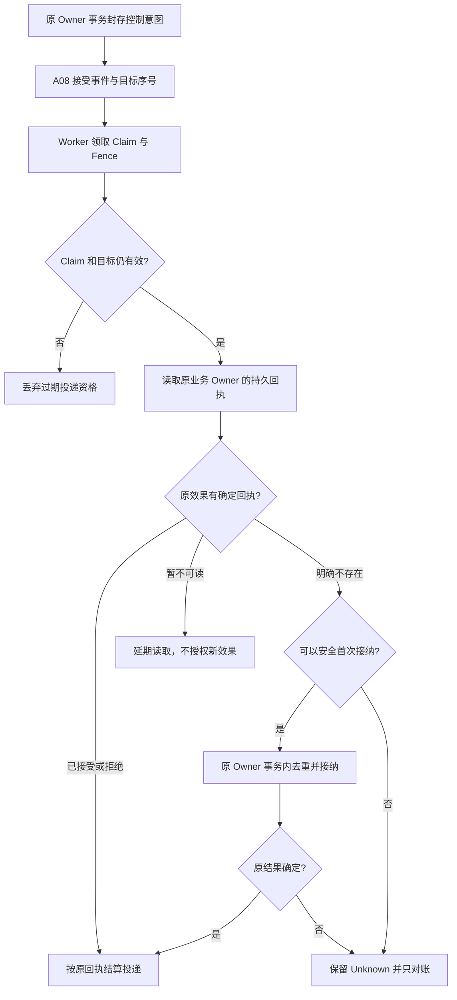

# Agent 收到控制指令后，为什么不能立刻执行？A08 持久控制事件的交接边界

后台研究正在进行，用户点了 Stop。另一台 Worker 随后接手，看到数据库里还有一条待处理命令。它能否直接再执行一次停止？如果上一个 Worker 已经让原任务停下，只是在写回投递 ACK 前掉线，这次重试应该做什么？

这是 ETF Agent 逐渐遇到的真正难题：**一条命令被可靠送达，和它要求的业务效果真实发生，是两件事。** 如果把“投递成功”当成“任务成功”，会漏掉真正的效果；如果把“没收到 ACK”当成“没执行”，又可能重复停止、重复唤醒，甚至重派受保护的动作。

A08 的工作不是管理整个 Agent，而是把持久控制事件作为一条有身份、顺序、领取资格和交付回执的窄通道。实际终止 Run、接纳 Correction、建立 Task 或恢复 Child 的权力，仍由它们各自的原 Owner 持有。

## 一、为什么普通事件总线不等于持久控制事件

在 Agent 内部，“事件”至少有几种完全不同的含义。

| 事件种类 | 谁最终拥有它 | 真正的结果 |
| --- | --- | --- |
| 生命周期 Hook | A29 | 一次回调是否被选择、执行以及它的局部结果 |
| 持久控制命令 | **A08** | 原命令被接受、持有、投递及按原业务回执结算 |
| 会话进度或正文事件 | A24 | 内容版本、序号、投递与 History 回读 |
| 调用轨迹与审计观察 | E04 等观察能力 | 实际采集范围内的记录、缺失和 unknown |

工具完成不代表四条支路都必须触发。普通 Tool Result 可以直接回到研究；需要持久唤醒或停止时才有相应控制意图。Hook 的 Stop 建议也不自动拥有 Run 的技术终止权，SSE 发出去更不证明用户已看见或业务已提交。

我们没有制造一个万能的 EventBus，让它决定研究、预算、发布和记忆。A08 只为确实需要跨进程保存的控制交接负责。

## 二、先封存身份，再让 Worker 领取

一条持久命令不能只保存一段 `"stop"` 文本。它需要能让原业务 Owner 识别的授权主体、原生产者、目标及版本，还有用于去重与顺序处理的稳定身份。

当前实现把生产者在原事务中封存的 `producerKey` 与事件指纹对应起来：同一个生产者意图、同一份内容再次出现，返回原有事实；同一个键却换了内容，拒绝身份冲突。被接受的事件取得 `eventId`，投递侧生成 `commandKey = control:eventId`。对同一目标的事件还有接受序号及目标修订，不能因为队列扫描顺序变化就把后来的控制先执行。

为什么先有 *intent*，再有 *event*？有些原业务事实需要与待发控制意图同一事务提交。`stageInTransaction` 保证原事实回滚时，持久交接也一同回滚；后续 Relay 只把既有意图转换成可领取事件，不直接执行模型、工具或业务效果。对于未来的定时触发，未到期的意图不能先占据目标事件顺序，挡住用户此刻的 Correction。

背压同样不是一句“消息放不下就重试”。未完成的 intent、pending、claimed、unknown 和保留的容量预留都可能占据同一个 Scope 的待办空间。新的准入不能把未知效果删除，好让表面计数变小。

## 三、Claim 与 Fence：拿到工作，不等于拿到永久执行权

两个 Worker 可能同时读取同一队列。A08 在短数据库事务中领取候选，保留对应 Worker、有效期和递增的 `fence`；领取时也检查目标当前修订、事件种类与适用消费者。失效的目标不应继续执行旧动作。

更重要的是，**Worker 在领取时有效，不等于稍后接纳业务效果时依然有效**。外部 I/O、线程停顿或数据库重试都可能跨过租约期限。原业务 Owner 在自己的事务中使用同一命令身份，重新检查当前 claim、Worker、fence、目标与有效期，然后才有资格接纳效果。

这不是让 A08 变成第二个权限中心。Claim 只证明投递者现在可以携带哪条封存命令去敲原 Owner 的门；那扇门是否接受，由原 Owner 的身份、授权、资源和业务状态决定。

## 四、真正困难的是：先看业务回执，再决定要不要重投

一次正确的交接如下。图中“未知”并非临时网络错误的同义词，而是原业务效果无法证实已经发生或未发生。

原 Owner 的 `readReceipt` 返回 `null`，必须表示**在权威存储中确定不存在原回执**；数据库不可读应该抛错，而不是偷偷返回 null。当原回执读取暂时不可用、且此前没有启动过不确定的业务接纳，A08 只延期读取而不立即新建业务效果；只有原 Owner 能证明准入事务已回滚、未派发，才可能恢复安全重试。已经开始接纳却丢了结果，或者旧 Claim 标记了 owner uncertain，必须保留 unknown；下一轮首先对账，不能默认再次调用 `admit`。

当重投次数超过边界，或当前路由/事件无法安全处理时，命令可以进入隔离状态。隔离是一份可解释的处置记录，不是“命令执行成功”，更不是清空底层业务的副作用。

## 五、一次丢失 ACK 的合成案例

假设某个 Run 的停止请求被原 Owner 原子接纳，并留下 `accepted` 的业务回执。Worker 随后掉线，未把 A08 中的状态从 claimed 改为 acknowledged。租约过期后，第二个 Worker 可能领取同一 `eventId`，此时 fence 已经不同。

正确路径不是再停止一遍，而是**以相同 `commandKey` 查询原业务回执**。找到先前 accepted，就只完成投递结算。另一种情况是原事务提交与回执读取都无法确认：即使客户端看见超时，A08 也要保留 unknown，等待能够独立确认的原 Owner 结果。

| 看到的现象 | 能确认什么 | 下一步 |
| --- | --- | --- |
| 原 Owner 已有 `accepted` 回执，A08 尚未 ACK | 原效果曾获接纳，投递结算落后 | 复用原回执，结束投递，不重复效果 |
| 原 Owner 明确无回执，且此前没有不确定效果 | 可以检查是否仍具备首次接纳资格 | 在当前 Fence 与原事务内尝试 |
| 原 Owner 回执暂时不可读，且尚未开始接纳 | 本次还没有证据允许执行效果 | 延期再次读取，不以 null 假装原效果不存在 |
| 原 Owner 曾开始接纳但提交结果不明 | 可能已经发生原效果 | 保留 unknown，仅沿原身份对账 |
| 目标修订已改变或 Claim 过期 | 旧投递资格失效 | 拒绝旧 Claim，不替新版本作决定 |

示例是对当前合同的教学重构，不是公开的真实用户 Stop 记录。它之所以重要，是因为失败发生的地方恰好在两个数据库事实之间：业务已接纳，投递 ACK 尚未写回。复制一个统一的“完成”布尔字段不能消除这个时序差异。

## 六、A08 与 HIO、Task、Recovery 怎样协作

A37 HIO 接纳的是人与 Agent 的交互请求和回复身份；它需要恢复原研究时，仍经原 Correction/Recovery 合法入口，必要的持久控制命令才使用 A08 投递。A09 Schedule 拥有确认日程、Task 与取消；A08 不因为收到了 timer_due 就有权创造未来研究额度。A06 决定 Run 的继续、有限收尾与技术终态；A08 的 ACK 从来不是 A06 的完成回执。

这种拆分最容易遭遇的质疑是：“为什么不把这些状态放在同一张表？”因为表的数量并非问题，**同一效果是否出现两个最终裁决者**才是问题。共享身份与事务锁顺序是可取的；让交接层顺手把业务状态改成成功，则是另一回事。

## 七、实现已经存在，但不能凭源码宣称所有控制路径都可靠

截至 2026 年 10 月 24 日，主干已有 ControlEventRepository、ControlEventService、原 Owner 事务身份检查、意图 Relay、Claim/Fence、回执协调、unknown/隔离及容量背压等实现。它们也被接入若干定时、Correction 与研究控制路径；本文讲的是这套实际机制，不是一个尚未写代码的 EventBus 提案。

这并不等于所有目标、生产部署和跨进程故障都已完成统一全链验收。特别是一次真实控制命令是否最终导致正确的 Run/Task/Child 效果，仍要读原业务回执；模型是否问了正确的问题、文章是否交付，也不能由 A08 的队列状态证明。

**可靠的控制事件，不是“消息至少发出去一次”，而是失败后仍能明确区分“事件到了”“原效果成立了”“结果还不知道”。**

---

## 延伸阅读

[持久 HIL：用户回复如何接回研究](https://hpoenixf.com/eff-agent-article/articles/agent-durable-human-interaction-response-adoption)讨论 A37 交互准入，[定时研究](https://hpoenixf.com/eff-agent-article/articles/agent-autonomous-scheduled-research)解释 A09 Task 的长期承诺；[异步交付](https://hpoenixf.com/eff-agent-article/articles/agent-asynchronous-research-time-bound-delivery)解释 A24 的通知与 History。

[公开工程文集](https://github.com/hpoenixf/eff-agent-article)收录更多基于实际系统演化的文章。欢迎 Star 关注后续更新。
