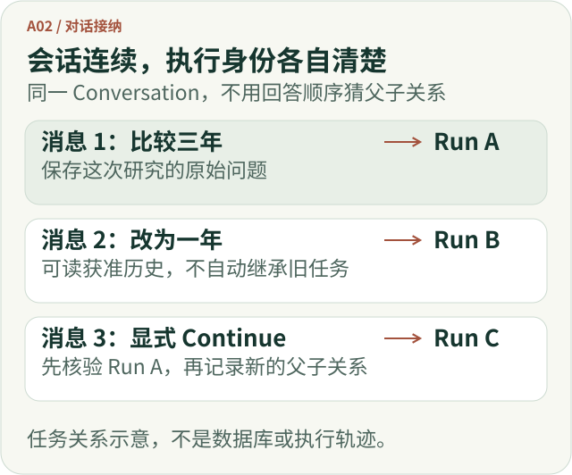
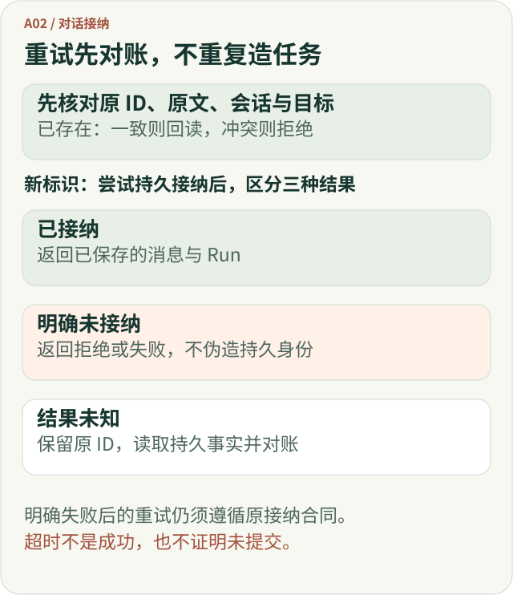
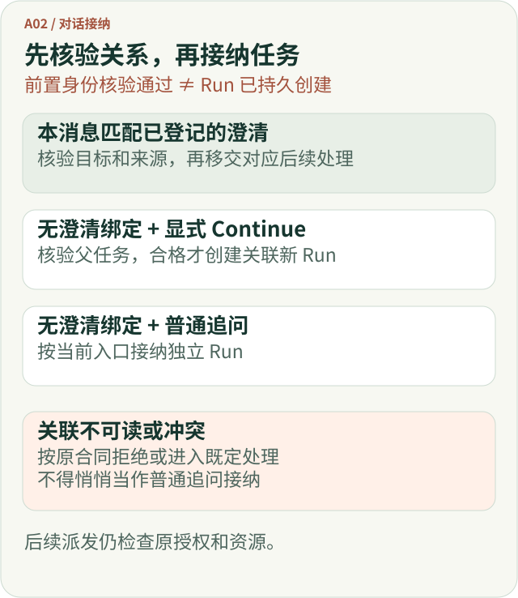
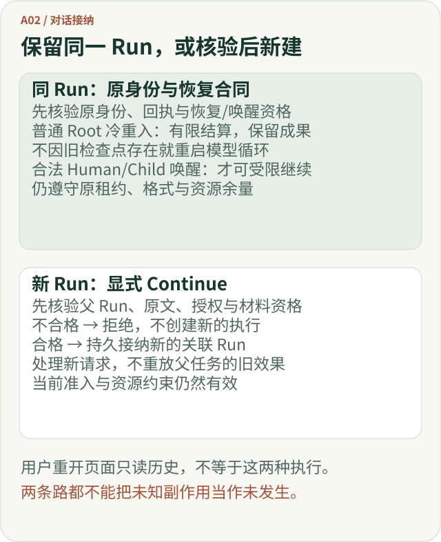

# “接着聊”不等于“接着执行”：Agent 对话接纳与任务接续的设计

用户在聊天框补了一句“那改成近一年呢？”，看起来只是继续对话。可对 Agent 来说，它至少包含三个问题：这是一条**新的用户消息**吗？它需要**新的任务执行**吗？它能否**沿用之前研究的权利和结果**？

如果系统把这三件事混成一件事，短期内可能毫无异常；直到请求重试、长研究中断、用户切换任务，才出现重复执行、错误继承旧权限，或者模型连原问题是什么都不知道。

本文从 ETF Agent 的 A02“对话接纳与任务接续”实践出发，讨论一种更稳妥的设计：**对话负责让人接着说，运行身份负责让系统准确知道自己在执行哪一次任务；只有显式、可核验的关联，才允许跨 Run 继承同一任务的必要信息。**

## 一、先拆开三个很容易混淆的对象

考虑一个教学场景：

> 第一问：比较基金甲和基金乙过去三年的表现，说明数据的时间口径。  
> 第二问：那只看最近一年呢？  
> 第三问：上次生成到一半断了，继续完成那份比较。

三句话都出现在同一个聊天窗口，但不一定属于同一项执行。这里需要区分：

| 对象 | 保存什么 | 不意味着什么 |
| --- | --- | --- |
| **Conversation（会话）** | 一段对话及其可见消息、历史和关联 Run | 整段对话始终只有一个执行任务 |
| **Message（消息）** | 一次用户提交的原文及稳定身份，例如 `clientMessageId` | 一次网络提交就一定创建一个新 Run |
| **Run（研究运行）** | 一次被接纳的执行身份、来源授权、预算、进度及终态 | 后一条消息自动获得本 Run 的执行资格 |

`Conversation` 可以包含多个 `Run`。回答的先后顺序，也不能倒推任务的父子关系。

再增加两个容易撞名的概念：**历史引用**是让新问题能看到获准的旧问答；**任务接续**是声明新 Run 与某个旧 Run 属于同一项研究。历史引用可以帮助模型理解“那只”，但它不能单独证明新 Run 获准访问旧任务的私有资料或重放旧工具调用。

这也是为什么仅用“最近一次 Run”决定关系不可靠。上一项研究可能还在后台运行，用户刚提出的却是一个完全独立的问题。

下面把这三句话画成任务关系图。每条消息保留自己的执行身份；只有明确核验的父任务，才能为新 Run 建立接续关系。图中不是实际数据库结构。



[放大查看完整矢量图](../visuals/a02-conversation/relationships.svg)

*图 1：对话连续不等于运行连续。第二条消息使用历史线索，不自动继承第一项研究；第三条只有在可信父任务成立时才建立接续关系。*


## 二、新消息进来时，首先判定的是身份，而不是语义

假设页面提交了一条消息，但响应在网络中丢失。页面重试时，如果服务端仅根据文字“是否一样”判断新旧请求，就可能创建两项研究；如果一律去重相同文本，又可能吞掉用户有意提出的第二个相同问题。

更合理的是让客户端为**这次提交意图**生成稳定标识，重试保持标识不变。服务端把标识和已接纳的原文、会话、接续关系一起核对：

| 接纳条件 | 结果 |
| --- | --- |
| 新消息标识，当前会话和主体有效 | 尝试持久接纳新消息及新 Run |
| 相同标识，原文和已固定关联一致 | 回到已存在的消息与 Run，不额外创建 |
| 相同标识，原文不同 | 拒绝冲突；不能静默覆盖旧原文 |
| 相同标识，显式父 Run 与已保存关系不同 | 拒绝冲突；不能把同一提交改挂到另一项研究 |
| 接纳回执未知 | 先用原标识对账，不换新标识盲目重投 |

最后一条尤其关键：数据库超时不能直接等同于“事务没提交”。有的失败明确表示未接纳，有的只能表示本次调用结果未知。后者需要先读取原持久事实，再决定是否继续。

反过来，已经明确拒绝或回滚、确认没有完成接纳的请求，不能返回一份不存在的持久身份。是否允许用原标识修正后重试，要按原接纳合同判断；它与结果未知时的对账是两条分支。



[放大查看完整矢量图](../visuals/a02-conversation/admission.svg)

*图 2：消息幂等门。网络失败和持久化失败不是同一事实；结果未知时不生成新的消息 ID 试运气。*


这与分布式系统已有的**幂等请求**思想相近。Amazon Builders’ Library 的 [*Making retries safe with idempotent APIs*](https://aws.amazon.com/builders-library/making-retries-safe-with-idempotent-APIs/)也强调：同一客户请求标识但参数发生变化时，应视为冲突，而不是用“幂等”掩盖意图改变。Agent 的额外难点是，除了请求参数，还必须保持任务父子关系和模型上下文的身份一致。

## 三、普通追问、澄清和显式 Continue：三条路不能混成一条

模型负责理解问题；Host 负责确认哪些请求关系成立。A02 不靠阅读一句话的语义，去推断用户是否获得了旧 Run 的执行权。

下面按已核验的关系区分三条路径。前置消息身份核验不等于最终持久接纳；图中的“创建 Run”发生在关系与资格检查之后，后续模型或工具派发还要经过原有授权、资源和运行治理。




[放大查看完整矢量图](../visuals/a02-conversation/routes.svg)

*图 3：通过消息身份门之后，才选择任务关系。普通追问可引用旧历史，但不等于 Continue；后续模型和工具派发仍受独立授权及资源约束。*

### 1. 普通追问：借鉴历史，不自动继承旧任务

“那只看最近一年呢？”可以通过授权的会话历史理解“那”指向前面的两只基金。但它仍可以是一个独立的新 Run：以**当前用户原文**为新目标，由这次入口和当前有效的 Host 约束管理执行。

早期设计容易把“使用历史”理解成“继续原任务”。2026 年 10 月的设计调整明确把两者拆开：普通消息可以读取获准历史，却不填写显式接续身份；即使保存 `parentRunId` 用来记录上下文来源，它也不是继承旧 Run 限制或执行权的开关。

这个分离在复杂金融研究里尤为重要。模型可以看见“上次比较了三年”，但旧报告引用的数据版本、资料权限和时间有效性，不能因聊天语气连贯就变成当前事实。

### 2. 澄清：用户在回答一个已经登记的问题

如果上一轮 Run 明确处于等待澄清的状态，例如系统问“比较累计收益还是年化收益？”，用户回答“年化收益”，这类回复可以按**已登记的待澄清关系**交给对应 Run 的后继处理。

关键区别在于：系统先拥有一条真实、已保存的澄清状态与消息归属，再接纳答复；不是因为新消息“听起来像补充”，就擅自接到最近的研究上。

待澄清记录不可读或关联不成立时，不能伪造已确认的事实。允许的降级应以当前受信合同为准，而不是直接拿普通聊天文本冒充一次有效的人工审批。

### 3. 显式 Continue：从旧研究派生新 Run

“继续上次中断的比较”如果通过产品提供的明确 Continue 入口，就应携带准确的父 Run 身份。当前实现中的 `continuationOfRunId` 是这类声明的关键输入；单靠 `parentRunId`、最近消息或模型对“继续”的猜测都不够。

即使有父 Run ID，也要核对相同会话与 Scope、可接续的持久终态、真实 Main 执行记录，以及父任务授予的来源与工具范围。常规已完成或部分完成研究有各自条件；某些断连或执行 Owner 丢失状态可以受限接续，但普通失败、用户主动取消与任意运行中的任务不会因此获得通行证。

**Continue 创建的是一个新 Run，不是把旧 Run 的阶段、预算、工具回执重新打开。** 需要继承的权限与限制按原始持久记录和当前准入上限核对；需要用户再次确认的披露同意，也不能从旧授权里无条件复制。

## 四、真正难的是：新 Run 究竟带走什么旧材料？

任务关系建立以后，模型需要足够上下文，但不能把数据库中的所有历史直接拼进新请求。工程上至少有四种不同性质的旧材料：

| 旧材料 | 新 Run 可以怎样使用 |
| --- | --- |
| 原始用户请求 | 在身份与内容哈希匹配后，为显式接续提供原任务目标 |
| 已发布的历史回答 | 在可见和容量允许范围内，作为历史结论与限定条件 |
| 历史研究摘要、未解决问题 | 作为带来源的工作线索，而非当前已证实事实 |
| 已保存的计算结果与资料 | 通过原结果与来源验证后，有界读取；标注它是历史结果 |

一次历史压缩可能遗漏旧答复，或生成的工作笔记不再适合当前问题。A02 的职责并不是自己修补一个“看起来完整”的故事。读取缺口应被保留，再由上下文投影模块决定本轮实际能装入哪些材料，研究模型据此调整结论范围。

这一点曾经有过明确的工程反例：中断研究放开接续资格后，定向验证发现新 Run 虽然走到了 Main，却没有正确取得原始问题。继续追加更多提示词无法补回丢失的任务身份；后来通过父任务的原文哈希、授权与上下文绑定，才让可核验的原始请求进入后继研究。这个观察来自受控代码与模拟 Gateway 验证，不是线上用户事故统计。

还有一个反例是父 Run 的不同投影**互相矛盾**：研究记录显示部分完成，而对话记录没有对应的可接续原因。此时不能只相信其中一个状态就开始新 Run。现有定向回归采用拒绝接续、零新增执行的保守结果；不会因为某条材料看起来合理而绕过另一份权威记录。

## 五、拿一个例子走完整条链

以下结构是**教学示意，不是 ETF Agent 的真实 HTTP 请求或数据库 Schema**：

```json
{
  "conversationId": "conv-8",
  "clientMessageId": "msg-103",
  "content": "继续完成上次中断的基金比较，保留原有时间口径",
  "continuationOfRunId": "run-102"
}
```

Host 首先在真实会话范围里读取父 Run：`run-102` 必须是可接续的记录，带有可核验的原任务、主执行事实、权限和正确的中断原因。如果接纳成立，新消息对应的是一个**新的** `run-103`，它保存直接父子关系。随后，经过验证的原任务与有界历史材料交给本次模型输入；新 Run 的操作仍受自身的实际准入与资源管理控制。

同一例子只改变一个条件，结果就可能不同：

- **重发 `msg-103`，正文及父 Run 不变**：读取已接纳身份，不再创建另一个 `run-103`。
- **重发 `msg-103`，却把父 Run 改为 `run-099`**：拒绝身份冲突，而不是把已发出的研究改挂到另一项任务。
- **父 Run 是用户主动取消，或与当前会话不符**：不能按“明确说了继续”而绕过资格；旧回答仍可依原可见性规则保留。
- **父 Run 可接续，但历史结果的来源版本已不可验证**：关系可以与材料可用性分开判断，不能把不可读的旧结果伪装成当前数据。

特别注意最后一种情形：**接续成功是任务关系事实，不是金融结论正确的证书。** 基金净值、比较窗口和基准口径仍需要研究链在相应时点核验。

## 六、再厘清一个最容易搞错的词：恢复

在 Agent 工程里，“恢复”至少有两种完全不同的动作：

**同 Run 恢复与结算（Recover / Resume）**：依据原 Run 的持久身份、租约、已派发请求与已提交回执，按原恢复合同处理**同一个 Run**；这个名称本身不承诺重新启动旧模型循环。已发表的[中断处理边界](./agent-disconnect-is-not-crash-recovery-contract.md)区分两种情况：普通 Root 冷重入没有获准控制唤醒时，只做有限结算、保留已提交成果；原 Human/Child 控制负责人已经接受的合法唤醒，才可在受限检查点和原资源余量内继续。两者都不能把结果未知的外部副作用当作未发生而盲目重做。

**跨 Run 接续（Continue）**：用户明确要求沿旧研究继续，系统核实父 Run 身份与资格，然后创建**一个新的关联 Run**。它可以获准读取旧任务的材料，但不会重启父 Run 的执行器，也不会重放父 Run 已经完成的工具动作。

两个动作在网页上都可能叫“继续”，实现时却绝对不能共享一个含糊的 `resumePrevious()` 接口。前者依赖执行恢复合同，后者依赖消息身份、父子关系和新任务准入。



[放大查看完整矢量图](../visuals/a02-conversation/recovery.svg)

*图 4：同 Run 保留原身份，能否继续派发取决于原恢复与唤醒资格；Continue 先核验父任务，再创建新身份。不合格不会先创建任务，未知副作用也不会被改写为未发生。*


## 七、哪些实现已经能让读者自己观察？

[Open ETF Agent 的公开代码](https://github.com/hpoenixf/open-etf-agent)可以复现 Session、原 Run 与持久恢复的基础区别。以公开提交 [`34124cef`](https://github.com/hpoenixf/open-etf-agent/tree/34124cefc6df289e08518173789210b45a716451) 的 [Session 实现](https://github.com/hpoenixf/open-etf-agent/blob/34124cefc6df289e08518173789210b45a716451/src/session.mjs) 为依据，使用 Node.js 26.8.1–26.x，安装并构建后运行：

```bash
git clone https://github.com/hpoenixf/open-etf-agent.git
cd open-etf-agent
git checkout --detach 34124cefc6df289e08518173789210b45a716451
npm ci --ignore-scripts --no-audit --no-fund
npm run build
npm run session -- start --session runs/a02-boundary-demo --case durable-report
```

从输出复制实际 Run ID，再执行：

```bash
npm run session -- inspect --session runs/a02-boundary-demo --run RUN_ID
npm run session -- resume --session runs/a02-boundary-demo --run RUN_ID
```

`start` 正常完成后，这组 `resume` 命令验证的是**终态重复调用与原结果回读**：固定版本的 [Runtime 终态分支](https://github.com/hpoenixf/open-etf-agent/blob/34124cefc6df289e08518173789210b45a716451/src/runtime.mjs#L145-L160)读取原结果，不重新执行。它不演示进程中断后的检查点恢复，也不是 A02 完整的 HTTP 多轮 Conversation/Continue 体验。本次仅核对固定源码与命令说明，没有重新运行示例或注入故障。公开仓库使用本地 SQLite 和离线脚本 Gateway，适合观察身份、终态与重复调用的基础合同；本文讨论的会话接纳、澄清绑定和跨 Run 接续来自更完整的系统实现，不能据此宣称已在这个公开 CLI 中交付。公开可变入口及最新说明见 [main](https://github.com/hpoenixf/open-etf-agent/tree/main) 和 [模块运行指南](https://github.com/hpoenixf/open-etf-agent/blob/main/docs/module-guide.zh-CN.md)。

## 八、A02 的价值，不在于替模型决定下一步

把聊天、任务、恢复和历史混在一起，最初往往是出于好意：希望用户说一句话就能顺利往下做。但复杂 Agent 真正需要的，是**自然语言的连续性与执行事实的连续性相互协作，而不是互相冒充**。

A02 的接口应该回答有限而明确的问题：这条原始消息是否已经被接纳？它属于哪个可信会话？应该建立哪一种已核验的任务关系？冲突应当拒绝到哪里？

它不负责替模型判断研究是否充分，不授予新的工具权限，不恢复旧 Run 已派发的外部动作，也不因旧材料不可用就删除已有合法回答。语义选择留给研究模型，权限与预算留给原 Host Owner，执行终结、上下文拟合和正文发布仍由各自的权威机制负责。

下一次审查多轮 Agent，不妨从一组反问开始：**断网重发会不会生出第二个 Run？普通追问会不会误继承旧任务？显式 Continue 能否说明父任务的原文、授权和中断依据？如果其中一项回答不清，应该先修身份与交接合同，而不是再加一个聪明的 Planner。**
