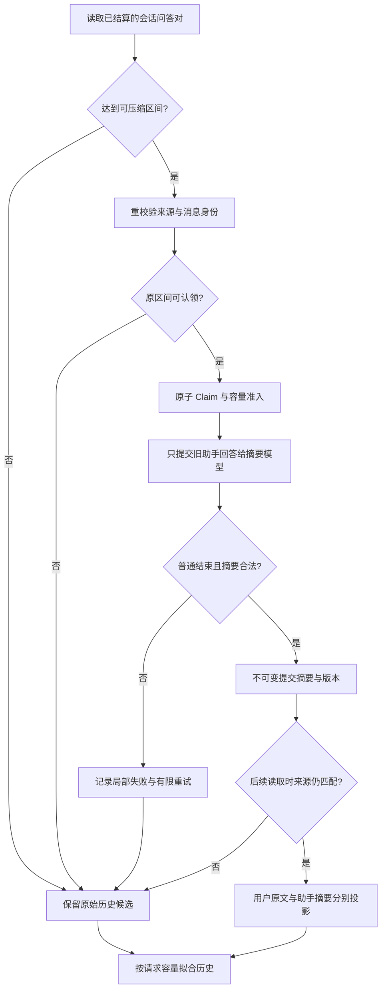

# Agent 为什么不能直接总结历史对话：跨 Run 压缩、来源绑定与不可变摘要

一个用户和研究 Agent 连续聊了几十轮：最早问基金费用，中间更正了投资期限，后来又要求比较不同日期的净值。下一次提问前，历史上下文已经很长。最省事的办法似乎是：“请模型把前面的对话总结一下。”

但如果摘要把“截至上周的净值”写成“当前净值”，或者遗漏了“不要按默认风险偏好推断”的原始要求，新 Run 就可能在一个看似连贯、实际失真的历史上开始。

**跨 Run 会话压缩要解决的不是让模型记住一切，而是让旧助手回答有界进入后续上下文，同时不让有损摘要取得修改用户原文、来源身份和业务事实的权力。**

## 一、先分清三种看上去相似的“历史”

一个研究系统里，至少有三种不同的上下文减负：

| 机制 | 处理的对象 | 不能代替什么 |
| --- | --- | --- |
| 工具结果外置 | PDF、行情表、分析结果等可重读材料 | 不能自动缩短已发生的问答历史 |
| 同 Run Main 压缩 | 一次研究内部已结算的旧模型/工具工作单元 | 不能代表多个独立 Run 的会话历史 |
| **跨 Run 会话压缩** | 同一 Conversation 中已经完成、能够关联的用户—助手消息对 | 不等于长期记忆，也不恢复或重派旧 Run |

这里的 **Conversation** 是用户可继续打开的会话，**Run** 是一次独立请求对应的执行生命周期，**消息对**则是经验证属于同一个 Run 的原始用户消息和已完成助手回答。

只有这些关系成立，系统才有资格把一段历史当成可压缩对象。摘要不是一个新的回答版本；旧消息、已发布正文、工具回执和权限仍由原来的持久记录负责。

## 二、并非聊天记录里的每一行都能被压缩

我们首先从持久会话快照中投影出完整问答对。源码选择技术状态为 `completed`、`partial` 或 `clarify_pending` 的 Run，但仍要求它关联的助手**消息本身**已经完成；用户与助手消息都必须属于当前 Conversation，身份完整且正文非空。

因此，以下内容不能因为出现在同一段时间线上就混进历史摘要：

- 还在流式生成的助手消息；
- 没有合法关联 Run 的消息；
- 工具调用、内部 Trace、未结算动作；
- 其他会话中的用户资料。

这一步并不判断一段金融结论是真是假。它只判断“这些原文是不是同一份已结算的会话材料”。内容准确性仍要靠资料证据、业务计算和实际后续研究判断。

## 三、30 对问答以后，为什么先处理最旧的 10 对

当前实现采用容易审计的固定窗口策略：至少积累 **30 对**可用问答后，才出现第一段历史压缩目标；每段恰好 **10 对**；始终留下至少 **20 对**较新的原始消息对不纳入后台批量压缩。

例如有 30 对，索引从 0 开始：

| 区间 | 当前处理 |
| --- | --- |
| 0–9 | 第一段压缩候选；得到持久成功回执后才可作为摘要消费 |
| 10–29 | 最近 20 对保留原始形式 |
| 下一次达到 40 对 | 10–19 才进入第二段压缩候选 |

这不是“30 轮后把全部聊天变成一段 Prompt”。阈值只**计划**压缩区间，不等于模型已成功生成摘要；达到 31–39 对时，未纳入候选的原始尾段会多于 20 对。

为什么坚持整段 10 对？因为存储与读取能对同一段范围建立稳定身份，不需要按每次 Token 波动来任意截断半条对话。代价是策略偏保守，也不保证它就是最节省 Token 的划分。

## 四、关键细节：用于认领的来源包含用户原文，但摘要模型不接收用户原文

每个压缩任务有一组受校验的身份：Conversation、Scope、`fromPair/toPair`、20 个来源消息 ID、来源消息哈希、模型 ID 和 Prompt 版本。来源哈希依据这 10 对**完整**问答序列计算，包含真实用户原文与助手回答。

然而送给摘要模型的只是这 10 条**助手回答**，并附各自的 `assistantMessageId`。用户原文不会变成让摘要模型自由转述的材料。

两者并不矛盾：

- **来源身份**需要覆盖用户和助手两侧，才能确认这一段摘要仍匹配原始对话。
- **有损生成**只针对助手的旧回答，避免用模型复述代替用户真正说过什么。
- **后续读取**在符合容量限制时，把来源区间内的用户原文作为独立字段，与“旧助手回答摘要”一起投影。

例如下面是抽象后的输入与输出形状，ID 和内容均为示意：

```json
{
  "sourceRange": { "fromPair": 0, "toPair": 9 },
  "sourceBinding": {
    "messageIdCount": 20,
    "digestAlgorithm": "SHA-256",
    "promptVersion": "conversation-compaction@3"
  },
  "summaryInput": { "assistantMessageCount": 10, "includesUserText": false },
  "nextRunProjection": {
    "originalUserMessageCount": 10,
    "assistantHistorySummary": "此前只比较过两只基金的上周净值，不代表当前净值"
  }
}
```

示例是概念结构，并非可直接提交的实际 API payload；它省略了 10 对消息的具体原文，只展示权威分离：**摘要里说“用户要求什么”不等于真实用户要求；只有原始用户消息才有这个身份。**

## 五、压缩不是一次普通的“模型生成文本”请求



一次压缩至少有四个不同的裁决点。

**第一，认领的是准确区间，而不是“谁先完成谁赢”。** 区间必须从 10 的整数倍开始、长度恰好 10 对，来源消息 ID 必须完整且不重复。认领时比对来源哈希、模型及 Prompt 版本；已有相同区间若正在执行或已完成，不能再起一份竞争摘要。数据库原子操作与锁负责这一点，不能仅依赖调度器预读的旧快照。

**第二，生成必须正常结束。** 摘要模型不应调用工具，也不能把截断、错误或异常结束伪装成成功。现行合同要求得到一次正常停止的纯文本响应，非空且在 6,000 字符上限内。

**第三，失败有界，且不拖累已交付回答。** 同版本失败区间最多允许两次尝试；失败后可再次使用原始来源。后台压缩异常不能回滚此前已经交付的回答。代码同时有进程内并发名额以及 PostgreSQL 共享准入的设计和测试，不靠“模型通常很快”限制资源。

**第四，成功后不可变。** 已完成摘要不能被新结果直接覆盖。旧 Prompt 版本有其原身份；当前新任务采用 `conversation-compaction@3`，后续投影可识别符合合同的既有 `@2` 成功记录，但不把更早的混合输入版本 `@1` 冒充为只总结助手回答的结果。

## 六、三种边界情况，比正常摘要更能说明设计价值

**案例 A：模型返回了文字，却夹杂工具调用。** 即便文字读起来是完美摘要，本次请求也不满足“纯文本摘要 + 正常结束”合同。结果记为该压缩任务失败，不擅自写入成功摘要，更不能因为有自然语言输出就宣告用户历史已被安全压缩。

**案例 B：来源发生变化，旧摘要还在。** 假设第 3 对问答的文本或身份变动，当前 0–9 区间重算的消息 ID / 哈希不再匹配历史压缩记录。投影不能把旧摘要当作当前来源的事实；有效原始消息仍可按容量规则尝试进入上下文。这里的保护来自来源身份，而不是模型“记得”旧回答。

**案例 C：摘要已存，但当前请求放不下。** 后续 Run 按保守的 UTF-8 字节预算装配历史，先验证摘要范围、状态、版本和来源。如果“用户原文 + 助手摘要”这个候选整体装不下，会尝试回到原始消息对的受限投影；若容量仍不足，较旧历史可能无法放进本次请求。**保留原始持久记录，不等于保证模型本轮看到了全部原文。**

这一点对金融研究尤其重要：即便系统知道历史里有一次风险偏好更正，也不能因为存储中存在这条记录，就声称下次模型已经实际读到它；如果缺少当前事实，应让研究流程重新取得足够依据。

## 七、这套机制到底验证了什么

截至 2026 年 10 月 27 日，仓库已经有跨 Run 会话压缩的实际实现、来源哈希与版本规则、任务持久认领、摘要消费逻辑，以及覆盖重复 Claim、失败重试、不可变提交和跨连接竞争的针对性测试代码。

这些材料能够支撑本文的**机制说明**，但不能直接推出生产环境长期运行后的摘要保真率、对金融问答的质量提升、Token 节约比例，也不能把存在 PostgreSQL 测试文件等同于本文已重新执行并通过整套验收。这里不引入未经采集的准确率或成本数字。

它与同 Run Main 压缩同样遵守一个原则：有损摘要只是一种有来源的工作材料，不能把自己升级成新的权限、用户意图或金融事实。不过，两者处理的身份和生命周期不同，不能混为一谈。

## 结语

复杂 Agent 的历史管理，难点从来不是让模型少看几个字，而是回答：**哪段内容可以有损，哪段原件不能被改写，今天的摘要还能否证明来自昨天的那份消息。**

因此我们选择了更麻烦但可核查的做法：准确消息对、固定旧区间、只总结助手回答、来源哈希、原子 Claim、不可变完成和受限回放。

下次设计会话压缩时，优先检查“摘要不合法时是否仍保留原始事实”，而不是先优化摘要 Prompt 的文采或压缩率。愿意承认“本轮没装进去”，比让模型假装记得更可靠。

## 延伸阅读与交流

[Main 同 Run 上下文压缩](agent-main-run-context-compaction.md)回答单次研究内部的 Checkpoint， [工具结果外置](tool-results-outside-model-context.md)解释按需读取与上下文拟合。本文讨论的是另一份能力：跨 Run 的会话历史身份和不可变助手摘要。

[ETF Agent Engineering Notes](https://github.com/hpoenixf/eff-agent-article) 收录更多可独立阅读的 Agent 工程案例；如果这类工程机制对你有帮助，欢迎 Star 支持。
