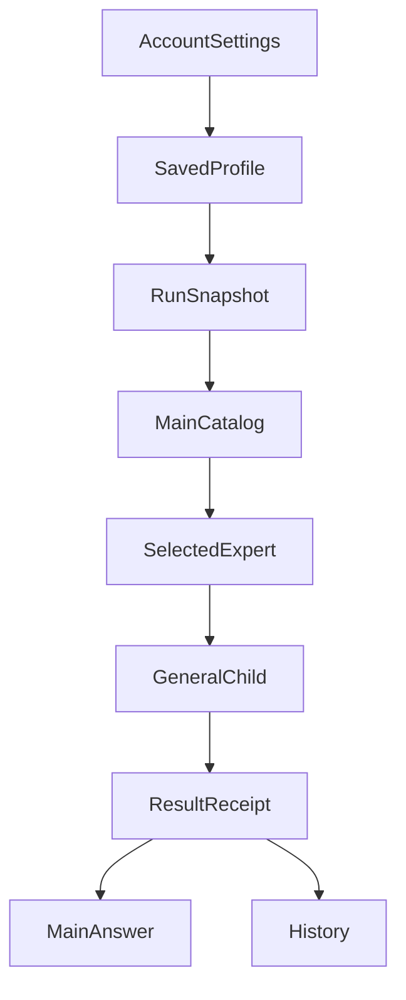

# 自定义专家，不应该只是一个 Prompt 输入框

*ETF Agent 工程实践：从个人研究方法到可恢复的 Subagent*

如果希望用户创建自己的 AI 专家，最简单的实现方式是什么？

做一个设置页面，填写名称、描述和 Prompt，保存到数据库。下次用户选择这个专家时，把 Prompt 放进模型请求。

从演示来看，似乎已经足够。但当我们真正将自定义专家接入 ETF Agent 的研究系统时，问题远不止如此：用户编辑了专家，正在运行的研究要不要立即采用新版？模型怎样发现专家，又怎样避免把所有人的完整 Prompt 都塞进主上下文？研究中断后恢复，究竟该使用哪个版本？如果某位专家写着“访问全部数据”，它真的获得了这些权限吗？

这些问题决定了“自定义专家”是一段临时提示词，还是一项能够长期维护的产品能力。

我们选择不为每位专家创建一套 Runtime，而是让用户保存一份带有身份和版本的研究方法，交给既有的通用 Subagent 执行。实践中也踩过一些很具体的坑：指引进入了错误的请求层级，Child 明明使用了个人专家，History 却识别不出它，还有一次浏览器验证因两份 React 实例而出现空白页。

这篇文章只讨论**用户自定义专家**的保存、选用、执行和恢复。Web/PDF/Python 能力包与多 Agent 对话，是它所依赖的基础，而不是本文要重复介绍的系统全景。

## 一、为什么不能继续给 Child 叠加一个角色 Prompt？

ETF Agent 原本就有 Web、PDF、Python 子代理和六种内置投资方法。前者指向资料阅读与计算的工作侧重，后者代表 Markowitz、Taleb、Bernstein、Bogle、Marks、Fama-French 等不同研究框架。

这些方法由开发者维护。可用户自己的习惯未必符合固定目录：有人要求始终检查基金费率与跟踪差，有人先穿透底层持仓，也有人希望每个判断都附带证伪条件。把这些习惯写进系统 Prompt 会影响所有任务；让用户每次重述又无法积累方法。

早期接口分别用 `type`、`perspectiveId` 和 `subagentProfileId` 表达执行专长、投资视角与个人配置。这是按需求逐步增加的合理设计，但随着专家种类增加，调用者开始需要理解多个维度的组合。

我们没有简单新增一个 `custom` 类型，或只在界面隐藏复杂参数。统一普通 Child 的选择接口改成：

```json
{
  "agentId": "user/<profile-id>",
  "task": "根据已提供的披露资料核对基金底层持仓重叠"
}
```

这里的 ID 仅作形状示例；实际 `user/` 后面是服务端签发的 Profile UUID。不选专家时使用 `builtin/general`。一次普通 Child 只绑定一份专家定义；执行机制、模型路由和授权并不随专家名称重新创建。

**用户保存的是“怎样研究”，而不是“另一个拥有独立权力的 Agent”。** 这成为后续设计的分界线。

## 二、保存的是方法，不是运行平台

第一期个人专家故意保持很轻：

| 字段 | 用途 |
| --- | --- |
| `name` | 用户识别和管理时显示的名称 |
| `description` | Main 判断何时适合使用这位专家 |
| `instructions` | 选中后交给 Child 的完整研究方法 |
| `enabled` | 是否向后续新研究开放 |

例如用户可以创建“基金持仓重叠检查员”。描述说明它核对多只基金的底层资产集中度；指引要求先检查持仓披露日期，区分产品名称与底层公司，资料不足时保留未知，而不是输出精确暴露的猜测。

这只是一个教学配置，不是 ETF Agent 对真实基金结果的认证。它说明个人专家最值得保存的内容是**判断顺序、关注点和可重复使用的约束**，不必是富有戏剧感的虚拟人设。

服务端为个人配置分配稳定的 `profileId`，保存 `revision`、内容哈希与账户归属。保存或更新时，客户端提交 `expectedRevision`，数据库通过条件更新防止并发覆盖。删除是软删除：停止新研究继续发现此专家，但不把已经发生的研究改成“从未使用过它”。

还有容量界限。当前配置限制是最多保存 20 个 Profile、启用 8 个；这些限额服务于账户存储与模型目录的可控性，不是每位专家的推理预算。

当保存失败、发生版本冲突或超过容量时，UI 需要保留用户未提交的编辑，不能把错误提示当作一次成功保存。

## 三、从设置页到研究结果，一条链如何走通？



这张图是关键事实的交接关系，并不是一条必须按固定速度顺序执行的队列。

### 1. 新 Run 冻结自己的目录

研究开始时，系统读取该账户已经启用、未删除的个人专家，并将当时的内容与版本固定到这个 Run。

Main 收到的是有界的目录：精确 ID、名称、描述。它不需要一次性加载所有专家的完整 `instructions`。只有选中某位专家，完整方法才作为带有用户来源标记的数据进入对应 Child。

目录为空与目录读取失败是不同事实。后者需要反馈“当前专家配置不可用”；系统可以继续其他获准研究，却不能悄悄用 General 替代一位被明确要求的专家。

### 2. 由同一套 General Child 执行

Child 沿用既有模型、工具、来源授权、资源管理与结果交付。个人专家的说明并非新的系统指令，也不授予交易、发布、递归创建 Child 或额外数据访问权限。

一次执行选择的准确身份包含 `agentId`、来源、版本、内容哈希和个人修订号。`agentId` 不是文件路径，也不是执行脚本的许可证。

当前用户自定义 Profile 是文本型配置。与此相邻，内置 PDF 等受管理专家已支持 `SKILL.md`、参考文件和受控 Python 辅助脚本；但**用户目前不能因此随意上传 ZIP 并执行任意代码**。共用选择入口，不等于共用全部包安装能力。

### 3. Main 只依据实际结果交付

Child 完成工作后，原执行系统记录实际结果。Main 可以读取结果并综合回答；History 根据原 Child 身份和绑定版本显示实际使用的个人专家。

“创建成功”“被选中”“Child 已准入”“Child 已交付”是四件不同的事。系统不能因为界面显示了一个角色名称，就声称该专家真正完成了研究。

### 4. 旧研究不能偷用新版本

一个反例足以说明为什么需要 Run 快照。

上午使用 Profile 第一版启动基金研究。下午用户把它改为第二版，增加更严格的披露时点要求。晚上研究从暂停点恢复。

如果恢复时只凭 `profileId` 重新查最新配置，同一次研究前后就可能使用不同方法，却显示同一个名字。因此我们保持原 Run 的冻结内容：**新编辑只影响后续新 Run，旧 Run 沿原绑定继续。**

这既是版本一致性，也是解释研究结果时必要的事实基础。

## 四、踩坑一：用户 Prompt 被放进了 system 层

把旧选择合同迁移到统一 `agentId` 后，一次真实生产请求装配的受控测试发现：私有 `instructions` 被重复放进 Child 的通用 system 内容。

如果只看最终文本，这可能像是个无伤大雅的重复。但模型消息的**来源**与**文本本身**同样重要。

system 层承载宿主的执行约束，用户写入的专家指引只能作为方法数据被消费。把后者放到前者，就混淆了可信指令与可编辑用户内容的边界。

修复并没有再造一套 Prompt 安全分类器。我们沿原请求装配机制，让内置包与用户方法分别进入正确的位置，并核对发送前的内容身份：Main 看见的是目录信息，Child 恰好收到选中版本的指引，独立正文不默认暴露私有 Prompt。

这次问题在受控工程测试中发现，没有证据表明发生了真实用户的隐私泄漏。真正可复用的教训是：

**Prompt 不只有字节和措辞，它还必须带着正确的生产者身份。**

## 五、踩坑二：Child 明明用了个人专家，History 却认不出来

另一个集成问题发生在结果读取端。

新的委派入口已经使用 `agentId`，但旧 History 读者仍沿部分旧字段识别个人 Profile。结果是 Child 实际采用了某份个人方法，History 却可能遗漏它的归属。

看似只是少显示了一个标签，实际上是**创建、执行和历史读取对“专家身份”的理解不再一致**。

修复时，我们没有根据名字猜测，也没有去查询账户中的最新版配置替旧结果补名。History 只消费原 Child 的准入、冻结 Profile 和真实执行记录，按当时的身份显示结果。

用户之后改名、停用或软删除，不会倒过来替换历史研究的方法版本。这条规则同时使审计、恢复和用户阅读保持一致。

由此可见，统一创建接口并不是只修改一次 `spawn_subagent` 调用。只要 History、inspect 或恢复依赖旧形状，它们都可能成为迁移接缝。

## 六、踩坑三：HTTP 200，但设置页面是空白的

配置管理的用户体验同样重要。我们在真实设置组件和账户 HTTP 接口的合成浏览器环境中检查了多行指引保存、刷新读取、启停、并发编辑、取消删除和失败后草稿保留。

第一次运行时，页面接口返回 200，浏览器却只有白屏。控制台提示 Hook 调用失败。排查发现测试装配中的 ReactDOM 与组件 Hook 分别引用了两份物理 React 模块，即使版本一样，也无法共用同一个 Hook dispatcher。

最终修改的是测试夹具的解析路径，使组件和 ReactDOM 使用同一 React 实例；没有为了让测试通过而改变产品保存逻辑。

修正后，两页同时编辑同一 Profile 的真实组件行为得到验证：页面 A 保存新版，页面 B 仍基于旧修订提交时收到冲突，旧数据不被覆盖，B 的草稿也保留。

这次浏览器验证使用合成身份和进程内存储，并不是完整生产登录环境。这反而提醒我们：**测试跑通了哪一层，就只声称那一层真的跑通。**

对用户而言，冲突保存和失败保留草稿可能比 Agent 的复杂架构更直接地影响能否长期维护自己的专家。

## 七、对照 Octop：模板、实例和执行不必是一个东西

腾讯云开源的 [Octop](https://github.com/TencentCloud/Octop) 展示了另一种专家产品路线。它的专家模板可以包含 `manifest.json`、`SOUL.md`、`IDENTITY.md`、Skills 等文件，实例化时把模板内容写入独立 Agent 工作区。用户随后持续使用、修改，还可以通过受支持的机制分享或发布模板。具体模板复制与目录机制可参见其 [Expert Catalog 源码](https://github.com/TencentCloud/Octop/blob/main/src/octop/infra/agents/experts/catalog.py)。

Octop 更适合“长期独立工作的数字助手”这个产品问题，而 ETF Agent 当前的个人 Profile 主要回答：“一次完整研究怎样准确采用用户保存的某套方法？”

两条路线各有合理性。独立专家实例便于保留自己的对话、文件和工作习惯，但需要管理更多长期状态。我们则让个人方法进入原 Run/Child 体系，不复制模型、记忆、预算和恢复栈；代价是个人专家暂时没有独立的长期对话空间。

比较之后，我们更确信应该分清三个对象：

- **Expert Definition**：这位专家采用什么方法，哪个内容版本；
- **Expert Execution**：这次在什么授权范围内实际做了什么；
- **Expert Workspace**：如果确有长期使用需求，才为它持有哪些持久工作资料。

未来可以借鉴 Octop 的专家卡片、示例任务、模板分享等体验，但不必仅为了一个 Prompt 配置页面，就创建第二套 Agent 平台。尤其在金融场景，模板共享不能自动带走个人持仓、私人研究历史或原授权。

## 八、用户真正怎么使用专家：从建议到真实贡献

原先的问题是“我能不能保存一个专家”；进一步实现后，问题变成“我在聊天里选了它，它到底有没有参与这次研究”。

我们没有把目录卡片设计成新的执行入口。账户可见的专家目录只展示身份、用途与示例，不返回私有完整指引；输入框里的卡片选择和明确的 `@` 选择使用同一条精确 `agentId` 链路。用户原文保留，发送后由原消息与 Entry 保存选择，再由 Main 在合法条件下委派 Child。文本里偶然出现一个专家名字，不能凭字符串匹配变成一次授权调用。

这里有四层不能合并的事实：

| 用户看见的东西 | 真实含义 | 不能冒充 |
| --- | --- | --- |
| 专家目录、方法说明 | 当前账户可以发现的配置 | 已获得工具权限 |
| 显式选择、常用组合 | 对本次研究的选择或建议 | Child 已经派发 |
| Child 请求、阶段回执 | 原执行者实际开展了哪些工作 | Main 已采纳该观点 |
| Main 正文与 History 贡献区 | 已提交的答案及可见执行依据 | 专家观点已达成共识 |

例如，一个合成的基金研究问题需要核对 PDF 中的费率，并计算组合风险。用户选择 PDF 专家，另从常用组合取得 Python 专家的可编辑建议。Main 可以只派发部分合适的 Child，不能因为组合里有两位就显示“两位专家均已参加”。运行中 PDF Child 交出带引用的结果后，统一贡献区沿原 `taskRef` 和实际结果呈现它；Main 是否采用以及最终怎样解释，仍由 Main 的正文说明。

账户常用组合的 `presetId`、版本、名称和专家 ID 列表由原账户存储维护。应用组合只是填入可编辑建议，不自动开启团队房间、Peer 对话、Reviewer 或额外预算。刷新、历史重开只读原 Run 冻结的选择与实际贡献，不能用今天的目录为昨天的运行补一个虚构成员。贡献展示局部失败时，原正文与下载仍应独立可读。

## 九、让专家改变研究方向，而不改写历史

研究描述也不能被 Main 最初的一句话永久锁死。假设 Main 交给某位 Child：“计算这两只基金底层持仓的精确重叠”。Child 阅读披露后发现其中一只只有前十大持仓；继续执行原命令，容易把部分覆盖当作完整重叠。

我们把**方法身份的冻结**和**本次研究任务的修订**分开。专家包、账户修订号以及原 Run 身份保持不变；Child 则可在原 `submit_subagent_result` 的可选 `update` 中修订 `task`、`hint`、`relationHint` 和合法 `inputRefs`。已接受的修改只进入后续请求，不覆盖原创建记录、已派发请求或用户原话。

下面是抽象教学示意，不是原始模型输出：

```json
{
  "summary": "第二只基金仅披露前十大，无法计算完整持仓重叠",
  "update": {
    "task": "计算已披露部分的重叠，并明确覆盖率与不可推断部分",
    "relationHint": "供主研究参考，不能将部分覆盖写为完整敞口",
    "inputRefs": ["本次运行已授权的真实结果引用"]
  }
}
```

新增输入仍经过原授权和来源检查；越界输入只能被局部拒绝，不能顺便取消已经合法的描述修订或清空独立正文。模型自己修改研究方法不意味着可以换一个专家身份、追加资源额度、放宽账户限制或把文字关系变成自动等待的任务图。尤其是 `relationHint`：它表达希望怎样协作，不代表另一位 Child 已执行、已发送消息或其结果已被读取。

这项演进与 [OpenAI Agents SDK 对 agents-as-tools 与 handoff 的区分](https://openai.github.io/openai-agents-python/multi_agent/)有相邻问题：这里选择让 Main 继续负责用户回答，而不是把对话控制权永久交给某个专家。但具体的版本化配置、软偏好、回执修订和账户展示，仍要由应用的原负责者实现。新增自由度值得投入的条件，是它能保留真实依据而不是制造更多模型自述。

## 十、这套机制已经走到哪里？

截至 2026 年 10 月 27 日，个人 Profile 的版本冻结、普通消息精确选择、专家软偏好与预加载、按需调用指南、目录/贡献展示、常用组合及 Child 自主描述修订，都已有真实实现与有界工程验收。隔离的 PostgreSQL、认证浏览器和脚本化模型请求用于证明选择、存储、回读、恢复与界面路径，不能代替真实模型是否会选对专家或采用偏好的质量评估。

更早的真实模型研究样本主要是内置研究方法或 General/Python，仍不能推断个人自定义专家已经在真实投资问题上提高质量。新增体验也不意味着允许账户随意安装可执行专家包、给某位专家一套独立预算，或者让建议文本获得交易授权。

这不妨碍解释一个已经成立的工程判断：**个人研究方法可以作为版本化的数据，复用现有 Child 执行与结果系统；没有必要因此新增一个拥有全部权限的 Expert Manager。**

## 结语

实现自定义专家最简单的一步，是提供 Prompt 输入框。让它真正可维护的，是**方法身份固定、任务描述可修、实际贡献可重读**，而不让“用户喜欢什么”变成“系统已经做了什么”。

ETF Agent 的做法不要求每新增一种个人研究方法，就额外维护一个模型实例、一份预算、一套授权或一份任务账本。用户可以逐步积累自己的研究习惯；系统则在每次执行中记录：用了谁的方法、采用哪一版、实际上完成了什么。

**专家值得被复用，执行事实更值得被保留。**

只有两者分离，用户定义的专家才能从一次性的角色扮演，演变成一种可以持续升级、又不会拖垮已有 Runtime 的能力。

---

<!-- agent-article-sync:guidance:start -->
## 延伸阅读与交流

[Subagent：从上下文隔离到专业化协作](/articles/agent-subagent-context-specialization) · [模型会理解，代码才授权](/articles/011-model-understands-code-authorizes) · [ETF Agent 技术文章仓库](https://github.com/hpoenixf/eff-agent-article)（欢迎 Star）。
<!-- agent-article-sync:guidance:end -->
