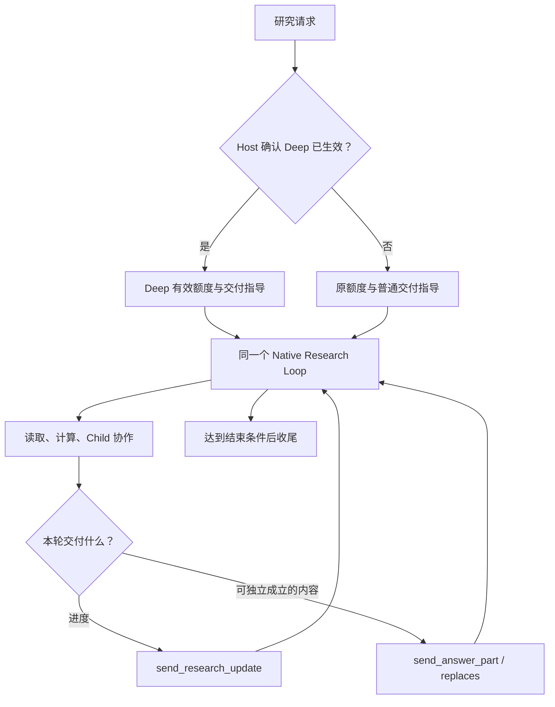

# Deep Research：从资源升级到研究交付，我们怎么实现，又测出了什么？

普通的投研问答可能只需核对一只基金的费率；另一类问题却要求穿透组合、读取跨期报告、处理修订版本、让不同研究分支协作，最后给出一份连贯的结论。这两类任务都叫 Research，但对资源和交付节奏的要求不一样。

在 ETF Agent 中，我们没有为后一类任务重新搭建一套 Agent。做法是让**同一个 Native Research Loop**获得经过授权的更高资源档位，再根据当前实际生效的研究模式调整交付指导：研究过程中持续反馈进度，已有独立依据的部分允许先交付，关键结论则更倾向于在完成证据比较后组织成文。

这篇文章只回答三个问题：为什么原有 Research 不够；Deep 在代码与运行时究竟改变了什么；真实 Standard/Deep 配对运行交出了什么结果。这里所述的 Deep 实现依据 ETF Agent 工程仓，不把它冒称为当前公开版 Open ETF Agent 已经具备的功能。

## 一、为什么要单独做 Deep？

### 1. 普通 Research 要及时回答，复杂研究要留得住调查空间

普通 Research 原来就支持搜索、阅读、计算、调用 Child，并通过 `send_answer_part` 在任务尚未结束时交付有用部分。这个选择有合理性：一个已经核对清楚的费率事实，不应该被后面无关的资料读取拖住。

问题是，复杂研究的结论往往依赖多个相互关联的前提。例如，基金收益与指数收益存在差额，至少需要弄清比较区间、净值与全收益口径、实际费用是否已经包含在净收益中，以及更新公告有没有改变这些解释。前几项事实即使先成立，也未必足以支持“差额主要由费用造成”。

如果所有研究都采用统一的资源上限，复杂任务可能在必要取证完成前进入收尾；如果直接提高所有任务的默认上限，又会让简单问题无端获得更多执行空间。**所以第一项需求不是让所有研究变长，而是让确有必要的 Run 能有条件升级。**

### 2. 研究额度更大，不等于应该更早发布综合结论

原来的渐进交付鼓励模型一旦找到有依据的部分，就尽早给用户。它解决的是“用户不要一直等到最后才看到东西”。

但当研究任务需要比较来源版本、跨材料计算和分歧处理时，模型可能先写下一段初步解释，再不断追加修正。这样虽然每次都有输出，最终仍可能是一串研究过程记录，而不是围绕用户问题形成的报告。

因此第二项需求是区分两种交付：

- **研究进度**：当前在核什么、发现了什么冲突、还剩什么关键缺口。可以早反馈，但不能冒充完成的结论。
- **研究成果**：已经能独立成立的事实、计算或一段有边界的分析。可以提前交付；依赖尚未解决冲突的综合判断则应更审慎。

这不是要求 Deep 在前 70% 时间禁止输出，也不是把“证据成熟”变成一个服务器可读取的布尔值。它是对模型研究与写作优先级的改变。

## 二、怎样在同一套 Runtime 上实现？

### 1. 四种入口，最终只有一个资源批准者

Deep 可以来自用户的显式选择、已注册 Skill 的可信默认声明、Entry 的研究模式提议，或者 Main 在研究中调用 `enable_deep_research`。它们都只是提出模式意图。

前端的 `researchDepthPreference` 区分 `auto`、`standard` 和 `deep`：未主动选择时，`auto` 可允许符合条件的建议；用户明确指定 `standard`，则不应被 Skill 或模型静默升档。一个已被接纳为 Direct 的回答也不会因建议而偷偷变成 Research。

真正决定升档的，是原有 Run Resource Owner。它根据这次 Run 冻结的原始额度、当前消耗与预留、阶段、时钟和外部限制，批准或拒绝一次升级；Child 不能自行提高 Root 的档位。

我们刻意没有建立第二份“Deep 预算账本”。否则 Main、Child、提醒和恢复很容易分别看见不同的可用额度。

### 2. 1.5 倍是有界目标，不是模型的奖励积分

当前资源 Profile 使用“原准入总额加上向下取整的一半”计算升级目标。以当前默认值举例：

| 资源轴 | Standard | 已获准且实际应用的 Deep |
| --- | ---: | ---: |
| Main 总模型轮次 | 36 | 54 |
| Root 模型请求额度 | 57 | 85 |
| 读取类动作 | 72 | 108 |
| 发现类动作 | 6 | 9 |
| 发布类动作 | 48 | 72 |
| 活跃执行时间上限 | 60 分钟 | 90 分钟 |

这些数字是本次策略的默认基线和目标，不代表每个 Run 都一定能使用到上限。已消耗、Child 预留、未知结算以及外部 Provider/任务限制继续生效。升级**不重置计数，也不追加一份全新预算**。

升级还有时间窗口。约在原有请求或时间额度达到 50% 的提醒阶段，系统可以建议 Main 考虑 Deep；但建议不会自行启动新模型调用。在原始额度接近 80%、进入 `finalization-only`、期限或授权条件不允许时，资源 Owner 会在真正执行升级的边界重新判断，而不是因为工具先前可见就放行。

这里还有一个容易忽略的差别：升级的持久批准记录不等于当前 Host 已经把新额度应用到运行中的预算和时钟。运行时区分 `standard`、`recorded-pending`、`deep` 与 `unknown`；只有实际应用的 `deep` 才能改变后续有效行为。

### 3. 改变的是每一轮请求，而不是修改上一轮 Prompt

当前模型请求并非共享一份会永久留在 Provider 内部的 System Prompt。每一轮都会重新组装 `system`、历史消息、工具结果及当前工具集合。

Main 在新的模型回合读取 Host 的当前资源状态，刷新有效研究合同，再由 Native Request Projector 为本轮构造指令。交付节奏选择可以概括为下面的逻辑（**示意代码，不是项目可直接调用的 API**）：

```typescript
const cadence = currentHostDepth === "deep"
  ? deepDeliveryCadence
  : ordinaryDeliveryCadence;

const modelRequest = {
  system: composeResearchInstructions(cadence),
  messages: projectCurrentResearchHistory(),
  tools: projectAuthorizedTools()
};
```

普通模式继续鼓励尽早发布已受支持、可独立阅读的部分；Deep 模式则要求先考虑目标覆盖、相互矛盾的证据与重要未知，再组织主要综合结论。已经独立成熟的部分仍可提前发布。此前共享指令中无条件的“尽早交付第一份答案”也被移除，避免同一份最终指令同时要求相反的节奏。

假设前五轮按 Standard 工作，第六轮由 Main 提出升级：只有 Host 真正应用成功后，第七轮重新构造请求时才会选择 Deep 的交付指令。先前发给模型的请求不需要“覆盖”；历史研究内容仍作为新一轮上下文延续。升级无法追溯改变已经发布的正文，也不会自动提高模型的 reasoning effort。

### 4. 进度与正文复用已有的两条交付路径

下面是一次研究请求的主要路径，省略了权限、期限、纠错与恢复中的细节：



`send_research_update` 传递简短的工作进展或需要关注的问题，属于有自身回执和展示权限的进度事件；`send_answer_part` 才是正式答案的一部分。发布一个答案块不会自动结束研究，完成仍走原有的结束机制。普通正文路径和答案工具都归入原有 Publication 的控制范围。

Deep 没有新建一位强制终稿 Writer，也没有规定“先查满 N 条资料才允许发布”。模型能够早发布独立内容，同时继续调查其余问题；来源不充分的判断需要保留限制，而不是用进度消息伪装结论。

### 5. 深研究会改判，所以要给合法修订留空间

研究中途可能出现新公告或更完整的附录。已有的 `replaces` 能针对当前合法发布块进行版本修订，不必把每一次改判都作为新段落追加。

原默认额度是“每块最多 2 次、整次研究最多 8 次修改”；在实际应用的 Deep 模式下，未显式配置时改为 **6 / 24**。运维明确配置的上限仍优先，包括明确设为零的情形。

修订并不等于任意重排全文：它仍然受目标身份、版本、来源、权限和持久保存约束。一次已在界面显示的临时预览，也不能被误读为 Recovery 已经保存的新版本。升档后不会清除旧修订次数，恢复时继续使用原有的 Run 和修订事实。

这形成了一种刻意克制的 Deep 实现：**资源归资源 Owner、研究和综合归模型、正式正文与版本归 Publication、恢复归原有持久化链路**。Deep 改变同一条链路的策略与容量，而不是复制整套执行系统。

## 三、效果如何？让真实配对实验回答

我们先做过两道基金合成题的 Standard/Deep 对照：A 中 Deep 第一份有用内容更晚，却满足 14/14 组要求（Standard 13/14），终态更早；B 中两种模式都是 15/15，Deep 首次交付稍早，但总体结束更晚、已知用量也更多。它们说明方向不一致，但样本还太少。

随后在 2026 年 11 月 10 日又完成了四组配对，分别覆盖**运行前资料齐全的静态研究**（S1、S2）和**首次发布后才登记更正版资料的动态研究**（D1、D2）。各组使用相同的题目、来源字节、模型 `deepseek-v4.1-flash`、Provider 与工具装配，Standard/Deep 分别运行在独立的 Conversation、数据库和研究工作区。

### 1. 四组配对结果不是“Deep 全胜”

| 任务 | 最终要求组：Standard → Deep | 首次满足全部要求：Standard → Deep | Run 完成事件：Standard → Deep |
| --- | --- | --- | --- |
| S1 · 静态资料 | **7/7 → 5/7** | 326 秒 → 未达到 | 411 秒 → 310 秒 |
| S2 · 静态资料 | 9/9 → 9/9 | 96 秒 → **73 秒** | **102 秒** → 129 秒 |
| D1 · 发布触发资料更新 | 8/8 → 8/8 | **123 秒** → 183 秒 | **184 秒** → 262 秒 |
| D2 · 发布触发资料更新 | 7/8 → 6/8 | 两者均未达到 | 445 秒 → 329 秒 |

表里的“满足要求”是按事先冻结的组别及全部子条件判定，不等于全文没有任何额外错误。“完成事件”是 Conversation 的终态观察，不是浏览器绘制时间；“首次发布”也不能自动算作首次有效成果。

S1 的 Deep 虽更快结束，却遗漏了估值上界区间和具名来源支持等关键要求。S2 中 Deep 更早形成全项满足的版本，但较晚结束。D1 中 Standard 形成正确结果并结束得更快。D2 两模式都没有全项满足，且 Deep 首次发布的内容只是读取提示；其关于先发布旧版可修订结论的要求按严格口径未完成。

D2 有一处题面要求的解释存在宽读空间：若只要求最终回述旧版事实，Deep 的通过数可以从 6/8 变为 7/8；但另一个费用推断错误仍存在，所以无论哪种口径都不能成为 8/8。不能因这个边界模糊，就把结论改写为 Deep 成功。

### 2. 为什么不能只用“耗时更短”选模式？

这批四组实验中，Standard 合计 82 次实际调用，Deep 69 次；Provider 已知的列表价小计分别约为 0.219 美元和 0.192 美元。但 D1 Deep 还有一笔未取得完整协议与用量的调用，订阅费、服务成本及实际账单也不在这些小计里。

更重要的是：**较少调用没有转换成每题更好的最终正确性**。有的 Deep 提前收束却遗漏要求，有的 Deep 花了更长时间，也只是取得相同的正确性。

动态 D1/D2 还有一个测评结构问题：更正版资料是在首次正式发布后才登记的。模式影响首次发布时点，也就会影响新资料什么时候可读。它测量的是“发布会触发新证据”的完整工作流，不是“在完全相同时间获得全部材料后，Deep Prompt 自身提升多少质量”的单因素实验。

因此，本批实验能证明：两种模式都能真实进入 Native Research、使用各自有效额度、完成来源阅读与正式交付；**它不能证明 Deep 在金融研究上具有普遍的质量、速度或成本优势**。

### 3. 还有哪些效果是实测支持的？

真实执行里已经观察到 Deep 的升级生效记录、Subagent 的实际参与、来源版本更新后的继续读取、`replaces` 修订，以及正文持久化后的读回。另一批 A/B 研究也保留了实际 Model Turn、来源与修订证据。这些是“机制能够工作”的执行证据。

Ragas 和 DeepEval 的后评同样已经接入并用于这些回答，但两套指标有不同的材料范围、拆分规则和 Judge 偏差。实际评测还暴露过声明数量与判断数量不一致、评分输入容量不足、以及 Judge 指令与 Schema 枚举不统一等问题。我们不把一个单次的 `faithfulness=1.0` 当作来源、计算和读取范围都已真实核实的证明。

这里恰好能看见 Deep Research 的工程边界：**给模型更多研究空间是可以确定地实现的；模型是否充分利用这份空间，则必须回到实际结果检验。**

## 四、为什么最终没有另建 Deep 工作流？

另一条路线是为 Deep 固定“规划 → 搜索 → 专家审核 → 终稿 Writer”节点，每次都经过同样的阶段。这对工作流高度标准化的产品是合理选择。

ETF Agent 已经有工具循环、Child、资源与收尾阶段、进度事件、Publication、Checkpoint 与 Recovery。再建一条平行的 Deep 执行图，意味着同一组权限、预算、恢复和答案版本需要重新协调。我们选择让**已有研究循环根据当前 Run 的真实资源状态调整行为**，把系统能够判定的额度与效果交给 Host，把证据是否足以形成某个结论留给模型。

这不是终点。新的实验告诉我们：单纯提供更多额度和更审慎的写作指导，不会自动产生更好的综合判断。后续如果要评估纯粹的交付节奏效应，应让两个模式在固定时点拿到同样的资料，并将 Prompt 策略与预算档位的影响分别观察，而不是把两者打包后的结果解释成某一个因素的收益。

对于已经有成熟 Native Loop 的 Agent，Deep 可以先作为一个**有界、可恢复、可评估的模式**落地，再让真实测评决定是否需要更重的审稿、计划或终稿阶段。对较短的问题，普通 Research 的及时回答仍然有价值；对需要更长证据链的问题，Deep 提供的是继续查证和合法改判的机会，而不是结果保证。

---

**实现与证据**：本文基于 ETF Agent 工程仓 `main` 快照 [`d8b0432`](https://github.com/hpoenixf/etf-agent/tree/d8b0432a7a09dc474416dce86568428d8068e1a4) 取材；最新四组测评实际冻结的研究代码为 [`ef2cc81`](https://github.com/hpoenixf/etf-agent/tree/ef2cc8143effdfa7b45a66a8371adfbded42a887)。研究细节见 [四组配对报告](https://github.com/hpoenixf/etf-agent/blob/d8b0432a7a09dc474416dce86568428d8068e1a4/doc/engineering/normal-deep-four-pairs-20261110.md) 与 [此前 A/B 配对报告](https://github.com/hpoenixf/etf-agent/blob/d8b0432a7a09dc474416dce86568428d8068e1a4/doc/engineering/deep-multi-agent-evaluation-results-20261108.md)。工程仓链接可能需要相应访问权限，合成评测不包含真实个人持仓或投资交易。

**延伸阅读**：[研究什么时候该停](./agent-research-decisions-evidence-synthesis.md)解释模型如何选择下一步，[长研究全景](./agent-long-horizon-research-panorama.md)讨论跨时间持续执行。本文只聚焦 Deep 的资源模式、交付节奏与对照效果。公开的 [Open ETF Agent](https://github.com/hpoenixf/open-etf-agent) 可用于了解基础 Agent 项目，**不要将本文工程版 Deep 能力直接等同于该公开版本的已发布功能**；如果项目对你有帮助，欢迎为公开仓库 Star。
