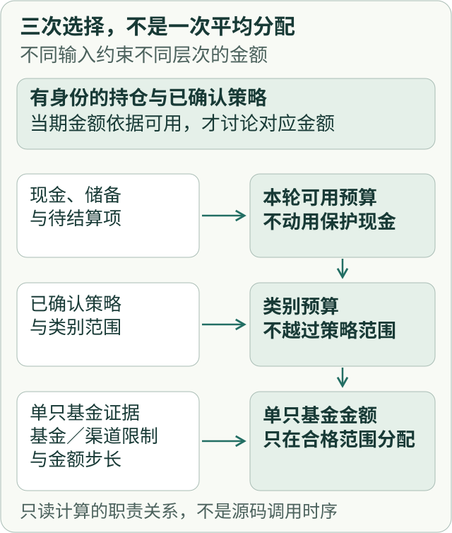
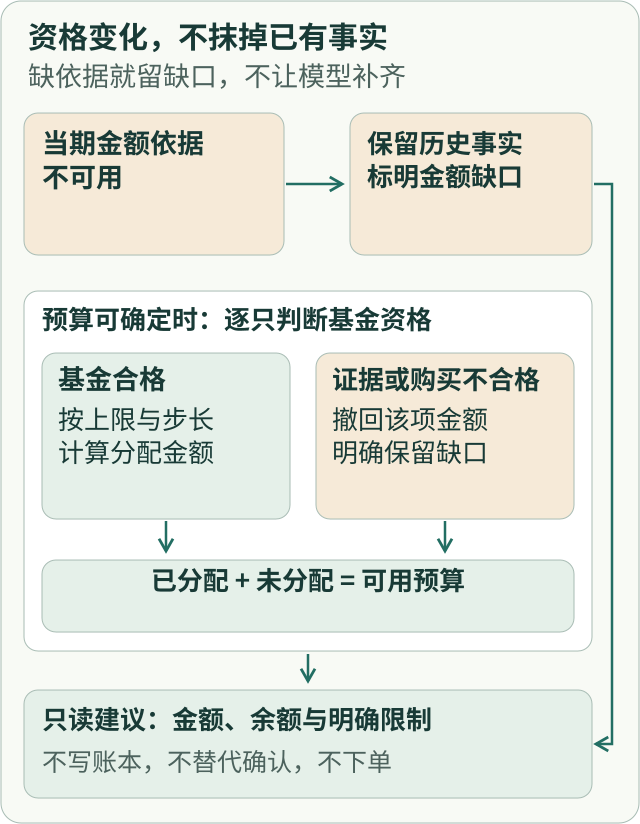

# 确定性基金计算：从持仓事实到可复算的金额建议

假设一份基金定投计划写着：“今天可以买入 300 元。”执行前发现其中一只基金暂停买入，另一只达到单日上限。现在该怎么办？平均分给剩下的基金，看起来很自然，却可能突破原策略的类别比例；强行把 300 元全部花掉，也可能动用本应保留的现金。

**金额建议的难点，不只是把数字算准，而是让每一元钱都能追溯到可用的事实和仍然成立的约束。** 某项买入不合格时，正确结果可以是“暂不分配”，而不是总额必须凑满。

这正是 ETF Agent 中「确定性投资计算」要回答的问题：输入账本和来源事实，按既定预算与风险规则计算金额及资格，输出只读建议与缺口。本文使用**完全合成的基金、金额和政策**解释机制，不描述真实用户持仓、真实交易或实时投资建议。

## 一、先确认算的是哪一份钱

“现在持有 1,000 份”和“今天价值 1,230 元”不是同一类事实。前者来自账户快照与有依据的已结算交易，后者需要给这些份额匹配适用时点的净值才能派生。若净值推迟更新，金额的时效性变弱，份额却不因此改变。

一个确定性的计算入口至少要把以下输入分开：

| 输入 | 它决定什么 | 不可用它推断什么 |
| --- | --- | --- |
| 账户快照与已结算变化 | 当前确认份额及基线时点 | 用最新价格反推交易已发生 |
| 净值与市场证据 | 估值、日期、覆盖和单只基金的金额资格 | 公开行情等于私人账户事实 |
| 已确认策略与配置范围 | 类别目标、风险区间、允许的操作 | 模型好评等于用户已确认 |
| 现金、储备与待结算项 | 哪部分预算可以进入本次模拟 | 所有现金都能立即用于买入 |
| 基金与渠道限制 | 是否允许新增、单笔或单日上限及步长 | 限额不足仍可以补齐目标总额 |

待结算交易可能占用可用现金，但在确认结算前不能直接增加份额。模拟买入更不能被记录成一次已发生的交易。这里的输入身份归投资事实读取和账本；投资计算模块消费它们计算，不自行修正原账本。

## 二、预算、类别和基金是三次不同的选择

先决定“本轮可以用多少钱”，再决定“应该分给哪些类别”，最后才是“类别内哪些基金具备合格金额”。这三个层次不能互相覆盖。

[查看完整关系图](../visuals/fund-allocation/allocation-relations.svg)

[查看完整关系图](../visuals/fund-allocation/eligibility-outcomes.svg)

这里的步骤是**职责与判断的阅读模型**，不是把实际源码中的每一个函数调用画成固定顺序。预算是否可动用由资金和策略约束决定；分类预算与单只基金金额由领域计算处理；来源不可靠时需要撤回的是依赖该来源的金额权限，而不是已经成立的全部历史事实。

尤其要避免一个误区：**组合总体覆盖较好，不等于每只基金都有合格的当前估值。** 如果某只基金缺少当前可用证据，它不能靠另一只基金的数据“补齐”自己的购买金额。未分配余额必须能从输出中找到，不能消失在舍入或重新加权里。

## 三、一个可以用纸笔核对的 300 元例子

以下数值全部是教学假设，不是对真实源码运行结果的逐字重放。设本轮可用预算为 300 元，另有受保护储备不参与计算，金额步长为 10 元；策略在本例中已经明确将 180 元给核心类、120 元给卫星类。

| 类别 | 基金 | 本轮限制 | 分配金额 |
| --- | --- | --- | ---: |
| 核心类（预算 180） | 基金 A | 单次最多 100 元 | 100 元 |
| 核心类（预算 180） | 基金 B | 单次最多 80 元 | 80 元 |
| 卫星类（预算 120） | 基金 C | 单次最多 50 元 | 50 元 |
| 卫星类（预算 120） | 基金 D | 当前停买 | 0 元 |
| 卫星类（剩余） | 未分配余额 | 本类无其他合格容量 | 70 元 |

这组结果满足：**300 = 100 + 80 + 50 + 0 + 70（元）**。核心类的 180 元全额分配，卫星类只分配 50 元，另有 70 元留在本次计划之外。保留 70 元不是算法失败，而是拒绝通过跨类别随意挪用来伪装策略已经执行。

机器可消费的结果至少应该保留结构化分配与缺口，而不是只给模型一句“买入 230 元”：

~~~json
{
  "scenario": "synthetic-read-only",
  "currency": "CNY",
  "dailyBudget": 300,
  "amountStep": 10,
  "allocations": [
    { "fund": "A", "amount": 100 },
    { "fund": "B", "amount": 80 },
    { "fund": "C", "amount": 50 },
    { "fund": "D", "amount": 0, "reason": "no_buy" }
  ],
  "allocated": 230,
  "unallocated": 70,
  "ledgerWritten": false
}
~~~

这些字段是为了读者复算而设计的**教学投影**，不是声称生产系统恰好发布这一 JSON Schema。实际金额引擎需要同类别分配、基金上限、暂停再分配和金额步长共同处理；不能只做一轮平均分配就宣布所有边界成立。

## 四、三个小变化，为什么会导向不同结果

**情况一：基金 C 的当前净值或来源身份不合格。** 即使其他基金有可靠行情，也不能给 C 保留 50 元当期买入额度。在上述固定类别预算与无其他卫星类合格基金的假设下，卫星类 120 元全部不分配；核心类仍为 180 元。这是**局部金额撤回**，不是把历史持仓删掉，也不是拒绝一般概念性分析。

**情况二：基金 D 恢复申购，但渠道有单日上限。** 可以在其真实准入与可用额度内重新计算，并按策略允许的步长处理。若仍有未分配余额，应明确留下；不能因为目标总额为 300 元，就忽略渠道限制、把不足资金塞给另一类别。

**情况三：用户想在常规计划外额外买入。** 这不是原定投金额的自然延伸。额外操作还需要已确认生效的策略、所需证据的新鲜度、周频次、月度上限、可用现金、渠道限额和风险范围等独立条件。缺少已确认策略时，计算模块可以拒绝**这项额外操作**，不因此禁止用户查看持仓历史或获准的研究资料。

这三个分支的共同点是：金额资格必须具体落在操作及标的上。缺口出现时，先记录原因和未分配的量，再决定是否存在被策略允许的替代分配；不能让模型用“应该差不多”填满余数。

## 五、谁保证算术，谁决定这笔钱能不能分

精确的十进制加法、比较和舍入属于通用的数值计算能力；它能证明 100 + 80 + 50 = 230，却不能自行认定哪笔现金受保护、哪个净值日期可用、哪个基金还能买。这些必须由投资领域规则给出。

因此我们将责任拆开，而不是创建一个包揽一切的计算裁判：

- **投资事实读取**只读投影已确认持仓和报告，不生成新持仓。
- **确定性投资计算**依据事实、策略和限制生成情景金额、可行性与未分配余额。
- **精确数值运算（Numeric）**在调用方指定单位、尺度和舍入策略后进行精确运算，不选择基金公式。
- **投资账本与确认**才持有用户确认后的持久投资事实；投资计算结果不触发写入。
- **原子报告生产**将输入身份、计算与覆盖组织为可核对的快照；模型解释或文件展示不改变其事实归属。

一个报告既可能引用真实持仓，也可能包含情景建议。它们即使排在同一页，也必须分别标记。用户“同意这个方向”、确认一项计划、发出执行指令、真实交易获得回执仍是不同的步骤；**只读计算不构成自动下单能力**。

## 六、验证这样的模块，不该只看模型是否写出漂亮报告

给定固定的合成快照、策略和基金限制，最小验收应核对四件事：同样输入得到同样金额；各基金不突破上限或停买规则；总额满足“分配 + 未分配 = 可用预算”；结果不会改变账本及已确认交易。再构造过期证据、无可用资金和跨账户输入，观察不合格的具体动作是否局部拒绝。

ETF Agent 的既有工程复盘已记录过：重建账户基线、只读定投、按单只基金撤回不可靠金额，以及将余额返回未分配项的修正路径。但这类工程验证**不代表模型能在真实完整投研任务中忠实引用和解释计算结果**；历史独立研究质量复验仍出现过未通过的样本。

本文讨论的是领域计算的机制。独立公开的 [Open ETF Agent](https://github.com/hpoenixf/open-etf-agent) 提供离线合成文档、研究与交付的教学路径，**不提供本文所述完整私有基金金额分配系统**。读者可以用本节 300 元示例手工复算守恒与限制；不要把公开教学 Demo 当成投资计算或交易通道。

## 结语：好的金额计算允许答案不是“全部买完”

如果策略只允许把 230 元分到合格基金，那 70 元应当以原本的身份留下来。下一次设计金融 Agent 的金额工具时，先问：输入份额是什么时点、预算里哪些钱不可动、哪些标的可以接纳金额、每一笔限制为何成立、剩余金额去了哪里。回答这些问题，再让模型解释数字。

进一步阅读：[只读 Portfolio MCP](./portfolio-mcp-readonly-investment-data.md)、[金融数字的时点与口径](./031-fintech-data-time-and-reproducible-numbers.md)、[精确数值核](./agent-numeric-kernel-exact-units-rounding.md)、[研究与交易边界](./030-fintech-from-research-to-investment-advice.md)。

如果这篇机制分析有帮助，可从 [Open ETF Agent](https://github.com/hpoenixf/open-etf-agent) 的合成示例开始学习研究和交付链路，并在 GitHub Star 或 Issue 中交流可复算的金融工具设计。
