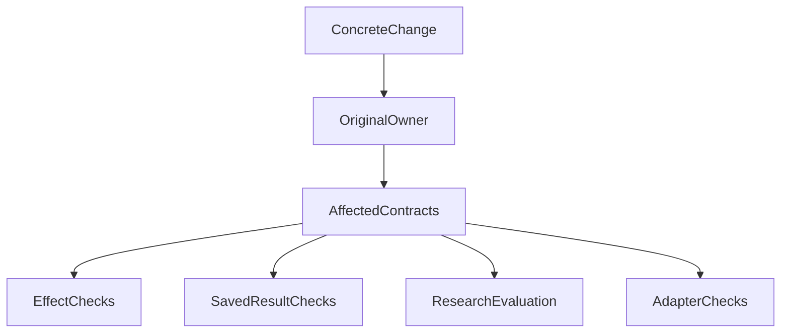

# Agent 架构如何做到该稳定的稳定，该变化的变化？

一个客服系统会把新工单分给合适的服务组。团队想换一种分类方法，让“退款进度”更容易进入售后组，而不是技术组。

分类方法当然可以改。但更新之后，旧工单的处理记录不能悄悄换组，一次分派不能重复发送通知，甲公司的工单也不能被乙公司的客服看到。

这些要求都在同一个工单模块附近，却需要不同的演进方式。把整个模块标成“核心，尽量别动”，会妨碍改进；把它标成“算法，可以快改”，又可能放松仍然必要的保护。

下面用这个教学模拟贯穿说明，工单业务与情节不代表 ETF Agent 的真实功能。**要稳定的是具体承诺，要允许变化的是实现与方法；两者不能按目录一刀切。**

## 一、先把这次变化，缩小到一条清楚的承诺

“升级自动分派”太宽。它可能意味着改分类方法，也可能意味着新增自动通知，甚至允许系统重新分派所有旧工单。

在这个例子里，先明确：新版只改变新工单的推荐服务组；原有公司隔离、分派确认和通知去重规则不变；历史工单仍显示当时实际分派给谁。是否重新分派存量工单，是另一项需要明确决定的工作。

这几句话让开发者知道哪些可以改，也让评审知道哪些不应顺手改变。

接口因此不只是函数参数。调用方还可能依赖一条记录的归属、一个操作是否已执行、结果能否重读，以及失败后是否可以安全重试。类型签名不变，承诺也可能已经改变。

## 二、同一模块里，至少有四种不同的事情

不必先给全仓库分等级。看本次修改涉及哪些具体约定即可：

| 事情 | 在工单案例里意味着什么 | 怎样演进 |
| --- | --- | --- |
| 操作必须守住的保护 | 公司隔离、确认、重复请求不重复通知 | 实现可以重写，保护继续成立 |
| 已经保存的结果 | 某条工单当时分给了谁、用了哪个版本的方法 | 展示可以改，历史含义不被静默重写 |
| 需要改进的方法 | 怎样理解问题、推荐服务组 | 可以试验，用代表性工单检查效果 |
| 可以更换的外部接入 | 调用哪个分类服务，怎样解释它的失败 | 可以替换，保住对内结果和失败约定 |

在原来的架构讨论中，它们分别称为受保护效果、持久成果、演进行为和可替换适配器。名字是为了帮助区分问题，不是四个必须新建的模块，也不是四档质量要求。

分类方法变化快，仍然要对推荐质量负责。外部接入可以换，也不能随意转交私人数据。同一次修改可能影响多行，需要按实际影响处理。

## 三、换一个分类方法，为什么不该让存储层学习一遍业务

假设新方法只是更好地区分“退款进度”和“系统报错”，保存的工单身份、推荐组、方法版本没有变化。

这种变化应该尽量集中在分类能力内部。存储层继续保存约定的结果，通知模块继续消费已确认的分派事实。它们不必理解新版先查了哪些词、模型分了几步思考。

如果每次调整分类提示词，都要修改内存存储、数据库存储和恢复读取器，说明方法的内部知识可能已经漏到了调用方。

这不是承诺所有改动只改一个文件。若新方法需要增加“等待人工确认”的持久状态，真实消费者就受到了影响，必须一起设计。先说明是否改变了数据和行为约定，才能判断协调范围。

ETF Agent 的子任务重构也来自类似摩擦：交接规则散在运行时、恢复编解码和两种存储中，同一条规则需要反复解释。把领域判断收回负责它的模块，让存储继续负责原事务，解决的是责任归属；再区分哪些方法可变、哪些交接事实稳定，才解决演进策略。具体过程见[Runtime 重构复盘](agent-runtime-refactor-one-day-blocked.md)。相关工程验证不能替代真实研究质量或维护成本收益的比较。

## 四、方法升级之后，旧结果应该怎样打开

设想一条旧工单当时确实分给了技术组。新版认为它更适合售后组，页面是否应该自动显示售后组？

如果页面展示的是“当前推荐”，可以明确给出新版推荐；如果展示的是“当时分派”，就必须保留原事实。把两者放进同一个字段，会让用户误以为历史操作已经改变。

可以给新推荐保留新的方法版本，并把实际分派记录分开保存。是否执行重新分派，仍走原有确认和执行路径。重新计算不是重新执行，推荐也不是操作回执。

金融结果有一个更容易看清的合成对照：净收益 100,000 元，资产 A 贡献 150,000 元，B 贡献 −50,000 元。以净收益为分母，占比分别是 150% 和 −50%，合计仍为 100%。

若新版报告为了让数字“好看”，偷偷改用正收益总和作分母，就改变了问题。可以明确提供另一种分析，但应标出新方法与新结果，不能重开旧报告就把原口径替掉。

保留历史含义也不等于永远保存一切。保留期限、删除和遗忘仍遵守各自约定。需要稳定的是仍然合法保留的结果含义，不是无限存储。

## 五、替换外部服务，哪些事情不能一起重置

分类服务不可用时，切到另一家服务可能有帮助。但先要确认两条路线是否真的独立；不同模型名可能仍指向同一个故障端点。

再确认新服务是否获准接收本次工单里的私人资料。原来已发送的请求、未知费用、通知记录也应继续保留，不能换了服务就把尝试次数清零，再把同一通知发一遍。

更换实现解决的是技术差异，原操作身份、授权和记账仍由各自责任模块维护。ETF Agent 中，原 Run 及其恢复沿用已记录授权；适配器替换不能自行扩大接收资料的范围，也不借机新增运行中撤权判断。

没有在途任务切换需求时，先让新任务使用新实现，往往更容易说清版本。若产品确实要求正在执行的任务无缝切换，再处理它依赖的状态、版本和未确认效果。一个“插件化”标签不能代替这些工作。

## 六、验证跟着承诺走，不跟着目录走

Google 的 Andrew Trenk 在[《Test Behavior, Not Implementation》](https://testing.googleblog.com/2013/08/testing-on-toilet-test-behavior-not.html)中讨论过：实现更换、对外行为不变时，原有行为断言通常应继续有效。这里还要补上另一半：方法本来就要变化时，不能把旧输出逐字冻结成唯一正确答案。

对应工单升级，验证可以这样分工：

| 改动 | 合适的检查 |
| --- | --- |
| 只改分类方法 | 用固定代表工单比较推荐，检查实际使用了新版输入与方法 |
| 改分派提交逻辑 | 检查正常分派、重复请求、未确认操作与跨公司隔离 |
| 改历史读取 | 用旧版本记录重开，确认实际分派和方法身份仍正确 |
| 换外部服务 | 检查正常响应、失败、已发请求结算与资料接收资格 |

无需给每次改动跑完四行。根据真实影响选必要检查；若声称分类质量更好，就增加相称的内容判断，不能用接口返回成功代替它。

原文的评审示意图保留如下：先找本次改变的负责模块，再看实际触及哪些承诺，最后选择相应检查。图中的四个分支可以部分适用，也可以并存。

这些关系放进原有任务和评审即可，不必创建新的分类台账或审批层。

## 七、下次升级，可以先写这段任务

> 新版分类方法用于新工单，保留既有公司隔离、分派确认与通知去重。分类实现自行处理方法细节，存储和通知继续消费原约定。保存方法版本，重开旧工单时保留当时实际分派；需要展示新推荐时另行标明。用代表工单检查新推荐，并从实际提交入口确认重复请求不会重复通知。若接口或持久状态需要变化，明确受影响的消费者后再修改。

这段教学任务给出了变化、保护、历史处理和观察位置，开发者不必靠“核心要稳定”猜测工作范围。

同样的思路也适用于恢复：能读取保存结果，不代表必须跨版本重建完整执行现场；如果承诺原位续跑，就要维护它实际依赖的状态。当前仍有消费者的读取器，不能因为准备缩小未来承诺就提前删除。

**架构升级的余地，来自把变化留给方法，把保护落到具体操作，把历史还给已经发生的事实。** 下一次改规则时，先把这三件事分清楚，再决定改哪些代码和测试。

## 延伸阅读与交流

- [Runtime 重构复盘](agent-runtime-refactor-one-day-blocked.md)：本文思考来自哪些实际职责问题。
- [代码与系统演化](code-cheaper-systems-harder-to-evolve.md)：怎样减少依赖和退出成本。
- [Memory：保存、召回与遗忘](026-agent-memory-forget-durable-effects.md)：方法变化与数据使用保护的具体案例。
- [按接口区分稳定性与演进方式](/principles#method-7)：原则导航。

本文收录于 [ETF Agent 工程手记](/catalog)。欢迎在 [GitHub 公开文集](https://github.com/hpoenixf/eff-agent-article)交流或点一个 Star。
