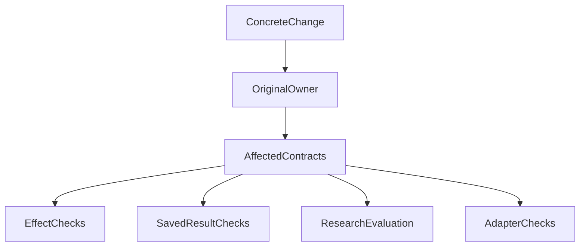

# Agent 架构如何做到该稳定的稳定，该变化的变化？

*从一次 Runtime 重构，重新思考复杂 Agent 的模块演进策略*

**架构最值得保护的不是某个模块，而是它对外承担的具体承诺。** 研究方法、Prompt 和适配实现需要迭代；授权、已经发生的效果与仍须读取的历史结果，则不能因为重构而改变含义。

我们在 ETF Agent 的 Subagent、Memory 和金融计算中逐渐发现：仅仅把责任收回模块还不够，还得回答“哪些行为必须稳定、哪些实现允许改变”。本文讨论这两次判断如何相互配合，而不是再介绍一套给模块打分的等级表。

配套的[一天 Runtime 重构复盘](agent-runtime-refactor-one-day-blocked.md)保留当时的具体代价；这里重点讨论读者下一次改接口时，该怎样决定稳定性与验证方式。

## 一、模块已经拆了很多，为什么还是难以升级？

最近开发 ETF Agent 的子任务能力时，我们发现：修改一条交接规则，常常需要同时修改恢复编解码、内存存储和数据库存储；调整用户 Memory，又会牵动 Runtime Factory 和共享运行状态。

2026 年 10 月 25 日的评审中，Research Runtime 已有 **130 个 TypeScript 文件、57,786 物理行**，其中一个恢复编解码文件达到 **5,247 行**。行数包含空行和注释，只是定位线索，真正的问题是同一条规则被几个地方重复解释。

我们开始将 Child 的领域规则收回原负责模块，把可变状态封装进所属能力，让 Factory 回到组装职责。这里的 Owner，指对某类事实或效果负责的模块，不是再加一层管理者。

这解决的是第一个问题：**复杂度应该由谁维护？**

但即使职责清楚了，演进策略还没有自然出现。权限、报告、研究方法、模型供应商，是否都应该承担同样的稳定要求？

这成为后续架构讨论的起点。

## 二、业务核心，不等于最不应该变化的代码

我们最初考虑过，将能力分成核心、外围和金融几组，再给予不同的维护要求。

很快就遇到了矛盾。

金融研究是产品的核心价值，专家提示词、研究路线和报告结构却需要经常改进。模型网关属于通用基础设施，实际请求身份、调用记账和执行回执却必须保持可信。

用户 Memory 更直观：召回算法可以换，用户已经提交的遗忘要求却不能因为升级而失效。同一个模块里，稳定要求已经不同。

所以，“核心模块少动、外围模块随便动”并不能指导具体修改。

**业务价值回答为什么需要它；稳定性要求回答哪些对外承诺必须继续成立。**

我们后来给当时的 43 个能力 Owner 整理了七个维护分区，但它们只帮助找代码，不是七个稳定性等级。金融计算不会因为属于某个分区就变得不重要，研究编排也不会因为经常变化就可以放松权限。

真正需要分类的是具体接口和效果，而不是整个目录。

## 三、四类演进契约，不是四档质量标准

接口不只是函数参数与返回类型，也包括调用者依赖的身份、顺序、失败语义和保存规则。我们把这些承诺分成四类：

| 契约 | 需要保住什么 | 允许怎样变化 |
| --- | --- | --- |
| **受保护效果（Protected effect）** | 权限、执行身份、幂等、确认与真实回执 | 可以重写实现，但有效保护和效果含义继续成立 |
| **持久成果（Durable outcome）** | 报告、引用、计算结果的身份与历史含义 | 可以调整展示与读取实现，遵守原有保留、删除和遗忘规则 |
| **演进中的行为（Evolving behavior）** | 对研究质量负责，而非冻结旧提示词字节 | 研究路线、提示词、检索排序和摘要方法可以试验、版本化 |
| **可替换适配器（Replaceable Adapter）** | 对内约定、来源表达与失败语义 | 可以更换供应商、解析器或外部接入实现 |

这不是从高到低的可靠性排名。研究方法可以快速迭代，不意味着研究质量可以随便；适配器可以替换，也不意味着它对私人数据的处理可以宽松。

同一次修改可能触及几类契约。调整摘要策略主要改变研究行为，但如果因此丢掉来源身份，或者把已遗忘内容重新送给模型，就同时触及受保护效果。

分类的用途是看清影响，而不是替修改免责。

## 四、Subagent：让研究方法变化，不必连着改执行底座

子任务是这套思考最直接的来源。

假设基金研究子任务正在查资料，用户中途补充要求，旧一轮的阶段结果随后返回。系统要判断：回复是否被接受？结果属于哪个任务？是否已经取消？这次交接是否重复或过期？

这些属于执行合同。首批重构将回复接受事实、Child 的交接判断与 Store 的事务提交分别归还给原模块。两种存储消费同一份规则，数据库仍在原锁与事务里读取事实、规划并提交。

这条路径已有首批限定范围的实现与验证，但当时完整恢复与旧读取器处置仍未完成。

现在换一个需求：新增一位研究基金持仓重叠的专家，或者改进多空观点质询的方法。

专家怎么提问、先查什么、怎样比较证据，属于可演进的研究方法。**只要不改变交接数据合同或新增持久事实，改方法不应迫使两个 Store 再解释一遍专家行为。**

一旦新增了结构化交接字段或恢复语义，确实可能需要协调底座。我们追求的是减少无关修改，不是承诺任何升级都只改一个文件。

这也说明两轮讨论怎样衔接：职责重构让变化集中到原 Owner，差异化契约再规定这种变化需要保住什么。

## 五、Memory：把算法变化与遗忘保护拆开

ETF Agent 的 Memory 同时涉及召回、摘要、用户范围、记录修订、临时模式和遗忘。它们放在同一个能力附近，却不是一种性质的东西。

10 月 25 日，项目还独立处理过遗忘内容经后续请求上下文重新披露的缺口。这件事与 Memory 的结构提取分开修复，没有被当作普通重构顺手放宽。

原因很实际：删除或遗忘的效果提交后，旧索引、缓存、历史投影都可能成为再次输入模型的路径。需要保护的是数据资格，不是某一套旧缓存实现。

与此同时，关键词、向量或混合召回怎样排序，什么长度的摘要更有用，可以继续优化。

结构上，让 Memory 自己管理单次研究的读取、缓存、引用和使用去重；Factory 只组装必要依赖。这样将来换排序算法时，调用者不必知道缓存增加了哪些字段。

契约上，继续保留原 Run 授权生命周期、账户隔离和已提交遗忘效果。**改算法不是扩大数据权限的理由，也不需要借机重新设计一套运行中撤权机制。**

这就是同一个模块可以同时拥有快变行为和严格保护的含义。

## 六、金融研究：方法可以创新，分母不能悄悄换

金融研究最容易让“核心就应该少动”显得合理。但核心研究能力恰恰需要持续改进，真正应保护的是具体计算与结果含义。

看一个合成示例，不对应任何真实持仓：组合净收益为 **100,000 元**，其中资产 A 贡献 **150,000 元**，资产 B 贡献 **−50,000 元**。

以净收益为分母，A 的贡献占比是 **150%**，B 是 **−50%**，相加仍是 **100%**。

报告生成器如果觉得“超过 100% 一定不对”，把分母偷偷换成正收益总和，数字看起来更顺眼，却已经回答了另一个问题。

我们的金融研究规范明确要求保留分母、单位、方法版本、输入依赖和覆盖范围。原领域方法拥有计算口径；模型负责解释，不通过重新编一个公式成为第二个计算权威。

因此，改进报告解释、增加风险研究方法，可以持续进行。更改公式或分母时，要显式绑定新方法与新结果；重新打开旧报告，不应该静默重算成新的结论。

也不能把“保留历史含义”理解为永远保存全部数据。保留期限、删除与遗忘仍按各自契约执行。

## 七、技术实现可以换，执行事实不能跟着重置

模型 Provider、网页获取和 PDF 解析都存在真实的外部差异，适配器可以把这些差异挡在稳定的对内接口之后。

但换一个实现，远不止改掉一个函数调用。

在模型故障切换设计中，我们发现：两个模型即使名字不同，也可能共享同一个服务端点。端点故障时，在这两个模型之间轮换，未必获得新的可用性。

切换到独立供应商，还要确认它是否有资格接收当前请求里的私人资料。已经派发的请求如何结算、未知成本是否仍占用预算、已有回执属于哪次尝试，也不能随切换重置。

这里同时存在可替换的技术实现和受保护的执行事实。Adapter 只隐藏外部差异，不接管授权和记账权。

因此，我们优先支持启动时装配，或让新研究、新子任务绑定新版方法。运行中的热替换，需要额外的版本与在途任务处置证据，不能仅凭“插件化”三个字默认成立。

没有第二个真实实现或明确替换需求时，也不必为每个内部函数预建一整套插件生命周期。

## 八、从分类到修改：用现有评审就够了

如果分类只停留在图表上，实际开发还是会回到“一改就全测”或者“外围模块随便改”。

我们更希望在原有设计评审中，说清楚本次改变了什么。例如：

| 实际需求 | 主要改变 | 同时保住 | 验证重点 |
| --- | --- | --- | --- |
| 更新基金专家研究方法 | 演进中的行为 | 原授权与交接合同 | 真实消费路径；声称质量改善时做代表性研究与复核 |
| 调整部分结果交接规则 | 受保护效果 | 原任务身份与事务原子性 | 正常提交、重复、过期、取消和受影响并发场景 |
| 替换记忆召回排序 | 演进中的行为／适配器 | 用户隔离与遗忘后的使用资格 | 新旧排序行为和真实输入路径中的数据保护 |
| 修改收益计算口径 | 计算规则与持久成果 | 单位、分母、版本和历史结果 | 独立期望值、新结果身份、旧报告读取 |

这是几种不同修改的例子，不是所有变更必填的审批表。跨类别时，覆盖实际受影响的部分；纯局部实现调整，不必给四类契约各造一组测试。

这张图是评审思路，不是新的执行流程。四个验证分支可以同时适用，也可以只需要其中一部分；验证范围来自真实影响，不是模块所在目录。

## 九、Recovery 是应用案例，不是整套原则的主旨

差异化契约也让我们重新审视恢复能力：已经提交的成果需要可靠保留，不等于每一次普通研究都必须跨版本重建完整执行现场。

后续轻量恢复设计提出，让普通旧任务在原有安全保护下诚实中断，用户显式继续时，用新任务承接仍然合法的有限成果。但当前人工交互或 Child 唤醒仍依赖的状态、未知外部效果与真实回执，需要继续保护。

这是一项按场景缩小执行承诺的选择，不是普遍降低可靠性。本文讨论的设计当时仍分阶段实施，不能据此宣称完整交付。

同样，原位续跑若是产品的必要能力，就应承担相应版本与恢复成本。四类契约帮我们把选择说清楚，而不是预先规定所有系统都选“轻恢复”。

## 十、结语：该稳定的是承诺，该变化的是方法

**先问谁拥有规则，再问这条规则承诺了什么。** 这是两次架构调整真正互补的地方：责任归属避免同一知识四处复制，演进契约则避免把所有代码都当成必须冻结的“核心”。

下一次评审变更，我们会优先追问三个具体问题：它改变的是可替换实现，还是对用户和其他模块的承诺？真实消费者依赖哪些身份、时序或历史含义？如果更换算法或 Provider，哪些行为仍必须成立？

例如，Memory 召回算法可以更新，但合法的遗忘效果不得复活；投资研究方法可以调整，但不能悄悄更换比较分母；Child 调用方式可以重构，但已发生的工具调用与授权不能靠新版本重写历史。

这不要求四种契约各建一个新模块，也不意味着所有接口都承担同样的测试成本。**稳定具体承诺，开放实现与方法，才有可能既保持可靠性，又保留升级空间。**

---

*工程范围：本文基于 ETF Agent 2026 年 10 月的职责重构、现行领域规范和差异化演进 RFC。文中区分已记录问题、首批实现与设计方向；完整改造和真实模型研究质量不能由这些局部证据直接推出，维护成本的量化改善尚未采集。*

## 延伸阅读

[一个 Subagent 改动，为什么拖住了我们整整一天？](agent-runtime-refactor-one-day-blocked.md)提供完整事件背景；[代码越来越便宜，为什么系统却越来越难升级？](code-cheaper-systems-harder-to-evolve.md)讨论引入、替换与退出的长期成本。

本文收录于 [ETF Agent 工程手记](https://hpoenixf.com/eff-agent-article/articles/agent-differentiated-evolution-contracts)。如果这些架构取舍对你有帮助，欢迎在[公开文集仓库](https://github.com/hpoenixf/eff-agent-article)点一个 Star。

这四类契约在阅读地图中对应[外围方法 7：按 Interface 区分稳定性与演进方式](/principles#method-7)，不是新增第十条核心原则。
