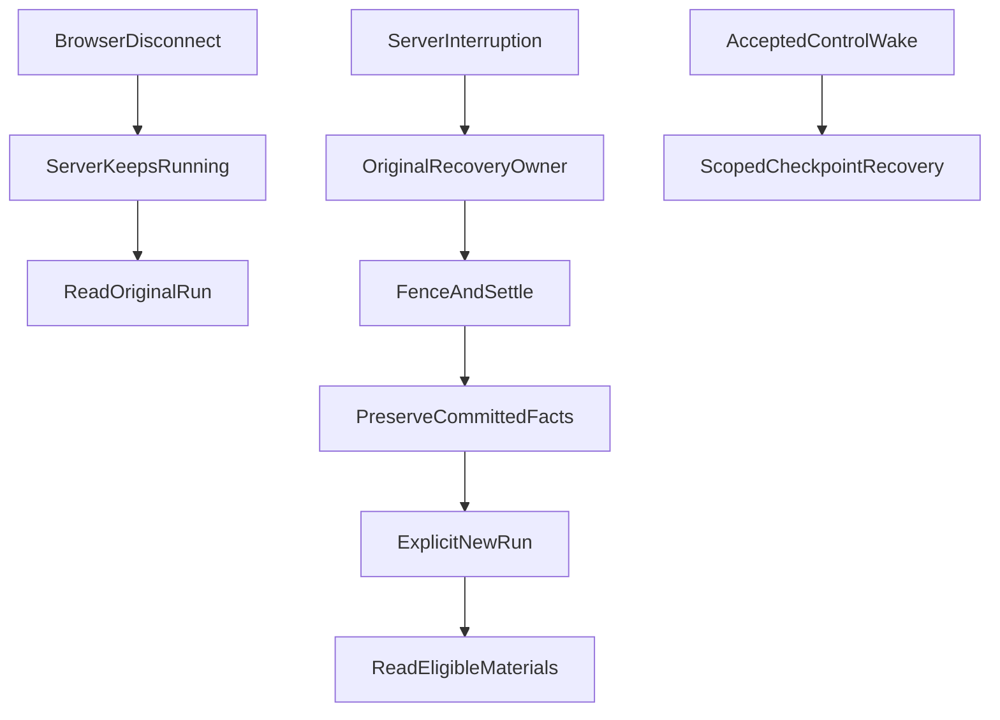

# 断线不是崩溃：为什么 Agent 不必恢复原来的执行图？

**长时间研究的关键承诺，不是任何故障后都从原来的模型步骤继续，而是用户离开时研究不被误停、已发生的效果不被重做、已经保存的事实能够被安全地再次使用。** 在允许丢失未提交进度的产品里，执着于恢复整张执行图，可能是在维护比用户真正需要的更昂贵的承诺。

这来自 ETF Agent 对研究恢复机制的一次收缩。我们已经拥有后台研究、数据库状态、浏览器重连、子代理和人工交接，却逐渐发现“恢复”被用来指代几件性质完全不同的事：页面重新打开、进程中断后重建原 Run、用户主动继续未完成的研究。它们共享资料，却不应该共享执行权。

## 一、先问清哪一种连接断了

设想用户提出一个问题：“比较两只基金的持仓重叠，核对最新披露，并标出覆盖率不足的地方。”Main 已读取部分资料，某个 Child 还在处理 PDF，用户关掉了手机页面。

**浏览器关闭不等于服务端 Run 结束。** 如果服务进程仍在运行、原 Run 的准入和资源仍有效，后台可以继续做原来的事。重连只读取已有正文、事件和进度，不应为了重新显示页面再调一次模型。

但如果执行所在的服务进程停止，而数据库里只留下若干 ModelTurn、Tool、Child 和等待回执，问题就不一样了。你能读取这些事实，并不等于能重新创建原来那组同时运行的对象。下表把三个经常混用的动作拆开：

| 用户或系统面对的情形 | 合理行为 | 不应该做的事 |
| --- | --- | --- |
| 仅浏览器断开，原服务仍在执行 | 原 Run 在原授权内继续；重连读取原记录 | 新建模型调用来“恢复显示” |
| 服务进程中断，普通 Root 没有合法的控制唤醒 | 原 Recovery 负责有限结算、保留已提交内容 | 无依据重放旧 Root/Child 执行图 |
| 原 Human/Child 控制等待有明确获准的唤醒 | 在原身份、围栏和有限检查点下接续允许的动作 | 凭“数据库有旧 Run”推断唤醒已获准 |
| 用户明确要求继续刚才的研究 | 创建有独立准入的新 Run，读取仍合法的旧成果 | 把旧 Run 的执行权限和额度转移到新 Run |

“Run”是处理一次用户请求的执行尝试；“执行图”则是这次尝试内部的模型请求、工具调用、Child 和等待关系。前者的历史身份可以长期保存，后者不必永久处于可重建状态。

## 二、旧方案当时为什么合理，现在为何愿意后退？

最早的恢复思路是尽可能把 Run 的内部游标和检查点存下来。发生重启时，重新装配待执行节点，继续原来的模型轮次。这有合理的工程动机：不丢掉昂贵研究工作，尽量避免用户重复提问，也让合法的人工回复能够接回原来的研究。

随着执行系统加入 Child、Peer、人工安全点、模型工具表面版本和并发状态，承诺的范围变大了。恢复一个旧游标，可能需要解释当时的工具目录、专家方法版本、授权、尚未结算的外部调用、并发等待者和历史格式。如果恢复程序只是“成功拼回了对象”，却不知道某次请求是否真的已经执行，重复副作用风险仍然存在。

这次选择不是发现“检查点毫无价值”，而是重新定义产品目标：**服务端崩溃后允许丢失尚未提交的进度；保留已经完成的资料和成果；用户可以明确启动新 Run 接着做。** 现有合法的 Human/Child 等待与服务器未中断的后台运行仍然保留。

这是比通用持久工作流更弱、也更可解释的承诺。作为对照，[Temporal 的 Workflow replay](https://docs.temporal.io/tasks)依据持久事件历史重建工作流状态，并区分 replay 与重新执行外部活动。ETF Agent 没有把自身实现称为 Temporal，也不试图在所有历史模型协议上复制同等级别的恢复保证；我们选择按原实际效果和产品可接受的进度损失收缩范围。

## 三、取消旧图重建，不能取消原效果

中断时至少有三种独立事实。第一种是**已经提交的结果**：原工具回执、带身份的研究材料、已发布正文或文件。第二种是**未确认的效果**：请求可能发给了 Provider，响应中断，账目和结果都不完整。第三种是**执行位置**：原模型本来打算下一步做什么。

第三种可以丢失；前两种不能被顺便改写。

普通 Root 冷重入如果没有被接受的控制唤醒，恢复入口不再直接构造旧模型循环。它沿原 Store/Recovery 的租约与围栏检查身份，只由原终结负责人决定怎样结算。已有合格的正文时可以保留部分结果；没有可交付正文时不能凭几个工具日志冒充完成。已经提交的内容按原 Publication 和来源资格可见，旧执行不因页面重开而再次派发。

这张图表示三条不同入口，而不是自动串行流程。浏览器重连只读；普通中断要由原 Owner 安全结算；获准的控制唤醒继续走它已有的受限恢复通道。

为什么要强调围栏（fence）？因为一个进程暂时不在本机内存表里，不代表它已经丧失写入资格。若旧执行尚可能有迟到结果，新的恢复者不能仅凭“看不到它”就夺取终态、清空预算或覆盖已提交正文。原租约、持久执行身份、取消事实和事务约束，才决定哪些操作还能写入。

尤其不能把未收到 ACK 当作未执行：发往外部模型或工具的动作结果未知时，相关耗费应保持未知，而不是推断为零、退款或盲目重试。跨外部 Provider 与本地数据库，这套策略不声称达成端到端 exactly-once。

## 四、短期继续研究：继承材料，不继承执行权

如果原 Run 被诚实标为中断，用户点击“继续”，新任务究竟能继承什么？

可以继续使用的，是原负责者已保存、当前用户仍获准读取、身份与时点可追溯的材料：旧报告片段、来源观察、合法结果引用、明确的计算输入/输出、尚未解决的研究问题。新 Run 要重新经过自己的准入，继承的是**研究背景**，不是旧 Run 的未用预算、旧模型请求 ID、租约或某条未执行的工具提议。

用一个合成例子说明：

1. 第一个 Run 阅读了基金 A 的公开持仓，保存日期和覆盖范围；计算结果也取得原始结果引用。随后进程中断，原有结论已提交，但关于基金 B 的资料是否足够仍待确认。
2. 用户再次打开页面，只能看到原始结算与已保存的部分正文；系统不为了显示历史就重新抓取基金 A。
3. 用户明确发起新 Run。系统带入仍有资格的 A 资料、计算结果、方法和“B 的覆盖率未确认”这个待解决问题。新的 Main 可以先核对 B 的最新披露，再决定是否需要补算，而不是重复整套旧 Child 步骤。

这里“复用旧计算”不等于“旧结论仍然适用于今天”。披露日期、计算窗口、覆盖率、来源授权和后续修订都要保留：资料过期就必须说过期，已撤权的内容不能因出现在历史摘要里而重新获得读取资格。模型此前判断“问题已解决”也只是历史评估，不是金融事实。

在现有受控跨进程研究验证中，原 Tool、Python 计算和 ResultRef 可以通过 PostgreSQL 的合法安全点在另一操作系统进程被重新读取，而不重跑已提交的来源和计算。这证明了**已保存观察可以跨进程消费**这条有限路径，不代表任意崩溃位置、所有历史协议和真实模型研究质量都已验证。

## 五、保留受限唤醒，不要一刀切关掉恢复

最容易出现的错误，是听完“旧图可以放弃”，就把全部 checkpoint 和 wake 一起删掉。这样会破坏另一类已有的产品能力：Child 的阶段性结果和用户回复，可能正停在一个获准的人工安全点上，等待原身份继续。

因此我们区分两件事。**普通 Root 冷重入**不默认拥有执行权；**已被原控制 Owner 接受的 Human/Child 唤醒**，仍可在受限当前格式、原请求封存身份、租约和资源余量内继续。一个旧数据库记录存在，不构成控制唤醒；一个合法的控制唤醒，也不能扩张为对任意历史版本的重放承诺。

同样，完成当前步骤的“状态”并不是继续执行的许可证。外部请求已经提交，结果是否可接受、是否仍有合法后续动作，要由各自持久负责者判断。未知必须保留为未知；当前步骤不可恢复，也不应该抹掉之前已经发布的独立成果。

从工程取舍看，这需要保留一小段当前使用者确实依赖的检查点逻辑，而不是全面删除恢复模块。删掉旧图重建之后，安全点的有效性、当前版本兼容和最终结算反而更值得单独测清楚。

## 六、把验收从“能重建图”改为“没有丢失该保留的事实”

这次收缩最有意义的验证，不是“模型接着说了几句话”，而是普通冷重入时没有重复外部派发，迟到执行不能改写原终态，原正文/工具结果和未知额度保持，用户新发起的继续能读到适用材料，合法 Human/Child 唤醒又没有被错误阻断。

我们在原生产接口的受控测试中检查过普通 Root 的不再重派、原结果投影以及有界的新 Run 继续；部分跨进程、原唤醒和结果交付路径也各有独立证据。**截至 2026 年 10 月 27 日，这些工程进展已出现在主干实现与已接受的部分合同里，但独立中断简化 Spec 的全量正式收尾不能由此推断完成**，尤其不能写成真实模型对任意故障都能无损续跑。

这种设计不是每个场景都值得采用。如果合同要求某一步必须完成、不可重复或必须跨任意重启继续，就应使用相称的持久执行技术和外部效果协议，而不是靠一个“继续”按钮满足承诺。反过来，如果目标是长时间研究、允许有限进度损失，那么准确保存结果、显式重启下一轮，可能比维护永久兼容的执行图更符合用户需要。

## 结语：恢复最重要的是保持事实，不是维持幻觉

“任务从哪里继续”听起来只是游标设计，实际首先是产品承诺和权力分配。

我们保留后台不断线执行，保留合法人工安全点的受限继续，也保留已经结算的资料、计算和正文；放弃的是**在不知道完整执行事实时，假装能够重建并安全重跑整张旧图**。读者下次设计 Agent 恢复时，先分别写清楚三条保证：客户端重连只读什么、服务端崩溃保留什么、用户新任务可以合法复用什么。只有这些承诺需要同一份执行图时，才值得为它付出通用持久重放的复杂度。

---

## 延伸阅读

[异步研究：离开页面后怎样按时交付](agent-asynchronous-research-time-bound-delivery.md)讨论交付时点和用户可见通知；[当每个模块都能说“不”](agent-veto-authority-and-run-termination.md)讨论局部失败与终结权；[已保存的结果为何不等于模型下一轮已经消费](tool-results-outside-model-context.md)讨论研究证据的投影与读取。这些问题相关，但不要求共享一个万能恢复管理器。

[ETF Agent 技术文集](https://github.com/hpoenixf/eff-agent-article)（欢迎 Star 与讨论）。
