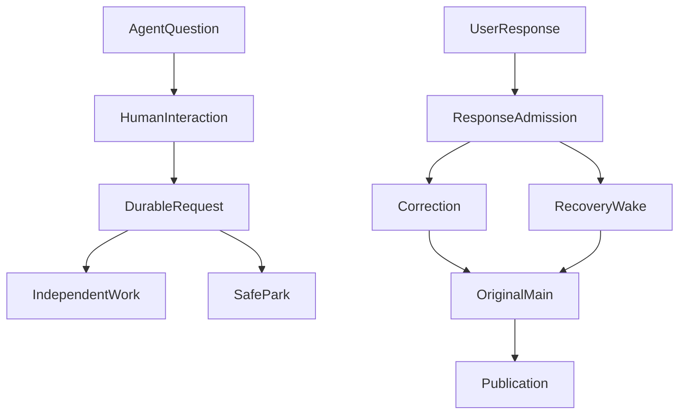

# Agent 问完用户之后：持久人机交互如何接回原研究

研究 Agent 正在撰写一份基金风险报告，读过持仓摘要，也找到了基金披露资料，却缺一个决定分析口径的问题：“这次比较以哪个基准为准？”它可以先整理已经取得的资料，同时把问题交给用户。用户可能正在开会，过几个小时才回答；期间页面已经关闭，服务也可能重启。

难点不在于画一个“请确认”的弹窗，而在于：**回答被系统收到之后，究竟有没有进入最初需要它的那次研究？** 更棘手的是，“我同意”可能只是回答问题，也可能是对受保护操作的审批。把它们混成一个布尔值，Agent 就会失去解释自身行为的能力。

本文以一个长期运行的研究 Agent 为例，解释持久 Human-in-the-Loop（HIL）如何实现非阻塞提问、精确回复、同 Run 恢复与有界审批。例子均为说明机制的合成输入，不涉及真实账户或持仓。

## 一、先分清四个时点

传统聊天框很容易把“问题发出了”“用户看到了”“用户回答了”“研究已经采用回答”合并为一个已完成状态。但它们是四个可独立失败的事实。

| 事实 | 真正的凭据 | 不足以说明 |
| --- | --- | --- |
| Request accepted | 服务端封存带身份与版本的交互请求 | 用户已看见问题 |
| Response received | 认证用户的原始回答被持久接纳 | 模型已经使用回答 |
| Response adopted | 原 Correction、Child 或 Effect 等消费者提交采用回执 | 一项业务效果已经执行 |
| Effect committed | 原业务 Owner 记录批准后的真实效果 | 新生成的模型回答必然正确 |

因此，我们没有让一个可变的 `resolved=true` 管理全部阶段。Human Interaction Owner（HIO）只接纳和路由交互；会话保存用户原文，Recovery 管同一次运行的检查点，Authorization 管授权，Effect 管受保护的实际操作，Publication 仍管正文。

这个划分增加了少量身份字段，却省去了另一套模型循环、授权账本和发布状态机。用户看到“回答已收到”时，它只承诺系统保存了回答，不提前承诺研究已经继续。

## 二、问题发出去，不一定要让研究停下来

一种简单实现是模型调用 `ask_user` 后直接终止本轮。短问答可以接受，但多份资料的研究往往仍有独立工作可做。我们的接口因此区分两种模式：

**非阻塞（non-blocking）**是默认值。请求被接纳后得到稳定的 interactionRef，Main 继续进行其他合法读取、计算和部分正文交付。用户回复到达后，由原 Correction 在安全点送入后续 Main 模型请求。问了问题不等于停止整个研究。

**阻塞（blocking）**用于模型判断暂时没有可独立推进的工作。它只是提议：原 Recovery 仍要确认已结算正文、未完成的 Child/Hook/工具效果、取消和 lease/fence，再决定能否把同一个非终态 Run 安全停放。停放不触发正常完成 Hook，也不创建第二个 Run。



两条路径不是每次同时发生。独立工作足够时继续研究；真正要等待时才 SafePark。单个 Root 最多一个实际人工停放点，超期、Stop 与原有预算约束仍有效。人工等待不会重置真实模型请求数、费用和用户硬截止时间；自动运行的 Scheduled Task 也不会进入这种人工等待。

## 三、用户回答哪一个问题，由身份决定

假设原请求需要两个条件，用户在另一个会话的待办中心打开其中一个。若后台仅靠“最新一条消息”或者相似措辞去匹配，答复很容易落到另一个 Run，甚至错误地批准一个操作。

一次交互请求至少要绑定原 producer/action、Root Run、会话、账号接收人、请求版本、有效期与响应约定。回复再携带精确 request revision、认证主体、稳定 clientResponseId 和**原始内容**。用户不能自行改写该请求的类型、scope 或应由哪个业务模块执行。

下面是概念化的交接形态，不代表公开 HTTP API：

```json
{
  "interactionRef": "human-question-example",
  "requestRevision": 2,
  "runRef": "research-run-example",
  "mode": "non_blocking",
  "question": "这份风险报告采用哪个比较基准？",
  "response": {
    "clientResponseId": "reply-example-01",
    "text": "以沪深300作为比较基准"
  },
  "receipt": "response_received",
  "adoption": "pending"
}
```

重试同一个 reply ID、同一内容，应返回既有接纳回执；同 ID 不同内容是冲突。另一个账号、旧版本或过期请求不能借由前端展示获得接纳。答复被保存后，即使当前缺少模型容量，也应保留“已收到，等待继续”的真实状态，而不是丢弃回复或立即重派研究。

**终态之后是另一条路径。** 原 Run 如果已经结束，迟到回复只能先保存；若满足原续研资格，用户明确确认“继续分析”，再由 Continue 创建关联的新 Run。不能悄悄把已终结的 Run 改成 running。Stop 与失效操作也不因为用户随后作答而自动复活。

## 四、难点常在最后一跳：收到，不等于真的采用

实际工程验收暴露了两个比接纳更隐蔽的问题。

**第一，序列化后看起来相同，不代表字节身份相同。** 数据库 JSONB 会保存对象的值，却不承诺原 stdin 字节顺序。恢复一个需要精确封存输入的命令时，如果重新序列化再声称与先前原文一致，就可能给错误的操作放行。必须回到原 sealed preview 的字节证明，而非重造等价对象。

**第二，安全点完成了，恢复游标却未必前进。** 某次用户回复已经进入安全点，但 continuation cursor 仍指向旧 Main 请求，就可能再次拿旧输入继续。正确恢复需要找到最新 Main 的精确 request/seal 身份；后来提交的 Child 回执不能遮挡这份身份。已批准正文也必须在原 Publication 路径完成持久化，才能跨过恢复屏障。

Child 的咨询还有一个特别容易漏掉的细节：Main 解释了用户回复，并不代表原 Child 收到了原话。真实消费者如果是 Child，就必须在自己的独立用户消息中收到绑定原请求的响应，并按原 Child Control 恢复。原 Child 已取消或结束，则不能被旧回复唤醒。

因此，测试不能只断言“回复成功”“模型调用一次”或“最终 Run 已完成”，还要检查**下一次实际模型输入和实际消费者**，以及原操作是否被重复派发。这个问题和普通网页聊天中的 loading 状态无关，是持久运行的因果身份问题。

### 公开提炼：先让一个普通回复回到原调用

[Open ETF Agent v0.13.0 的固定公开实现](https://github.com/hpoenixf/open-etf-agent/tree/300f78f7066ab76fcc4e9efb54137ff021ecc278)先保留这个问题里最小的一段：`ask_response` 提出一个问题，Session 保存问题身份后让出执行租约；另一进程接纳回复，再由显式 `resume` 让原 Run 采用它。这里没有复刻上文完整的非阻塞 HIO、Human Park、审批或跨账号待办，也不会收到回复就自动启动研究。

合成例子问的是“报告应原样保留哪个标签？”。使用 Node 26.8.1–26.x（本例验证环境为 26.11.1），按[该固定版本 README](https://github.com/hpoenixf/open-etf-agent/blob/300f78f7066ab76fcc4e9efb54137ff021ecc278/README.zh-CN.md)安装依赖后，使用一个新的本地目录运行：

```bash
npm run session -- start --session runs/article-reply --case durable-response
# 用上一条输出的原 runId 和 questionId 替换占位符
npm run session -- question --session runs/article-reply --run RUN_ID --question QUESTION_ID
npm run session -- respond --session runs/article-reply --run RUN_ID --question QUESTION_ID --response reply-1 --text 'Synthetic label: blue'
npm run session -- resume --session runs/article-reply --run RUN_ID
npm run session -- response-status --session runs/article-reply --run RUN_ID
```

第一条命令返回 `awaiting-response`，问题已保存，执行进程可以退出。`respond` 只记录原回复，状态是 `received-not-adopted`；直到原 Run 的 `resume` 获得租约、校验原检查点并提交采用，回复才成为原 `ask_response` 的工具结果。示例的下一次实际 Gateway 输入和最终报告都保留 `Synthetic label: blue`，报告仍走已有文件交付路径；完成结果中的 `directory` 与报告回执让读者找到原文件。

这条分界也解释了一个负例：如果进程在采用之后、下一模型请求已经保留额度时退出，恢复可能得到 `MODEL_OUTCOME_UNKNOWN`，而不是再次派发请求。保存了回答，不等于后续研究一定完成；“未知”也不是自动重试的许可。

此例只支持每 Run 一个普通问题和一个接纳的回复。操作需在原有 300 秒截止内完成，等待不重置预算或截止时间；同一回复 ID 和原内容可读回既有回执，冲突内容不会覆盖它。回复是普通不可信输入，不产生授权或 Memory 写入意图。示例用脚本 Gateway，SQLite 交接、独立进程与原文件读取真实执行，并不证明真实模型会提出合适的问题。

新的显式回复 profile 使用 Session v3，旧默认 profile 仍为 v2，不做原地迁移。尚在执行的旧 Run 应留在原固定版本完成；本地 Session 写权限也是这里的信任边界，不是互联网身份认证。

对应的[回复合同](https://github.com/hpoenixf/open-etf-agent/blob/300f78f7066ab76fcc4e9efb54137ff021ecc278/src/human-response.mjs)、[CLI](https://github.com/hpoenixf/open-etf-agent/blob/300f78f7066ab76fcc4e9efb54137ff021ecc278/src/session-cli.mjs)和[原调用采用的测试](https://github.com/hpoenixf/open-etf-agent/blob/300f78f7066ab76fcc4e9efb54137ff021ecc278/test/ordinary-response.test.mjs)可以对照阅读；日常使用仍从[当前 main README](https://github.com/hpoenixf/open-etf-agent/blob/main/README.md)进入。

## 五、把询问、审批与权限申请分开

“按沪深300比较”是研究输入；“允许读取这份私有文件”是权限申请；“批准把某份文件分享给指定接收者”是操作审批。这三种交互都能使用同一持久待办机制，却必须由不同的真实效果 Owner 处理。

Permission Request 先由 Authorization 判断是否存在合法可申请的范围，HIO 保存类型化用户响应，只有原 Authorization 再确认当前上限与申请条件后才可能追加授权。用户在普通聊天中说“可以”，不能直接变成 grant。已存在的 Run grant 同 Run/recover 保留，新申请却需要独立合法凭据。

Effect Approval 必须指向原操作、最终参数和预览版本。用户批准的是看过的那一份动作；修改参数意味着新提案。未知是否执行过的效果不能通过再次点击批准而重放。没有可安全恢复身份的任意脚本闭包，也不会被包装成“可跨进程审批”。

Child 可以提出缺口，再由 Main 决定是否合并普通问题或向用户咨询。受保护 Effect 的精确审批不能靠模型把多个不同请求合成一个泛化的“同意”。这样，HIO 集中的是**交互身份和交接**，不是所有业务效果。

## 六、三种容易混淆的失败

| 场景 | 应有行为 | 需要防止的错误 |
| --- | --- | --- |
| 页面关闭、用户稍后回来 | 从认证待办恢复原问题和回复入口 | 依赖原 SSE/内存 Promise 存活 |
| 回复已保存，原 Run 已终结 | 保留回复，明确请求 Continue 确认 | 直接重启旧 Run 或重复使用旧授权 |
| Effect 已发送但结果未知 | 保留 unknown，等待原 Effect Owner 对账 | 把再次审批当成安全重试 |

这些分支说明“人参与”不是一条同步阻塞调用。它更接近在原任务中引入一段持久、可追溯、有限的双向交接。只要每个效果仍由原负责模块完成，更多交互形态就不必催生第二套控制中心。

## 结果与当前边界

截至 **2026 年 10 月 24 日**，ETF Agent 的 HIO Stage A–D 已完成其声明范围的本地 provider-free 正式关闭和归档：涵盖 Main 非阻塞/阻塞问答、跨会话待办、重复响应、Effect Approval、Permission Request、Child 原文交接，以及限定 PostgreSQL、独立进程与认证浏览器的恢复路径。生产 Human Park 仍默认关闭。上述工程事实**没有证明**真实模型会正确决定何时提问、用户会喜欢怎样的问题，或生产环境的长期可靠性。

这项实现真正改变的是判断方法：**收到回复，只是交接开始；正确的原消费者采用它，才算回答回到了研究。** 新的交互模块应该持有足够少但足够准的事实，让真实效果继续由原 Owner 承担，而不是为了方便显示一张“完成”卡片复制整套运行时。

### 2026-10-26 · HIO 与 Runtime 规则收口

新的 Runtime 局部重构把**已接纳回复如何影响 Child 阶段**的判断集中到原 Child/HIO Owner，并要求 Memory/PostgreSQL Store 在原事务保护中消费同一规划。这并非给 HIO 新增发布、授权或全 Run 终结权。首批交接规则已有范围限定的实现证据；更完整的重复、取消、过期 fence、跨进程恢复矩阵及旧规则清理仍在原 Runtime 变更中开放。

本篇介绍的 A37 本地关闭不因此变成生产 Human Park 已启用或真实提问质量合格；当用户回复与原研究之间的最后一跳仍不可核验时，应保留 unknown，而不是仅凭“已收到”显示为已采用。

## 延伸阅读

[前台与后台研究的并行体验](https://hpoenixf.com/eff-agent-article/articles/agent-background-research-collaborative-experience)解释为何聊天无需被长任务阻塞；[异步研究按时交付](https://hpoenixf.com/eff-agent-article/articles/agent-asynchronous-research-time-bound-delivery)讨论时间承诺与历史结果。这两条交付路径与本文的双向人工回复可以协作，但有不同的 Owner。

更多机制案例收录于 [ETF Agent Engineering Notes](https://github.com/hpoenixf/eff-agent-article)。欢迎 Star 公开技术文集。
