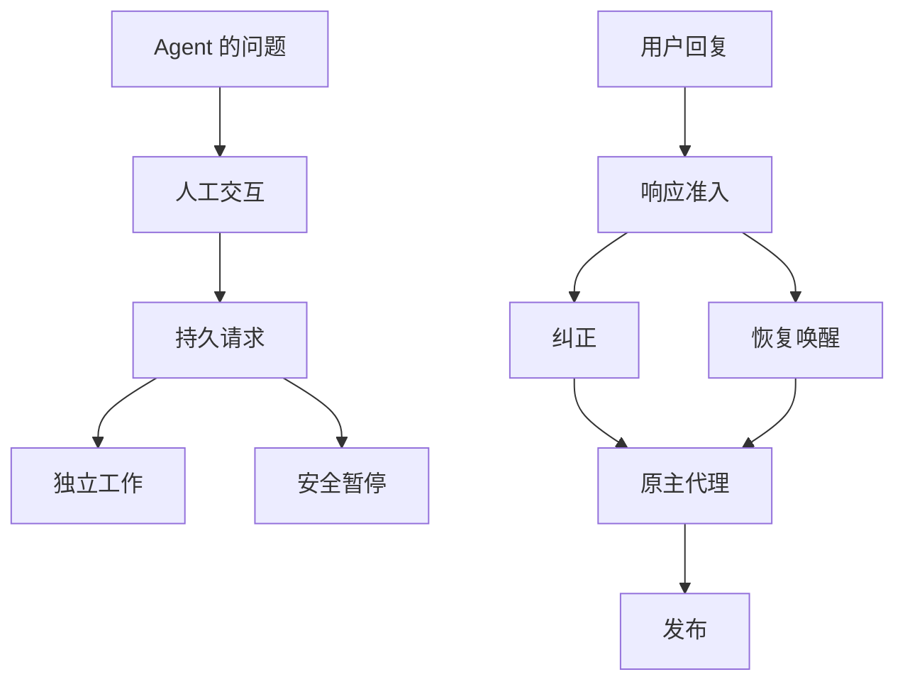

# Agent 问完用户之后：持久人机交互如何接回原研究

一份基金风险报告已经收集了披露资料，却还不知道该用哪个基准比较。Agent 向用户提问后，应该停下来，还是继续工作？

答案取决于接下来要做什么。整理基金费用、核对披露日期，不需要先知道基准；计算相对收益、给出相对风险判断，则需要。如果把整个任务都停住，会浪费可以并行推进的时间；如果一边问一边默认一个基准算下去，最后很可能返工，甚至把猜测写成结论。

**人机交互首先是依赖管理，其次才是消息收发：让不依赖答案的工作继续，让依赖答案的工作等待，并让回复回到原来的执行位置。** 本文沿这份研究任务，拆开模式选择、执行交接、回复采用和恢复。前半部分讨论 ETF Agent 的完整 HIO 机制，后半部分给出公开 Open ETF Agent 当前可采用的普通问答路径；两者范围不同。

<span id="二、问题发出去-不一定要让研究停下来"></span>

## 一、选择 blocking 之前，先拆开工作依赖

这里的 blocking / non-blocking 描述的是**原研究如何等待答案**，不是 HTTP 请求是否异步，也不是浏览器还能不能输入。两种模式都可以把问题持久保存，让用户关闭页面后再回来。

| 判断 | non-blocking：提问后继续 | blocking：请求等待 |
| --- | --- | --- |
| 还有什么可以做 | 有不依赖答案的合法工作 | 后续有价值的工作都依赖答案 |
| 原研究的动作 | 继续读取、计算或交付已有部分 | 部署启用且安全检查通过后停放原 Run |
| 用户回复怎样进入 | 经纠偏安全点进入后续 Main 请求 | 经恢复入口唤醒，再进入原任务 |
| 一直没有回复 | 可在明确缺口的前提下正常结束 | 受等待期限、Stop 和原任务预算约束 |

在基金报告里，缺比较基准时可以先查费率、规模和披露时间，把相对比较留空，这适合 non-blocking。如果用户要求的唯一产物就是“相对指定基准的超额收益”，而基准和区间都没有确定，继续调用模型并不会创造有效输入，这时 blocking 更合适。

一个重要区别是：**某一步必须等，不代表整个 Run 必须停。** 假如读取持仓明细还缺授权，持仓分析必须等待授权，但公开披露分析仍可继续。把问题标成 non-blocking，只是允许独立工作前进，不会让依赖它的读取或外部操作变得合法。

模式由模型结合任务语义选择，运行时不另加一个“这个问题够不够重要”的评分器。这样保留了模型规划工作的空间，也把责任说清楚：模型负责指出缺口、选择可推进的工作；确定性代码负责身份、权限、预算和安全停放。这段 HIO 路径不负责证明工作之间的语义依赖，因此“哪段工作确实不依赖答案”仍需要在规划与最终报告中保持一致。

non-blocking 默认更适合长研究，但它有代价。回复到达前，部分工作可能已经完成，后续只能基于新输入补充或修正，不能假装此前已使用答案。blocking 则减少这类返工，却增加等待延迟。选择依据应是错误假设的代价和可独立推进的工作量，而不是“异步一定更先进”。

## 二、一次提问怎样变成两条执行路径

两种模式共享同一个起点：Main 提交问题，Human Interaction Owner（HIO，人工交互模块）校验原请求并保存稳定身份，再返回接纳回执。回执说明问题已进入系统，而不是用户已经看见或回答。



图中的“独立工作”和“安全暂停”是不同选择；回复也按原 Run 的实际状态分别进入纠偏或恢复，不会同时启动两套 Main。

### non-blocking：保存问题，继续原循环

`ask_user` 返回稳定的交互引用后，Main 继续原来的模型与工具循环。用户还没有回答的可选问题，不会自动成为结束条件，也不会迫使系统额外调用模型等答案。报告可以先交付已确定的部分，并明确留下尚未完成的比较。

回复到达时，接收端先保存原文及关联，再把交接送入原 Correction（纠偏）安全点。非阻塞回答不会为此抢占并取消正在进行的独立读取。安全点的作用是让输入变化发生在可核对的执行边界：已经发出的请求不能被事后改写，尚未派发的旧提案可以按原纠偏规则被替代；下一次合法的 Main 请求才带上新回答。这样，“用户改了条件”有明确生效位置，而不是后台悄悄换掉正在执行的参数。

这里有过一个很具体的反例。在真实浏览器、认证服务和 PostgreSQL 配合脚本网关的受控验收中，用户回答非阻塞问题时，通用纠偏逻辑却取消了正在进行的资料读取。读取留下未结算调用，原任务以 partial 结束，答案也没被采用。修复不是取消纠偏，而是根据原问题与回复的精确绑定，只暂缓“抢占独立读取”这一效果，让读取先结算，再由 Main 安全点采用。普通的即时纠偏仍可中断读取。**补充一个答案和要求立即改道，不能共用一个含糊的“继续”信号。**

### blocking：先证明可停，再让出执行资源

模型写出 `blocking`，只是请求等待。真正停放前，Recovery 要能回答几件事：

- 最新 Main 请求是否已结算，恢复游标是否指向同一份封存输入？
- 已交付正文是否已持久保存，工具和 Hook 是否还有未结算的效果？
- Child 是否已结束，或已安静地停在可恢复的 partial 检查点？
- 当前取消状态、期限、lease 与 fence 是否仍允许这次交接？

通过这些检查后，原 Run 才进入非终态的 Human Park，释放允许释放的执行资源。它保留任务身份、已提交结果、检查点和预算；不触发正常完成 Hook，也不为等待再创建一个 Run。若还有一个 Child 请求在途或某项效果结果未知，就不能仅凭模型说“我要等用户”把它包装成安全暂停。

一个 Root 最多一个实际 Human Park，可以有多个有界的非阻塞交互。等待截止取问题有效期、剩余累计人工等待额度和用户硬截止中的最早值。重启和再次提问不会补满额度，收到回答后等待执行容量的时间，也不能继续计作人工等待来抵扣。自动执行的 Scheduled Task 不进入人工等待，缺少必要输入时保留可完成的研究或拒绝依赖它的操作。

完整 HIO 的安全停放已有实现和受控恢复验证，但生产 Human Park 默认关闭。对接产品时，需要分别确认“问题可以接纳”和“部署允许实际停放”，不能从一个 blocking 回执推断后者已经启用。

<span id="一、先分清四个时点"></span>
<span id="三、用户回答哪一个问题-由身份决定"></span>

## 三、持久化的重点，是回答与原任务之间的因果关系

页面上的聊天记录能保存文字，却不一定保存“这句话回答了哪个请求、下一步该交给谁”。用户可能同时打开两个研究任务，也可能从全局待办回复旧问题。靠最新消息或相似措辞匹配，无法承担这种交接。

请求需要绑定原 producer/action、Root Run、会话、接收人、类型、版本与有效期。回复则携带精确的请求身份、认证主体、稳定的 response ID 和原始内容。前端负责选择要回答的原问题，服务端负责验证绑定；模型不需要再猜一遍“这句话大概是在回答谁”。

持久状态至少要区分四个事实：

| 事实 | 它允许系统作出的判断 |
| --- | --- |
| Request accepted | 原问题已保存，可以重新展示与查询 |
| Response received | 原回答已保存，重复提交可以返回同一回执 |
| Response adopted | 原消费者已把回答纳入自己的执行交接 |
| Effect committed | 获批的具体业务效果已有执行结果 |

“采用”的证明必须落到消费者。完整 HIO 的运行中问答，要能关联实际 Main 请求中的纠偏输入；公开普通问答路径，则先把回复提交为原 `ask_response` 的工具结果检查点。两者都不能仅凭 HTTP 返回成功就显示“研究已继续”，也不能把模型读到答案等同于模型理解正确。

这种拆分直接解决重试问题。若回复已保存但网络确认丢失，客户端使用同一 response ID 和相同正文重试，应读回原回执；同 ID 改了正文，则是冲突。系统不需要再问一次，也不能生成两次采用。用户原文保存在原会话或 Session 中，交互模块保存关联与交接凭据，不复制一套模型上下文和运行账本。

前端还必须保存“这一次提交”的结果，而不只是轮询任务状态。同一套受控浏览器验收把两份不同答案同时提交，后端正确返回一份 202、一份 409，并只保存一条回复；失败方的界面却在轮询后把冲突提示刷没了。详情读取失败时，还可能换一个 response ID 再发。修复后，前端先冻结原提交身份、保留冲突，再核对服务端已收答案，刷新不能把冲突改回“可以重新发送”。这说明后台只收一次，和用户知道到底收了哪一次，是两个都要验收的目标。

原始字节在这里有实际意义。恢复受保护命令时，数据库里重新序列化出的 JSON 可以“含义相同”，却未必是用户审阅的那份输入。审批要对照原 sealed preview 的精确身份，而不是拿新拼出的等价对象替代。这项约束应留在真正需要它的命令与效果边界，不必让每个普通问题都承担整套审批协议。

<span id="四、难点常在最后一跳-收到-不等于真的采用"></span>
<span id="六、三种容易混淆的失败"></span>

## 四、恢复时先看原 Run 状态，再决定把回复送到哪里

回复接纳和恢复执行应分开。用户能提交答案，并不要求系统此刻已有模型执行名额。保存完成后，调度端再根据原 Run 的真实状态选择路径。

### 原 Run 仍在运行：送入下一次安全点

继续使用原 Correction 路径，不另起一个并发 Main。下一次实际模型输入要包含原回答，并关联对应的采用回执。此时最值得检查的不是页面显示了什么，而是新输入是否真的进入目标请求。

### 原 Run 已停放：取得执行权，再恢复原检查点

Wake 需要重新取得原类别的执行容量和唯一 lease。假如另一个任务已经占用了释放的名额，回答继续保留在“已收到，等待继续”，不能抢占或偷偷超额执行。

取得执行权后，恢复的是最近一个合法的 Main 检查点，而非原进程的内存栈。旧游标即使格式合法，也可能指向回答到达之前的请求；后来产生的 Child 回执，也不能遮住真正的最新 Main 身份。因此恢复必须一起核对 request、seal、cursor 和已提交正文，防止从旧条件重新派发。

<span id="_2026-10-26-·-hio-与-runtime-规则收口"></span>

如果问题来自 Child，交接还多一跳。Main 可以先处理用户答案，但只有显式选择恢复原 Child，完整原文才会沿原问题关联进入 Child 自己的输入。Main 的转述不能冒充用户原话。当回复到达与原 Child 不携带证据或产物引用的 partial 交接相遇时，Child/HIO 共同核对原请求、响应和阶段；Memory 与 PostgreSQL Store 在各自受保护的提交边界内消费同一规划，并重验执行权，避免两套存储得出不同的接纳结果。

另外，Human Park 的安全检查允许已经结算、可恢复的 Child partial 随 Root 一起停放，却不会自动唤醒 Child。Main 仍可决定不再需要它；已取消或终结的 Child 也不会因旧回复变回活动状态。

### 原 Run 已终结：保存回答，重新取得继续意图

终态不能当作一种更长的暂停。完整 HIO 对符合原续研条件的普通问题，会要求用户明确“继续分析”，再由 Continue 创建关联的新 Run；已有报告仍属于原运行。已经采用的回复不能再次触发续研，过期的权限或审批也不能借这个入口复活。公开 v0.21 普通问答尚不支持终态续跑。

三条路径共同守住一个边界：**已知停在哪里，才能从那里继续；不知道某次请求或效果是否已经执行，就先保留未知状态。** 比如回复已经采用，但下一次模型请求派发后失去结果，保存着回复也不意味着可以再发一次。恢复要先核对原请求结果，而不是用新的 Run 掩盖不确定性。

<span id="五、把询问、审批与权限申请分开"></span>

## 五、等待模式与授权类型，是两个不同的维度

blocking / non-blocking 决定普通问答期间怎样安排工作；普通问答、权限申请、动作审批决定用户的回答能改变什么。权限与审批按各自合同阻挡相关效果，并不因此支持任意等待模式组合。将两者混在一起，最常见的后果是把“这个问题不阻塞研究”误解成“这个动作不需要批准”。

| 交互 | 用户决定的对象 | 生效位置 |
| --- | --- | --- |
| 普通问答 | 研究条件，例如比较基准 | 原 Main 或 Child 的输入 |
| Permission Request | 可追加的访问范围 | 原 Authorization 的 Run grant |
| Effect Approval | 一次具体操作及其最终参数 | 原 Effect 的确认与执行链 |

以持仓研究为例，“请使用沪深300”改变分析条件；“允许本次研究读取持仓明细”改变可访问范围；“确认执行预览中的外部操作”批准的是一项已确定的动作。获得读取能力，不等于相关外部动作也已获批；批准一个动作，也不会顺带授予以后任意访问或执行的能力。

当前完整 HIO 的权限申请入口是 `request_research_scopes`，实际可申请的持仓投影限于 `anonymized_holdings_summary` 和 `portfolio_details`。Authorization 先给出合法可申请范围，用户确认后再核对当前政策、路由与上限，最后追加原 Run grant。它不是任意文件或任意系统权限申请器，普通聊天里的“可以”也不是该类型化确认。

Effect Approval 绑定的则是原 Action、最终参数摘要、预览和版本。参数、接收对象或预览发生实质变化，就需要针对新动作重新提案。用户批准后，原 Effect 模块仍要记录实际执行结果；若外部请求已发送却结果未知，再点一次批准不能使重放变得安全。

因此，统一 HIO 值得复用的是请求身份、待办展示、回复接纳和交接。授权与效果的判断留在各自负责的模块，才能在研究继续推进的同时，让未获准的那一步确实停住。

<span id="公开提炼-先让一个普通回复回到原调用"></span>

## 六、公开实现怎样采用：从一个顺序问答闭环开始

Open ETF Agent 没有把完整 HIO 全部搬到公开版。[v0.13 的固定实现](https://github.com/hpoenixf/open-etf-agent/tree/300f78f7066ab76fcc4e9efb54137ff021ecc278)先建立单问题的持久接纳与原调用采用；[v0.21 的固定公开源码](https://github.com/hpoenixf/open-etf-agent/tree/427315b5554b1c9af8fa50b8ab622747045e691a)把它接入本地研究项目，支持有上限的顺序问答。

这里的“固定公开源码”表示可读回的候选实现及其限定测评；最终发布包的原 CI 和正式 tag/Release 仍需另行核验，不能把源码提交等同于正式发布。

这条实现对应 blocking 一侧：`ask_response` 保存问题并让出 Worker，用户回答后再显式执行同一个任务。它适合先把“找得到问题、答得上原问题、恢复后确实用到答案”做完整；没有后台独立工作要并行时，不必先建非阻塞纠偏和跨会话收件箱。

按[固定项目指南](https://github.com/hpoenixf/open-etf-agent/blob/427315b5554b1c9af8fa50b8ab622747045e691a/docs/research-project.zh-CN.md)建立项目、导入选定资料并完成提供方、数据与费用批准。在项目配置中保留 `report`、启用 `response`，再显式设置：

```json
"interaction": {"schemaVersion":"human-interaction@1","maxQuestions":3}
```

上限可设为 1–8；没有 interaction 配置的旧项目继续原单问题合同。配置更新只影响未来任务。任务运行到问题后，沿[普通问答入口](https://github.com/hpoenixf/open-etf-agent/blob/427315b5554b1c9af8fa50b8ab622747045e691a/docs/human-interaction.zh-CN.md)操作：

```bash
node dist/src/research-cli.mjs interaction list --project PROJECT
node dist/src/research-cli.mjs interaction inspect --project PROJECT --run TASK --question-id QUESTION
node dist/src/research-cli.mjs run respond --project PROJECT --run TASK --question-id QUESTION --response-id RESPONSE --text ANSWER_FILE
node dist/src/research-cli.mjs run work --project PROJECT --run TASK
node dist/src/research-cli.mjs run report --project PROJECT --run TASK
```

`TASK`、`QUESTION` 使用 list/inspect 返回的原标识；`ANSWER_FILE` 是保存回答的文本文件。查询和接纳回答都不调用模型。`respond` 得到 `received-not-adopted` 后，原 Run 的 `work` 才提交工具结果检查点；前一回答已采用、问题配额和原模型/工具预算仍允许时，才可以提出下一问。报告沿原文件交付路径取回。

这一接收、采用、再提问的顺序由[交互合同代码](https://github.com/hpoenixf/open-etf-agent/blob/427315b5554b1c9af8fa50b8ab622747045e691a/src/human-interaction.mjs)核对，等待仍占用原任务期限。恢复时保留完整项目目录，并继续原任务，而不是重新提交一个替代任务。日常使用从[当前 main README](https://github.com/hpoenixf/open-etf-agent/blob/main/README.md)进入，旧任务留在其兼容版本完成。

这条公开路径已有真实模型配合合成资料的执行记录。固定 v0.21 测评里，十个自然任务留下了十二次问题接收/采用与十份可冷读报告，说明顺序多问不再只有脚本网关演示。但这证明的是当次交接和报告读回，并不证明模型总能正确理解用户偏好：其中一题未能召回既有的英文格式偏好。其中一次模型自行推断了资料版本的适用日期，最后按用户明确选择的版本继续并保留日期不确定性。它说明交接正确和理解正确仍是两件事：Runtime 能保证原答案回到原调用，研究结论仍要核对答案的具体含义。[固定执行证据](https://github.com/hpoenixf/open-etf-agent/blob/427315b5554b1c9af8fa50b8ab622747045e691a/docs/verification/v021-release.zh-CN.md)保留了这项观察。

采用时应把范围看清：这是本地单用户的普通顺序问答，不提供非阻塞插话、Child 定向咨询、追加权限或外部效果审批。需要这些能力时，前文的身份、消费者和恢复分工可以作为设计依据，不能把一个 `response` 开关当作完整平台。


<details>
<summary>追溯最小协议：在固定 v0.13 复现一次回复的接收与采用</summary>

要单独观察“先收到，后采用”，可按 [v0.13 README](https://github.com/hpoenixf/open-etf-agent/blob/300f78f7066ab76fcc4e9efb54137ff021ecc278/README.zh-CN.md)安装该固定版，使用 Node 26.8.1–26.x 和一个新的本地目录。下面调用的是[该版本原 CLI](https://github.com/hpoenixf/open-etf-agent/blob/300f78f7066ab76fcc4e9efb54137ff021ecc278/src/session-cli.mjs)，不是上面的项目命令：

```bash
npm run session -- start --session runs/article-reply --case durable-response
# 用 start 输出的原 runId 和 questionId 替换占位符
npm run session -- question --session runs/article-reply --run RUN_ID --question QUESTION_ID
npm run session -- respond --session runs/article-reply --run RUN_ID --question QUESTION_ID --response reply-1 --text 'Synthetic label: blue'
npm run session -- resume --session runs/article-reply --run RUN_ID
npm run session -- response-status --session runs/article-reply --run RUN_ID
```

这是脚本网关的单问题路径：`respond` 保存原文并得到 `received-not-adopted`，`resume` 才把它提交为原调用的工具结果。请在原有 300 秒期限内完成；等待不续期，回复不授予权限。它用于观察持久交接，当前项目使用仍以上面的 v0.21 入口为准。

</details>

<span id="结果与当前边界"></span>

## 结语：该停的是依赖答案的工作，应该保留的是执行依据

回到那份基金报告：基准未定时，公开资料仍可整理；相对比较要等待；回答到达后，只有原任务的后续输入采用了它，比较才真正按新条件开始。若整个任务已经没有独立工作，就让原 Run 安全停放，而不是占着模型循环空转。

设计下一次人机交互时，可以先回答四个问题：现在还有哪些合法工作不依赖答案？谁有权决定真正停放？回答最终由哪个消费者采用？进程重启后，凭哪份持久事实从哪里继续？这四个问题明确了，弹窗、收件箱和状态卡才有可靠的内容可展示。

## 延伸阅读

[前台与后台研究的并行体验](https://hpoenixf.com/eff-agent-article/articles/agent-background-research-collaborative-experience)讨论用户如何在长研究期间继续聊天；[异步研究按时交付](https://hpoenixf.com/eff-agent-article/articles/agent-asynchronous-research-time-bound-delivery)讨论时间承诺与保存的结果。它们与本文的人机交接可以协作，但不替代回答的精确关联和采用。

更多机制案例收录于 [ETF Agent Engineering Notes](https://github.com/hpoenixf/eff-agent-article)。欢迎 Star 公开技术文集。
