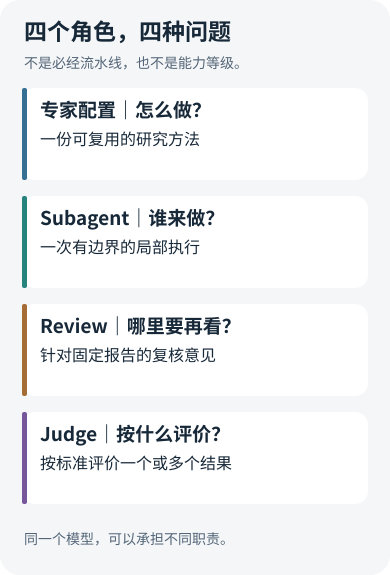
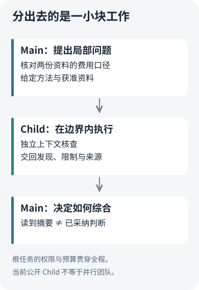
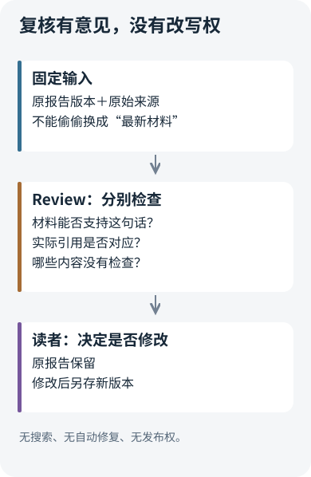

# 专家、Subagent、Review、Judge：都是另一个模型，为什么不是同一回事？

<LearningPathNav />

一份基金研究报告写完后，我们想请“另一个模型”再看一眼。它应该叫专家、Subagent、Reviewer，还是 Judge？

这些名字似乎都意味着多发一次请求。但如果只按模型数量设计系统，很快就会遇到实际问题：这次调用要拿到哪些资料？它能改报告吗？它的意见是否等于评分？它失败了，原报告还应不应该显示？

**模型是执行手段，角色由任务、输入、产物和决定权共同定义。** 同一个模型可以承担不同角色；不同模型也可能重复同一种工作。先把角色说清楚，才知道为什么值得增加一次调用。

## 一、四个词，其实在回答不同的问题

先用一个教学场景贯穿全文：主 Agent 要比较两只基金的费用，生成一份有来源的说明。资料里既有年度费用率，也有假设投资金额下的示例成本。两种数字看起来相关，却不能随意混用。

围绕这件事，四个角色各有一个问题：

- **专家配置：按什么方法做？** 例如先核对份额类别、费率时点与费用范围，再解释差别。
- **Subagent：把哪一小块工作交出去？** 例如让一个独立执行单元只读两份已授权资料，核对费用口径。
- **Review：这份已经写出的报告哪里需要再看？** 例如报告把示例成本当成了年度费用率，引用是否支持这句话？
- **Judge：按什么标准评价结果？** 例如在一批固定题目里，哪套配置更少出现口径错误，代价又是多少？

图中的 Judge 可以逐条评分；“跨样本”是我们使用它回答版本效果问题的场景，不是这个词的普遍定义。现实框架常把配置、执行与角色包装在一个对象里。本文拆开它们，是为了看清责任，而不是要求所有项目采用同一套命名。

## 二、专家先是一份方法，再谈由谁执行

“你是一位资深基金专家”可以是提示词，但它没有说清研究怎样展开。更有用的配置会规定：先识别什么，哪些数据不能直接比较，遇到缺证据怎样表达，以及最终需要交回哪些依据。

例如，这份教学用的方法卡只关注费用口径：

> 先列出份额类别与生效日期；区分持续费用、交易费用和示例成本。只在口径一致时比较，不能把不同假设下的金额直接换算成年费率。

它可以交给主 Agent，也可以交给子 Agent。**方法可复用，不意味着必须新增执行体。** 对一道简单问题，把这几条要求放进现有提示词，通常比增加调度更直接。

Open ETF Agent 的项目专家配置把方法管理做成了显式步骤：操作者维护配置，任务提交时选择具体修订，随后冻结到任务中。配置后来被修改，不应让一项已开始的研究中途换方法。这里解决的是“这次研究究竟采用了哪版方法”，而不是给模型颁发新的身份或权限。

项目从早期的有界 Child 执行走到专家目录，沿用的是原执行机制：配置选择已有的受限方法，不再另起一个预算和权限系统。主 Agent 可以在冻结的方法集合中选择，也可以不选择；预设列表不是强制逐个运行的流水线。[公开配置合同](https://github.com/hpoenixf/open-etf-agent/blob/v0.28.0/docs/v027-specialist-profiles.zh-CN.md)保留了这一区分。

因此，排查“专家没起作用”时，第一步不是增加专家数量，而是分别确认：配置有没有进入任务、方法是否被选中、执行是否发生。

## 三、Subagent 的价值，在于把工作边界切出来

假设费用资料很长，主 Agent 还要综合其他研究。我们可以把“核对两份资料的费用口径”交给一个 Subagent，简称子 Agent。

它得到的输入应是一个小问题、必要资料和明确方法，而不是一份含糊的“帮我研究一下”。它交回的是局部结论与原始来源，主 Agent 再决定怎样用于最终报告。这样，执行分工和结论综合便分开了。

Open 的有界 Child 为这项工作保留独立上下文和执行身份，但仍受原任务的资料授权、次数与时间约束。方法不能借一段提示词替自己增加工具。Child 的摘要也是派生结果，不能因为换了一个模型说出来，就升级成原始证据。

这张图还解释了一个常见误解：**上下文独立，不等于判断完全独立。** 如果主 Agent 把“费用一定是差异原因”连同问题一起交过去，Child 可能只是为这个猜想补充理由。公开实现中的独立取证方法会把 Main 的局部解释从 Child 的任务文本中排除，但它仍使用指定材料和方法，仍可能与 Main 共享模型偏差。

Claude Code 的[自定义 Subagent 文档](https://code.claude.com/docs/en/sub-agents)也把独立上下文、专用提示和工具访问作为重要配置。与之相比，Open 当前公开 Child 更窄：沿已准入方法依次完成局部核查，不是通用的并行后台团队。两种范围适合不同目标，不能把它们都画成“多个模型同时研究”就算解释了机制。

如果资料少、问题短、几乎没有可分离的子任务，委派还会增加传递、等待与综合成本。保留一个主 Agent 不是退步，而是省掉不必要的交接。

## 四、Review 检查已写出的东西，不替它取得发布权

报告里出现一句：“基金 A 的费用更低，所以它在这段时间的回报更高。”这句话值得复核，因为费率差异和收益差异同时存在，并不自动建立因果关系。

此时需要的不是再做一份同题报告，而是固定原报告的版本，连同它使用的来源，提出一个针对性问题：**这句话受到什么材料支持，引用又是否真的指向那些材料？**

Open 0.28 的报告 Review 沿这条思路设计：接收一份固定的 Markdown 报告及来源文本，单独产生复核意见。它没有搜索或编辑工具，不自动改报告，也不负责发布。输出保留原文位置、引用摘录、判断理由和未检查范围。报告有修订时，应知道检查的是哪个版本，不能把旧意见无条件搬到新正文上。

这里有两个必须分开的判断：

1. **材料支持**：现有材料能不能支撑这句话？
2. **引用对应**：这句话实际标注的来源，是否支撑它？

即使另一份材料能证明该事实，错误的引用仍然需要修正。反过来，引用摘录真实存在，也不代表它足以推出报告里的判断。

这个结构付出的代价是覆盖范围有限：Review 只能检查收到的材料，不能替读者补齐全网资料，也不复核未提供的二进制附件。程序可以核验原文位置和摘录确实存在，却不能据此保证模型的语义判断正确。默认的离线演示只展示生命周期，不是一次真实语义复核；实际使用应按[复核合同](https://github.com/hpoenixf/open-etf-agent/blob/v0.28.0/docs/report-review.md)配置模型入口。

Anthropic 在 [Building effective agents](https://www.anthropic.com/research/building-effective-agents) 中分别介绍了 orchestrator-workers 和 evaluator-optimizer：前者分工完成任务，后者通过评价反馈改进输出。Open 这里选择的是更克制的后置复核，没有把反馈自动接成修改循环。对需要读者保留判断权的报告，这种分离更容易看清发生了什么；若目标是自动修稿，则还需要明确修改范围、终止条件与版本保存，不能靠多写一句“请修好”补齐。

## 五、Judge 回答的是评价问题，不是事实来源

单份 Review 发现了两处问题，并不能回答“新版本是否更好”。旧版本也许有三处，也许只是写得短，或者两份答案使用的材料不同。

要做比较，Judge 必须得到明确的评价对象与规则。可以先逐主张核对来源、时点和口径，再评价必要内容是否齐全、表达是否容易使用。程序能直接算出的数值关系应先计算；需要理解语义的部分，再交给模型或人工。

同一个模型可以做 Review，也可以做 Judge。差别在于合同：前者帮助处理这份报告，后者按既定标准产生可比较的评价。评分可以服务一次选择，也可以汇总多个样本，但不能代替原始资料。

裁判同样会犯错。[MT-Bench 与 Chatbot Arena 的原始论文](https://arxiv.org/abs/2306.05685)讨论了位置偏差、偏好冗长和自我偏好等问题。应用到工程评测中，就不能把答案更长、调用更多或平均分更高直接当作改进；应固定题目、来源、模型条件和资源口径，检查顺序影响，并抽查判断理由。具体评测流水线可继续阅读[测评全景](https://hpoenixf.com/eff-agent-article/articles/honest-agent-evaluation)，这里不把私有测评系统当作公开版自带功能。

## 六、别先凑齐角色，先找缺口

面对一份不可靠的报告，可以用四个问题定位下一步：

- **研究方法不稳定？** 先整理专家配置，未必需要增加执行体。
- **局部工作太多、上下文互相干扰？** 再考虑有界的 Subagent 分工。
- **已有一份具体报告需要核查？** 对固定版本做 Review。
- **想判断两套方案谁更值得采用？** 才进入可比实验与 Judge 评价。

这不是升级阶梯。简单任务不需要把四种角色全部启动；一套复杂系统也可能用子 Agent 来执行复核，让它同时具有执行身份与复核职责。组合没有问题，混淆决定权才有问题。

最值得保留的边界是：**专家配置不能授予权限，子 Agent 的摘要不能取代来源，Review 的意见不能悄悄改写原报告，Judge 的分数不能替代用户任务的成败。** 把这些边界说清楚，再多一个模型才是在增加一种能力，而不是再增加一种叫法。

想把这张概念地图变成一次操作，可以接着读[练手篇续篇](open-etf-agent-report-review-workshop.md)；要理解执行怎样跨时间延续，则看[任务、会话、Run、Worker 与 Schedule](agent-task-session-run-worker-schedule.md)。

<!-- introductory-series-links:start -->

## 入门系列：按顺序继续

上一篇：[把自己的资料交给 Agent：从第一份报告到可恢复的研究项目](open-etf-agent-research-project-workshop.md)。

下一篇：[报告写完以后：让 Agent 查证、协作，再独立复核](open-etf-agent-report-review-workshop.md)。

<!-- introductory-series-links:end -->
