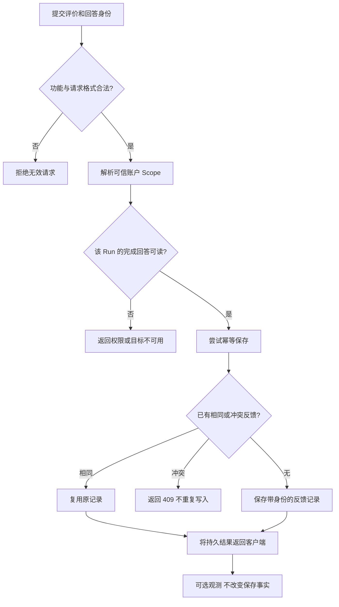

# 用户点了踩，Agent 就该学习吗？从反馈幂等到可信改进信号

一个研究 Agent 交付了基金比较，用户点了“缺少依据”。页面显示“已记录”，看起来这件事已经结束。可当用户刷新会话，按钮又回到未评价状态；切换到另一段回答，还可能读到上一段异步请求留下的状态。

另一种更隐蔽的风险是：系统真的存下了这个“踩”，却把它当成回答不可靠的确定结论，甚至自动写入长期记忆、触发交易限制或改变之后的研究判断。

**用户反馈首先是一条有归属、可回读的评价事实，不是模型质量判决，更不是一次自动训练。** 把这层做对，才谈得上后续评测、复盘和改进。

## 一、一个“踩”究竟评价哪一条回答？

不能只存 `rating = down`。同一个会话里可能有多个 Run，一个 Run 可能经过预览、修订和最终回答；用户真正评价的是某条已完成的助手消息，而不是“今天这个会话总体不好”。

当前反馈合同以五项关键输入描述一条用户动作：

| 字段 | 说明 | 谁拥有最终事实 |
| --- | --- | --- |
| `clientFeedbackId` | 客户端为提交生成的逻辑幂等 ID | 请求提交者 |
| `runId` | 这条回答实际所属的 Run | 原会话运行/存储 |
| `assistantMessageId` | 被评价的已完成助手消息 | 原会话存储 |
| `rating` | `up` 或 `down` | 用户的评价动作 |
| `reason` | 有限枚举，如 `not-grounded`、`incorrect`、`incomplete` | 用户选择，服务端校验 |

`scopeId` 不允许普通浏览器自行挑选：服务端从已验证身份与 Scope 解析得到它，确认这条 `runId + assistantMessageId` 在当前 Scope 下可读，才接受反馈。

一个简化请求如下，全部 ID 均为示例：

```json
{
  "clientFeedbackId": "fb-demo-001",
  "runId": "run-demo-017",
  "assistantMessageId": "answer-demo-017",
  "rating": "down",
  "reason": "not-grounded"
}
```

服务端持久化的是这些有限字段以及服务端时间和记录身份，不会把整篇回答正文或原始用户问题复制进反馈元数据。**“缺少依据”是用户选择的原因码，而不是系统已经证明这份回答缺乏证据。**

## 二、提交前，先证明这条回答确实存在且属于当前用户

反馈不是让模型直接解释的一句自然语言。写入路径包含几层确定性判断：



具体拒绝范围很重要：请求字段错误是 400，Scope 无法接纳是 403，目标回答在当前身份下不可用是 404，同一回答已经存在不一致评价则是 409。不能把“跨账户不可读”伪装成“目前没有评价”，也不能因为观测服务异常撤销已经写入的反馈。

现行 PostgreSQL 写入采用数据库唯一约束以及 `INSERT ... ON CONFLICT DO NOTHING` 的竞争收敛；如果提交时发现冲突，会回读原记录并比较是否相同。它不只靠页面按钮防止重复点击。

这里的“相同”要求回答身份、Run、评价和原因一致。重试同一份反馈可以复用已有结果；不同请求争抢同一条回答且内容矛盾，不能默默选最后一条覆盖第一次评价。

## 三、为什么“提交成功”和“刷新后还能看到”是两个独立问题

用户点击时，前端容易做一个乐观本地状态：请求成功，设置 `submitted = up/down`，把按钮禁用。这能解释点击后的 UI，却不能解释刷新、关闭或重新打开会话之后，究竟显示什么。

2026 年 10 月 27 日的开发记录里，一条组件 RED 测试明确重现：**反馈已经存在，但重新挂载控件时未显示“已记录”。** 根因方向很清楚——组件内部的临时状态不是持久反馈的读取结果。

相应的局部修复让控件按 `runId + assistantMessageId` 精确查询已保存记录，并区分三种状态：

| 读回结果 | 页面应该如何做 |
| --- | --- |
| 合法回应，`records: []` | 当前回答尚无记录，可以允许提交 |
| 合法回应，存在匹配的记录 | 显示已记录，并防止再次修改 |
| 网络/权限/结构读取失败 | 显示暂时不可读取，**不要**当作“无记录”开放重复提交 |

同时，切换回答或会话时，要丢弃上一目标的迟到响应。例如用户先打开 A，读取尚未返回时切到 B。A 的旧 `up` 不能盖到 B 的按钮上；这需要请求取消和目标身份校验，不是简单地多加一个 Loading。

有一个必须坦白的当前限制：已检查的 `FeedbackPanel` 实现是从当前 Conversation 中寻找**最近一个已完成的 Run/助手消息**，而不是自动支持历史里任意被点击的一条消息。因此“控件的精确反馈读回”与“用户在历史里任选一条回答评价”仍是两个不同的交付范围，不能凭局部测试说后者已经完成。

## 四、三个失败分支，决定反馈是否值得信任

**案例 A：网络超时后用户重试同一份评价。** 如果沿用同一逻辑 `clientFeedbackId`、对应回答和评价内容，重复请求不应新增第二条评价。一次真正保存成功但 HTTP 回执丢失，不等于应再次计数。当前界面新点击会产生自己的提交 ID；网络层自动重试必须保持原意图身份，这属于调用方需要遵守的幂等约定。

**案例 B：同一回答先被评价“正确”，稍后又发送“缺少依据”。** 现行一回答一评价的规则不会把后一个值直接覆盖前一个值；同一目标提交不同内容属于冲突。这意味着现在不是“允许任意修改评分”的完整编辑产品。若未来要支持撤回或更正，需要独立定义可见修订历史，而不是放宽当前唯一约束。

**案例 C：跨 Scope 查询另一位用户的完成回答。** 10 月 27 日定向 RED/GREEN 证据曾记录精确读取错误地返回 200，而期望的是拒绝不可读目标；局部修复后，相关 HTTP 选定测试通过。这个问题不是评价统计是否准确，而是反馈读回会不会泄露另一位用户与回答的关联。身份校验必须先于读取反馈记录。

另一个常见误判是“读取失败=没人投票”。这不仅会误导界面，还可能使用户再次尝试产生冲突；区别不可用与不存在，本身就是反馈产品的一部分。

## 五、为什么真实用户反馈也不能自动升级为“模型学会了”

`up/down` 对产品很有用：它能提示优先排查的样本，以及用户认为不足的方向。但它不自带可靠标签。

例如一份基金回答被点了 `incorrect`：用户可能反对结论，可能发现日期使用有误，也可能是因为问题本身没有提供足够信息。单条反馈不足以确认真实 NAV、模型推理错误、证据采集故障中的哪一项需要修复。

合理的后续处理是把评价作为**候选观察**：在另一个得到授权的调查流程中关联原回答与可验证依据、分类根因、构造评测样本，并复核修复是否真的改善同类问题。它不是 A40 反馈事实自动拥有的权力。

当前反馈写入**不会**直接改写已发布正文，不会自动保存长期 Memory，也不授予投资执行或风险策略操作。观测系统可以记录有限事件，但观测失败不应该改变持久写入结果。不要把“用户点击了踩 → 下一次模型接受了反馈 → 研究质量提高”写成一条未经验证的闭环。

## 六、这次的工程证据支持到哪一步

截至 2026 年 10 月 27 日，已有反馈写入与幂等仓储、Scope 下的完成回答校验、精确读取接口和对应 Web 控件。进行中的反馈 Spec 记录了一个组件 RED，以及后续同一开发窗口中 Web 重开、迟到响应、目标切换和 HTTP 身份读取的**定向 GREEN**。

但这批证据有明确范围：一部分结果来自尚未完整收尾的工作树；跨文件较大测试选集另有一项不属于反馈的 Publication History 失败。隔离 PostgreSQL 新连接读回、真实浏览器完整提交→重开、temporary/删除生命周期与正式验收尚未被这份记录证明。

因此本文介绍的是**已存在的基础合同与正在验证的准确读回改进**，不是宣布真实用户反馈闭环或模型自学习能力已经生产可用。尤其不能把局部 Web 测试的通过写成用户效果显著改善。

## 结语

用户给 Agent 点一个踩，最容易实现的是一枚会变色的按钮；真正困难的是让它始终回答三个问题：**谁评价了哪条回答、这条记录是否只被保存一次、下一次读回是否仍属于原来的用户和回答。**

只有这些基础事实稳定，反馈才可能成为后续调查的可靠入口。工程实践中应先把“读取失败”和“没有反馈”分开，再考虑评分聚合和自动优化；没有身份、幂等和可回读证据的“学习系统”，很容易只是另一套制造误判的机制。

## 延伸阅读与交流

[失败诊断与反馈归因](agent-failure-is-a-boundary-problem.md)讨论如何确认最后一个真实阻塞点， [测试与真实评测](honest-agent-evaluation.md)讨论验证强度与用户效果；本文仅处理 A40 中“用户评价事实如何准确保存与重开读取”的独立问题。

更多实作与设计取舍见 [ETF Agent Engineering Notes](https://github.com/hpoenixf/eff-agent-article)；欢迎 Star 支持后续分享。
