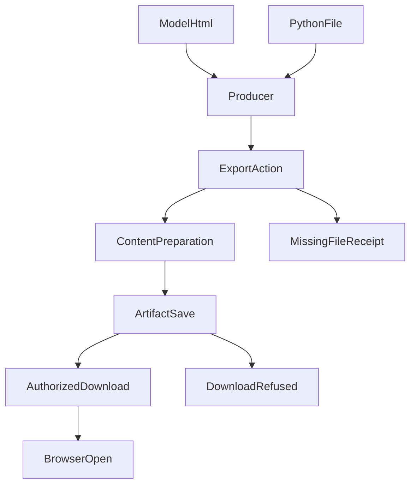
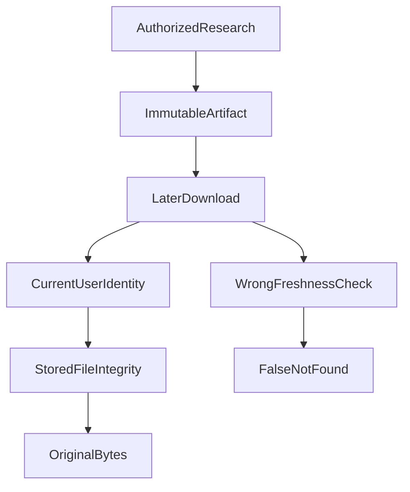
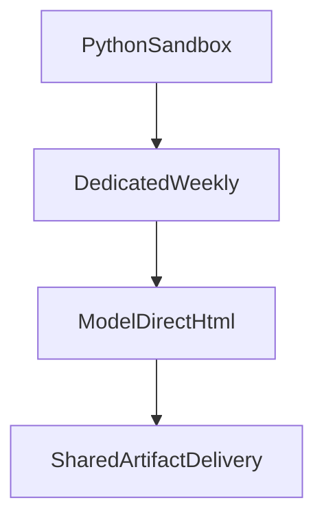

# HTML 都保存了，为什么还是交付失败？一次 Agent 报告系统的架构反转

> 从隔离 Python、专用周报生成器，到模型直写 HTML 与统一 Artifact：真正难的不是排版，而是让一次跨越模型、执行器、来源、存储和权限的操作，最终变成用户手里**确实存在、确实能打开的文件**。

我们一度以为 HTML 报告只差最后一步。

一次真实研究任务里，Python 脚本执行了 **33 次**，其中 **9 次计算成功、4 次完成渲染**，最后却**没有成功导出文件**。另一次真实运行更离谱：Agent 已经保存了 **5 个 HTML Artifact**，最终回答也给出了文件链接，但 **5 次 HTTP 下载全部返回 404**。

前者不是 Python 不会生成 HTML，后者也不是文件不存在。**每一层都能证明自己“做完了”，系统整体却没有完成用户的任务。**

这才是我们花了十多天搭这套机制，最后又主动删除专用周报生成器的原因。

## 一、第一道难题：谁说了“成功”，究竟成功了什么？

一开始，我们把能力拆成两步：模型调用隔离 Python 计算和写文件，再显式调用导出工具。这样做有必要——工作区文件是临时产物，不应因为代码执行过，就自动变成用户的附件。

但实际运行暴露了更深的问题：**模型看到“我生成了 HTML”，并不意味着 Host 已保存它；Host 保存了文件，也不意味着浏览器能拿到它。**



这条链上至少有六种不同的事实：内容已写出、工具调用已结束、导出已接受、文件已提交、当前用户获准读取、实际下载字节与原文件一致。少任意一环，都不能向用户宣布“报告交付成功”。

甚至 CLI 退出码为 0，也曾对应一个 `research_interrupted` 的运行：工具回执里没有任何成功导出。对 Agent 来说，**模型的陈述、Runtime 的终态和外部世界的效果，必须分别取证**。

## 二、第二道难题：文件跨过多个 Owner，不能把“信任”弄丢

比“没有导出”更棘手的是：文件确实生成了，却无法证明它有权被导出。

我们允许 Child Agent 使用已授权的研究结果，再用 Python 或直接 HTML 生成报告。然而，数据可能先后经过工具结果、Stored Result、历史读取、Child、工作区，最后才走向 Artifact。**内容可以被复制，来源资格不能靠复制文字来继承。**

真实故障里，Child 重复读取 Skill 后，原本已确认的 Host 来源事实没有被正确投影到后续动作，HTML 导出得到 `ANALYSIS_ORIGIN_UNAVAILABLE`。另一次 Child 的引用证明还被一个看似合理的算式卡住：`total = used + remaining`。实际上部分额度已经预留给 Child，三项数字不必相等；错误的投影检查最终把合法结果当成身份不一致。

这里存在两种看似省事、但都不能接受的修法：

- **把来源设为空**：能让文件导出，却可能让来自私有数据的产物丢失依赖与权限约束。
- **在导出器里加例外**：本次报告能过，但另一个入口仍会重复判断，权限规则逐渐分叉。

最后我们选择更难、但可维护的做法：**回到第一次产生事实的 Owner，把已经存在的 Host 回执与来源身份正确交给消费者。** Child、Publication、Artifact 读取同一份事实，不让它们各自发明一个“来源应该没问题”的判断。

这也是为什么 Python 沙箱隔离还不够：容器防止不可信代码接触主机和网络，却不能替代研究数据的授权与来源追踪。甚至模型把已见过的私有数值写进代码字面量，工作区仍需保守继承原依赖。

## 三、第三道难题：安全规则太弱危险，太强同样会让产品不可用

HTML 比纯文本麻烦：它既可以是一张静态研究报告，也可以携带脚本、事件处理器、外部资源请求和复杂的浏览器行为。

我们最初采用了严格的静态元素与 CSS 白名单。真实模型生成的普通 **CSS 变量、数字排版和传统表格属性**，却被当成危险内容拒绝；旧规则也过度限制渐变、响应式与打印样式。模型随后不得不花轮次修改本来合法的排版。更早的一份固定模板报告，在 **320px** 宽的手机视口中甚至产生约 **2,723px** 的横向内容宽度：固定生成并不自动等于易读。

真正需要守住的，不是“长得像我们预设模板”，而是**有没有危险效果**：主动执行、隐式资源加载、越权访问、恶意路径、超出实际解析资源。于是我们保留 HTML/CSS 的结构化检查，去掉展示品味型白名单；普通 CSS 可以存在，脚本、危险加载和超资源仍然不能通过。

这里还有一个不直观的工程成本：不能因为取消旧的 256KiB HTML 限制，就随意解析任意巨大 DOM。最终改为由 Artifact 统一负责 **32MiB 文件字节上限**，解析器另设经过实测约束的节点分配预算。**文件大小、解析内存和页面审美是三个问题，不该由一个粗糙阈值同时裁决。**

## 四、第四道难题：历史报告的“来源权限”不是今天的“数据还新不新”

最有代表性的一次故障发生在最后一米：真实运行已经保存 5 份文件，下载却全部 404。

检查发现，下载时重新调用了面向**当前组合数据**的依赖校验：部分持仓版本、新鲜度或快照信息已经不再 current，于是一个合法保存的历史 HTML 被拒绝读取。

但下载旧报告和重新计算最新持仓，本来就不是一个操作。



修复并不是“删除来源检查”。原运行的授权仍须有效，独立的隐私删除或更正规则仍然生效；新下载请求还必须验证**当前账号是否有权读取这份 Artifact**。只是不能拿今天的组合快照重新裁决昨天已经合法生成的静态文件。

同样，分享链接不是一张通行证：Share Grant 只授予指定接收者读取**某一个固定哈希的版本**。报告生成了新版，旧分享不会偷偷切到新文件。

## 五、为什么最后不是继续修周报生成器，而是删除它？

回头看，我们走过一条很典型的复杂化路径：



专用生成器的初衷并没有错：固定版式、固定口径、容易验收。但随着能力增加，它开始要求模型搬运专用方法参数，重复接线来源、生成、保存、下载和回读。甚至出现过模型把**结果哈希当作工具调用 ID**、拿**不存在的工作区路径**尝试导出的真实情况。

我们意识到，周报的独特性主要在**研究方法**，不在**文件基础设施**。

最终只保留两种输入：

```json
{ "html": "<html>...</html>", "fileName": "review.html" }
{ "path": "review.html", "fileName": "review.html" }
```

模型根据研究内容选择直接编排 HTML，或者让隔离 Python 计算、批量生成。之后，两条路径都经过已有的 **Publication** 处理正文与引用，再由 **Artifact** 检查、保存最终字节、签发文件身份，由原下载接口按当前账户或指定分享授权交付。

不为 HTML 再造一个 Router、DSL、授权中心或自动修复循环；周报 Skill 保留分析框架，移除过期的专用生成协议。既有其他标准报告的固定方法约束并没有因此一律取消。

## 六、我们究竟证明了什么？

10 月 16 日已有一条真实模型驱动的 **Child → Python → HTML 导出 → Main 下载**成功记录：文件 **11,384 字节**，HTTP 200，大小与哈希匹配。这是共享链改造前的真实成功样本。

10 月 20 日，统一链路完成新的验收：**5/5 次普通真实 CLI 请求正常完成，13 个 HTML 版本全部可认证下载，字节大小与 SHA-256 一致**；代表性文件在浏览器中实际打开。此前一轮 **3/5** 的结果仍保留，不能被新的批次覆盖。共享链对 Python 和模型直写两种输入还进行了生产接缝组合验证，但最新五次真实请求不等于对新架构下真实 Python/Child 路径的重新专项验收。

这些数字证明的是**交付效果**，不是金融结论、页面审美或线上部署质量。

## 结语

我们起初想解决“Agent 怎样生成一份漂亮的 HTML”，最后发现最难的问题是：**当模型、Python、Child、Publication、Artifact 和下载接口都说自己成功了，谁来证明用户真的拿到了同一份、合法的、未被偷换的文件？**

真正的架构升级，不是再加一个万能生成器，而是让每个 Owner 只对自己能证明的事实负责；当这些事实能可靠衔接时，才有资格删除那条越来越重的专用链路。

---

*工程取材：* [隔离 Python 的来源与交付](https://github.com/hpoenixf/etf-agent/blob/6fb56b27acd0498799a0e3007fafd705680b646b/doc/common/history/time/2026-10-05-isolated-analysis-lineage.md) · [Python 实际交付和 Child 隔离](https://github.com/hpoenixf/etf-agent/blob/6fb56b27acd0498799a0e3007fafd705680b646b/doc/common/history/time/2026-10-16-python-delivery-isolation-and-cancellation.md) · [计算与文件效果分开验收](https://github.com/hpoenixf/etf-agent/blob/6fb56b27acd0498799a0e3007fafd705680b646b/doc/common/history/time/2026-10-18-numerical-oracle-and-artifact-delivery.md) · [共享 HTML 的设计决策](https://github.com/hpoenixf/etf-agent/blob/6fb56b27acd0498799a0e3007fafd705680b646b/openspec/changes/archive/2026-10-20-agent-deliver-portfolio-weekly-review-html/design.md) · [真实失败与验收账本](https://github.com/hpoenixf/etf-agent/blob/6fb56b27acd0498799a0e3007fafd705680b646b/openspec/changes/archive/2026-10-20-agent-deliver-portfolio-weekly-review-html/evidence.md) · [下载与访问授权](https://github.com/hpoenixf/etf-agent/blob/6fb56b27acd0498799a0e3007fafd705680b646b/doc/common/history/time/2026-10-19-artifact-access-and-run-authorization.md)

## 延伸阅读与交流

- [ETF Agent 工程文章与连续阅读目录](https://github.com/hpoenixf/eff-agent-article)：包含更多 Agent Runtime、Publication、Python 与工程演化案例。如果对这些实践感兴趣，欢迎在 GitHub 点个 **Star**。
- [个人技术博客](https://hpoenixf.com/)：按时间阅读技术分享与思考。
