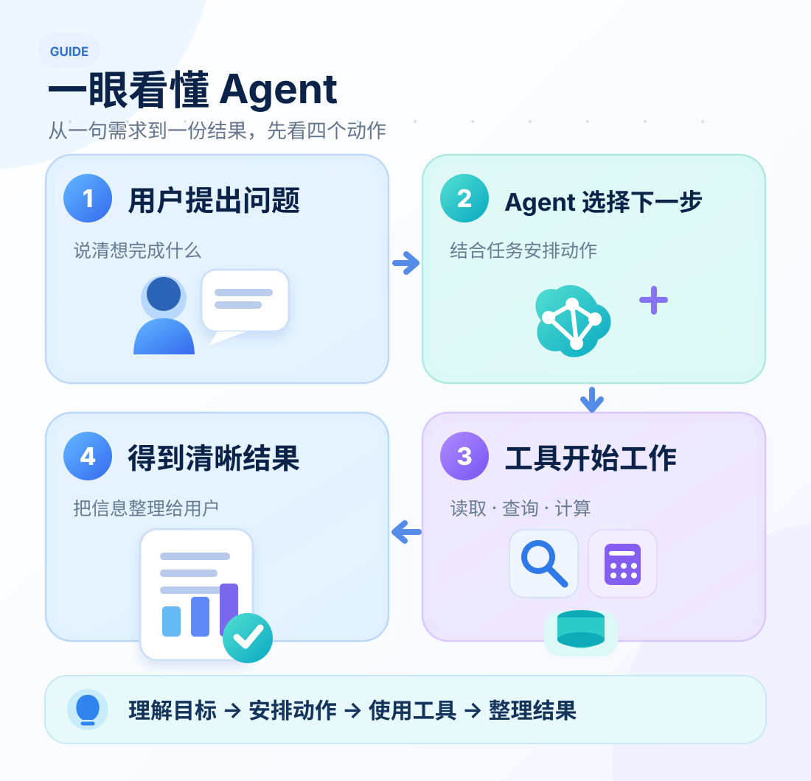
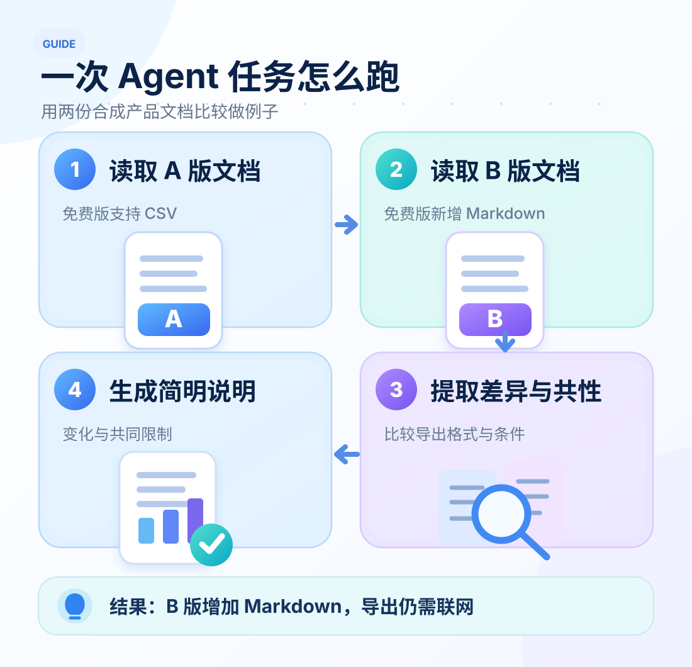
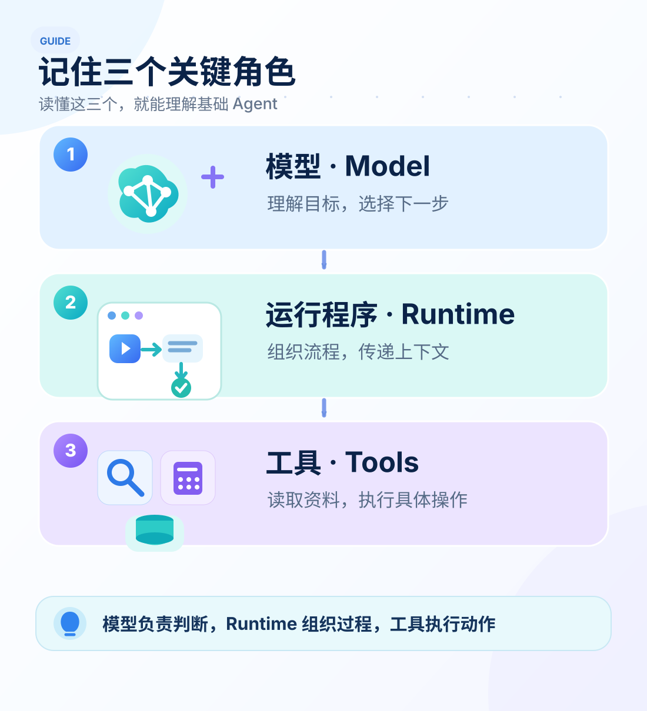

# 十五分钟入门 Agent

> **入门 · 第 1 站**　入门 → [进阶](./agent-ten-modules.md) → [深入](./agent-loop-to-application.md) → 全景

如果你写过接口、调过 API，或者用 JavaScript 做过自动化脚本，就能很快理解 Agent。

**你可以把 Agent 想成一个会推进任务的助手：它理解目标，选择下一步，使用工具，再根据得到的信息继续工作。**

下面用一个例子、三张图，再走一遍 Agent 循环，把这件事讲清楚。



## 一个熟悉的任务：比较两份文档

假设你收到一个需求：

> **“帮我对比 A、B 两版产品指南：免费版支持哪些导出格式？两版有什么共同限制？”**

这是 [Open ETF Agent](https://github.com/hpoenixf/open-etf-agent) 开源项目里的合成教学案例，产品叫 *Atlas Notes*。两份文档里的信息很简单：

- **A 版：** 免费版支持 CSV 导出。
- **B 版：** 免费版支持 CSV 和 Markdown 导出。
- **共同条件：** 导出时都需要联网。

如果让你处理，大概也会先读 A 版，再读 B 版，接着整理变化和共同点。Agent 也是沿着这条思路推进任务。



**最终可以得到这样一段说明：**

> B 版在 CSV 之外新增了 Markdown 导出。两版免费导出都需要联网。

这个例子很小，却已经包含了 Agent 的基本动作：理解要求、读取资料、整理信息、生成结果。

## Agent 里面，谁在做这些事？

把一个基础 Agent 拆开，只需要先认识三个角色。



**模型（Model）**负责理解问题，并选择下一步。它可能决定先读取文档，拿到内容后再整理回答。

**运行程序（Runtime）**负责把步骤串起来。它把用户的问题、已有资料和工具结果组成下一轮要用的**上下文（Context）**，让 Agent 能接着刚才的工作继续。

**工具（Tools）**负责做具体的事。读取文件、查询数据库、调用接口或计算，都可以封装成工具。对前后端开发者来说，它们就是有明确输入和输出的函数。

## 跑一遍 Loop：每一步由 AI 接着判断

**工具执行完，结果会交回 AI；AI 看过结果，再决定继续用工具，还是直接回答。** 这个反复进行的过程，就是 Agent 循环（Agent Loop）。

把刚才的文档比较交给一个由 AI 选择动作的 Agent，可能这样展开。下面是教学示意：

| 回合 | AI 选择什么 | 这一轮的结果 |
| --- | --- | --- |
| 第 1 轮 | 先读取 A 版文档 | 工具返回：A 版支持 CSV，导出需要联网 |
| 第 2 轮 | 已了解 A，还要读取 B 才能比较 | 工具返回：B 版支持 CSV、Markdown，导出需要联网 |
| 第 3 轮 | 两份资料齐了，整理比较结果并回答 | AI 回答：B 新增 Markdown，两版都要求联网 |

第一轮的工具结果进入第二轮的上下文，第二轮的结果又进入第三轮。**每次调用 AI，它都能接着已有信息重新判断。** 这些回合发生在同一次用户请求里，无需用户一步步催促。

可以把一轮记成：**AI 选择动作 → 工具执行 → 结果交回 AI**。随后，AI 决定下一轮做什么，或者结束这次任务并回答。Runtime 负责运行这个循环，并管理工具权限与执行上限。

用几行 JavaScript 风格的教学伪代码，就能看清分工：

```javascript
while (withinLimits()) {
  const step = await model.decide(context, tools);
  if (step.type === "answer") return step.text;
  const result = await runAllowedTool(step);
  context.push(step, result);
}
```

`model.decide` 表示让 AI 选择下一步，`context.push` 表示把动作与结果交给下一轮。辅助函数和消息格式在这里做了简化。

## 跟传统程序有什么不同？

写一个传统的文档比较脚本，你可能会先排好：`读取 A → 读取 B → 比较 → 输出`。循环、分支和停止条件，都由开发者写进代码。即使其中“比较”这一步调用了 AI，整体路线依然可以是预先安排好的。

Agent 则把一部分任务推进的选择交给 AI：**读哪份资料、调用哪个工具、是否继续、何时回答，都可以结合刚收到的结果决定。** 开发者提供目标、可用工具和运行约束。这也是 Anthropic 在 [Building effective agents](https://www.anthropic.com/engineering/building-effective-agents) 中区分工作流与 Agent 的关键。

举个小变化：假设 B 文档写着“导出格式详见附录”。AI 读到这句话，可以选择下一轮继续读附录，再回来比较。传统脚本也能做到，只需要开发者提前写好相应规则。

步骤清楚、规则稳定的任务，用普通代码很直接；需要边读资料、边决定下一步的任务，就更能体现 Agent 的灵活性。

## 自己跑一次：五分钟体验

上面的文档比较有可运行的开源示例。使用 [Open ETF Agent v0.15](https://github.com/hpoenixf/open-etf-agent/tree/74bd5aa455ccaeb2994eb22aa744affde660bfa2)，准备好 Node.js 26.8.1–26.x，然后在终端执行：

```bash
git clone https://github.com/hpoenixf/open-etf-agent.git
cd open-etf-agent
git checkout v0.15.0
npm ci --ignore-scripts --no-audit --no-fund
npm run build
npm run demo -- --case T1
```

运行后，终端会给出本次任务的目录。打开其中的 `report.md`，就能看到刚才的文档比较结果和对应来源。

这个版本的默认示例用**脚本模拟模型选择动作**，让你不用配置模型密钥也能体验完整的工具执行过程。以后接入真实模型时，仍然围绕同一套“选择下一步、使用工具、利用结果”的思路开发。

## 下一站：进阶，认识代码里的十个模块

到这里，你已经有了一张入门地图：**用户给目标，AI 根据每轮结果决定下一步，Runtime 运行循环，工具执行动作。**

继续读[**《Agent 进阶：读懂 Open ETF Agent 的十个核心模块》**](./agent-ten-modules.md)，在同一个 v0.15 版本里认识 Skill、MCP、上下文、记忆、会话与子代理。接着进入[深入篇](./agent-loop-to-application.md)，沿一次真实的专家协作看它们怎样配合。

**阅读路线：入门 → 进阶 → 深入 → 全景。** 每一站沿用已经熟悉的任务，再多看一层。

[Open ETF Agent 源码与示例](https://github.com/hpoenixf/open-etf-agent) · [English version](/en/articles/agent-in-15-minutes) · [工程文集（欢迎 Star）](https://github.com/hpoenixf/eff-agent-article)
