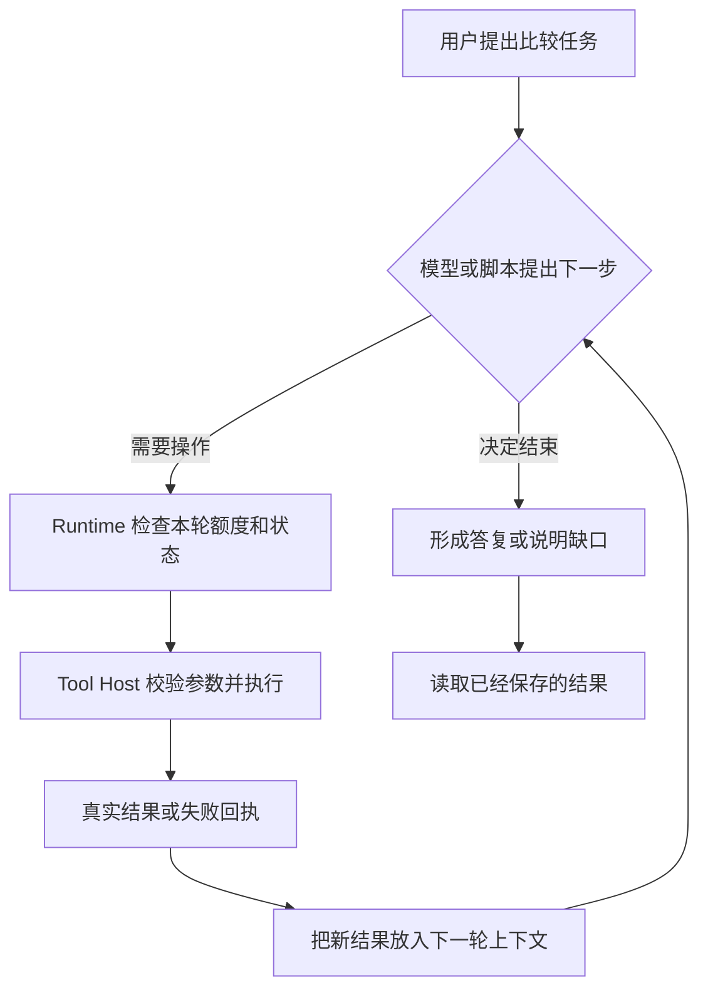
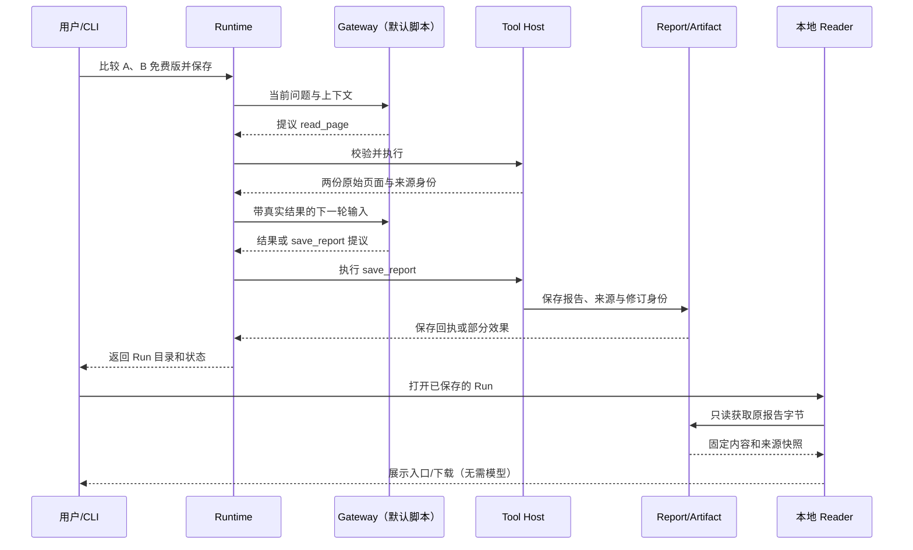
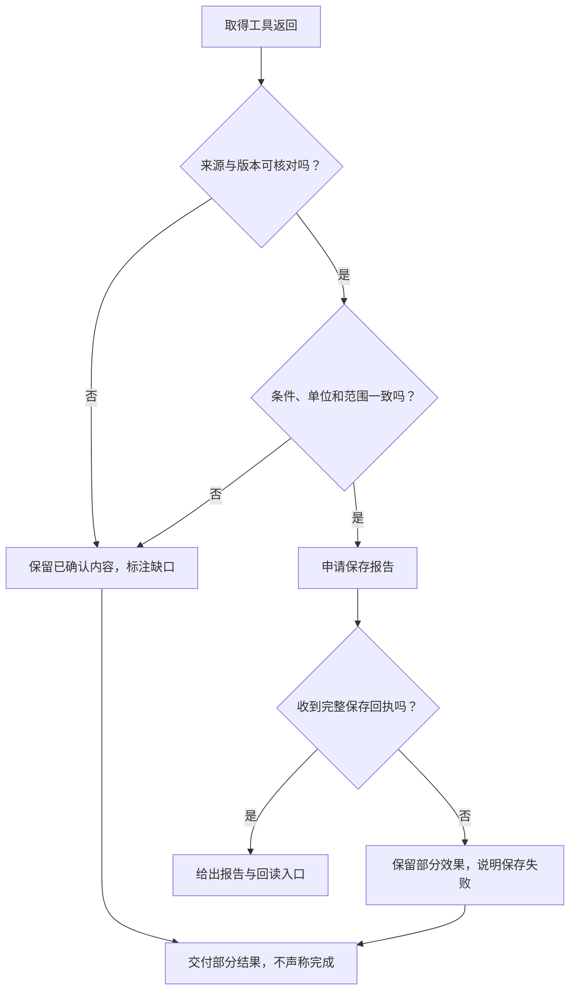

# 十五分钟入门 Agent

> **适合谁：** 会写一点 JavaScript、接口或后端程序，但没做过 Agent 的开发者。本文约十五分钟读完，不要求先懂 LLM 框架、MCP 或多智能体。

很多人第一次看 Agent 架构图，会被 Model、Runtime、Tool Host、Context、Publication、Subagent 这些词淹没。其实可以先只问一句：**用户交代一件事，程序怎样找到资料、选择下一步、完成操作，再把确实做好的结果交出去？**

本文从一个可以在电脑上跑的例子开始。最后再告诉你，它对应完整 Agent 系统的哪几部分。

## 一、先看任务：比较两份文档并保存报告

假设你接到一个需求：

> 对比 Atlas Notes A、B 两版产品指南：**免费版**能导出哪些格式？有哪些共同限制？请标注两份来源并保存报告。

这不是基金推荐，也不是某家真实公司的接口。它来自开源项目 [Open ETF Agent](https://github.com/hpoenixf/open-etf-agent) 的**合成教学资料**。选择它，是因为读者可以核对[原始资料](https://github.com/hpoenixf/open-etf-agent/blob/7480b656b18192e6d6b44aab65255b970d58e6f8/fixtures/documents.json)、[四个测试问题](https://github.com/hpoenixf/open-etf-agent/blob/7480b656b18192e6d6b44aab65255b970d58e6f8/fixtures/cases.json)和固定版本的代码，不必相信文章凭空描述了一个跑通过的故事。

资料的关键内容只有几行：

| 项目 | A 版（A-2026-01） | B 版（B-2026-02） |
| --- | --- | --- |
| 免费版导出格式 | CSV | CSV、Markdown |
| 免费版单次导出上限 | 120 行 | 300 行 |
| 导出是否需要联网 | 需要 | 需要 |
| 企业版 PDF 导出 | 有 | 有 |

注意最后一行：**企业版支持 PDF，不代表免费版支持 PDF。** 这就是为什么读两份文档不是简单把关键词拼起来——还要保留版本、适用范围和限制条件。

对于第一问（仓库中的 T1），合格的说明应指出“B 新增 Markdown，CSV 保留，两版都要求联网”，并关联 `atlas-a:1`、`atlas-b:1` 的原始页面。对于数字问题 T3，还要分别写清：增加 **180 行/次**、B 为 A 的 **2.5 倍**、相对 A 增长 **150%**。这些是不同的问题，不能把 T1 自动说成也完成了 T3。

## 二、模型不是工具，Agent 也不是一条固定流水线

把工程分工拆成三件熟悉的事：

| 角色 | 用后端开发的话说 | 本例 |
| --- | --- | --- |
| **Model / Gateway** | 提出下一步要做什么 | 提议读取 A、B，或者给出最终回答 |
| **Runtime** | 管循环、上下文、额度与停止条件 | 判断下一轮还能不能继续，接纳实际回执 |
| **Tool Host** | 执行被允许的函数 | `read_page` 读取资料、`calculate_change` 计算、`save_report` 保存 |

**图 1 · 一个工具型 Agent 的最小心智模型**



**核心不是“调用过多少次工具”，而是“看到真实结果后，下一步可以改变”。** 比如找不到原始页面，正常的下一步应是重查合格来源或坦诚说明缺口，而不是假装已经比对。

但这里有一个重要区别：**v0.6 默认演示用的是脚本 Gateway（fixture），不是实时大模型在自主选动作。** 它让你真实运行读取、计算、保存与回读这条执行链；它证明的是 Runtime 与工具的行为，不证明真实模型的理解能力。

## 三、把执行过程展开：动作、结果和可回读文件

在 [v0.6 固定代码](https://github.com/hpoenixf/open-etf-agent/tree/7480b656b18192e6d6b44aab65255b970d58e6f8)里，默认 `document-compare` 会执行 T1–T4 四个合成问题。一次有代表性的交接是：请求经 Gateway 提出读页，Host 拿到资料，Runtime 继续下一步，最后用 `save_report` 产出报告。

**图 2 · 从文档比较到下载：两种“成功”不能混为一谈**



图里有两个容易混淆的事实。

**第一，工具“说要保存”不等于保存成功。** 只有 Host 执行并取得保存回执，才能认定磁盘上发生了相应效果。

**第二，报告存在不等于用户能读到。** v0.6 在更早的本地报告基础上，加入不可变 Artifact、Revision 和一个**仅限 127.0.0.1 的只读 HTTP Reader**。刷新或下载已保存的报告，不需要重新调用模型；它不是公开部署的聊天产品。

### Context 是模型这一轮真正拿到了什么

上下文可以简单理解成这次模型调用实际看到的工作材料：用户问题、当前允许使用的工具说明、之前提出的动作、工具返回的正文或错误等。

**“文件已经上传”与“模型看过文件”是两回事。** 要调试“Agent 怎么不知道文档内容”，先看 `read_page` 是否真的执行，再看结果是否进入下一轮输入。Runtime 也不会因为模型写下某个不存在的来源 ID，就把它变成真实资料。

下面的代码只表达这个循环的形状，**不是 v0.6 源码或某个 SDK 的可复制实现**：

```js
while (canContinue(run)) {
  const proposal = await gateway.next(context);
  if (proposal.type === "final") break;
  const receipt = await host.executeAllowed(proposal);
  context.add(proposal, receipt);
}
return readActualRunStatusAndArtifacts(run);
```

理解这几行，你就掌握了入门最重要的交接：**提议 → 合法执行 → 真正的结果 → 下一轮判断**。

## 四、失败时怎么办？这才区分演示和真正能用的程序

来看三种容易踩坑的情况：

- **范围混淆（T2）：** 文档里写企业版允许离线编辑，不代表免费版也允许；免费版可以看先前下载的内容，但不能离线编辑，初次下载仍需联网。
- **数据不完整：** 如果没拿到 B 版原文，就不能写“比较已完成”；可以交出已确认部分，同时标注缺口。
- **保存发生部分效果：** 例如 `report.md` 已写入，但来源清单写入失败。既不能说“完全成功”，也不能当作“什么都没发生”然后无条件重试。

**图 3 · 失败与降级：先判事实，再决定回答内容**



**一次 Run 结束，不保证答案语义一定正确。** 在固定 v0.6 的[历史验收回执](https://github.com/hpoenixf/open-etf-agent/blob/7480b656b18192e6d6b44aab65255b970d58e6f8/docs/verification/v06-delivery-receipts.safe.json)中，四个案例的本地 HTTP 字节与来源回读检查通过；其 `semanticStatus` 仍为 `unreviewed`。这就是“工程交付能回读”与“模型结论已被验证”的差别。

## 五、动手跑一次固定版本

最短复现路径使用 **v0.6.0-dev.0 / 固定提交 `7480b656`**，不是不断变化的 `main`。需要 Node.js **26.11.1–26.x**；安装依赖可能联网，默认示例本身不需要模型密钥。

```bash
git clone https://github.com/hpoenixf/open-etf-agent.git
cd open-etf-agent
git checkout 7480b656b18192e6d6b44aab65255b970d58e6f8
npm ci --ignore-scripts --no-audit --no-fund
npm run build
npm test
mkdir -p runs
node src/cli.mjs --case document-compare --output runs > runs/comparison.json
npm run evaluate -- --input runs/comparison.json
```

运行结果写到各自的 `runs/run-...` 目录；`comparison.json` 会包含实际目录。选一个已生成的 Run，启动只读服务：

```bash
npm run serve -- --run runs/run-YOUR_ID
```

终端会打印 `http://127.0.0.1:PORT`。用本机浏览器打开它，可以看到已保存的修订与报告下载入口；再次刷新**不会再次运行模型**。`run-YOUR_ID` 是占位符，必须换成上一步真实打印的目录名。

初次只看 T1：能否正确区分 A/B 免费版格式和联网条件。再看 T2 的适用范围、T3 的计算口径，最后看 T4 的原文件回读。也可以直接用 `--case T1` 运行单题。这里不给出虚构的本次运行截图或新鲜成绩；上文的验收数据来自仓库固定版本的已保存记录。

## 六、懂了循环，再去看六层全景

这次本地 CLI 演示只覆盖完整系统的一部分。把它放进一套有账户、会话、后台任务、发布系统和浏览器的 Agent 里，还会遇到更多交接：

| 完整系统的阅读地图 | 你现在能理解的部分 |
| --- | --- |
| L1 任务输入与触发 | CLI 或界面提交了什么任务 |
| L2 身份、会话与上下文 | 哪些资料允许使用，本轮实际给了什么 |
| L3 Agent 决策与运行 | Gateway 的下一步提议如何被 Runtime 处理 |
| L4 工具与领域能力 | 读页、计算、保存及真实回执 |
| L5 结果发布与交付 | 哪一份报告被真正保存、能否重新取得 |
| L6 用户界面 | 用户打开了哪个结果，是否可以回读 |

**六层是理解交接的地图，不是六个必须部署的进程。** 此处的 v0.6 示例尤其没有实现完整多账户鉴权、云端对话或后台研究；不能把这张对照表理解为“六层系统已由 v0.6 全部实现”。

如果你只记得三个问题，就足够开始写自己的第一个 Agent：**模型拿到了什么？程序实际执行了什么？用户最终能拿到什么？**

下一站可以按自己的兴趣选择：

**[继续进阶：《从一次提问到答案可见：ETF Agent 六层调用全景》](/articles/017-prompt-to-answer-six-layer-panorama-v3)**，了解完整的身份、上下文、Main/Child、工具、发布与前端交付职责；或者打开 [Open ETF Agent 固定 v0.6 源码](https://github.com/hpoenixf/open-etf-agent/tree/7480b656b18192e6d6b44aab65255b970d58e6f8)，沿 `src/cli.mjs` → `src/runtime.mjs` → `src/tools.mjs` → `src/reader.mjs` 对照实现。

[English version](/en/articles/agent-in-15-minutes) · [工程文集 GitHub](https://github.com/hpoenixf/eff-agent-article) · [开源实现（欢迎 Star）](https://github.com/hpoenixf/open-etf-agent)
