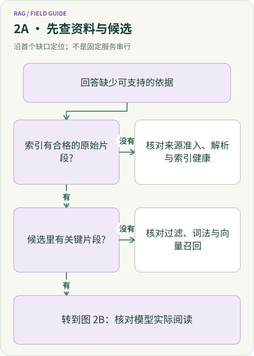
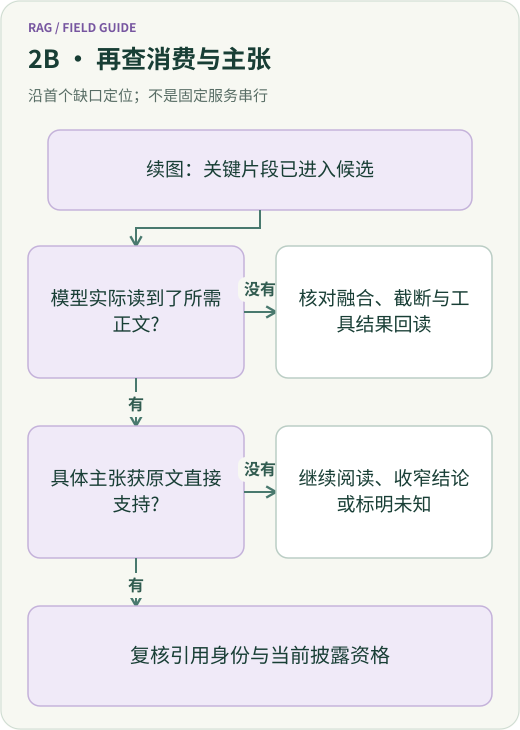
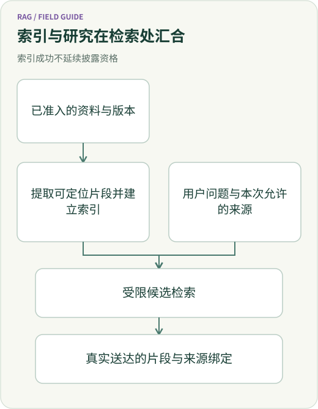
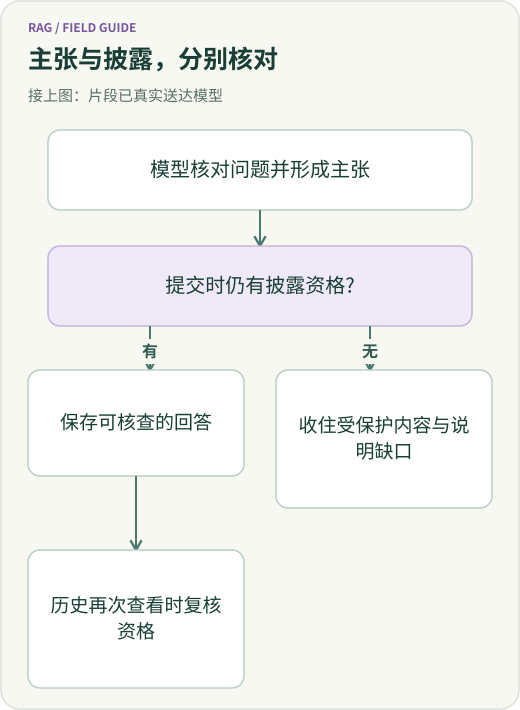

<script setup>
import { withBase } from 'vitepress'
</script>

<span id="知识检索-一段文档怎样成为可引用、可撤权的研究证据"></span>

<span id="rag-全链路全景-从知识入库到可信回答-一套-agent-检索系统如何工作"></span>

# RAG 全链路：从文档入库到可引用回答

用户问：“510500 在 2023 年的公告里改了什么？后来的说明书能补充哪些信息？”资料库里有三份材料：2021 年招募说明书、2023 年公告、2025 年招募说明书。

一套 RAG（Retrieval-Augmented Generation，检索增强生成）系统要完成的工作很具体：**把三份文件变成可定位的资料，找到回答问题所需的段落，把段落连同来源交给模型，再生成可以回查的答案。**

这篇文章就沿着这份公告走一遍。先看主流框架把流程拆成哪些组件，再看文件怎样入库、问题怎样检索、模型怎样写出带引用的回答，最后落到 ETF Agent 的实现和读者可以运行的公开示例。公告研究背景与历史观察沿用已核对的材料；下面的片段卡、查询拆解和上下文包是教学示意，不是一次新模型运行的日志。

<span id="一、先建立全景-一条问题链-四种不同的工作"></span>

## 一、先看正常路径：离线建库，在线回答

RAG 通常有两条主线。

**离线入库**发生在提问之前，或资料更新时：取得文件 → 解析正文 → 切成片段 → 建立索引。它的产物是一组可以被检索、可以回到原文位置的记录。

<picture>
  <source media="(max-width: 640px)" :srcset="withBase('/diagrams/rag-lifecycle/zh/ingest-flow-mobile.svg')" />
  
</picture>

<a :href="withBase('/diagrams/rag-lifecycle/zh/ingest-flow.svg')">打开入库流程完整图</a>

**在线问答**从用户的问题开始：确定查询与范围 → 检索并合并候选 → 按需重排 → 装配上下文 → 生成答案与引用。系统用完这次结果，再把问题、相关片段、答案和成本纳入评测。

<picture>
  <source media="(max-width: 640px)" :srcset="withBase('/diagrams/rag-lifecycle/zh/query-flow-mobile.svg')" />
  
</picture>

<a :href="withBase('/diagrams/rag-lifecycle/zh/query-flow.svg')">打开问答流程完整图</a>

*图 1、图 2｜正常 RAG 的教学流程。向量通道和重排按任务需要启用；图中顺序不表示每次 Agent 研究只能检索一次。*

### 主流框架把哪些步骤做好了？

以下三套常见框架都能组织这条流程，组件边界各有侧重。这里是职责对照，并不表示项目同时采用了三套框架。

| 框架 | 入库侧的常见组件 | 查询与回答侧的常见组件 | 阅读它时可以抓住的线索 |
| --- | --- | --- | --- |
| **LlamaIndex** | Reader 载入 Document，IngestionPipeline 串起切分、元数据与 Embedding，得到 Node | Retriever 取回 Node，后处理器筛选或重排，Response Synthesizer 组织回答 | 跟着 Document → Node → 检索结果 → 回答走 |
| **LangChain 生态** | Document loader、text splitter、embedding model、vector store | Retriever 与模型组合成检索问答；也可把检索交给 Agent 作为工具调用 | 分清固定“先检索再生成”和按需调用工具两种编排 |
| **Haystack** | Converter 转换文件，预处理组件切分/清理，DocumentWriter 写入 Document Store | Retriever → 可选 Ranker → PromptBuilder → Generator | Pipeline 显式连接组件的输入输出，便于观察各步产物 |

这些对应关系来自各自官方说明：[LlamaIndex 入库](https://developers.llamaindex.ai/python/framework/module_guides/loading/ingestion_pipeline/)、[查询](https://developers.llamaindex.ai/python/framework/understanding/rag/querying/)与[回答合成](https://developers.llamaindex.ai/python/framework/module_guides/querying/response_synthesizers/)，[LangChain 生态的检索说明](https://docs.langchain.com/oss/python/deepagents/retrieval)，以及 Haystack 的[预处理](https://docs.haystack.deepset.ai/docs/documentpreprocessor)、[写入](https://docs.haystack.deepset.ai/docs/documentwriter)、[精排](https://docs.haystack.deepset.ai/docs/sentencetransformerssimilarityranker)和[提示词装配](https://docs.haystack.deepset.ai/docs/promptbuilder)。框架中的具体类名与 API 应以使用版本为准。

**我们在 ETF Agent 私有系统中的落点**，已有[此前公开的知识检索文章](https://github.com/hpoenixf/eff-agent-article/blob/a629e450e9e3a505089b54d68a14eaecf3b9a2fb/articles/agent-knowledge-retrieval-end-to-end.md)作过公开说明：知识导入处理资料，PostgreSQL 保存文档和片段，pgvector 提供向量检索，词法检索与向量候选经过 RRF 合并，可选本地 TEI 做重排；Native Knowledge 工具把结果交给原来的 Agent 研究流程，Host 负责结果与引用的绑定。后面逐步展开这条此前公开文章描述的私有系统实现路径。公开教学仓库 Open ETF Agent 提供另一套范围更小的词法检索示例；私有系统与公开教学版的能力在本文分开说明，文末给出公开版可直接检查的代码入口。

<span id="二、知识进入系统之前-先回答-我们究竟拥有什么"></span>

<span id="二、离线链路-为什么要先审材料-再建立索引"></span>

## 二、步骤 1—3：把文件加工成能回到原文的片段

<span id="_1-来源准入先于文本提取"></span>

### 1. 接入资料，登记来源和版本

输入是三份实际取得且获准处理的文件。先记录各自的标题、来源地址、发布日期、逻辑来源、内容版本与原件位置。2021 说明书、2023 公告和 2025 说明书各占一条记录，历史关系保留下来。

<span id="一份报告有三种身份"></span>

<span id="一、先分清四件容易混淆的事"></span>

这里会形成三层对象：**原始文件**保存取得的字节，**研究资料资产**记录来源、版本和读取情况，**知识索引**保存便于搜索的表示。这样一来，索引里的某个片段可以沿着版本与位置回到原文件。网址和文件名可能重复或被替换，内容哈希与版本身份负责把这次引用固定下来。

接入时还要登记资料可用形态：原文、人工整理摘要、仅元数据。若只能保留简介与来源链接，就让检索返回简介的身份和回查入口；需要正文的任务继续取得原文。历史公告在这里属于解释性资料，当前 NAV、持仓和交易状态仍由各自的数据来源提供。

**这一步的产物：三条有来源、有版本、有可用范围的文档记录。**

<span id="_2-解析、切块要保住限定条件"></span>

### 2. 解析正文，保留标题、页码和表格关系

PDF 需要先提取可用正文；HTML 要提取文章区域；Markdown 已有标题和段落结构，可以直接利用。扫描件通常还需要 OCR 或其他文档解析能力，是否支持应单独检查所选解析器与部署。

在 2023 公告中，我们关心的是第一页的字段变更。解析结果应保留物理页码、字段名称、变更描述以及它们附近的限定。若材料是表格，列标题、单位、脚注和跨页关系都影响句子的含义。

<span id="解析覆盖比-chunk-数量更重要"></span>

可以把解析后的页面理解为：“文档版本 + 第 1 页 + 提取的正文 + 覆盖状态”。例如一张表抽出了“费率 0.5%”，对应的份额类别却没有提取出来，那么应先补读表头或原页，再将它用于回答。解析检查要覆盖读到了哪里、哪些结构尚不完整。

此前公开文章描述的 ETF Agent 知识入库路径保留 PDF 物理页码，并区分提取覆盖。只解析到前几页时，不能把它登记成全文已经入库。复杂表格需要回到文档读取能力核对，后面的检索器依赖这一步提供的文本质量。

**这一步的产物：带结构和定位信息的可用正文。**

### 3. 切块，让每段内容足够独立，也能继续展开

切块是在“好找”和“读得完整”之间选一个合适单元。常见做法是先按标题、段落或页面组织，再对过长内容做有限长度切分，并保留少量重叠。短公告的一页可能就足够作为一个片段；长说明书则需要分出多个章节和段落。

以公告第一页为例，字段变更句、适用条件和必要脚注应尽量放在同一个可读单元中。下面是一张**示意片段卡**，内容说明是对已核对事实的概括，不是 PDF 原句：

| 字段 | 示例内容 |
| --- | --- |
| 文档 | 510500 的 2023 年公告 |
| 版本与定位 | 本次取得的文档版本；物理第 1 页；相应片段范围 |
| 片段内容说明 | 现金替代相关字段名称调整，并增加相应折价字段 |
| 回查信息 | 原件位置、内容哈希、页码与片段标识 |
| 表示与用途 | 从原文提取的片段；用于核对当年公告的字段变化 |

公开文章中的切块方案可按 Markdown 标题组织内容，再对长段落作有限重叠切分；PDF 片段保留页码。遇到跨片段限定，可以沿同一来源版本补读相邻内容。切块大小需要用任务验证，没有一个对所有语言、表格和文档都最优的数值。[Azure 的官方切块指南](https://learn.microsoft.com/en-us/azure/search/vector-search-how-to-chunk-documents)也把定长、按结构和语义切分列为不同选择。

**这一步的产物：正文片段及其来源、版本、位置和表示类型。**

## 三、步骤 4：给同一批片段建立检索入口

词法检索和向量检索使用同一批片段，但查找方式不同。

- **词法入口**保留词项与文本的对应关系。用户查“510500”“PCF”或准确字段名称时，可以直接找到包含它们的片段。全文检索、BM25 都属于这条路线中的常见能力。
- **向量入口**用 Embedding 模型把片段转成数值向量，保存到向量索引。查询时用兼容的 Embedding 模型处理问题，再按向量相似性找出候选，适合补充不同说法之间的关联。
- **元数据入口**保存来源、版本、用途、状态与可读范围，让检索在正确的资料集合中发生。

在此前公开文章描述的 ETF Agent 私有系统实现中，文档、片段和相关元数据进入 PostgreSQL，向量查找使用 pgvector。词法通道会检查 `pg_search` 扩展、BM25 索引和配置条件；条件具备时可选 BM25，否则保留 PostgreSQL 全文检索（FTS）。**这里描述的是已核对的实现分支；某次运行到底启用了什么，需要看该次配置和检索记录。**

入库完成后，做一次最小冒烟检查：按基金代码能否找到公告？指定版本与页码能否回到对应正文？文档和片段数量是否与实际接入范围相符？再开始检验语义检索。

这项顺序来自一个很具体的历史教训：2026 年 9 月的一次本地诊断中，模型和数据库相关依赖可用，但索引中没有文档或 chunk。那次任务首先需要完成语料入库。这个观察仅指当时状态，不能推断今天的索引仍为空。

**这一步的产物：词法/向量可查、范围可筛选、原文可回读的索引。**

<span id="三、在线查询不是-拿用户输入去搜全库"></span>

<span id="三、在线链路-从用户问题到候选片段-谁决定什么"></span>

## 四、步骤 5—7：把问题变成有序候选

### 5. 形成查询，确定当次资料范围

问题“2023 年到底改了什么”可以先拆成一条主查询和两条对照查询：

| 查询用途 | 查找内容 | 结果在答案中的位置 |
| --- | --- | --- |
| 当年变更 | 510500、2023 年、公告、现金替代字段 | 直接说明当年修改了哪些字段 |
| 变更前背景 | 2021 年说明书中的相应条款 | 需要时解释较早版本如何表述 |
| 后续背景 | 2025 年说明书中的相关字段 | 说明后续材料怎样呈现，保持时间顺序 |

这是研究拆解示意。简单问题可以使用一条查询；需要比较版本时，再补充对照。固定问答流水线可以由应用直接发起检索，Agent 则可在研究过程中选择调用工具、改写问题或继续补读。

<span id="权限过滤为什么应在-top-k-之前"></span>

<span id="_2-硬过滤必须发生在-top-k-之前"></span>

ETF Agent 的 Host 先给出获准范围，检索在账户作用域、`reference` / `personal` 集合、来源用途、有效版本、文档状态等硬约束内选择 Top-K。这样公开公告和私人笔记可以共存，排序面对的是本次真正可用的集合。若先从全库取少数候选再剔除无权材料，获准内容可能在更早的候选阶段就被挤掉。

领域偏好还可以进一步缩小第一轮范围。已有合同允许候选不足时在原授权集合内做一次有界扩展；明确指定 `only` 的查询保持该限制。这是研究范围的控制，不应由“结果太少”自动改写。

下面把输入拆开看，便于把问题接到实际工具。表中是已公开合同的语义说明，具体 ID 要使用系统实际返回的身份。

| 输入 | 用途与边界 |
| --- | --- |
| 查询正文 | 说明要找的事实；在 Agent 中可通过 `search_financial_knowledge` 提出 |
| `collection` | 选择获准的 `reference` 或 `personal` 集合，默认查询不会悄悄扩到个人笔记 |
| 领域与模式 | `prefer` 可在原硬约束内做一次有界扩展；`only` 保持明确限定 |
| `sourceIds` | 指向实际返回过的逻辑文档身份，进一步收窄来源；猜测一个 ID 不会取得权限 |
| scope、用途与版本 | 由 Host 和来源状态约束，模型提出的参数不能放宽这些条件 |

<span id="_3-为什么需要两路召回与-rrf"></span>

### 6. 两路召回，用 RRF 合并名次并去重

<span id="词法、向量、融合和精排解决的是不同问题"></span>

词法通道用代码、年份和字段名找候选；向量通道用问题的表达找语义相近片段。例如“现金替代字段调整”和“申赎清单版本更新”可能采用不同说法，两路搜索提供互补入口。

查完之后，我们有两张排序列表。RRF（Reciprocal Rank Fusion，倒数排名融合）根据片段在各列表中的**名次**合成一个顺序，再按来源、版本和片段身份去重。这样无需直接相加尺度不同的词法分数与向量相似度。[Azure 的 RRF 说明](https://learn.microsoft.com/en-us/azure/search/hybrid-search-ranking)展示了这种按名次融合的基本过程。

两路召回各有候选上限。如果词法通道失败，但向量仍返回合格候选，可以保留这批材料并报告部分状态；反向情形同理。观察记录要说明实际可用的通道，避免让模型把一条通道的失败解释成整个知识库没有资料。

对于公告问题，候选池可能同时包含三个年份的材料。接下来要优先选择直接描述 2023 年变更的内容，并为旧版和后续版保留背景角色。这里不假设某次实际检索的名次或得分；候选顺序应由对应运行记录或固定评测得到。

### 7. 按需重排，选出值得进入上下文的片段

重排器把“问题 + 候选正文”放在一起比较，重新确定候选的相关顺序。它适合处理这样的情况：当年公告已经被召回，但相似的说明书段落挤占了最终上下文。

此前公开文章描述的 ETF Agent 私有系统实现支持可选本地 TEI 精排，输入仍是同一批已获准候选。若未配置、调用失败或无法满足使用条件，保留原 RRF 顺序。精排读得更细，也增加延迟与计算；可以先对照固定题集，再决定是否启用。

精排能够调整已有候选的顺序。若当年公告根本没有进入候选池，应回到资料、查询或召回阶段补查。主流检索服务也区分这两个阶段，例如 [Azure semantic ranker](https://learn.microsoft.com/en-us/azure/search/semantic-search-overview)就在初次排序结果上进行第二次排序。

**这三步的产物：位于正确范围内、去重并排序的候选，以及来源定位和检索状态。**

<span id="四、最容易消失的不是-chunk-而是-模型实际看到它-的事实"></span>

<span id="四、候选进入模型-怎样才算变成证据"></span>

## 五、步骤 8—9：装配上下文，生成带引用的回答

### 8. 给模型一份有顺序、有来源的材料包

候选确定后，应用需要组织模型这一次实际接收的内容：保留问题，选入直接相关片段，去掉重复内容，在预算内补足标题、前后段或表格脚注，再附上来源标记。

我们的公告案例可以整理成下面的**教学上下文包**。这些编号只用于说明结构，实际系统的结果和引用身份由 Host 生成。

| 包中的部分 | 放入什么 | 模型用它做什么 |
| --- | --- | --- |
| 用户问题 | 2023 年公告修改了哪些字段，后续材料提供什么背景 | 保持回答目标 |
| 材料 A：直接证据 | 实际读到的 2023 公告第 1 页相关正文，附版本与页码 | 写当年字段变更 |
| 材料 B：较早背景 | 按需读到的 2021 说明书对应条款，附相应定位 | 比较此前表述 |
| 材料 C：后续背景 | 实际读到的 2025 说明书相关片段，附相应定位 | 说明后续版本情况 |
| 作答要求 | 按年份区分材料；为具体主张附对应引用；缺少依据时指出待查项 | 组织可回查答案 |

<span id="_1-host-允许查询-不等于模型一定调用"></span>

在 Agent 里，这段过程经过真实工具交互：Host 允许 Knowledge 工具 → 该轮模型请求包含工具定义 → 模型调用并收到结果 → 后继模型输入承载片段正文与来源。Native Knowledge 将检索接进原来的研究循环，模型读完后可以继续追问或回读原件。

<span id="外置结果尤其容易制造-读过了-的假象"></span>

如果结果太大而被外置，先返回定位符，再通过实际读取把所需正文送进输入。相邻内容应保持同一来源版本和授权范围，引用则绑定本次真实交付的片段。找到匹配位置只完成了定位，需要正文时还有一次回读。

<span id="_4-取相邻上下文不是扩大引用范围的许可证"></span>

具体到已公开的 Native Knowledge 路径，Host 绑定的是实际交付的锚点片段。为了理解脚注而扩展相邻阅读，不会自动扩大这个旧引用的正文范围；需要引用新增内容时，要保留它实际取得和交付的来源范围。

历史核对中曾有一轮 Host 已准备知识授权，但工具定义没有出现在实际模型请求里；后来的另一轮 Run 才确认了 Knowledge 调用与材料消费。这类问题可以直接沿上述四个交接点排查，先检查工具呈现与正文交付。

### 9. 生成答案，把每项主张连回具体材料

<span id="一条答案里-哪些部分真的能说"></span>

模型读到材料之后，可以按“当年变更 → 后续背景 → 待查问题”组织答案。引用要跟着具体主张，包含对应文档版本和位置，读者打开时应看到支持这句话的内容。

已有公告研究中，人工查看的 2023 年公告第一页直接支持现金替代相关字段名称变化及相应折价字段增加；2025 年后续说明书提供后续版本背景。把这项观察整理成逐条主张审阅，就得到一份可检查的回答骨架：

| 准备写入答案的主张 | 材料与审阅结果 | 合适的输出 |
| --- | --- | --- |
| 2023 年公告调整了现金替代相关字段名称，并增加相应折价字段 | 当年公告指定页直接支持这项变化 | 引用当年版本，限定为这次清单字段变更 |
| 后续说明书仍出现相关字段 | 后续版本提供背景与一致性线索 | 标明资料年份，说明后续版本情况 |
| 变更的全部原因、市场影响和实时持仓 | 已查看片段不足以支持这些更强推断 | 明确哪些问题还需要其他证据 |

这是教学用的主张审阅表，沿用人工核对事实，没有新增自动语义判分或真实模型成绩。一个合适的回答能够让读者先看到“改了什么”，再沿引用核对原文，最后知道剩余问题要补查哪些材料。

**这两步的产物：模型实际读到的材料包，以及逐项关联来源的回答。**

<span id="七、评测要沿-证据第一次在哪儿丢失-展开"></span>

<span id="五、没有答案时-先找到-最早丢失证据-的阶段"></span>

## 六、步骤 10：用固定问题评测，随资料变化更新

先准备一组具有代表性的问题，为每题标出相关文档、应读页段和允许回答的事实。保留文档版本、查询条件与运行配置，再对比词法、混合检索或精排方案。这样可以知道哪项改动影响了哪一步。

| 检查阶段 | 对公告案例检查什么 | 可以观察的结果 |
| --- | --- | --- |
| 资料与解析 | 公告及所需页段是否实际可读，字段与限定是否完整 | 来源覆盖、提取覆盖、定位准确性 |
| 召回与排序 | 相关公告片段是否进入候选和最终 Top-K | 在明确标注集合上的 Recall@K、Hit@K、MRR@K |
| 上下文交付 | 相关正文是否进入实际模型输入，外置材料是否回读 | 工具可见/调用记录、正文消费范围 |
| 答案与引用 | 变更主张是否由当年原文支持，后续背景是否正确标注 | 逐项主张支持、版本与引用一致性 |
| 整体任务 | 用户问题是否回答完整，交付是否成功 | 同题同资料时点下的延迟、调用与 Token 成本 |

已有 RQ-08 核对固定了三份来源版本，比较了 **306 个实际索引 chunk** 的排序，并观察了真实 Knowledge 调用。这些片段没有完整人工相关性标注，部分回读仅能证明找到了位置，因此当时的证据适合说明候选与调用情况，还不足以宣布真实 Recall 或金融答案准确性提升。后续评测应补齐相应标注与主张审阅。

排障还要区分两套状态，才能决定下一步修什么。

| 所在层 | 已公开状态 | 怎么使用 |
| --- | --- | --- |
| 索引健康 | `ready`、`partial`、`empty`、`not-indexed`、`unavailable` | 判断资料是否已入库、覆盖是否完整、依赖是否可用 |
| 当次检索 | `grounded`、`partial`、`no-evidence`、`unavailable` | 判断这次查询取得了什么、哪些通道或读取仍有缺口 |

检索层的 `grounded` 表示取得了符合该层合同的材料；答案主张是否受支持仍按上一节核对。索引未建成时先处理入库，候选遗漏时检查召回，正文未送达时检查工具与回读。下面两张诊断图帮助定位最早出问题的阶段。



[打开完整矢量图](../visuals/panorama-rag/diagnose-1.svg)



[打开完整矢量图](../visuals/panorama-rag/diagnose-2.svg)

*图 3、图 4｜正常流程之外的诊断入口：资料、候选、实际阅读和答案分别检查。*

<span id="更新是一个有条件的状态变化"></span>

<span id="_3-更新不是-把旧行覆盖掉"></span>

### 资料更新怎样进入同一条流程？

有新版本时，先检查来源变化和保留许可，再解析、切块、建立新版本索引，确认可用后切换当前资格。2025 说明书作为有自己身份的材料加入；查询 2023 年历史事件时，仍能定位当年的公告。

ETF Agent 的知识生命周期区分只读变化检查与需要审查的同步写入。检查负责发现变化，同步才更新索引；个别来源失败时，保留其他有效材料。旧版本按其合法保留与回读规则处理，版本身份贯穿搜索、上下文和引用。

<span id="六、四条链路怎样分工-而不是造一个包办一切的-rag-manager"></span>

<span id="七、最后一个架构判断-不要再造一个包办研究的-rag-manager"></span>

## 七、项目里由谁把这些步骤接起来？

正常流程建立后，再看工程分工会容易得多。此前公开文章描述的 ETF Agent 私有系统路径沿既有职责协作，检索是研究中的一个可调用能力。

| 责任位置 | 负责的输入与产物 | 在这次公告问题中的作用 |
| --- | --- | --- |
| 研究资料资产、Web/PDF 读取 | 原件、来源版本、页面与提取覆盖 | 取得并定位三份材料 |
| 来源许可与 Run 授权 | 可处理的来源集合和当次能力范围 | 确定本轮可查、可读哪些资料 |
| 知识导入与检索 | 片段、索引、有序候选与检索状态 | 找到公告和相关对照材料 |
| Host 结果与引用管理 | 已交付正文、来源关系、引用身份与回读 | 把片段交到模型，并保留引用来源 |
| Main 研究与综合 | 查询拆解、补读决定、逐项主张 | 区分当年变化和后续背景 |
| 正文发布与会话历史 | 当次提交与后来再次查看的结果 | 交付答案并按当时资格重新展示 |

这些职责可以在同一进程中实现，不要求每行都建一个服务。MCP 可以承担工具连接，Native 工具也可以直接进入原运行时；它们连接的是同一组取数、授权、阅读与交付动作。



[打开完整矢量图](../visuals/panorama-rag/system.svg)

*图 5｜把前面的正常流程放回系统：资料建设和在线研究在检索处汇合，回答沿原交付路径完成。*

<span id="五、模型读过之后-资料仍可能失去披露资格"></span>

### 可修订、可撤权资料怎样交付？

多账户或可撤权资料要在读取、答案提交和历史再次展示时分别检查资格。用户可能在生成期间撤销访问，也可能几小时后重新打开旧对话。正文提交和历史交付沿各自机制完成检查，检索保留来源身份供它们判断。

2026 年 9 月的一次受控撤权复现中，历史回放已隐藏撤权资料，首次流式发送却仍可能输出受保护片段。对应修复点在实际披露提交：复核当前资格，并让并发撤权和提交有明确先后。已经发出的字节无法事后收回。

访问暂时失败与明确撤销保留许可也要分别处理。前者不自动触发永久删除；后者需要按照保留规则处理旧副本与派生内容。纯公开静态资料可以采用更简单的交付设计，可修订、分账户可见的资料则需要这一层明确约束。



[打开完整矢量图](../visuals/panorama-rag/disclosure.svg)

*图 6｜在内容正确之外，来源还需要满足实际交付时的可用资格。*

<span id="八、什么时候采用完整-rag-什么时候应该主动保持简单"></span>

<span id="六、怎样从这篇文章走到一个可运行的最小实现"></span>

## 八、从一个可运行的小闭环开始，再增加组件

工程起点可以很小，先把“找到资料 → 读取原文 → 生成带来源的结果”接通。

| 手头的任务 | 可以先做什么 | 下一步依据 |
| --- | --- | --- |
| 几份短文档，来源与版本已知 | 直接读取原文或做有限关键词定位 | 文档长度和重复查询是否开始影响阅读 |
| 较多文件，常问代码、标题和准确字段 | 目录、范围过滤和词法检索 | 题集中是否持续出现不同说法导致的漏召回 |
| 同义表达很多，已有受控语料 | 加入向量召回与可复现融合 | 相同问题下是否找回了原先遗漏的相关材料 |
| 相关片段已召回，却排在上下文之外 | 在同批候选上试验精排 | 增量质量是否值得延迟、成本与故障处理 |
| 多账户、可撤权或需要历史回读 | 保留各阶段来源资格与版本检查 | 这些约束随资料与交付场景成立 |

可选组件的价值由同题对照决定。精排收益不稳定，可以回到 RRF；向量通道没有补足实际缺口，可以保留词法路径；用户已指定两页公告时，直接读原文就能完成任务。来源许可、账户隔离、版本和实际阅读范围则应始终保留。

公开教学仓库 [Open ETF Agent](https://github.com/hpoenixf/open-etf-agent) 提供了一个容易看懂的小切面。在[固定 v0.15.0 的词法检索代码](https://github.com/hpoenixf/open-etf-agent/blob/v0.15.0/src/retrieval.mjs)里，`searchPages` 接收查询、文档和获准文档列表，对获准页面统计查询词命中，返回文档 ID、页码和分数。候选驱动后续原页读取，再进入来源关联报告。

按该版本的安装与构建说明准备好环境后，可以用[运行说明](https://github.com/hpoenixf/open-etf-agent/blob/v0.15.0/docs/module-guide.md)中的示例观察这一段：

```sh
npm run demo -- --case retrieve-reread --query "offline editing"
```

然后把查询改成 `Markdown`，检查候选页面、实际回读的原文与报告来源如何变化。这个固定版本示例使用合成文档和脚本化 Gateway，不需要真实模型调用；它演示受限词法检索与回读，没有复现前文私有系统的 PostgreSQL/pgvector、混合召回和 TEI 全套路径。这里提供的是可运行入口，本次改稿没有重新运行该示例。

<span id="九、重新走完那份-2023-年公告研究"></span>

## 九、现在重新走完这次公告问答

三份文件先获得各自的来源与版本。解析器提取正文并保留页码；切块器组织可独立阅读的片段；词法和可选向量索引为片段建立查找入口。

用户提问后，系统在获准集合中查找 2023 公告，需要时补充前后版本。候选经融合、可选精排和上下文装配，连同真实正文与来源交给模型。模型先写公告直接支持的字段变化，再写后续材料提供的背景，未有证据的原因或影响留作待查。回答中的具体引用回到对应版本和页段。

资料更新和评测继续沿同一条链进行。我们能逐步检查：**文件有没有取得，正文有没有解析完整，相关片段有没有找到，模型有没有读到，以及答案中的哪一句由它支持。**这就是一套正常 RAG 从资料到回答的工作印象，也是选择框架、增加组件和排查问题时可以共用的地图。

---

延伸深挖：[PDF 从文本到证据](/articles/024-agent-pdf-from-text-to-evidence) · [RAG 召回、BM25 与金融证据评测](/articles/rag-retrieval-evaluation-evidence) · [文档撤权与历史回放](/articles/027-rag-revocation-publish-replay) · [研究资料资产](/articles/agent-research-assets-identity-version-lifecycle) · [Agent 引用系统设计](/articles/ai-citations-do-not-prove-reliability)。这些文章分别深入检索、评测、撤权、文件身份和引用机制；本文重点是它们怎样共同完成一次问答。
