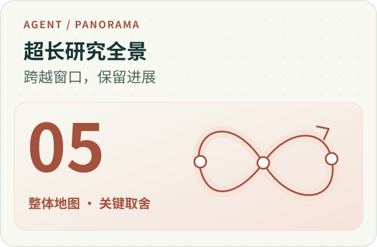
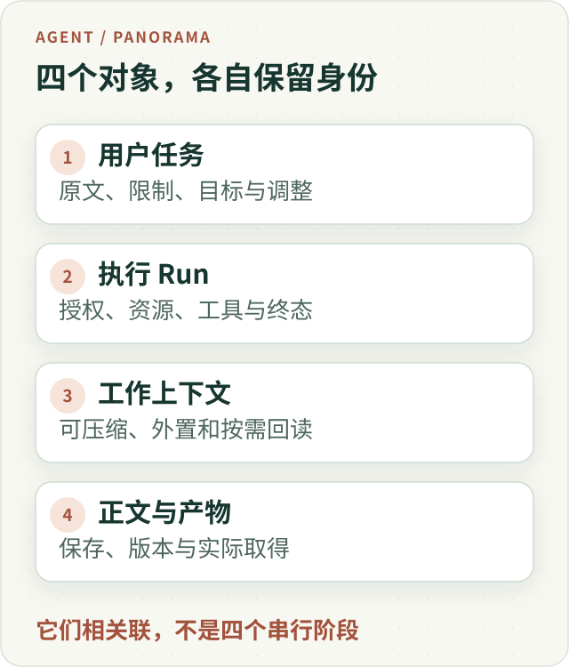
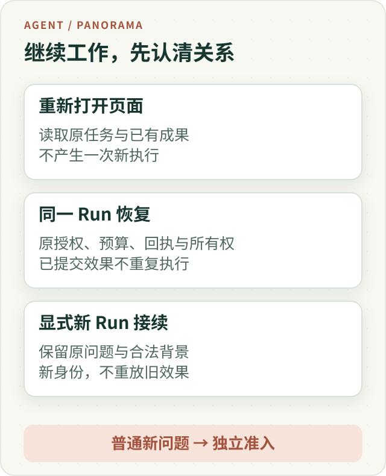
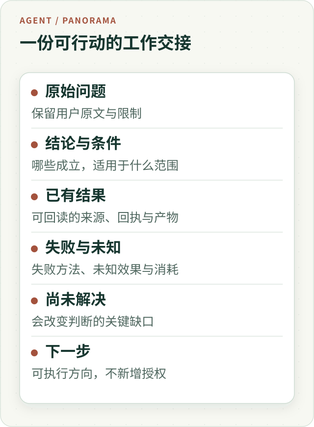

# 超长研究全景：让 Agent 跨越上下文、中断与时间继续交付

用户交来一个问题：“请比较两只主题基金与我的组合，先给我一份有依据的初稿，再把关键疑点查清。”研究可能需要多份文件、几轮计算和不同方法的复核。中途用户会离开页面、追加条件，服务也可能重启；资料越积越多，单次模型请求装不下全部历史。

这里的“超长”没有统一的小时数或 token 阈值。它指的是：**一项研究的生命期，已经超过一次请求、一个上下文窗口或一段不间断进程能够承载的范围。**

把上下文开大、把超时调长，可以延后某些限制，却无法单独解决任务归属、原始依据、重复执行、结果保存和下一次怎样继续的问题。

**真正支持超长研究的系统，需要让研究判断持续演进，让执行事实稳定保留，让用户在每个有价值的阶段取得成果。** 本文沿开头的教学任务展开这些关系；示例不是一次已完成的真实投资研究，也不代表自动交易能力。

## 一、先分清四个会被误叫成“会话”的对象

长研究最初看起来只是“让模型多想一会儿”。实现深入后，必须分开四个对象：

| 对象 | 保存什么 | 为什么不能互相替代 |
| --- | --- | --- |
| 用户任务 | 原问题、限制、后续明确调整，以及希望取得的成果 | 任务可以跨越多次执行；“继续”不能丢掉原问题 |
| 执行 Run | 本次授权、资源、模型轮次、工具效果和终态 | 一次进程重启可以恢复同一 Run；新执行仍需自己的身份 |
| 工作上下文 | 当前推理需要的原文、摘要、结果引用和未解问题 | 它有容量限制，也会变化；不能充当所有历史事实的唯一副本 |
| 正文与产物 | 已接纳的报告版本、文件及交付记录 | 模型还在研究，不妨碍已有成果被保存和阅读 |

同一项任务可能经过初稿、补查和完整更新报告；同一 Run 也可能跨过多次模型请求和工作上下文压缩。浏览器只负责观看和交互，不能用一个全局 loading 状态替所有对象决定生命期。

*图 1 · 四个对象彼此关联，各自保留原身份。工作上下文变短，不应使已记录的用户要求、工具效果或报告消失。点击可查看完整矢量图。*

## 二、研究怎样前进：让新证据改变下一步

一个静态工作流可以规定先读文件、再做计算、最后写报告。开放研究却经常在执行中发现前提不成立。

例如，Main 原本想计算两只基金的精确重叠；读到文件后发现，一只只披露前十大，另一只披露完整持仓。此时继续把两列数字相加，并不会让结果更精确。合理的动作可能是改为报告已知重合贡献、说明覆盖范围，或寻找同口径的替代资料。

模型负责解释这些信息，修订研究策略与结论。运行时负责执行获准动作、记录结果，并限制真实资源和效果。用关键词规则或“资料已齐全”状态替模型判定问题是否研究充分，会把开放任务重新压成一条隐蔽的固定流程。

这种推进存在三个时间尺度：

- **请求回合内。** 读一份资料，发现日期或对象不匹配，选择继续读取或换来源。
- **同一 Run 内。** 几轮工作后修订研究问题，把大结果外置，按需读取，保留局部成果。
- **跨运行与时间。** 发生中断，或用户明确要求接着原任务研究时，把可用进度与原始要求交给后续执行。

这三个尺度复用已有的模型循环、上下文、恢复和接续机制，不需要再造一个知道“研究真相”的总调度器。可迁移的设计重点，是让每轮得到的新信息真正有机会改变下一轮，而不是把“不断调用工具”当成进展。

## 三、先交出有用的阶段结果，再围绕缺口继续

长研究的价值不应等到最后一个工具调用才出现。用户可能先需要知道费用差异，复杂的持仓核查可以稍后完成；某个风险结论暂时缺材料，也不妨碍已经核实的事实先交付。

一份有用的初稿应当包含已成立的发现、必要口径和会影响判断的缺口。不能先写一个过强结论，再把限制都塞到末尾；也不能把“正在研究”换一种说法冒充阶段产物。

随着研究继续，正文会出现不同版本。已经生成、独立获准展示的内容，应沿原发布机制保存；某个来源附件坏了，可以局部省略或显示限制，不能顺手吞掉整份合法正文。界面预览、正式保存、文件导出和用户实际打开，需要保留各自的状态。

**阶段交付还需要一个明确的产品约定：下一份结果是增量，还是完整更新稿？** 聊天中只展示新增发现，能减少重复阅读；如果用户原本要一份报告，最终产物应整合仍然成立的旧结论、新发现和更正。不能把初稿替换成只谈最后一个角度的短文，却称之为完整报告。

阶段化也不意味着无止境后台工作。研究是否继续，仍受原任务、明确用户指令、预算和支持的调度方式约束；“以后还有资料可查”本身不产生新的执行授权。

## 四、上下文减负：外置结果、保留原文、按需回读

研究越长，重复携带所有工具正文的成本越高。但把历史一刀切掉，会丢失计算输入、旧结论的条件和用户限制。需要分别处理几种信息：

**用户原文保留其身份。** “不要使用个人持仓”“只比较指定日期”不能被助手摘要改写成一个大致意思。原指令与模型工作笔记应可区分；摘要不是新的用户要求。

**大结果保存后引用。** 长表、网页与 PDF 提取结果可以外置，模型保留简要说明和可读取引用，真正需要时取回准确部分。外置不等于已经读完；读取部分不能冒充整个文件已经核查。

**助手过程可以压缩。** 工作摘要应尽量保留带条件的结论、做过的工作、失败方法、未解问题与下一步。长段叙述、重复材料目录和中间调试可以退出后续请求。

**执行事实留在原回执。** “计算已经完成”“文件已经发布”必须可从原记录确认，不能只因为摘要这么写。摘要若丢了一个结果引用，先检查原结果与授权内的回读路径；不能直接重新执行一个效果未知的操作。

[Anthropic 的上下文工程文章](https://www.anthropic.com/research/effective-context-engineering-for-ai-agents)讨论了压缩、结构化笔记和子代理等长期工作方法。这里需要额外强调它们在系统中的身份：整理后的笔记帮助模型继续思考，原始来源和执行回执继续承担事实责任。

容量也要看完整请求。只量摘要长度，会漏掉保留的用户原文、工具定义、身份与序列化开销。摘要的期望长度可以是软目标，实际传输容量仍由对应执行模块控制。压缩失败时，标明缺失并继续独立可做的工作，比伪造一份无损摘要更可靠。

## 五、进程会死，已经发生的事不能跟着丢

浏览器断线与服务进程崩溃需要不同处理。前者可能只是观看连接断了，后者才涉及谁接管执行。没有前台连接，不等于任务已经停止；看不到旧 PID，也不代表可以无条件另起一份研究。

同一 Run 的恢复，需要沿既有持久记录确认原执行身份、检查点、已完成或未知的调用，以及谁有权继续写入。执行所有权和防止旧执行者继续写入的机制，解决的是并发接管；模型摘要解决的是工作理解，两者不能替代。

长任务尤其要分清三种工具结果：

| 已记录的情况 | 恢复时的合理动作 |
| --- | --- |
| 效果明确完成且结果可读 | 重读原回执与结果，避免重复执行 |
| 明确失败，且原动作允许安全修复 | 根据原预算、取消与幂等条件决定是否重试 |
| 请求可能已执行，但没有可靠结算 | 保留未知；由原效果负责人查询、对账或按既有策略处理 |

“再试一次”有时是正确选择，但不能靠忘掉旧请求换取一笔看似免费的新请求。也不能声称系统在所有外部工具上天然具有严格的恰好执行一次语义。

我们的同一 Run 恢复沿用该 Run 已记录的授权，不在恢复途中重新解释变化中的权限表。账户、scope、来源与内容身份、明确取消和资源上限仍然有效。某份资料的字节丢了是可用性问题，不应被改写成整个 Run 的授权消失。

临时分析环境还有一个重要边界：进程恢复不承诺 Python 内存变量、打开的 Reader 或临时文件原样复活。需要长期交付的表格和报告，应通过正式产物路径保存；原结果引用也不自动授权在另一 Run 读取整个旧工作区。

## 六、恢复、显式继续与普通新问题，走三条不同的路

很多“接着做”的 Bug，来自把不同动作都叫作 Resume。

*图 2 · 连接恢复不创建新工作；同一 Run 恢复保留原执行事实；显式继续建立有来源关系的新 Run。普通新问题独立准入。*

| 情况 | 执行关系 | 需要保留的边界 |
| --- | --- | --- |
| 重新打开页面 | 观察原任务，读取进度与成果 | 不因重连重新执行工具或重发已提交效果 |
| 原工作进程故障后恢复 | 同一个逻辑 Run 继续 | 原授权、预算、回执、取消与执行所有权 |
| 用户明确选择原研究继续 | 关联父任务的新 Run | 继承适用任务限制与已记录的来源/工具授权，绑定新身份；不复用旧效果冒充新结果 |
| 用户提出普通新问题 | 新任务按原入口处理 | 历史背景不自动扩大授权，也不强制进入前一项研究 |

在 ETF Agent 的显式研究接续中，已经有明确父研究身份，可以由既有准备模块直接把原问题和获准研究背景送到 Main；再调用一次通用入口分类，反而可能把原问题重置成“用户想继续”。

这种接续继承父研究适用的来源与工具授权，并绑定新 Run；不能顺带继承所有其他效果。例如向某个提供方发送数据的接收授权，仍需按新 Run 的原准入约定处理。旧预算消耗、未知费用和已有工具回执也不能清零或改签为新执行。

“继续”两个汉字本身不是运行时授权协议。普通自然语言由模型理解；显式控制携带的真实父任务身份，才选择对应的接续路径。这样既能延续同一个问题，也能让用户自然地换话题。

## 七、用户可以随时调整，但“收到”与“采用”要分开

回到开头的研究。它仍在后台执行，用户在主对话问了一句别的问题，又在原研究面板补充：“请把跟踪误差也纳入比较。”

前一个是独立短问，后一个有明确的目标研究。不能因为后台正忙，就把所有新消息都塞进它的上下文；也不能把明确调整当成一个无关新任务。

调整至少涉及三个事实：原始用户消息已经保存；后续研究请求实际带上它；最终报告满足了这项要求。界面上的“已收到”只支持第一层，“已交给研究模型”需要实际交接证据；最后一层仍然取决于研究质量。

模型请求正在进行时，系统可能需要在安全位置中断当前请求，让下一次请求采用新要求。**局部请求让位与用户停止整个研究，必须保留不同原因。** 我们曾遇到真实反例：调整已保存、当前请求也按预期中断，但适配层把局部让位压成了整项取消，研究被提前推入收尾。修复点是原因的真实交接，继续加重试并不能解决权责混淆。

前端也必须按 Run 对应内容。后发短问先完成、临时消息被持久消息替换、结束通知早于历史读取，都不应造成串话、丢字或重复执行。让研究拥有独立生命期，才让聊天输入框有机会持续可用。

## 八、长研究的资源约束要让模型和运行时看到同一件事

长时间工作有多个真实成本：模型请求、输入输出、工具与计算、并发等待，以及收尾保存。Child、Reviewer 和重试都在其中，不因名字不同就有一笔额外免费额度。

预算应该通过已有的共享准入和运行时资源记录表达。若产品认为还有几十次请求，外层脚本却偷偷只允许几次，模型会在错误条件下规划，终态也会变得难以归因。压力测试可以降低额度，但必须作为公开的实验条件传递进去。

未知成本同样是事实。请求已经发出但未取得明确用量，不能记成零；路线切换也不能抹掉此前的消耗。到达真实预算或用户期限时，应停止相应新效果，保留已经独立获准的正文、文件和缺口说明。不能因为最后一次整理请求没有额度，就把整个研究已有的成果清空。

研究停放与模型一直空转也不同。等待人工回复或支持的外部条件时，可以保留任务状态，按已有机制等待；唤醒后仍使用原身份和资源事实。没有配置的唤醒机制，就不能许诺“以后会自动继续”。

## 九、判断接续有没有价值，要回到原任务

接续后多了几段文字，不意味着原问题推进了。重复读取、换一种措辞、让另一个专家复述，都会增加活动，却可能没有减少任何关键不确定性。

继续开头的教学任务，实质进展可能表现为：找到了同口径的持仓资料；修正了费用生效日期；用真实计算撤回一个不成立的比较；或者明确证明某个问题在现有披露范围内无法精确回答。这些都改变了用户能作出的判断。

相应地，需要分别检查：

- 原问题、用户限制和已有条件是否进入了实际后续请求。
- 新研究解决或缩小了什么缺口，是否出现需要更正的旧结论。
- 新的可见内容是否已经保存，并能从历史重新取得。
- 用户要求的完整更新报告，是否保留仍成立的旧发现与必要来源。

前三项中的执行和交付事实，可以沿原记录取证；语义推进和报告是否完整，仍需模型与适当的人评判断。把一个“未解问题全部勾完”的结构字段变成发布通行证，只会重新制造影子裁决。

## 十、把整条链放进一次教学演练

现在让同一个合成任务经历几次变化，看这些机制怎样互相配合。

**第一段，取得可交付的发现。** Main 核对费用与文件日期，保存一份初稿。持仓资料覆盖不一致，重叠分析暂时限定在已披露范围。用户已经能读到一份有条件的成果。

**第二段，把复杂局部工作交出去。** Child 处理文件与计算，交回结果身份、口径和缺口。Main 只在关键位置回读原文，工作摘要保留“完整重叠尚未成立”，不携带全部调试过程。

**第三段，用户追加要求。** “加入跟踪误差”沿原消息交给目标研究。当前请求在支持的安全点让位，后续请求采用新条件；独立短问继续属于自己的执行。

**第四段，服务中断。** 新进程沿检查点恢复同一 Run。已经成功的计算重读原结果；一个缺少结算的请求保持未知，不凭摘要启动重复操作。初稿仍然可以读取。

**第五段，研究到达当前窗口的边界。** 保存已有进展、明确尚未解决的部分，并保留真实消耗。用户随后通过显式继续发起关联的新 Run；原任务和合法背景进入 Main，旧请求不会被重放成新效果。

**第六段，交出完整更新报告。** 新证据补上或修正缺口。聊天显示这次新增的发现，报告把仍然成立的初稿内容、新结果和更正整合起来。若关键资料仍取不到，就说明能回答到哪里，不把正常结束写成所有问题已经解决。

*图 3 · 交接保留下一位研究者需要的内容。原始记录可回查，摘要帮助行动，二者共同避免重复劳动与事实丢失。*

这是一条可以用于检查系统设计的合成路径。它没有声称已经在单次真实运行中覆盖所有故障，也没有把某条工程验证升级为长期可靠性承诺。

## 十一、已有实践说明了什么，下一步应该怎样采用？

本站已有的真实交互观察，验证过后台研究与多个短问重叠执行、定向调整进入研究请求、报告和历史可以回读；同一次正常结束的研究仍出现过需要独立资料更正的金融推断。因此，交互连续性、持久交付与研究质量始终分别判断。

上下文压缩、来源回读、同一 Run 恢复与显式接续也有各自的实现和限定验证。把它们放在同一幅全景里，是为了说明责任如何衔接，不代表每种组合、每个提供方或长期运行效果已经共同验收，更不是公开示例项目拥有私有系统全部能力。

要给现有 Agent 增加长研究能力，可以先选一个真正需要多轮资料处理的任务：把原始要求、原始结果和可回读报告接牢，再验证一次中断后仍能找回它们；之后按实际瓶颈增加结果外置、压缩、Child 或阶段交付。先把一份有价值的成果交到用户手里，再扩大持续工作的范围。

超长研究最终改变的，是系统对时间的态度：模型可以换一轮上下文，进程可以换一个执行者，用户也可以暂时离开；原问题、已经发生的事和可取得的成果，仍应有清楚的去处。只有这条关系保持连续，运行得更久才有机会变成研究得更深。

---

[全景系列](/panorama) · [完整英文版](/en/articles/agent-long-horizon-research-panorama)

延伸阅读：[后台研究与前台交互](agent-background-research-collaborative-experience.md)提供真实交互案例；[同一 Run 上下文压缩](agent-main-run-context-compaction.md)展开工作集减负；[断线与恢复](agent-disconnect-is-not-crash-recovery-contract.md)讨论执行生命期；[异步研究的时间约定](agent-asynchronous-research-time-bound-delivery.md)讨论期限与阶段成果。

更多工程实践见 [ETF Agent Engineering Notes](https://github.com/hpoenixf/eff-agent-article)，欢迎 Star，方便后续阅读。
