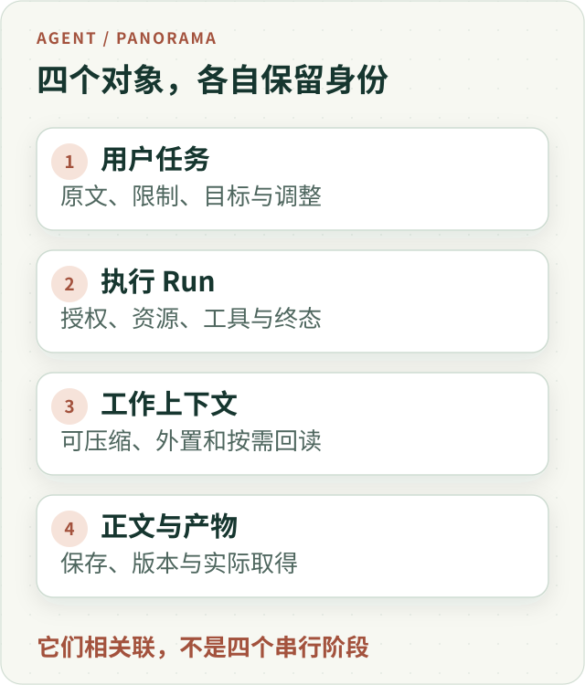
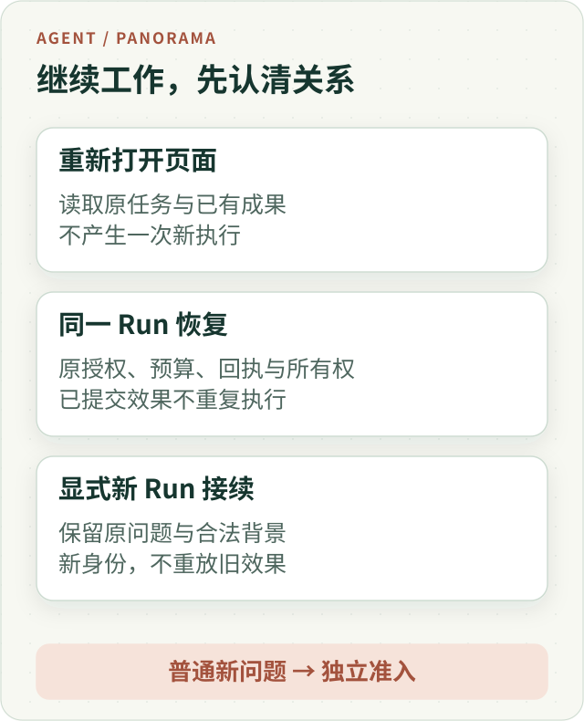
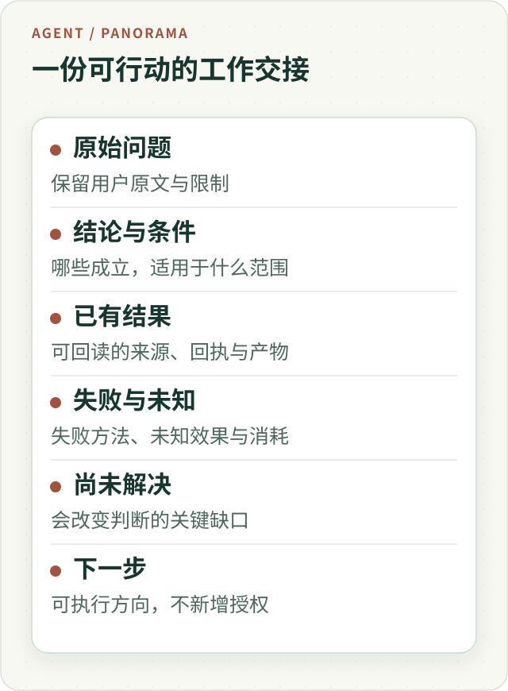

# 超长研究全景：让 Agent 跨越上下文、中断与时间继续交付

用户交来一个问题：“请比较两只主题基金与我的组合，先给我一份有依据的初稿，再把关键疑点查清。”模型读了很多资料，调用了几次计算，又启动几个专家。半小时后，进度列表很长，用户却仍不知道两只基金哪里不同，更不知道哪些结论可以采用。

问题不一定在于模型不够努力。它可能还没有读到关键披露，也可能已经拿到数据，却一直在继续搜索；计算可能成功了，但下游没有真正消费结果；答案甚至已经生成，只是没有保存为用户可以重新打开的成果。这些情况看起来都像“研究还在继续”，需要的修复却完全不同。

这里的“超长”没有统一的小时数或 token 阈值。它指的是：**一项研究的生命期，已经超过一次请求、一个上下文窗口或一段不间断进程能够承载的范围。** 扩大窗口、延长超时可以推迟某些限制，却不能回答研究是否推进、该不该交付，以及中断后凭什么接着做。

本文沿同一项教学任务展开。基金、数值和路径演练用于解释机制；真实工程观察会单独标明，不把它们拼成一次已经完成的端到端投资研究。我们要建立的整体关系是：**新证据改变研究判断，原记录保留已经发生的事，成熟的成果持续到达用户。**

## 一、先分清四个会被误叫成“会话”的对象

长研究首先是一个身份问题。用户认为“还是刚才那件事”，不意味着系统里的所有状态都应该共用一个生命期。

| 对象 | 保存什么 | 为什么不能互相替代 |
| --- | --- | --- |
| 用户任务 | 原问题、限制、明确调整，以及希望取得的成果 | 可以跨越多次执行；“继续”不能替换原问题 |
| 执行 Run | 本次授权、资源、模型轮次、工具效果和终态 | 进程恢复可以继续同一 Run；新执行仍有自己的身份 |
| 工作上下文 | 当前推理需要的原文、摘要、结果引用和未解问题 | 它会压缩和变化，不能成为所有历史的唯一副本 |
| 正文与产物 | 已接纳的报告版本、文件及交付记录 | 研究仍在继续，已经成立的成果也可以保存和阅读 |

*图 1 · 四个对象彼此关联，各自保留原身份。工作上下文变短，不应使已记录的用户要求、工具效果或报告消失。点击可查看完整矢量图。*

这一区分决定了产品怎样对待时间。用户关掉页面，只结束一次观看，不必结束已获准后台执行的研究；服务换了进程，不必重算已经完成的工作；用户要求补查，也不必覆盖旧报告。反过来，一次新提问不能仅因为出现在同一聊天里，就自动获得前一 Run 的来源访问权。

对一次性问答，这样拆分可能不值得。只需读一段材料并回答时，普通请求和历史记录已经够用。只有任务确实跨越窗口、进程或交付阶段，混在一起的身份才开始造成重复执行、串话和成果丢失。

## 二、研究怎样前进：让新证据改变下一步

### 进展改变的是判断，不是活动列表

继续基金比较。主模型想计算两只基金的精确持仓重叠，读取后发现一只只披露前十大，另一只披露完整持仓。此时再搜索十次同一份摘要、换一个专家复述，未必增加任何价值。真正有用的下一步可能是找同口径资料，计算已披露部分的已知贡献，或撤回“精确重叠”这个暂时无法成立的目标。

判断进展时，可以问：**新信息改变了原问题的哪一部分？** 它可能补上事实，也可能否定假设、暴露冲突，或者证明现有材料只能支持更窄的答案。合理收窄结论也是进展；把未知悄悄写成零不是。

当前模型指引把常见缺口分成三种临时思考角度：

- **缺证据**：不知道基金份额类别、报告期或具体持仓，需要取得原始资料。
- **缺变换**：数据已经取得，但还没对齐日期、统一单位、聚合或计算。继续搜索不能代替这一步。
- **缺判断**：事实和计算已经足够，尚需解释它们如何回应用户的问题，以及什么结论仍不能下。

这不是三条固定路由，也不是新的数据库字段。它的作用是提醒模型在重要结果、失败、冲突或研究阶段变化后重新选择下一步。把“还不确定”一律翻译成“再搜索”，会让长研究停在收集材料的阶段。

### 问题清单可以改，原问题不能被勾掉

ETF Agent 用研究问题清单帮助模型记住重要缺口。新证据可以让一个问题从待查变成有答案，也可以重新打开先前认为解决的问题。没有实质变化时，不必为了留下活动痕迹再更新一次。

关键在于，这张清单是**模型的工作判断**。将条目设为 `resolved`，不能证明来源可靠、比较正确或用户已经同意；删除一个条目，也不能取消用户原本提出的要求。相应地，保留 `unresolved` 并交代限制，可以是诚实结束，而非必须阻断交付的异常。

运行时可以确认清单保存了、工具返回了哪些内容、它们是否真正进入下一次请求，却不该通过关键词、条目清空或调用次数推断“研究充分”。把这些指标做成自动完成门，模型很容易学会满足表格，而不是解决问题。

### 工具成功之后，还要确认结果能被消费

近期一条**受控工程验证**很能说明这一点：原生分析已经完成，转换后的内容本身也能被基金研究方法读取，但包上真实工具返回结构后，下游拒绝了输入。原因不是算错，而是消费者只认旧脚本的 `exitCode=0`；当前原生分析的完成合同没有这个字段。

修复没有伪造退出码，也没有让模型重抄一遍数据。原输入解析器识别当前已完成的分析结构，并要求保留输出的 UTF-8 字节数完整、未截断，再交给既有方法读取。失败、取消、未知或不完整输出仍不能冒充可用结果。来源授权与计算含义继续由原责任方负责。

这个反例改变了排查顺序：看见“工具成功、研究没前进”，先检查真实输出是否到达了消费端，再判断模型有没有用好它。只改提示词无法修复协议不兼容；只修协议也不能证明模型以后一定会作出正确研究选择。

## 三、先交出有用的阶段结果，再围绕缺口继续

### 反馈与交付回答不同的问题

“已找到两份报告，正在核对口径”回答的是用户是否还需要等待；“费用比较已核实，但持仓只能覆盖披露部分”开始回答研究问题。两者都可能有价值，却不能合并为同一个完成指标。

一条值得发送的进度反馈，通常发生在研究路线改变、关键限制出现、用户需要决定，或等待已超出合理预期时。它不需要伪装成报告。**阶段成果则应在内容已有独立价值时出现，而不是等到所有分支完成。** 如果费用口径已核实，持仓来源还在等待，前者可以先交；如果缺失的恰好是费用生效日期，就不能为了“早点有答案”发布一个确定数字。

当前原生研究指引要求模型在研究阶段及时发送已有支持、能够独立阅读的部分，并沿原正文发布路径处理。它没有引入一个 `answerReady` 字段、定时强制写作调用或第二个初稿生成器。成熟与否仍由模型结合原问题和实际证据判断，运行时只执行已有的来源、数值、权限、版本与资源约束。

### 完整取得，不等于完整覆盖

用一个明确的合成例子看“成熟”的范围。组合中某基金占 20%，它已披露的两只股票在基金内分别占 25% 和 15%。可计算的已知组合暴露是 5% 和 3%。剩下 92% 仍未知，其中 80% 来自尚未观察的组合其余部分，12% 来自这只基金未披露的部分。

这份结果可以支持“已知暴露及未覆盖范围”，不能支持“完整组合穿透”，也不是两只基金的加权重叠率。网页全部读完，只证明传输完整，不会让原本部分披露的财务材料变成完整数据。对应的原生消费验证已经把这组口径传到保存、下载的 HTML；它使用合成输入与受控请求，不能据此声称真实模型自主完成了整项金融研究。

阶段交付需要这类贴近结论的范围说明，而不是先写过强结论，再在文末统一免责。已经成立的独立正文，也不应被一个坏掉的引用附件或无关慢查询吞掉；真实权限拒绝仍限制对应内容。

### 快，不意味着尽早结束；深，也不意味着用满预算

有证据支持原问题，就应综合回答。再找几个没有改变判断的来源、重复总结已经交付的部分，未必增加深度。反过来，一个会改变用户判断的冲突还没解决，就不能因为已经发过一段文字而宣布完成。

时间约定也要准确。“十分钟内给我”允许提前交付；“十分钟后通知我”约束通知时点，不意味着模型必须空转十分钟，更不意味着要隐藏已经独立获准展示的正文。到时仍未完成，应报告真实已有成果与缺口；后续是否继续取决于原授权、明确期限和剩余预算，不能把迟到的部分结果记成按时完整交付。

最后还要说明下一份结果是什么。聊天可以只展示增量；用户要的是报告时，更新稿应整合仍成立的旧结论、新发现和更正。只谈最后一个角度的短文，不能取代原报告后又被叫作“完整更新”。

## 四、上下文减负：外置结果、保留原文、按需回读

长研究的上下文不是档案馆，而是当前工作的桌面。真正需要减掉的，是不再帮助下一步判断的负担，而不是原始任务和事实来源。

**原始要求独立保留。** “只使用指定报告期”“不要访问个人持仓”应保持原文和来源身份。助手写下的“用户大概希望全面分析”不能覆盖它们。当前 Main 压缩把原始任务、适用调整和权威状态放在语义改写之外。

**大结果外置，按引用回读。** 长表、网页和 PDF 提取结果可以保存后给出摘要与定位。摘要帮助选择；精确计算或有争议的结论仍要回到实际取得的原结果。读过一个片段，不等于检查过整个文件；结果有下一页，也不自动否定已经完整取得的当前片段。

**压缩工作过程，而非执行事实。** 已完成的研究步骤、失败方法、带条件的结论与未解问题可以形成工作摘要。调用是否完成、授权范围、数值来源和正式报告是否保存，仍从原回执取得。未知效果不能因为摘要写了“已处理”就变成成功。

[Anthropic 的上下文工程文章](https://www.anthropic.com/research/effective-context-engineering-for-ai-agents)把压缩、外部笔记和子代理作为长任务的不同工具，也指出按需读取需要付出检索延迟与工具设计成本。这里的本地选择是把工作摘要与权威事实分开，让模型减负，同时还能回到未改写的依据。

这不是“越压越小”即可。当前 Main 实现按已结算的完整历史区间生成独立摘要，不把调用和结果切开，也不把旧摘要反复总结成新摘要。它减少了递归压缩的失真机会，代价是摘要本身会逐渐占满空间。原文、工具定义、摘要、输出预留与传输开销都要计入完整请求；容量仍不足时，只能沿原有的有界收尾或接续方式处理，不能承诺无限长上下文。

[Anthropic 的长期运行实践](https://www.anthropic.com/research/effective-harnesses-for-long-running-agents)使用进度文件、Git 历史和可验证的功能清单帮助编码代理接班。这对可观察的工程功能很合适。开放研究可以借鉴“留下可接续产物”，但不能照搬成“问题清单全通过即研究正确”：后来的证据可能推翻早先结论，研究目标也未必能预先列成完整验收项。

## 五、进程会死，已经发生的事不能跟着丢

浏览器断线、模型请求失败、整个工作进程崩溃，是三种不同故障。没有前台连接，不等于研究已停止；看不到旧进程，也不意味着可以从头启动另一份工作。

同一 Run 的恢复先找原执行身份、持久检查点和工具回执，再由持有有效执行权的进程继续。租约与隔离旧执行者的机制解决“谁能写”；工作摘要解决“下一步如何理解任务”。这两个问题不能只靠一份自然语言交接同时解决。

| 已记录的情况 | 恢复时的合理动作 |
| --- | --- |
| 效果明确完成且结果可读 | 重读原回执与结果，不重复执行 |
| 明确失败，且原动作允许安全修复 | 按原预算、取消与幂等条件决定是否重试 |
| 请求可能已经执行，但没有可靠结算 | 保留未知，由原效果负责人查询、对账或按既有策略处理 |

持久化游标可能落后于真实效果。比如结果已经保存，进程却在推进检查点前崩溃。此时保存回执应优先于旧游标，不能因为游标还停在“待保存”就再做一遍；更不能通过换一个请求身份，把旧的未知费用当成不存在。

这并非某个 Agent 独有的问题。[LangGraph 的容错文档](https://docs.langchain.com/oss/python/langgraph/fault-tolerance)同样区分节点重试与外部效果，并要求应用处理幂等和未知确认。框架能提供持久状态与恢复机制，仍需要应用决定哪些效果可重放。没有依据承诺任意外部工具都天然“恰好执行一次”。

ETF Agent 选择由既有原生循环直接顺序推进模型回合、动作执行与完成处理，由原恢复模块保存唯一执行游标。旧图工作流层已退役，原因是它与现有恢复机制重复表达同一套进度，而不是图框架不能做长研究。若新项目尚无成熟执行与持久化层，直接采用框架可能更省工程成本；已拥有这套边界的项目，再加第二个游标反而需要持续对账。

本系统的同一 Run 恢复沿用已记录的原授权，不在恢复中重解释变化中的权限表。账户与范围身份、明确取消、执行权和资源上限仍有效；历史展示和新 Run 读取分别遵循自身入口。资料字节缺失是可用性问题，不能扩大成整个 Run 授权消失。

恢复也不承诺 Python 内存变量、打开的 Reader 或临时文件原样复活。需要交付的表格和报告必须进入正式产物路径；一份旧结果引用，更不自动授权另一个 Run 读取整个旧工作区。

## 六、恢复、显式继续与普通新问题，走三条不同的路

*图 2 · 连接恢复不创建新工作；同一 Run 恢复保留原执行事实；显式继续建立有来源关系的新 Run。普通新问题独立准入。*

| 情况 | 执行关系 | 必须保留什么 |
| --- | --- | --- |
| 重新打开页面 | 观察原任务 | 进度、已保存成果，不重跑工具 |
| 工作进程故障后恢复 | 同一个逻辑 Run | 原授权、预算、回执、取消和执行所有权 |
| 用户显式选择原研究继续 | 关联父研究的新 Run | 原问题、适用限制、获准背景，新执行身份 |
| 用户提出普通新问题 | 新任务按原入口处理 | 当前问题及其授权，不自动绑定上一项研究 |

为什么要特别保留原问题？历史上有过真实 Continue：父 Run 关联正确，新正文能够显示，历史读回也一致，研究方向却偏离了原多指数任务。调查发现，后继请求里的原用户上下文为空。这个失败不能通过“保存成功”验收，也不能仅从新答案主题猜测是哪一层丢了内容。

后续修复把显式接续交给已有准备模块：保留原始用户文本，单独携带助手摘要、来源记录、问题清单与固定授权，不再让通用入口把任务重新分类成“用户想继续”。实际后继验证了这些内容进入主模型；模型是否完整整合旧结论仍另外评价。

父研究已经有合法身份的显式接续，与研究工作区里普通发起一项新研究，也不能混用。前者按既有 Continue 合同继承适用的来源与工具授权，并绑定新 Run；新的提供方数据接收授权等效果仍按对应入口处理。后者通过普通准入建立独立授权，旧报告、文件与更正只是可选择的材料。列在目录里不代表已经读取，更不代表可以绕过材料资格。

跨多次研究保存进展时，同样保留作者身份和版本。模型的“这个问题已解决”是工作记录，不是用户确认的目标，也不是交易指令；新证据可以重开问题，遗漏旧条目不等于问题消失。这样，接续既能带着历史向前走，又不会把过去的判断固化为今天的事实。

## 七、用户可以随时调整，但“收到”与“采用”要分开

研究仍在后台，用户在主对话问了一个短问题，又在原研究面板补充：“请把跟踪误差也纳入比较。”前者可以独立回答，后者需要进入指定研究。一个全局忙碌状态无法表达这种关系。

调整有三层不同的结果：**原消息已保存，后续模型请求实际带上它，最终答案真正回应了它。** “已收到”只证明第一层。即使第二层成立，也不能自动认证第三层，因为模型可能误解、遗漏或得出错误结论。

一条真实故障说明，即使纠偏已经进入模型输入，研究仍可能失去继续取证的能力：原请求被按预期抢占，但适配层把“这次请求为新要求让位”压成了普通取消。运行时于是将整项研究推进到只许收尾的阶段，模型失去了继续取证的工具。修复应保存并交接真实中断原因，而不是增加重试次数，或要求用户把指令再说一遍。

修复后的真实后继继续搜索和读取，后来的独立交互验证也观察到后台研究与短问分离。但同一组研究仍出现过语义错误：模型从两份文件的措辞推断“跟踪约束严一倍”。独立后继重新读取一手资料后撤回了推断，旧报告和更正分别保留。

这两个问题必须交给不同责任方。中断原因丢失是工程接缝问题；“严一倍”需要原文解释与金融语义复核。把后者修成运行时关键词禁令，既可能误杀合法比较，也没有解决模型怎样使用证据。反过来，只加强模型指引，也修不好错误的取消原因。

[OpenAI 的 deep research 介绍](https://openai.com/index/introducing-deep-research/)描述了依据新信息调整研究路径，并在 2026 年更新中加入实时进度与研究中途调整。它说明这是一类真实产品需要处理的交互；公开产品说明不能替我们证明自己的消息隔离、恢复或结论质量。这里的实践增量，是沿原消息、实际模型输入和交付结果逐层验证调整究竟到达哪里。

## 八、长研究的资源约束要让模型和运行时看到同一件事

长研究需要继续的空间，也需要诚实停止的边界。模型请求、工具计算、并发等待、输出整理与保存，消耗的资源并不相同。不能用一个“还剩几轮”的数字，替代所有限制。

当前实现区分主研究、子代理执行与实际提供方请求的记账。子代理有自己的执行额度，不应无限挤占主模型形成结论的空间；主模型专门发送成果的回合，也可以按原策略与探索轮次区别计数。**这种逻辑额度安排不退款真实模型调用：发送过的请求、时间和未知用量仍按原记录保留。** 旧 Run 继续采用自己的已记录策略，不能在恢复时悄悄升级额度。

模型应看到与真实执行一致的资源事实。产品说还可以继续，外层脚本却偷偷只给更低上限，会使模型在错误条件下规划，也让失败无法归因。压力测试可以收紧额度，但必须把它作为明确实验条件，而非藏在另一个计数器里。

资源提醒的作用是促使模型重新分配工作，而不是让运行时替它判定研究充分。接近边界时，可能应停止低价值探索、交付已经支持的分析，或明确说明缺口；真正的硬上限到达，则由运行时限制相应新效果。已经独立获准的正文不应因为最后一次整理没有额度而消失。

多代理也不是免费延长研究时间。[Anthropic 的多代理研究实践](https://www.anthropic.com/engineering/built-multi-agent-research-system)强调清楚的分工、动态搜索与结果综合，同时指出多代理的额外消耗，以及高度依赖共享上下文的任务未必适合拆分。对基金比较，独立核对两份披露可能值得并行；让多个专家反复解释同一张小表，未必值得。

决定是否委派时，应该能说出这一分支预计减少什么不确定性、主模型将如何取得结果，以及结果来晚了怎么办。子代理完成、提交、进入主请求、被主模型采用，是不同事实。主 Run 到达硬边界不会因子代理仍忙而无限等待；一个已提交但从未被消费的好结果，也不能算最终研究已经获益。

停放等待与空转同样不同。受支持的唤醒机制可以在合法条件满足后继续原工作；一般提醒应进入下一次已经允许的模型请求，而不是为了检查时间再调用模型。没有已配置的唤醒路径，就不应许诺“以后自动继续”。

## 九、判断接续有没有价值，要回到原任务

只看最终报告，很难知道系统在哪个环节浪费了时间；只看调用轨迹，又容易把忙碌当作认真。评估需要同时保留任务、证据和用户可见成果。

可以从一次实际交付倒查：

1. **原问题有没有到达？** 查看实际后续输入中的原任务、调整和限制，而不是只看父子 Run 关联。
2. **哪些关键未知改变了？** 新来源补上了什么、计算修正了什么、旧结论为什么撤回。重复读取可能是在核对不同口径，不能仅按次数判浪费。
3. **最早有用的内容是什么？** 它必须回应一个实质请求，并有相称依据。计划、心跳、非空预览和错误的早期数字都不算。
4. **用户能否再次取得？** 将实际可见、耐久保存、文件下载和完整更新报告分别核对，避免一项成功掩盖另一项缺失。

“首份有用答案时间”因此比“首个字符时间”更接近等待体验，但也更难测。需要把被审阅的内容版本与实际客户端显示时点绑定，缺少同一时钟或显示证据时保持未知。早期错误后来被修正，不能倒过来把早期时间记成正确成果到达。

比较两个方案时，也必须保留没有答案的样本。若只计算成功回答的平均耗时，快速失败、放弃难题或缩小用户范围，都可能让指标看起来变好。至少同时看有用成果是否取得、语义和来源错误、完整任务范围，以及真实资源成本。这里是在说明当前评价口径，不是在宣称本系统已经取得某个延迟改善。

模型和人工审阅负责判断证据是否支持结论、答案是否回应了问题；运行记录负责证明读到了什么、发出了什么、保存了什么。评审结论可以指导下一轮模型或工程改进，不应被偷偷塞回生产路径，变成新的语义发布门。

## 十、把整条链放进一次教学演练

现在让开头的合成任务经历几次变化，检查每个机制是否真的服务于研究。

**先建立一份可用成果。** 主模型读取费用和披露日期，确认可比较的口径。费用小节已能成立，于是交付；持仓覆盖不一致被放在相关结论旁，而不是藏在末尾。用户得到的不是“计划已完成”，而是一份有边界的初稿。

**再围绕会改变结论的缺口工作。** 一条分支寻找同口径披露，另一条计算已知持仓贡献。主模型区分缺资料、缺计算与缺解释，避免在已经得到数据后继续漫无目的地搜索。子代理返回可定位的结果、条件和未解问题，不只说“已完成”。

**用户提出调整。** “加入跟踪误差”沿原消息进入目标研究。当前请求在支持的安全点让位，后续请求采用新要求；另一个短问仍属于自己的执行。主模型据此重开相关问题，而不是把原来标记完成的清单当作不可改变的计划。

**上下文和进程先后达到边界。** 已结算过程压缩为工作摘要，原要求与原结果留在各自记录。服务中断后，恢复者读取旧回执：已完成计算直接回读，未知效果先保留未知。已交付的初稿仍可打开，不要求模型重新写一次来证明它存在。

**在当前窗口诚实结束。** 若同口径资料仍取不到，就保存已有成果与明确缺口，并保留真实消耗。用户显式继续时，关联新 Run 带着原任务和获准背景开始；它不重放旧效果，也不能把未读的历史目录当成已经掌握的材料。

**最后交付完整更新稿。** 新证据可能补上缺口，也可能撤回初稿中的推断。聊天告诉用户发生了什么实质变化，报告整合仍然成立的发现、来源和更正。历史版本保留其时点，正常结束不等于所有未知都已消失。

*图 3 · 交接保留下一位研究者需要的内容。原始记录可回查，摘要帮助行动，二者共同避免重复劳动与事实丢失。*

这是一条设计演练，不是一份把所有组合都跑过的验收记录。它的用途，是让读者检查每次交接到底保留了什么、改变了什么，又由谁负责。

## 十一、已有实践说明了什么，下一步应该怎样采用？

当前私有实现已经具备原生研究循环、结果回读、Main 上下文压缩、分段正文、同 Run 恢复与显式接续的相应机制。后台研究与多个短问重叠、定向调整进入后续请求、报告与历史回读也有真实交互观察；并发会话能力仍默认关闭，不能把这些观察直接写成生产启用。

近期原生分析结果消费修复，把一条合成的组合输入、披露读取、计算和文件读回链接通了。它解决了真实实现缺口，但个人金融研究增强仍未整体完成，真实模型选择、完整业务判断和各类恢复组合不能由这条局部验证代替。前述“跟踪约束严一倍”的错误，也提醒我们：执行连贯之后，研究质量仍须独立验证。公开教学项目提供哪些能力，应以它已发布的版本为准，不能从这幅私有系统全景推定。

要给现有 Agent 增加长研究能力，可以从一个确实需要多轮资料处理的任务开始，按三个问题逐步推进：

- **先问为什么没有成果。** 是关键证据没找到、数据还没变换、结果未到消费端，还是模型没有及时综合？先定位，再选修复。
- **再问什么已经值得交付。** 找一个能够独立成立的结论，通过真实显示与保存路径交给用户；核心依据不足时，保留它的未知，不制造占位答案。
- **最后问中断后凭什么继续。** 核对原任务、结果回执、资源消耗和报告版本能否回到下一次实际工作中，再根据瓶颈增加压缩、子代理或跨 Run 接续。

长研究的目标不是永不停止。它应当让每一段继续都有理由，每一次停下都留下可理解的状态，每一份成熟成果都能被用户取得。模型可以换一轮上下文，进程可以换一个执行者；只有原问题、已经发生的事与新的判断仍然连得上，运行更久才可能成为研究更深。

---

[全景系列](/panorama) · [完整英文版](/en/articles/agent-long-horizon-research-panorama)

延伸阅读：[后台研究与前台交互](agent-background-research-collaborative-experience.md)提供真实交互案例；[同一 Run 上下文压缩](agent-main-run-context-compaction.md)展开工作集减负；[断线与恢复](agent-disconnect-is-not-crash-recovery-contract.md)讨论执行生命期；[异步研究的时间约定](agent-asynchronous-research-time-bound-delivery.md)讨论期限与阶段成果。

更多工程实践见 [ETF Agent Engineering Notes](https://github.com/hpoenixf/eff-agent-article)，欢迎 Star，方便后续阅读。
