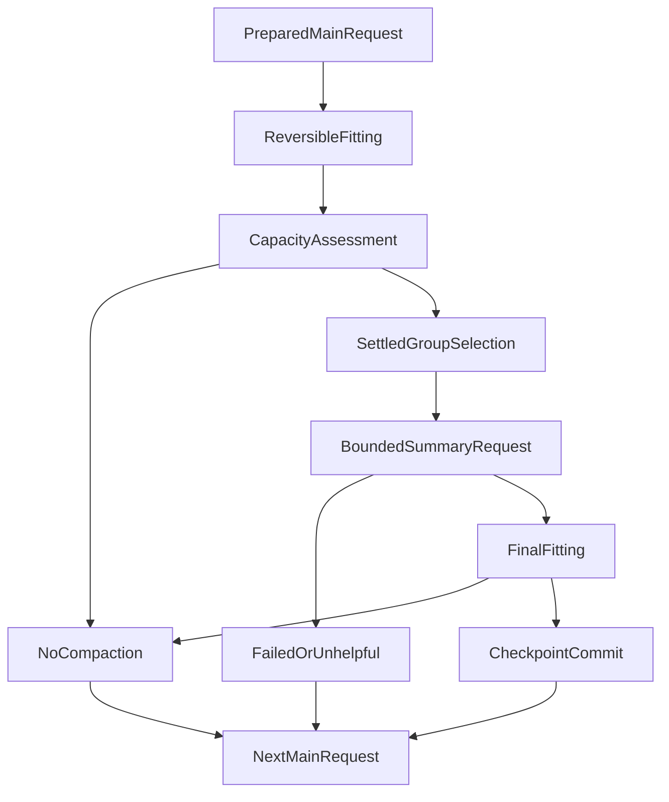

# 上下文快满时，为什么不能直接把历史交给模型摘要？

一段深度研究可能持续几十轮。模型读完一份长 PDF，又查询多个基金，再用 Python 计算，最后还需要核对引用与生成报告。随着工具调用增多，真正困扰我们的不只是“上下文不够放”，而是：**模型下一轮需要继续思考，旧内容却既占空间、又包含不能改写的执行事实。**

常见做法是请模型把前面的对话压缩成一份摘要，再拿摘要继续运行。这能缓解长度问题，却留下更危险的问题：如果摘要把“准备调用工具”写成“工具已经成功”，把用户的修正写丢，或者把一个过期数字写成最新事实，后面每一步都可能站在错误的上下文上。

我们为 ETF Agent 的 Main Research Run 增加上下文压缩，最重要的设计决定不是压缩率，而是**让模型只负责生成有损工作摘要；原始任务、授权、工具执行、金融数字、引用和恢复状态继续由原来的确定性记录负责。**

本文主体解释原系统的完整设计，末节用 [Open ETF Agent](https://github.com/hpoenixf/open-etf-agent) 的公开实验展示其中已经可运行的“便笺采用—原文回读”切片。后者没有原系统的冷恢复能力，不能用一个 demo 代替整条研究链路的验收。

## 一、三种减负手段，不能当成同一件事

最初，工具一旦返回结果，就可以全部跟着对话历史进入后续模型请求。对于一次简单查询，问题不明显；研究变长以后，旧结果、重复材料和多轮修错记录会挤占真正需要的上下文。

我们已经采用过两类办法。

第一类是**结果外置**：大表格和文档内容留在受控结果仓库，模型先看目录，需要时按版本与范围读取。它解决“完整结果是否必须一直放在上下文”，但不能自动消除已经发生的模型轮次历史。

第二类是**可逆拟合**：缩小辅助目录、替换可重新读取的旧工具内容、调整安全的展示形态，让最终请求在容量限制下尽可能保留有用材料。可逆意味着来源仍在，模型以后可以重新读取准确内容。

第三类才是**语义压缩**：连旧模型轮次的工作过程也被提炼成摘要。它不可避免地有损，所以必须排在前两者之后，而不是遇到压力就随手把全部对话交给一个总结模型。

[Anthropic《Effective context engineering for AI agents》](https://www.anthropic.com/engineering/effective-context-engineering-for-ai-agents) 提醒过度压缩可能丢掉后来才发现重要的细节。我们的场景还有一个额外约束：研究不仅要继续生成文本，还要维护工具效果、来源资格和金融口径；这些不能通过提高摘要 Prompt 的措辞来保证。

## 二、先问“容量有证据吗”，再决定要不要压缩

什么时候启动一次摘要？直接数消息条数，容易误判。五条大工具结果可能比五十条短消息占空间更多；只统计正文 token，又可能漏掉工具 Schema、输出预留和请求封套。

我们采用的是有明确来源的**应用层压力策略**。当前默认策略按序列化后的完整请求 UTF-8 字节计量：软阈值 256 KiB、目标 224 KiB，至少要节省 4 KiB，摘要不超过 6,000 字节。

这是一项工程上的应用阈值，不是供应商提供的 token context window，也不是说某个模型拥有 256 KiB 上下文。真正的模型窗口、路由传输上限与最终发送检查仍分别由原来的 Owner 执行。

只有已经完成可逆拟合，且完整请求仍有明确压力时，Main 才考虑语义压缩。没有合格容量依据时，不把未知 token 数写成零，也不假定上下文无限大。

另外，压缩必须给接下来的研究与最终回答留出空间。系统不会在原有收尾资源已经需要保护时，为了追求更小的上下文再偷偷发一轮摘要请求。

## 三、压缩的不是整段对话，而是可证明已经结算的旧工作

这是整套机制最关键，也最容易被忽略的取舍。

模型可见历史并不是普通文本列表。一次 Tool Call 可能有参数、派发身份、响应、失败原因和是否可重试；它们构成一个协议单元。只留下“模型想查这个基金”，却删掉了对应结果，或者保留结果却找不到调用身份，都会改变后续模型看到的事实。

因此，候选区间必须满足几个条件：

- 只选择同一个 Main Run 内较早、已有可信封存与回执的模型轮次；最近的工作组继续原样保留。
- 一个工具调用及其结果必须整体处理，不能在中间截断；存在未结算或结果不确定的效果时，不能将它当作已完成区间。
- 用户原始提问与后来的明确纠正，始终以原样进入后续请求，不是摘要模型可以替换的内容。
- 已存在的摘要不再递归传给下一次摘要模型。新增摘要覆盖新的、互不重叠的已结算区间，避免一次次转述丢失细节。

这里的摘要输入尤其克制：当前实现主要从**可恢复的已封存模型工具提议**组织工作线索，而不是假装能重新取得未保留的隐藏推理、全部助手叙述或任意工具原文。缺少可用原材料时就不编。

这与 [Pi 的 Compaction 设计](https://github.com/earendil-works/pi/blob/main/packages/coding-agent/docs/compaction.md)有共同动机：保留近期上下文，摘要较旧的部分，让 Agent 继续工作。不同之处在于，我们刻意不让旧摘要递归成为新摘要的事实来源，并把工具、数值和授权的原始真值留在独立持久记录中。这是不同约束下的工程选择，不是通用质量优劣结论。

## 四、摘要只能描述工作，不能继承执行权

考虑一个简化研究过程：

> 用户要求比较现有科技基金的重叠与费用，并补充：“不要用一个月前的净值当作最新数据。”

旧轮次中，模型曾提出读取基金材料、计算持仓重叠，又收到工具的部分结果。如果让模型直接总结全部历史，它可能写下“已经完成重叠计算，最新净值无异常”。这句话即使听起来流畅，也不能证明任何一次工具成功或来源足够新。

我们的处理是把两种信息分开：

| 进入后继模型请求的内容 | 权威来源与处理方式 |
| --- | --- |
| 用户目标与“不要使用旧净值”这类纠正 | 原始文本及当前修订，保持精确语义与顺序 |
| 已执行的工具与结果 | 原始调用回执、持久结果版本及选区，可按需重读 |
| 早期模型工作线索 | 非权威摘要，只用于减少重复解释 |
| 当前 Research Needs、阶段与剩余额度 | 原运行时与资源事实重新投影 |
| 已提交答案、引用与文件 | 原 Publication、结果与文件 Owner |
| 基金净值、金额、单位与计算结果 | 各领域生产者及其受控数值／来源回执 |

摘要里的某串来源 ID、数字或“工具执行成功”都不能直接晋升为授权或计算事实；真正要使用时，必须沿现存的版本化读取入口取得合法原件。

这也意味着：摘要并不保证模型以后一定正确理解每个风险。我们的工程机制能保护输入和来源身份，却无法单靠结构证明模型的最终金融分析质量。

## 五、一次 Main 压缩怎样真正发生

可以把执行理解成“形成候选—摘要—检查净收益—提交—回放”五个环节：



图上的多个出口代表不同条件，而非所有步骤都必经：无合格压力或无可压缩区间直接保留原请求；摘要失败或净收益不足回到原历史；只有最后仍满足容量与身份约束，才提交新的 checkpoint。

实际生成摘要也是一次真实模型请求。它经过原 Gateway、请求预留、时间/资源限制、取消与失败结算；不会因为被称为“内部摘要”就免费，更不能新建一套预算。未知派发结果继续占用原回执，不允许换个 ID 无限重试。

摘要生成以后，系统会把候选投影放回**完整的下一次 Main 请求**，重新检查摘要、引用目录、工具定义与其余受保护文本合在一起是否真的节省空间。如果节省不足、最终容量不符合目标，原请求继续使用，不把一次无用摘要提交为成功历史。

可选的 `PreCompact` / `PostCompact` Hook 可以观测这一过程，但它们不获得改写原执行事实和强制采纳摘要的权限。

## 六、真正重要的不是摘要文本，而是 checkpoint 的身份

假设摘要已经写入模型上下文，随后服务进程退出。恢复时如果只能找到一段文字，却不知道它替代了哪几轮、基于哪个版本、是否已经付费，就可能再次摘要、重复执行工具，或者把旧摘要插到错误的位置。

我们因此在原 Recovery checkpoint 里保留一段不可变的压缩记录，绑定：

- 原 Run 和 scope、前驱修订、当前纠正修订及所选模型路由；
- 被压缩的完整轮次与来源哈希；
- 从真实回执派生的工具结果引用和选择范围；
- 摘要请求身份、模型/Prompt 版本与摘要文本。

摘要段只描述**后继模型应该怎样投影历史**，它不是新的执行 cursor、来源注册表或金融事实库。冷恢复时读回这些记录，原工具结果仍然按旧身份读取，不需要为了找回上下文重新触发工具或网络抓取。

对比一个常见的反例：进程已经提交 checkpoint，却在返回 ACK 前断线。如果恢复逻辑只看本地“是否收到成功”，就可能重新调用摘要模型。这里则读取原持久回执，保留上次尝试的结算状态；无法证明效果时维持 unknown，不伪造一次安全重试。

即使以后显式关闭新压缩，先前已经提交的合法摘要仍可随原历史恢复。这是能力开关与既有持久事实不同的一个具体例子。

## 七、一次真实触发证实了什么，又没证实什么

截至 2026 年 10 月 21 日，已经有三类不同强度的材料。

第一类是离线实现证据：受控 Factory、请求组装和隔离 PostgreSQL 验证过完整工具单元保护、摘要净收益检查、提交、冷恢复、纠正、未知效果与原结果回读。部分测试使用较低的合成应用阈值专门触发压力，这些数值不能冒充普通环境的模型窗口。

第二类是默认接线与边界验证：当前 Main 压缩策略在原运行时默认启用压力触发；低于阈值、显式关闭、来源不合格或资源已进入收尾保护时，不应额外发出摘要请求。默认启用也不表示每次深研都会发生压缩。

第三类是后来补核的真实研究记录：2026 年 10 月 20 日的 PUBLIC01 深研确实观察到**至少一次自然摘要请求完成，且 checkpoint 摘要段已经提交**。这不是只有规划，也不是只有 fake 模型。与此同时，那次完整研究最终为 partial，最后收尾请求额度耗尽；压缩已经成功发生，不代表整个研究因此完成。

目前已实现按压力触发的压缩及相关受控恢复路径，但真实连续研究中，压缩摘要能否始终被后继 Main 正确消费、经过多次压缩后是否保持语义、引用和金融数字准确，仍缺乏充分的对照观察。

这套机制延续[原则 5「Context 是工作台，不是事实数据库」](/principles#principle-5)：压缩后的文本只是有损工作线索，不能获得回执、数字或来源的事实权威。按[方法 3「证据传递与投影」](/principles#method-3)区分原件、模型可见摘要和实际请求，才有机会在节省容量时不改变研究事实。

## 八、这套设计的代价，值不值得付

受保护原件不会凭空缩短。保留精确用户文本、工具回执、引用目录与新增摘要自身的字节，都要占用下一轮容量。若已经没有足够的可压缩旧工作，系统仍会走原有的有限继续、部分交付或失败规则，而不是递归摘要直到看起来能装下。

此外，摘要本身产生真实请求费用与时间；维护身份绑定和 checkpoint 也比简单替换一段消息复杂。它换来的不是“永远不会溢出”，而是三条可验证的纪律：

**只压缩可以安全退休的旧过程；只采纳确有容量收益的候选；任何摘要都不能重写原始事实。**

面对持续运行的 Agent，上下文管理更像一种有损缓存策略，而不是一种新的记忆权威。判断它是否有效，要同时看请求实际送达了什么、系统是否能恢复，以及最终研究有没有因为语义遗漏而变差。

<!-- open-etf-agent:minimal-experiment:start -->
## 在公开代码里观察“便笺采用—原文回读”

[Open ETF Agent](https://github.com/hpoenixf/open-etf-agent) 已把其中一条路径做成可运行的公开实验：读取合成材料，在显式字节压力下生成派生便笺，把便笺放进后继请求，再分别读取便笺和原始页面。它复现的是**压缩不能替代原件**这条边界，不是前文整套 Main Recovery checkpoint。

[`compaction.mjs`](https://github.com/hpoenixf/open-etf-agent/blob/05c0dd2dc550f4f7e5da034340ff5c3159768fcf/src/compaction.mjs) 先以现有的可逆上下文投影作为基线，再选择较早、完整且成功结算的工具调用组，保留最近一组和用户问题。候选便笺必须连同原始引用一起比这份实际基线更小，而不是拿一份本来就会外置的巨大原文虚算节省量。摘要等待失败、没有净收益，或者摘要生成与保存期间依据已经变化，就不采用候选；“文件已经写下”本身不等于“后继请求已经使用”。

使用 Node.js 26.11.1–26.x，在一个新的目录运行固定快照：

```bash
git clone https://github.com/hpoenixf/open-etf-agent.git open-etf-agent-compaction-demo
cd open-etf-agent-compaction-demo
git checkout --detach 05c0dd2dc550f4f7e5da034340ff5c3159768fcf
npm ci --ignore-scripts --no-audit --no-fund
npm run demo -- --case compact-and-reread
```

首次安装可能访问 npm；安装后的这个案例不调用远程模型。演示在 [`working-demo.mjs`](https://github.com/hpoenixf/open-etf-agent/blob/05c0dd2dc550f4f7e5da034340ff5c3159768fcf/src/working-demo.mjs) 中显式设置较低的合成字节阈值，用固定脚本产生摘要；这个阈值不是模型的 token 窗口。Runtime 真正执行的是依据检查、净字节比较、便笺持久化和后继请求装配。

这条案例不止检查磁盘上有没有一个摘要文件。后继 Gateway 必须先在实际输入中找到 `derived-working-note`，才会发出 `read_note`；随后用原先获得的 `resultRef` 调用 `read_result`，核对原始页面身份，再保存带原始来源引用的报告。终端 JSON 给出本次 `directory` 和报告 `receipt`；将该目录作为 `node src/cli.mjs --observe` 的参数，可以看到 `working_note` 的 `applied` 状态、采用的 `noteRef` 及前后字节数，和后面的实际读取、文件保存事件。

[`working-note.mjs`](https://github.com/hpoenixf/open-etf-agent/blob/05c0dd2dc550f4f7e5da034340ff5c3159768fcf/src/working-note.mjs) 给便笺保留 `origin: derived-summary` 与 `semanticStatus: unreviewed`。它的引用仍指回原始记录，便笺并没有取得原件身份。上下文里用于展示便笺的调用对还标为 `projectionOnly`、`dispatched: false`，避免把装配视图伪装成一次真实工具执行。

读者因此可以复现**便笺确实被采用、原文仍按原身份可读、报告确实保存**这条工程路径。这个公开切片没有前文的冷恢复能力，也没有证明真实模型会正确理解摘要。[首批真实模型调用](https://github.com/hpoenixf/open-etf-agent/blob/d075068ac99a6c798d012c46bff4fe0c33eb9979/docs/verification/live-v01-v05-first-batch.md)尚未触发压缩，不能替这条机制完成实测；这里的脚本观察验证的是输入交接和真实效果，摘要语义仍要单独评估。
<!-- open-etf-agent:minimal-experiment:end -->

<!-- open-etf-case:compaction@e1b8e4edde724548fab16d8ca4b205379bfa7f30 -->
### 检查便笺采用后还能回读什么

固定公开快照的[CLI 入口](https://github.com/hpoenixf/open-etf-agent/blob/e1b8e4edde724548fab16d8ca4b205379bfa7f30/src/cli.mjs)保留了同一个最小对照：先采用派生便笺，再回读便笺和原始页面。

在所链固定快照按 README 安装依赖后，运行：

```bash
node src/cli.mjs --case compact-and-reread --output runs/article-compaction
```

从终端给出的 `directory` 查看 `run.jsonl` 中的便笺采用、`read_note`、`read_result`，并读回 `report.md` 与 `manifest.json`。报告引用原始页面，派生便笺不替它取得来源资格。

便笺由合成脚本生成；这个案例检验采用与回读链路，不证明真实摘要的语义准确性，也不承诺压缩后所有历史仍在上下文内。
<!-- /open-etf-case -->


---

<!-- agent-article-sync:guidance:start -->
## 当前还需要观察什么

此变更已于 10 月 21 日按明确例外人工归档，并非标准 `spec:close` 通过。

受控路径已经确认摘要进入后继 Main 输入，真实研究也出现过摘要请求完成并提交 checkpoint。但那次真实摘要是否被后继请求正确使用，以及连续压缩后的语义、数字、引用和成本收益，仍需进一步观察；压力触发已经启用，不等于这些质量问题已经解决。

近期 Runtime 的 Access/Memory/Factory 重构也没有把摘要升级为 Memory 或历史数据权威。需要精确数值时，仍沿原来源和结果回读；后继请求实际看到什么与最后研究是否完成，继续分别验证。

## 延伸阅读与交流

**不要混淆两类摘要：** 本文聚焦一次 Run 内旧工具回合的 Checkpoint；[A41 跨 Run 会话压缩](/articles/agent-conversation-history-compaction-source-boundaries)则把同一 Conversation 已完成的旧问答对按来源身份、不可变摘要和容量投影交给后续 Run。两者的最终负责事实、失败回退和验证范围不同。

[在个人博客阅读本篇](https://hpoenixf.com/blog/agent-main-run-context-compaction) · [公开工程文章文集](https://github.com/hpoenixf/eff-agent-article)（欢迎 Star）。
<!-- agent-article-sync:guidance:end -->
