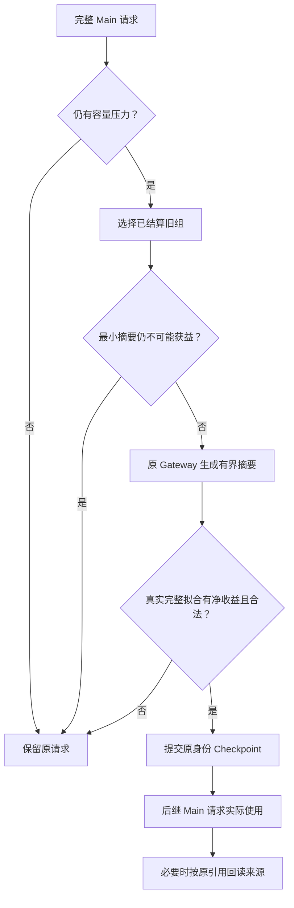

# 上下文快满时，为什么不能直接把历史交给模型摘要？

一次基金研究已经翻过数十份资料，Main 还需要继续分析。最简单的办法似乎是让模型“总结旧对话，再接着做”。但我们遇到的真正危险不是总结不够短，而是**一句流畅的摘要，把“模型曾经提议”写成“工具已经执行”，把“上季度数据”写成“最新事实”**。

我们采用的是 **LLM 生成式摘要（abstractive summarization）**：按时间顺序选择安全的旧工具回合，让现有模型把其中的工具提议概括成短便笺，同时保留最近两回合和原结果引用。它以新的自然语言概括旧动作，属于有损语义压缩；事实仍由原始记录提供。下面先拆开算法，再解释为什么选这种增量、非递归的做法。

<div><a id="一、三种减负手段-不能当成同一件事"></a></div>

## 一、不是所有上下文压力，都该靠模型摘要

我们把减负分成有先后顺序的三件事：**旧工具结果外置 → 可逆拟合和精确回读 → 必要时才有损摘要**。同一份 PDF 或基金持仓表，若已有原版本和合法选区，不该在每轮重复搬进请求；最近的工具调用及结果必须成对保留，不能只删结果、留下“曾调用”的空壳。

[Anthropic 的上下文工程](https://www.anthropic.com/engineering/effective-context-engineering-for-ai-agents)也强调上下文是有限工作空间。它提供的[工具结果清理](https://platform.claude.com/docs/en/build-with-claude/context-editing)很适合无需继续查看旧输出的任务。我们的金融研究要额外保证：**清掉模型当前视图，不等于清掉可核验的来源、授权或数值**。


### 实际算法：规则选区，模型写便笺，原件留在原处

这不是把整个聊天记录丢给模型。一次压缩有五个明确步骤：

1. **保留近期，选择旧组。** 按 Main 模型回合的时间顺序扫描，最近两回合始终保留。较早回合必须已有持久记录，工具调用与结果完整、已结算且身份一致；失败但已明确结算的调用也可能入选。遇到不安全边界就停止扩展，候选在当前消息序列中还必须连续，不能跨过保留的用户或系统消息。
2. **只组织可摘要的输入。** 输入是已封存的 assistant 工具提议：回合身份、调用身份、工具名和参数。用户原话、旧便笺、工具结果正文都不作为这次摘要的独立输入；缺失的模型叙述或隐藏推理也不补造。因此它概括的是“曾提议做什么”的工作轨迹，不能靠它重新归纳季报里的财务结论。
3. **通过现有模型生成短文本。** 复用 Main 的同一 Gateway 和模型路由，不另设专用压缩模型。提示词要求把提议仍写成提议，输出简洁纯文本，不调用工具。只有非空、未超字节上限、正常以 `stop` 结束的结果才进入采用检查。
4. **把原引用接回来，再计算收益。** 宿主独立保存调用状态、原 `resultRef`、合法选区和来源身份。它用“一条便笺 + 这份引用目录”替换选中的完整调用／结果组，再测量整个下一次请求。实际节省不足或超出硬容量时，保留原历史。
5. **逐段追加，不重新总结旧摘要。** 采用成功后记录不可变区间。下一次只选择尚未压缩的新旧工作，不把上一张便笺再喂给模型；多张便笺按原顺序继续计入请求容量。

用一个**教学简化例子**来看：四个 Main 回合中，前两个分别提议“查找两只基金的季报”“读取指定页”，后两个还在比较数据。前两个若构成安全连续区间，就可换成“此前提议查找两只基金的季报，并读取指定页”的便笺；对应调用究竟成功还是失败，由旁边的原回执说明。后两个回合保留原文。继续比较金额或日期时，再沿原引用回读页面，而不是从这句话猜数字。

<div><a id="二、先问-容量有证据吗-再决定要不要压缩"></a></div>

## 二、最意外的阻碍：越保守，反而越压不动

现行应用压力策略按完整请求 UTF-8 字节计量：默认软阈值 256 KiB、期望目标 224 KiB、最低净节省 4 KiB，摘要上限 6,000 字节。这是应用策略，**不是提供商的 token 上下文窗口**。

早期预检先假设“模型可能写出最大、最难转义的摘要”，然后将这个假想产物放回请求；只要达不到目标，就拒绝发起摘要。即使模型实际能写出很短且有收益的摘要，也永远没有机会尝试。另一条规则把软目标误当成硬门：省了可观空间却仍未一步降到目标线以下，也直接拒绝。

现在区分两道判断：**尝试前排除不可能，生成后检验真实收益**。如果连最短的有效非空摘要也不可能满足最低节省或真实硬输入上限，就不花这次模型调用；否则允许候选进入原 Gateway。实际完成后，把摘要、工具定义、引用目录、最近工作集与原用户纠正组成**完整下一次 Main 请求**，再检查实测净节省、硬容量和身份授权。软目标只是想留的余量，不阻止安全的渐进缩减。

<div><a id="三、压缩的不是整段对话-而是可证明已经结算的旧工作"></a><a id="四、摘要只能描述工作-不能继承执行权"></a><a id="同一份证据-为什么会被反复摘要"></a></div>

## 三、摘要最危险的能力：冒充原执行事实

例如用户要求比较两只基金，工具只返回部分季报；用户随后补充“不能用旧净值代替今天的价格”。自由摘要可能写出“已读取最新季报、完成净值核验”，让后继模型错把它当作执行回执。

我们只选**同一个 Run 内较早、完整、已结算并有持久身份的调用组**；未完成、未知效果、用户原文与纠正、最近工作都保留原样。旧摘要不递归变成新摘要的来源。财务数字、工具结果、来源、剩余预算、已提交正文仍由它们各自的原 Owner 投影，模型编写的摘要不能取得新的来源许可。

这也解释了为什么“压缩率高”并不够：若压掉了是否执行过工具、哪份结果属于哪次调用，后面的研究会在更短却更假的上下文中继续。

<div><a id="五、一次-main-压缩怎样真正发生"></a><a id="六、真正重要的不是摘要文本-而是-checkpoint-的身份"></a><a id="七、一次真实触发证实了什么-又没证实什么"></a><a id="等待摘要-也要有独立而有界的观察期"></a><a id="当前还需要观察什么"></a></div>

## 四、现在实际怎样运行：摘要要经历三次不同的确认

1. **是否值得试**：只有可逆拟合后仍有压力、存在安全旧区间、最小摘要仍可能满足原硬容量和净收益，才走原请求准入。
2. **是否值得采用**：摘要模型实际结束，未发生截断；在完整请求上重新拟合，确认净节省、真实硬限制、源区间与当前 Run/纠正身份均成立，然后由 Recovery 提交检查点。
3. **是否真的使用**：后继 Main 请求必须确实携带该摘要。恢复从原 checkpoint 读回已提交记录，不重新请求模型，也不重做已结算工具。



摘要是一次真正计费的模型请求，也要遵守原 Gateway、deadline、路由输出限制、请求扣账和收尾预留。一轮真实摘要曾因为额外写死的 900 输出 token 上限以 `finishReason=length` 结束，故不采用；当前不再单设更小的内部上限，而是使用已拟合 Main 与实际路由的界限。结果不合格则继续原历史，不重试到“看起来成功”。

另一真实 Run 中，完整拟合请求由 264,062 字节缩到 182,786 字节，且后继 Main 确实携带摘要。两次来自不同研究，不能当作质量或成本改善的 A/B 证明。真正有意义的观察不是“摘要文件存在”，而是“原请求改了什么、模型最终收到什么、原件是否仍能读回”。

<div><a id="八、这套设计的代价-值不值得付"></a></div>

## 五、别人的方案，以及我们为什么没有全盘照搬

先把不同层次的“压缩”分开。清除或外置旧工具输出可以直接减少重复文本；生成式摘要进一步把冗长的动作轨迹改写成短便笺。我们先做前者，再在必要时调用模型做后者。下面按当前官方文档比较可用做法，不把它们写成同口径效果排名。

| 方案 | 具体机制与适用处 | 本地取舍 |
| --- | --- | --- |
| [Anthropic Context Editing](https://platform.claude.com/docs/en/build-with-claude/context-editing) | 清掉较旧工具输出；不再需要这些输出时，直接清理很合适 | 本地也优先减掉重复正文，但研究仍需原版本回读和动作线索 |
| [LangChain SummarizationMiddleware](https://docs.langchain.com/oss/python/langchain/middleware/built-in#summarization) | 到阈值后由模型总结旧消息，并按消息数、token 数或比例保留近期上下文；通用对话可直接用 | 我们把摘要输入收窄为旧工具提议，用户限制、结果和执行状态另由原记录投影 |
| [Pi compaction](https://github.com/earendil-works/pi/blob/main/packages/coding-agent/docs/compaction.md) | 按近期 token 预算选切点，已有摘要会进入下一轮摘要；适合持续维护一份更新后的工作摘要 | 我们逐段追加，避免旧便笺反复改写；代价是便笺会累积，不能靠递归一直腾空间 |
| [OpenAI Responses compaction](https://developers.openai.com/api/docs/guides/compaction) | 服务端或独立端点生成不透明的加密压缩项，供后续 Responses 请求继续使用 | 这种表示适合对应 API 链路；本地需要经现有 Gateway 发送可读便笺，并独立绑定宿主回执 |

**选择生成式摘要，是为了留下比“删除旧消息”更多的动作线索；选择规则选区和引用保留，是为了让模型只负责缩写语言。** 只清空旧输出，仍会留下冗长的调用参数与多轮尝试；把它们概括为工作便笺，才有机会继续减负。原文精确性则交给引用回读，不要求一个有损模型同时承担事实存储。

**选择增量非递归，是用容量换取来源稳定。** 每张便笺始终对应自己的原始区间，避免把“摘要的摘要”越写越远；现有 Gateway、计费和恢复链可以继续使用。相应地，每次摘要都增加模型调用成本和延迟，多张便笺与引用最终也可能占满空间，此时仍要走原有的有界继续或收尾机制。最近保留两回合是当前工程策略，不是经对照实验得出的最优窗口。若任务只需随意聊天、不要求原件回读，通用滚动摘要通常更简单；若只清理重复工具输出就够用，额外摘要调用也没有必要。


<div><a id="在公开代码里观察-便笺采用—原文回读"></a><a id="检查便笺采用后还能回读什么"></a><a id="进程重启之后-用的还是同一份便笺吗"></a><a id="保存过的报告-为什么不能只剩一句摘要"></a></div>

## 六、一个能自己跑通的公开实验

[Open ETF Agent](https://github.com/hpoenixf/open-etf-agent) 的固定教学快照把其中一段做成了可运行的实验：合成资料在显式字节压力下生成派生便笺，后继请求先消费便笺，再用原 `resultRef` 读取原页面并保存报告。它展示的是**工作便笺被采用，原件却仍保留原身份**，不是私有 Main Recovery 的全量开源实现。

```bash
git clone https://github.com/hpoenixf/open-etf-agent.git open-etf-agent-compaction-demo
cd open-etf-agent-compaction-demo
git checkout --detach 05c0dd2dc550f4f7e5da034340ff5c3159768fcf
npm ci --ignore-scripts --no-audit --no-fund
npm run demo -- --case compact-and-reread
```

检查生成目录中的 `run.jsonl`、`report.md`、`manifest.json`。便笺为 `derived-summary`，展示性的上下文调用对带有 `projectionOnly`，不会假装工具真的再次执行。较晚的独立固定快照还有[跨进程便笺恢复](https://github.com/hpoenixf/open-etf-agent/blob/ff5b9273ef0d239e804f61792702cd2e94174be7/test/durable-runtime.test.mjs)与[已提交效果回执保留](https://github.com/hpoenixf/open-etf-agent/blob/8ba24a15cb1ce6ad3a0ebd48141be0549bfda35a/test/compaction-receipts.test.mjs)用例；不同版本的能力不要混写为一次验收。


<!-- open-etf-case:compaction@e1b8e4edde724548fab16d8ca4b205379bfa7f30 -->
如果要按固定 CLI 契约复核同一条选区与原文回读路径，请使用[对应版本的入口](https://github.com/hpoenixf/open-etf-agent/blob/e1b8e4edde724548fab16d8ca4b205379bfa7f30/src/cli.mjs)，在该版本安装后执行：

```bash
node src/cli.mjs --case compact-and-reread --output runs/article-compaction
```

它和上面的公开示例属于不同固定快照，不应把各版本的能力混成一次执行结果。
<!-- /open-etf-case -->

这也是[原则 5「Context 是工作台，不是事实数据库」](/principles#principle-5)的直接应用：研究所依赖的数值与执行效果，应先保留原件，再让 Main 使用便笺继续工作。

**下次设计类似机制时，先问哪段历史能被精确回读，再问哪段旧工作适合被有损总结。只有读不到原始事实时，摘要才会从“节省上下文”变成“制造另一套事实”。**

## 延伸阅读与交流

**不要混淆两类摘要：** 本文聚焦一次 Run 内旧工具回合的 Checkpoint；[跨 Run 会话压缩](/articles/agent-conversation-history-compaction-source-boundaries)则把同一 Conversation 已完成的旧问答对按来源身份、不可变摘要和容量投影交给后续 Run。两者的最终负责事实、失败回退和验证范围不同。

[在个人博客阅读本篇](https://hpoenixf.com/blog/agent-main-run-context-compaction) · [公开工程文章文集](https://github.com/hpoenixf/eff-agent-article)（欢迎 Star）。
<!-- agent-article-sync:guidance:end -->
