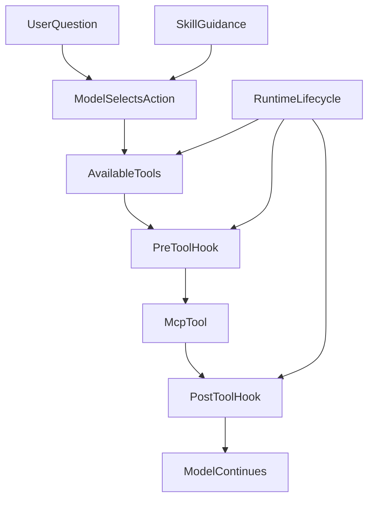

# 从让模型少想一点，到让 Runtime 少管一点：重新理解 Agent、Runtime、MCP 与 Skill 的分工

**把 AI 接入产品，难点不只是让它会做事，还要知道每件事究竟由谁负责。**

先看一个教学示例：同事请助手比较两份基金说明书，列出关键差异并保存报告。模型能理解“哪些条款发生变化”；读取工具负责拿到两份文件；保存程序知道报告是否真的落盘。如果把这些决定都塞进一个“总管”，看似集中，出了问题反而难以说清谁的判断有效。

这篇文章要回答一个普通的架构问题：**哪些事需要 AI 理解，哪些事应由工具和程序按事实处理？** 我们用这个小任务解释四种角色，再回看 ETF Agent 中两次真实演进：早期让模型维护过多执行状态，后来又让运行系统承担了不属于它的业务解释。

在这里，**Model（模型）**负责理解和选择；**Skill（技能说明）**提供分析方法；**MCP 工具**提供可调用能力；**Runtime（运行系统）**记录权限、调用和结果。这是帮助理解责任的地图，不是四个必须独立部署的服务。本文的迁移历史以 2026 年 9 月的原始记录为依据；不把当时未完成的替换写成今天已全面落地的事实。

## 一、第一步：模型说“我保存了”，不等于文件存在

早期我们让模型交回一个结构化的 `AgentTurn`，除了下一步动作，还包含证据缺口和完成声明：

```json
{
  "actions": ["search"],
  "gaps": ["还缺来源"],
  "completionClaim": false
}
```

这个方案当时有道理：研究要分步进行，系统也要知道为何继续。但随着权限、预算、工具回执和发布状态越来越多，模型不得不复述一份运行系统已经知道的状态。两份记录一旦不一致，就会出现“模型说完成，文件却没保存”的争议。

于是研究逐步转向原生工具调用：模型提出“下一步读取什么”，真正的工具执行、允许范围和保存结果由程序记账。**模型可以改变看法，但不能用一句自述改写已经发生的操作。** 这就是原生工具循环替代状态镜像的主要理由。

## 二、程序要记执行事实，但不用替模型做研究

对一份报告来说，“还剩几次读取机会”“文件写入有没有回执”“用户是否允许读取私人资料”应由程序判定；不能让模型靠猜。运行系统负责这些可核对的事实，并在中断后使用原有记录，而不是重新编造过程。

但另一个极端也不对：看到一段逻辑不适合模型，就全部塞进 Runtime。例如“比较基金时应该先核对披露日期”是一种研究方法，不是进程调度；“读取哪个基金组合”则由已经提供这种数据能力的工具定义。**程序负责安全执行，不代表程序要重新发明业务知识。**

## 三、同一个工具说明写了三遍，为什么难维护

2026 年 9 月的工具整理暴露了一个很实际的问题：工具叫什么、哪些参数可用、应该调用哪条路径，在不同接线位置重复维护。一处更新了“读取基金持仓”的定义，其他位置可能仍保留旧名字或旧参数。

当时先把重复映射收敛成一份工具约定，让各处从它派生。这避免了“三处各自解释同一件事”，但没有自动解决更深的问题：**剩下的那份定义，真的由提供数据能力的一方负责吗？**

这也是[工具可见性专文](agent-model-capability-presentation-tool-surface.md)与本篇的分工：前者讨论模型最终看到了哪些工具，本篇讨论谁应该定义工具及其规则。

## 四、工具已经能“查某项”，为什么还要包成“查全部”

拿组合查询举例：数据工具已经分别提供“读取组合概览”“查看某个持仓”“读取分组持仓”等能力。为了统一管理，研究侧曾再包出一个宽泛的 `read_portfolio`。它看起来给模型一个简单入口，却让“究竟能查什么”在两处都有解释。

可以把它想成：图书馆已经按书名、作者和主题提供检索，门口又设一个只接受“帮我查书”的窗口。窗口不是没有用——它可以检查读者证件和借阅限额；但它不应该再创造一套与馆藏目录不同的分类和书目。

因此，设计方向是让工具的能力描述来自真正提供它的地方，Runtime 保留授权、预算、调用回执和结果大小等保护。历史上的整层替换**没有在当时一次完成**：现有工具表面能消费发现的能力描述，不代表所有旧包装、映射已无条件退役。

读者可以用一个很简单的办法检查这类封装：删掉中间包装后，必要保护还在不在？如果都在，而重复名字和参数映射消失了，它可能只是把复杂度搬来搬去。

## 五、职责分工：模型 / 技能 / MCP / 运行时

这次重新划分后，我更愿意把四层理解成四种不同的复杂度。



**关系或判断条件：**

- **SkillGuidance → ModelSelectsAction**：辅助关联。
- **RuntimeLifecycle → AvailableTools**：辅助关联。
- **RuntimeLifecycle → PreToolHook**：辅助关联。
- **RuntimeLifecycle → PostToolHook**：辅助关联。

这张图表达职责划分。当前实现与局部回归已体现该划分；它不证明所有环境、恢复组合与 live 行为均已验收。

### 模型：负责语义复杂度

模型适合回答：

```text
用户到底想解决什么？
还缺什么信息？
下一步该查哪一类资料？
两个证据冲突时应该继续查哪边？
最后该怎么解释？
```

这些问题没有一个固定规则能在所有上下文下得到唯一答案。

### 技能：负责方法复杂度

Skill 更像一套可复用的方法，而不是数据接口。

例如“分析我的基金是不是重复”这个任务，Skill 可以规定：

```text
先看整体组合
→ 再看集中度
→ 对候选基金读取关系证据
→ 区分同产品、同指数和底层持仓重叠
→ 回答时带日期和覆盖范围
```

Skill 可以声明 allowed-tools、required-tool-attempts 或回答结构，但它不应该自己下载持仓、管理 sourceRef、缓存页面或维护恢复状态。

一句话：

> **Skill 说明这类问题怎么做。**

### MCP：负责能力复杂度

MCP 回答的是：

> **系统能做什么？**

一个业务 Tool 的 identity、description、input schema 和 output semantics，天然应该由提供这个 capability 的 owner 定义。

例如：

```text
portfolio__get_bucket_holdings
```

本身就已经表达一个完整能力：读取某个 Portfolio bucket 的持仓。

它不应该先变成一个更模糊的 Runtime Tool，再被映射回来。

所以我现在更愿意把 MCP 理解成：

> **capability interface，而不只是 data connector。**

### 运行时：负责过程复杂度

Runtime 负责的是一次 run 怎么活着走完：

```text
当前 phase
预算与消耗
取消
checkpoint
recovery
receipt
continuation
publication orchestration
terminal condition
```

Runtime 可以提供：

```text
remainingReadActions = 3
phase = finalization-only
```

但它不应该因为自己知道这些状态，就顺手定义 Portfolio、Market、Web 各自有哪些业务 Tool。

---

## 六、一个具体例子：同一句持仓问题，四层分别做什么

假设用户问：

> “红利低波这一块我到底买了哪些基金？是不是重复得太多？”

下面是教学示例，使用合成数据，不对应任何真实持仓，也不是现行 wire contract。

模型首先做语义判断：

```json
{
  "goal": "检查红利低波桶的组成与重复关系",
  "nextStep": "读取该 bucket 的持仓，再按需要读取关系证据"
}
```

Skill 提供方法约束：

```text
不要仅凭基金名字判断重复；
需要区分产品关系、同指数和 measured constituent overlap；
部分穿透不能写成全量重叠率。
```

MCP 提供能力：

```text
portfolio__get_bucket_holdings
portfolio__get_portfolio_relationships
```

一次 bucket read 的结构化结果可以类似：

```json
{
  "bucket": "dividend_low_volatility",
  "items": [
    {
      "fundCode": "F001",
      "fundName": "示例基金 A",
      "value": 10000,
      "weight": 0.08
    },
    {
      "fundCode": "F002",
      "fundName": "示例基金 B",
      "value": 7000,
      "weight": 0.056
    }
  ],
  "coverage": {
    "requested": 2,
    "returned": 2,
    "complete": true
  }
}
```

Runtime 不需要知道“红利低波是不是重复太多”。

它只需要知道：

```text
这项 Portfolio capability 是否已经授权？
当前 Tool 是否可执行？
调用是否完成？
结果是否在大小边界内？
receipt 是否已经落库？
```

这样每一层都只承担自己真正拥有的复杂度。

---

## 七、Hook 的边界：治理调用，不重新实现业务语义

把 Tool 语义还给 MCP，并不意味着 Tool 调用不再治理。

PreToolUse / PostToolUse 很适合做跨层的机械治理。

### PreToolUse：只做确定性的单字段处理

适合：

```text
2026/9/30 → 2026-09-30
1万 → 10000
确定市场后的证券代码规范化
人工审核过的一对一枚举 alias
```

这些处理有共同特点：

- 输入已经位于明确字段；
- 映射唯一；
- 不需要理解整句话；
- 可以稳定测试。

不适合：

```text
“腾讯最近跌得很多”
→ 猜测用户其实想查 0700.HK 并分析是否减仓
```

这已经是语义理解，应留给 Model。

### PostToolUse：可以收窄，不要重新造业务模型

适合：

```text
删除敏感字段
减少模型不需要的内容
做最终大小检查
保留 coverage / provenance
```

如果一个 Tool 每次返回后都需要在 PostHook 里重新分类、重新聚合、重新分页、重新构造业务语义，通常说明 Tool Interface 设计得不对。

更合理的修复是：

> **回到 MCP，增加一个真正适合该场景的 view。**

而不是让 Runtime 或 Hook 长成第二套业务层。

---

## 八、回看两次改变：不是“集中越多越好”

| 当时的办法 | 后来发现的问题 | 更合适的责任 |
| --- | --- | --- |
| 让模型同时写下一步动作和执行状态 | 模型的“完成”与工具实际回执可能冲突 | 模型提议动作，程序记录事实 |
| 多处各自维护同一工具说明 | 改一个名字还要改多处，容易遗漏 | 由一处工具能力定义派生展示与调用 |
| 用宽泛的研究工具包装已有的业务能力 | 原始工具的具体用途被遮蔽 | 工具本身描述能力，运行系统保留安全治理 |

三次观察并不能证明“所有包装都该删”。只有当包装不再独立承担必要职责时，删除才真正减少维护负担。

## 九、失败与降级边界：分工变清楚，不代表边界变软

把职责拆开，并不是把所有逻辑交给模型。

恰恰相反，有些硬边界必须继续由确定性代码执行。

### 私有 Tool 在授权前不可见

目标设计里，Portfolio 这类私有 Tool 在 capability grant 前不进入本轮 Tool Surface；授权成功后，下一 ModelTurn 才能看到。

即使可见，PreToolUse 仍然要重新检查本次调用是否允许。

> 可见性不是授权。

### 机械 canonicalization 有歧义就停止

日期、金额、证券代码或精确 alias 可以规范化，但只要需要理解句子或存在多个合理映射，就不猜。

返回结构化纠正信息，让模型重新决定。

### 结果太大就显式不可用

不能为了让模型“至少拿到一点”就把一个声称 complete 的持仓列表静默截成 Top N。

complete-or-unavailable 比“看起来成功”更重要。

### Web source state 不能为了拆 wrapper 而丢失

如果当前 Web wrapper 承担同一 Run 内的来源句柄校验、先读取再查找，以及失效或撤销的 Web 来源句柄拒绝访问等约束，就必须先把这些责任迁回 Web MCP / Gateway，再删除 wrapper。这里撤销的是 Web 来源句柄，不是重新撤销 Host 已记录的 Run 授权；现行授权在同一 Run 及其恢复过程中保持有效。

删除中转层的目标是消灭重复 owner，不是消灭安全边界。

---

## 十、现在我会用五个问题判断逻辑应该放在哪里

以后再看到一段 Agent 逻辑，我会先问：

### 1. 这件事需要理解意义吗？

是 → **Model**

例如用户意图、下一步调查、证据冲突、解释。

### 2. 这件事是在描述“这类任务怎么做”吗？

是 → **Skill**

例如基金重叠分析需要哪些步骤、需要尝试哪些能力、回答包含哪些部分。

### 3. 这件事定义的是“系统能做什么”吗？

是 → **MCP / capability owner**

例如读取组合、查询基金、浏览页面、获取指数成分。

### 4. 这件事是运行过程中可确定的状态吗？

是 → **Runtime**

例如预算、取消、receipt、checkpoint、recovery、terminal。

### 5. 如果删掉这一层，复杂度到底去哪了？

- 复杂度扩散给多个调用方：这层可能有价值；
- 复杂度被一个更深的 owner 吸收：应该 deepening；
- 只有 mapping、schema copy、alias 和自测消失：大概率应该删。

第五个问题尤其重要。

我们之前已经做对了“多 owner → 单 owner”，但这次才真正补上：

> **单 owner 之后，还要继续问 owner 是否放对了地方。**

---

## 十一、和主流 Agent 框架放在一起看，哪些分工是我们的选择？

前面的 Model / Skill / MCP / Runtime 四分法，是**面对实际维护问题得到的责任地图**，不是要求其他框架都照此组织，更不是声称这些分工由某个开放协议强制规定。

| 外部参照 | 公开定义与实现重点 | 与本文的对照 |
| --- | --- | --- |
| [Anthropic · Building Effective Agents](https://www.anthropic.com/research/building-effective-agents) | 区分预设代码路径的 Workflow 与模型自主选择动作的 Agent；从足够简单的组合开始，在确有收益时才加入复杂编排。 | 我们同样不要求所有任务先过固定 Planner 或 Reviewer；Native Loop 保留模型对研究下一步的判断，同时让实际执行事实由 Host 负责。 |
| [OpenAI Agents SDK](https://openai.github.io/openai-agents-python/) | 提供 Agent、工具、Handoff、Guardrails、Session 与 Trace 等编排与调试原语，也允许应用按需扩展。 | SDK 可以承载许多相同任务；本文更关心**哪些状态和效果最终归谁负责**，而不是再发明一套有相同功能的 Agent 编排层。 |
| [MCP 官方架构](https://modelcontextprotocol.io/specification) | 用 Host、Client、Server 及 Tools/Resources 等机制规定能力连接方式。 | MCP 解决如何描述、发现、调用外部能力，但具体金融授权、持仓口径、资料撤权和效果回执仍须由应用及相应能力 Owner 落实；“使用 MCP”不是业务许可本身。 |

因此，**与行业实践的共同点**是尽量保持工具与研究循环简单、可组合、可观察；**我们的额外工程取舍**是让长任务的资格、可恢复状态和持久效果有明确归属，避免后续业务功能把 Runtime 改成又一套业务裁决层。这不是框架能力排名，也没有通过横向实测证明某个 SDK 更快或更可靠。

一个实用判断是：如果现有 SDK 的 Loop、Handoff、工具执行已满足需求，就复用它；只有当原有责任归属无法满足可验证的金融授权、持久回读或恢复需求时，才增加最小适配层，并定义未来如何退出。区别来自任务契约，而不是品牌或模块数量。

## 十二、现行结构与历史尝试需要分开看

Native 工具循环、工具契约与 Host 能力查询的职责已经经历实际收敛，减少了重复的工具映射与准入判断。但历史上也有只做完局部接线、未完成整体替换的路线，不能因为部分代码存在就宣布整个架构迁移成功。

这个案例足以解释**为什么一份工具定义也可能放在错误的责任归属里**，却不能仅凭受控回归证明模型选工具更准、投研成果更好，或者研发成本已经下降。最有价值的不是完成项清单，而是下一次新增能力时如何判断该增加、迁移还是删除一层。

## 最后：下次评审新规则，先决定它应该在哪里

从 AgentTurn 到原生工具调用，我们首先学会让模型专注研究，Runtime 保留执行事实。后来又学会另一半：**Runtime 能执行一件事，并不代表它应该解释那件事的业务意义。**

例如，基金资料是否读回，是工具和来源事实；是否再查一项风险指标，是研究判断；是否已授权、是否真实发生，则要由执行效果的原责任方确认。

这一分工可以简记为：

```text
Model   → 语义复杂度
Skill   → 方法复杂度
MCP     → 能力复杂度
Runtime → 过程复杂度
```

下次评审 Validator、Tool、Hook 或 Skill，先问三个问题：**它在解释用户意图吗？它定义可复用的方法或能力吗？还是仅处理本次运行的资格、顺序与回执？** 不同答案不应被同一个新增总管吞下。

**让每一层维护自己真正拥有的知识，不让其他层重复裁决。** 这比不断把规则下沉 Runtime 更利于长期升级。相关设计检查见[原则 2](/principles#principle-2)与[方法 2](/principles#method-2)。

## 延伸阅读

- [别再让模型当状态机：一次 Agent 协议减负实践](./runtime-model-protocol-boundary-agent-article-v2.md)
- [Agent 查了很多资料，为什么还是交不出答案？](./agent-runtime-constraint-governance-v2.md)

## 阅读与实现口径（2026 年 10 月）

本文以 ETF Agent 的设计演进解释职责边界，而非把所有历史尝试视为现行完整功能。想动手观察一条范围明确的公开路径，可以看 [Open ETF Agent v0.11 固定源码](https://github.com/hpoenixf/open-etf-agent/tree/5f42c33892d57ed05e8cd09cad48573e6901995b)和[当前运行说明](https://github.com/hpoenixf/open-etf-agent/blob/main/README.md)：公开版的文档比较、结果传递与本地 PDF 演示主要使用合成资料和脚本动作，不能代表完整内部投研系统或真实模型效果。