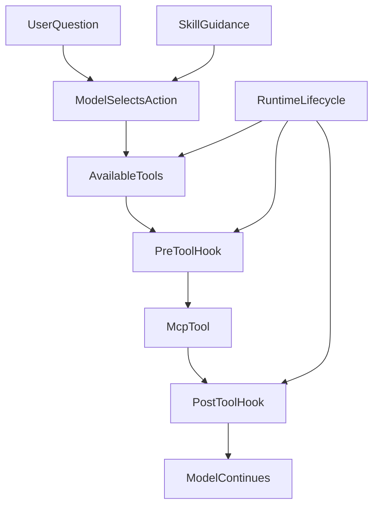

# 从让模型少想一点，到让 Runtime 少管一点：重新理解 Agent、Runtime、MCP 与 Skill 的分工

**Agent 架构不是把一切“不可靠”都交给 Runtime 就能变可靠。** 模型不该维护权限和执行回执；但 Runtime 能调用工具，也不代表它应该判断金融研究下一步查什么。真正的选择是：**把语义、方法、能力和执行事实放到各自最能负责的位置。**

ETF Agent 的演化走过两个阶段：先从重型 AgentTurn 迁到 native tool loop，避免让模型复制一份运行时状态；后来又发现 Runtime 逐渐替金融能力和工具表面作决定，需要把这些知识交回合适的责任方。

这不是一次架构会议就画出的分工。本文保留旧方案合理的动机与反例，区分截至 2026 年 9 月末进入实际执行链的改动，以及当时尚未完整退役的 synthetic Tool 路线。下次准备“再加一道校验”时，先判断：**这道规则究竟由谁有资格决定？**

## 一、第一步：先别让模型维护 Runtime 已经知道的事实

早期 Research 协议里，我们让模型输出一个结构化的 AgentTurn。它不仅表达下一步动作，还会携带状态、缺口、完成声明等信息。

简化后大概是：

```json
{
  "actions": ["search"],
  "gaps": ["还缺来源"],
  "completionClaim": false
}
```

这个设计一开始并不奇怪。工具调用需要审计，Research 需要恢复，系统也希望知道模型为什么继续、为什么结束。

问题是协议会自然膨胀。

当权限、工具集合、证据缺口、发布状态、子目标、完成条件都逐渐进入模型输出后，模型实际上同时做两件事：

```text
理解问题、判断下一步
+
维护一份 Runtime 状态镜像
```

第二件事很贵，而且通常没有增加任何权威。

Runtime 本来就知道：

- 某项能力是否真的获批；
- 某个 Tool 是否执行；
- 结果是否成功返回；
- publication 是否提交；
- 当前 run 是否取消；
- 还剩多少预算。

如果模型再输出一份，这份状态最多是“模型认为现在是什么状态”。一旦冲突，系统仍然只能相信 Host 实际记录的事实。

所以我们后来把 Research 收敛到 native tool loop。模型不再描述完整工作流状态，而是提出下一步 Tool 调用；Host 持久化 ModelTurn、执行结果、receipt 和 publication，Runtime 用这些事实控制恢复和终态。

2026-09-20 的历史记录里，这个边界被概括成一句话：

> **语义决策可以交给模型，权威与恢复不能。**

这一步的核心不是减少系统状态，恰恰相反，系统状态反而需要更严格。减少的是**模型对系统事实的重复维护**。

---

## 二、把复杂度下沉到 Runtime 是对的，但下沉不是越多越好

从 AgentTurn 迁到 native tool calling 以后，一个很自然的认识是：

> Runtime 已经能确定的事情，就不要再让模型推理。

于是越来越多确定性逻辑进入 Runtime：

```text
授权
预算
调用状态
取消
checkpoint
recovery
receipt
publication
terminal gate
```

这些职责有一个共同特点：答案应该是确定的。

例如：

```text
remainingReadActions = 3
```

不需要模型判断。

某个 receipt 是否已经 durable，也不需要模型判断。

但“确定性逻辑应该下沉”很容易被扩展成另一句话：

> 只要不是模型负责，就放 Runtime。

这两句话并不等价。

我们后来真正踩到的问题，就是 Runtime 开始拥有越来越多**业务能力本身的定义**。

---

## 三、第一次 Tool 收敛：从多份定义变成一个 Tool Contract

2026 年 9 月，我们连续两次发现 Tool 定义的重复维护。26 日，Host catalog 与生产 Runtime capability table 对同一关系各有解释；删除重复查询后，受控回归仍能使用原来获准的工具。27 日又发现 Native Tool、Skill Context 和 Runtime Factory 各自保存 Tool 与 Host 的映射，Web search/read 还可能因共用 route 错误暴露兄弟能力。

当时的合理修复，是用**一份 Tool Contract 派生 Host、Skill 与模型工具的映射**：从三处静态解释收敛到一处，减少 drift。这并不代表模型选择一定正确，也没有改变原权限与派发事实。

这个历史选择后来又暴露下一层问题：**把三份重复定义合成一份，仍要追问剩下的那一份是否属于正确的 Owner。** 最终请求中工具描述能否如实抵达模型，另由[A34 Tool Surface 专文](agent-model-capability-presentation-tool-surface.md)说明；这里继续讨论更一般的 Model / Runtime / MCP / Skill 责任划分。

## 四、真正的问题：剩下的这个 owner，放对地方了吗？

最近我们重新看 Portfolio 工具时，发现了一个很明显的信号。

Portfolio MCP 本身已经暴露了多种 scoped capability，例如：

```text
portfolio__get_portfolio_overview
portfolio__get_fund_position
portfolio__get_bucket_holdings
portfolio__get_sector_exposure
```

这些名字、参数和返回语义都很明确。

但是 Native Research 没有直接把这些 capability 给模型，而是又定义了一层 synthetic Tool：

```text
read_portfolio({})
```

调用链因此变成：

```text
MCP Tool
  ↓
Research Tool Contract
  ↓
Model Tool
  ↓
Host Action
  ↓
mapReadCall
  ↓
MCP Tool
```

每一层单独看都能解释：

- Runtime 要管权限；
- 要管 Skill ceiling；
- 要管预算；
- 要管输入；
- 要管输出大小。

但这些治理需求并不能推出一个结论：

> Runtime 应该重新定义一次业务 Tool。

Portfolio 场景把问题暴露得很直观：MCP 已经有 bucket holdings，模型却只看到一个宽泛的 read_portfolio。Runtime 为了治理 Tool，顺手成为了 Tool 语义的 owner，结果反而把上游已经表达清楚的能力压扁了。

这时候我们重新做 deletion test：

> 如果删掉 synthetic Tool layer，复杂度会扩散到调用方，还是直接消失？

对 MCP-backed business tools 来说，大量消失的是：

```text
重复的名字
重复的 schema
重复的 mapping
重复的 Host Action identity
```

而真正重要的治理并没有消失：

```text
authorization
budget
hook
recovery
receipt
result bound
```

这说明我们之前完成的是：

```text
3 owners → 1 owner
```

这一阶段进一步要做的是：

```text
错误位置的 1 owner → 0 个 shadow owner
```

现行 `native-tool-surface.ts` 已经能够接收 MCP discovery 的描述符，并按轮次收窄模型实际看到的工具。历史上的整层替换方案并没有完整落地，因此不能把局部接线成果写成原方案已被整体部署。

---

## 五、职责分工：模型 / 技能 / MCP / 运行时

这次重新划分后，我更愿意把四层理解成四种不同的复杂度。



**关系或判断条件：**

- **SkillGuidance → ModelSelectsAction**：辅助关联。
- **RuntimeLifecycle → AvailableTools**：辅助关联。
- **RuntimeLifecycle → PreToolHook**：辅助关联。
- **RuntimeLifecycle → PostToolHook**：辅助关联。

这张图表达职责划分。当前实现与局部回归已体现该划分；它不证明所有环境、恢复组合与 live 行为均已验收。

### 模型：负责语义复杂度

模型适合回答：

```text
用户到底想解决什么？
还缺什么信息？
下一步该查哪一类资料？
两个证据冲突时应该继续查哪边？
最后该怎么解释？
```

这些问题没有一个固定规则能在所有上下文下得到唯一答案。

### 技能：负责方法复杂度

Skill 更像一套可复用的方法，而不是数据接口。

例如“分析我的基金是不是重复”这个任务，Skill 可以规定：

```text
先看整体组合
→ 再看集中度
→ 对候选基金读取关系证据
→ 区分同产品、同指数和底层持仓重叠
→ 回答时带日期和覆盖范围
```

Skill 可以声明 allowed-tools、required-tool-attempts 或回答结构，但它不应该自己下载持仓、管理 sourceRef、缓存页面或维护恢复状态。

一句话：

> **Skill 说明这类问题怎么做。**

### MCP：负责能力复杂度

MCP 回答的是：

> **系统能做什么？**

一个业务 Tool 的 identity、description、input schema 和 output semantics，天然应该由提供这个 capability 的 owner 定义。

例如：

```text
portfolio__get_bucket_holdings
```

本身就已经表达一个完整能力：读取某个 Portfolio bucket 的持仓。

它不应该先变成一个更模糊的 Runtime Tool，再被映射回来。

所以我现在更愿意把 MCP 理解成：

> **capability interface，而不只是 data connector。**

### 运行时：负责过程复杂度

Runtime 负责的是一次 run 怎么活着走完：

```text
当前 phase
预算与消耗
取消
checkpoint
recovery
receipt
continuation
publication orchestration
terminal condition
```

Runtime 可以提供：

```text
remainingReadActions = 3
phase = finalization-only
```

但它不应该因为自己知道这些状态，就顺手定义 Portfolio、Market、Web 各自有哪些业务 Tool。

---

## 六、一个具体例子：同一句持仓问题，四层分别做什么

假设用户问：

> “红利低波这一块我到底买了哪些基金？是不是重复得太多？”

下面是教学示例，使用合成数据，不对应任何真实持仓，也不是现行 wire contract。

模型首先做语义判断：

```json
{
  "goal": "检查红利低波桶的组成与重复关系",
  "nextStep": "读取该 bucket 的持仓，再按需要读取关系证据"
}
```

Skill 提供方法约束：

```text
不要仅凭基金名字判断重复；
需要区分产品关系、同指数和 measured constituent overlap；
部分穿透不能写成全量重叠率。
```

MCP 提供能力：

```text
portfolio__get_bucket_holdings
portfolio__get_portfolio_relationships
```

一次 bucket read 的结构化结果可以类似：

```json
{
  "bucket": "dividend_low_volatility",
  "items": [
    {
      "fundCode": "F001",
      "fundName": "示例基金 A",
      "value": 10000,
      "weight": 0.08
    },
    {
      "fundCode": "F002",
      "fundName": "示例基金 B",
      "value": 7000,
      "weight": 0.056
    }
  ],
  "coverage": {
    "requested": 2,
    "returned": 2,
    "complete": true
  }
}
```

Runtime 不需要知道“红利低波是不是重复太多”。

它只需要知道：

```text
这项 Portfolio capability 是否已经授权？
当前 Tool 是否可执行？
调用是否完成？
结果是否在大小边界内？
receipt 是否已经落库？
```

这样每一层都只承担自己真正拥有的复杂度。

---

## 七、Hook 的边界：治理调用，不重新实现业务语义

把 Tool 语义还给 MCP，并不意味着 Tool 调用不再治理。

PreToolUse / PostToolUse 很适合做跨层的机械治理。

### PreToolUse：只做确定性的单字段处理

适合：

```text
2026/9/30 → 2026-09-30
1万 → 10000
确定市场后的证券代码规范化
人工审核过的一对一枚举 alias
```

这些处理有共同特点：

- 输入已经位于明确字段；
- 映射唯一；
- 不需要理解整句话；
- 可以稳定测试。

不适合：

```text
“腾讯最近跌得很多”
→ 猜测用户其实想查 0700.HK 并分析是否减仓
```

这已经是语义理解，应留给 Model。

### PostToolUse：可以收窄，不要重新造业务模型

适合：

```text
删除敏感字段
减少模型不需要的内容
做最终大小检查
保留 coverage / provenance
```

如果一个 Tool 每次返回后都需要在 PostHook 里重新分类、重新聚合、重新分页、重新构造业务语义，通常说明 Tool Interface 设计得不对。

更合理的修复是：

> **回到 MCP，增加一个真正适合该场景的 view。**

而不是让 Runtime 或 Hook 长成第二套业务层。

---

## 八、三个对比案例：为什么“更集中”不一定等于“更正确”

### 案例一：AgentTurn → native tool loop

旧做法：

```text
模型维护 actions / gaps / completionClaim / subGoals
```

后来的做法：

```text
模型提出 Tool call
Runtime / Host 维护真实执行事实
```

这里的收益不是“JSON 字段更少”本身，而是状态 owner 回到了真正拥有事实的地方。

### 案例二：三份 Tool mapping → 一份 Tool Contract

旧做法：

```text
Tool Contract
Skill Context
Runtime Factory
```

分别维护同一个 Tool 的暴露关系。

2026-09-27 收敛成一个 Tool Contract，是必要的一步，因为它减少了 drift。

但这次重新 review 又发现：

> **一个 owner 仍然可能是错误 owner。**

如果 MCP 已经定义完整业务 capability，那么 Runtime Tool Contract 再拥有一遍业务 Tool Interface，仍然是 shadow owner。

### 案例三：测试全绿，但 production 已经不经过这个 seam

这次继续扫仓库时，我们还发现了另一类历史债务：部分 src/server Module 已经没有 production consumer，但测试仍然直接调用它们。

典型结构是：

```text
Production:
A → B → C

Tests:
T → LegacyModule
```

测试绿，只能证明 LegacyModule 自己的 Interface 仍然符合测试，并不能证明 production 还经过这里。

因此我们另开了 `agent-retire-test-only-and-legacy-seams`：把仍有效的限制迁到生产调用边界，再删除没有生产消费者的旧模块。这里既有实际代码和断言迁移，也有尚未完全收口的旧结构；历史归档并不意味着所有遗留接缝已经消失。

这个案例让我重新理解了一句话：

> **The interface is the test surface。**

如果 production seam 已经移动，测试也要跟着移动。否则测试会开始保护历史结构，而不是保护系统行为。

---

## 九、失败与降级边界：分工变清楚，不代表边界变软

把职责拆开，并不是把所有逻辑交给模型。

恰恰相反，有些硬边界必须继续由确定性代码执行。

### 私有 Tool 在授权前不可见

目标设计里，Portfolio 这类私有 Tool 在 capability grant 前不进入本轮 Tool Surface；授权成功后，下一 ModelTurn 才能看到。

即使可见，PreToolUse 仍然要重新检查本次调用是否允许。

> 可见性不是授权。

### 机械 canonicalization 有歧义就停止

日期、金额、证券代码或精确 alias 可以规范化，但只要需要理解句子或存在多个合理映射，就不猜。

返回结构化纠正信息，让模型重新决定。

### 结果太大就显式不可用

不能为了让模型“至少拿到一点”就把一个声称 complete 的持仓列表静默截成 Top N。

complete-or-unavailable 比“看起来成功”更重要。

### Web source state 不能为了拆 wrapper 而丢失

如果当前 Web wrapper 承担 run-scoped source handle、read-before-find、revocation 等真实 invariant，就必须先把这些责任迁回 Web MCP / Gateway，再删除 wrapper。

删除中转层的目标是消灭重复 owner，不是消灭安全边界。

---

## 十、现在我会用五个问题判断逻辑应该放在哪里

以后再看到一段 Agent 逻辑，我会先问：

### 1. 这件事需要理解意义吗？

是 → **Model**

例如用户意图、下一步调查、证据冲突、解释。

### 2. 这件事是在描述“这类任务怎么做”吗？

是 → **Skill**

例如基金重叠分析需要哪些步骤、需要尝试哪些能力、回答包含哪些部分。

### 3. 这件事定义的是“系统能做什么”吗？

是 → **MCP / capability owner**

例如读取组合、查询基金、浏览页面、获取指数成分。

### 4. 这件事是运行过程中可确定的状态吗？

是 → **Runtime**

例如预算、取消、receipt、checkpoint、recovery、terminal。

### 5. 如果删掉这一层，复杂度到底去哪了？

- 复杂度扩散给多个调用方：这层可能有价值；
- 复杂度被一个更深的 owner 吸收：应该 deepening；
- 只有 mapping、schema copy、alias 和自测消失：大概率应该删。

第五个问题尤其重要。

我们之前已经做对了“多 owner → 单 owner”，但这次才真正补上：

> **单 owner 之后，还要继续问 owner 是否放对了地方。**

---

## 十一、和主流 Agent 框架放在一起看，哪些分工是我们的选择？

前面的 Model / Skill / MCP / Runtime 四分法，是**面对实际维护问题得到的责任地图**，不是要求其他框架都照此组织，更不是声称这些分工由某个开放协议强制规定。

| 外部参照 | 公开定义与实现重点 | 与本文的对照 |
| --- | --- | --- |
| [Anthropic · Building Effective Agents](https://www.anthropic.com/research/building-effective-agents) | 区分预设代码路径的 Workflow 与模型自主选择动作的 Agent；从足够简单的组合开始，在确有收益时才加入复杂编排。 | 我们同样不要求所有任务先过固定 Planner 或 Reviewer；Native Loop 保留模型对研究下一步的判断，同时让实际执行事实由 Host 负责。 |
| [OpenAI Agents SDK](https://openai.github.io/openai-agents-python/) | 提供 Agent、工具、Handoff、Guardrails、Session 与 Trace 等编排与调试原语，也允许应用按需扩展。 | SDK 可以承载许多相同任务；本文更关心**哪些状态和效果最终归谁负责**，而不是再发明一套有相同功能的 Agent 编排层。 |
| [MCP 官方架构](https://modelcontextprotocol.io/specification) | 用 Host、Client、Server 及 Tools/Resources 等机制规定能力连接方式。 | MCP 解决如何描述、发现、调用外部能力，但具体金融授权、持仓口径、资料撤权和效果回执仍须由应用及相应能力 Owner 落实；“使用 MCP”不是业务许可本身。 |

因此，**与行业实践的共同点**是尽量保持工具与研究循环简单、可组合、可观察；**我们的额外工程取舍**是让长任务的资格、可恢复状态和持久效果有明确归属，避免后续业务功能把 Runtime 改成又一套业务裁决层。这不是框架能力排名，也没有通过横向实测证明某个 SDK 更快或更可靠。

一个实用判断是：如果现有 SDK 的 Loop、Handoff、工具执行已满足需求，就复用它；只有当原有责任归属无法满足可验证的金融授权、持久回读或恢复需求时，才增加最小适配层，并定义未来如何退出。区别来自任务契约，而不是品牌或模块数量。

## 十二、现行结构与历史尝试需要分开看

Native 工具循环、工具契约与 Host 能力查询的职责已经经历实际收敛，减少了重复的工具映射与准入判断。但历史上也有只做完局部接线、未完成整体替换的路线，不能因为部分代码存在就宣布整个架构迁移成功。

这个案例足以解释**为什么一份工具定义也可能放在错误的责任归属里**，却不能仅凭受控回归证明模型选工具更准、投研成果更好，或者研发成本已经下降。最有价值的不是完成项清单，而是下一次新增能力时如何判断该增加、迁移还是删除一层。

## 最后：下次评审新规则，先决定它应该在哪里

从 AgentTurn 到原生工具调用，我们首先学会让模型专注研究，Runtime 保留执行事实。后来又学会另一半：**Runtime 能执行一件事，并不代表它应该解释那件事的业务意义。**

例如，基金资料是否读回，是工具和来源事实；是否再查一项风险指标，是研究判断；是否已授权、是否真实发生，则要由执行效果的原责任方确认。

这一分工可以简记为：

```text
Model   → 语义复杂度
Skill   → 方法复杂度
MCP     → 能力复杂度
Runtime → 过程复杂度
```

下次评审 Validator、Tool、Hook 或 Skill，先问三个问题：**它在解释用户意图吗？它定义可复用的方法或能力吗？还是仅处理本次运行的资格、顺序与回执？** 不同答案不应被同一个新增总管吞下。

**让每一层维护自己真正拥有的知识，不让其他层重复裁决。** 这比不断把规则下沉 Runtime 更利于长期升级。相关设计检查见[原则 2](/principles#principle-2)与[方法 2](/principles#method-2)。

## 延伸阅读

- [别再让模型当状态机：一次 Agent 协议减负实践](./runtime-model-protocol-boundary-agent-article-v2.md)
- [Agent 查了很多资料，为什么还是交不出答案？](./agent-runtime-constraint-governance-v2.md)

## 证据来源

- 2026-09-20 Native Tool Loop：语义决策可以交给模型，权威与恢复不能
- 2026-09-26 Research tool capability 只由 canonical Host catalog 定义
- 2026-09-27 Native 工具暴露收口到单一 Tool Contract
- agent-remove-synthetic-mcp-tool-layer proposal
- agent-remove-synthetic-mcp-tool-layer design
- agent-retire-test-only-and-legacy-seams proposal
- Native Tool lifecycle hooks 规范

- synthetic-layer 局部验证与冻结退役边界
- legacy-seams 验证与退役记录
- 当前 Native 工具面实现
