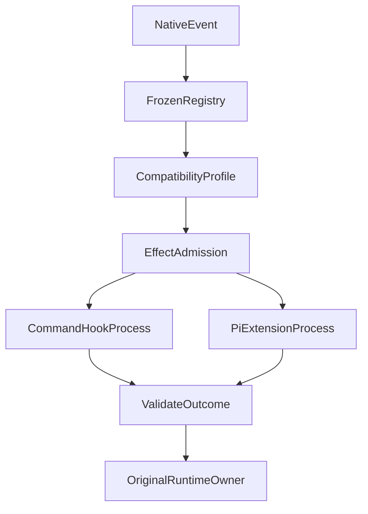

# 从 Claude、Pi 到 Codex：我们如何在自己的 Agent Runtime 中实现多生态 Hook？

在上一篇文章[《Agent 持续进化的秘诀：让你的 Agent 从大哥大进化成智能手机！》](020-agent-extension-host-smartphone.md)中，我们介绍了 ETF Agent 的 Extension Host：如何识别、审核、加载外部插件，让 Claude、Pi、Codex 等生态中的部分能力在自己的 Agent 中运行。

但其中有个问题没有展开：**插件加载成功之后，它的 Hook 究竟怎样运行？**

如果只是支持几个回调，事情并不复杂。真正麻烦的是，各个 Agent 生态对 Hook 的理解并不完全相同。

Claude Code 的 Hook 可以是命令行程序，通过 stdin 接收事件，通过 stdout、stderr 和退出码表达结果。Pi 的 Extension 则是 TypeScript 模块，可以注册异步事件回调、工具和状态操作，回调还能持有闭包和会话上下文。Codex 也支持命令 Hook，但事件字段、匹配规则、退出行为与 Claude 不完全等价。OpenCode 则采用另一套插件事件 API。

如果想让这些扩展在 ETF Agent 的 Native Loop 中工作，而且不启动另一个 Claude、Pi 或 Codex Agent 代替我们执行任务，问题就不再是提供 `on(event, callback)` 这么简单了。

我们需要让外部回调真正参与模型请求、工具执行和研究结束，同时继续遵守原来的权限、资源、恢复和持久化规则。这篇文章记录的就是我们怎样构建这套执行层，以及过程中遇到的几类具体问题。

## 一、Hook 的名字相同，不代表行为相同

先看几个典型事件：

| 场景 | Claude Code | Pi | ETF Agent |
| --- | --- | --- | --- |
| 开始会话 | `SessionStart` | `session_start` | `SessionStart` |
| 处理用户输入 | `UserPromptSubmit` | `before_agent_start` | `UserPromptSubmit` |
| 工具执行前 | `PreToolUse` | `tool_call` | `PreToolUse` |
| 工具执行后 | `PostToolUse` | `tool_result` | `PostToolUse` |
| 模型请求前 | 无简单的一对一命令 Hook | `context` 等事件 | `BeforeModelRequest` |
| 准备结束 | `Stop` | 有不同的回合结束语义 | `Stop` |

这里只是对应关系，不表示事件完全等价，更不表示 Pi 的所有事件都已经接入。例如 `before_agent_start` 可以参与 Pi 原有的上下文处理，但 ETF Agent 的 `UserPromptSubmit` 并不意味着插件可以任意重写用户原文或替换 Host 系统指令。

更直接的例子是 `turn_end`。Pi 有这个事件，ETF Agent 也有 `TurnEnd`，但两者的 ModelTurn、工具结算和状态语义不能仅凭名称相同就合并。目前 Pi 兼容层对缺少所需状态语义的 `turn_end` 明确报告不支持，而不是返回一个空成功。

因此我们首先分开两件事：**Native Lifecycle 定义自己的 Agent 什么时候发生事件；Compatibility Profile 解释外部插件希望在这个时点做什么。**

Native Loop 不需要理解每个生态的协议字段，Profile 也不能因为两个事件同名，就自动获得 Host 的执行资格。

## 二、建立自己的生命周期，而不是复制一家 Agent 的事件表

ETF Agent 当前的原生 Hook 执行层包含 13 个阶段，覆盖插件加载/卸载、会话开始/结束、用户输入、模型请求、工具调用/失败、上下文压缩、回合结束和 Stop。

这些名称不如它们插入的位置重要：`PreToolUse` 必须在实际派发前生效；`PostToolUse` 处理实际已发生的调用结果；`BeforeModelRequest` 的内容贡献最终要进入获准的模型请求；`Stop` 能提出继续意见，却不能成为另一个独立的 Run 终结器。

我们没有让各个插件自行查找 Runtime 内部函数，也没有为每个生态维护另一条工具循环。Native Runtime 产生事件，Host 选择适用回调，兼容适配器调用具体实现，再由原始效果 Owner 处理合法结果。



这只是有副作用回调的主要路径示意。纯回调不必经过持久效果执行器，不同事件的输出也由不同原始组件消费。

### 多个 Hook 的顺序不能由异步完成速度决定

一次工具调用可能同时匹配 Global、Tool、Skill、Skill+Tool Hook 和多个受审插件 Hook。如果不同 Promise 按完成先后修改同一份结果，执行语义就会随调度变化。

我们的 Native Host 先依据稳定的注册范围、Skill/插件身份和 Profile 顺序确定回调序列，并冻结相应输入。调用前参数变换逐步传递，前一个合法变换的有效参数才成为下一步的输入。

一次运行还会保留已选插件代际。插件在调用途中升级，不能让新版回调突然接入旧调用。这使原执行和恢复有相同的身份依据。

## 三、Claude 与 Codex：命令 Hook 是独立的协议适配

Claude 和 Codex 的命令 Hook 不是加载进程内的 JavaScript 函数。它们需要按对应协议执行受审命令：

```text
原生事件
  → 事件与 matcher 匹配
  → 构造该生态的 stdin JSON
  → 检查命令身份和效果授权
  → 启动受控进程
  → 收集 exit code、stdout、stderr
  → 按方言解释输出
  → 交回原始执行 Owner
```

### 输入不能直接序列化 Host Context

Codex 可以要求 `turn_id`、`model`、`permission_mode` 等字段；Claude 的部分事件则要求 `transcript_path`。我们在 `command-hook-profile.ts` 分开处理协议，在 `command-hook-lifecycle.ts` 根据 Native 的真实调用事实投影输入。

例如发给 Hook 的工具参数应当是实际有效参数，而不是随意从早期模型提议里复制的字段。Claude 的 Transcript 路径也只能来自 Host 获准的导出；没有合法导出或授权时明确拒绝，而不是拿私人原始文件路径兜底。

同样一项协议字段，在原生宿主和我们的 Agent 环境里可能拥有不同的资料访问含义。

### 退出码也不能一套规则走天下

在 Claude 命令 Hook 中，退出码 2 对 `PreToolUse` 可以表示阻断；对 `Stop` 可以提供继续反馈；但 `PostToolUse` 发生时，工具已经执行完毕，不能被一个后置回调回滚为“从未执行”。

Codex 的输出、工具别名和 matcher 又有不同约束，例如某些执行工具会涉及 `Bash`、`Edit`、`Write` 兼容名称。我们没有把 Claude 匹配规则直接照搬，而是对事件、匹配器、输入字段、输出对象和退出行为分别验证。

不支持的组合，如当前 Codex 方言中的 `PostToolUseFailure`，明确报告不支持。**实现了 Codex 的一部分命令协议，并不意味着所有原始 Codex Hook 插件都完成了执行验收。**

### 命令执行需要单独的效果身份

一个命令可能产生外部效果。恢复时不能因为上一次“没有收到成功返回”，就再次运行它。受审命令、输入和效果类型会绑定到原始调用/确认/回执身份；进程的取消、超时、退出与实际外部效果分别记录。

发出了 `kill` 不等于回滚外部操作，也不代表命令肯定从未执行。命令进程的生命周期由专用执行器管理，完成事实仍回到 Native 的原始回执。

## 四、Pi 不同：需要真的运行 TypeScript Factory

Pi Extension 不是一份声明 Shell Hook 的配置。它可以直接注册事件和工具：

```ts
export default function (pi) {
  pi.on("session_start", async (_event, ctx) => {
    // 初始化或恢复会话相关状态
  });
  pi.registerTool({
    name: "todo",
    // 参数定义和实际 execute 回调
  });
}
```

这是结构简化示意，不是官方 todo 插件的完整源码。

真实的 `execute` 与事件回调可能共享闭包、模块变量和 `ctx.sessionManager`。如果只扫描文件、抽取函数名，再用几段自己写的模拟回调替代，就无法证明原始 Pi 插件真正运行了。

我们的选择是加载受审的原始模块，执行它的 Factory，接纳实际注册的合法工具与事件，再映射到 ETF Agent 的 Native Host。

### Headless 不是启动另一个 Pi Agent

ETF Agent 已经有自己的模型、工具循环和运行历史，所以只需要 Pi 的扩展能力，不需要它的第二个模型循环。

Headless 兼容层提供有实际 Host Owner 的上下文、工具和状态接口；缺少的交互 UI、会话树或动态注册接口不能用成功的空操作伪装支持。

官方 Pi todo 的限定验收可以完成 `add/list` 工具及状态处理，但 `session_tree` 和 `/todos` 命令仍有明确的不支持记录。我们不必为了一个插件实现完整 Pi 产品。

Pi 扩展通过 `ctx.tools` 发起内部工具调用时，也必须沿 Host 原来的工具权限、预算、来源身份和执行回执，不会获得一条隐藏的“插件特权”路径。

## 五、最麻烦的一关：怎么真正终止异步 Hook？

一开始，受信任的回调可以放在 Node.js 进程内执行。我们可以设置 AbortSignal、Deadline 和 `Promise.race()`，但它们限制的是“还等不等结果”，不是保证 callback 已停止。

一个简单反例：

```ts
async function hook() {
  await Promise.resolve();
  while (true) {
    // 持续占用 CPU
  }
}
```

如果这段代码占住主线程，定时器自身都可能无法执行，更不用说用户 Stop 或正常 Publication。

我们先用 VM 机制限定首次同步入口，但这不能完整覆盖 `await` 之后重新进入的 CPU 循环，更不是对原生阻塞的隔离保证。

### 让整个受审 Pi 激活实例拥有可终止的进程

2026 年 10 月 17 日，我们将生产 Pi Loader 的受审模块、Factory、会话 Hook 和工具闭包放进一个持久子进程。

为什么不是把单个回调 `toString()` 再扔给 Worker？因为原始回调捕获了模块闭包、会话状态和 Host 能力，重新构造函数很可能改变插件语义。

新的分工是：

```text
Pi 子进程
  保留原模块与闭包
  执行注册回调
  通过有界 RPC 请求 Host 能力

ETF Host
  检查账号、Run、来源、授权、插件代际
  执行真正获准的工具/状态效果
  保存原始回执
  处理取消、超时与进程退休
```

超时或取消时，Host 可以退休这一激活实例，终止其 POSIX 进程组，并观察实际关闭和残留情况。回调已经触发的外部效果不能因此被宣称撤销；清理结果不明确时仍是 unknown。

这项选择有实际代价：一个共享激活进程被退休，依赖它的其他会话也会失效，需要显式重新激活，不能把旧闭包无声自动重跑。它也不是不可信代码的安全沙箱：逃离进程组的后代进程与不可中断的内核等待不在绝对终止保证内。

受控检查覆盖了 CPU 占用、原生阻塞、取消、后代进程终止和 PostgreSQL 发布接缝。更宽范围的离线运行仍有既有基线失败，不能据此宣称全仓验证通过。

**这一可终止进程方案覆盖受审生产 Pi Loader；手工注册的受信 Host-only 闭包并未全部迁入同样的隔离边界。** 两者不能混称为“所有 JavaScript Hook 已强制隔离”。

## 六、有副作用的 Hook，恢复时不能简单再调一次

插件真正能访问状态、工具和文件以后，恢复会遇到典型的不确定性：回调可能已经写入状态、完成子工具或者产生外部效果，但结果没有成功返回。

ETF Agent 的 Native Recovery 已有原始动作与回执，因此我们没有另造 Hook 账本。`durable-extension-effects.ts` 将受审扩展的状态、文件、命令或嵌套工具效果绑定到同一 Run 的资源与执行身份。

已结算结果直接复用；状态未知时保持 unknown，不盲目补发外部操作。回调代际、原始参数和效果身份必须匹配，不能让升级后的同名 Hook 接替旧调用。

真正的新 Run 可以执行对应的 `SessionStart`；已终结 Run 的历史重读则应该返回已有回执，不能再次初始化并修改 todo 状态。

这里我们曾经真实踩到一个问题：原 Pi todo 已经正常保存并完成 Run，但终态重放仍触发 `SessionStart`，导致没有新 Effect Executor 的历史路径报错。修复后，真正的新会话仍会恢复状态，而终态重放不再额外执行生命周期效果。

**恢复是消费已经发生的事实，不是再演一遍过去的生命周期。**

## 七、真实组合案例：Hookify 与 Pi todo 在同一个 Run 中工作

分别验证命令 Hook、Pi Factory 和状态恢复，还不足以证明多生态能共存。

我们后来选择了两个未改写的原始插件组件进行组合：Claude 官方 Hookify，以及官方 Pi todo。另有一条明确标为合成的 Pi 嵌套知识读取组件，用来验证跨插件调用仍受真实 Host 约束。

这组测试使用合成账号、脚本模型和实际原始插件字节，采用 Memory Store，不涉及真实投资者数据或付费模型。

一次获准组合的记录包括：

| 观察项 | 实际结果 |
| --- | --- |
| 原始 Hookify 提示 | 4 条 |
| 经合成认证流程完成的效果确认 | 4 次 |
| 原始 Pi todo 工具调用 | 2 次 |
| todo 状态提交 | 2 次，修订号推进 |
| 明确标注合成的嵌套知识读取 | 1 次 |
| 该 Run | 正常完成并持久保存 |

我们更关心的是几个行为：

第一，Hookify 和 todo 确实沿同一个 Native Factory 和 Host 工作。嵌套工具调用继续携带原来源、预算和父子身份；外部插件没有单独创造一套调用权限。

第二，Hookify 的用户提示走展示路径，并不会自动作为研究资料进入模型输入。提示展示失败也不能抹掉已经合法形成的工具限制。

第三，重新创建 Registry/Factory 并从相同 Memory Store 读取已完成结果时，模型请求、todo 调用、状态提交、通知、确认和嵌套读取都没有额外增加。禁用 Hookify 后，todo 及获准嵌套读取依然能够独立完成。

这个组合验证不是 PostgreSQL 操作系统级冷恢复，也没有覆盖所有真实插件。后续 Pi 进程终止和 PostgreSQL 发布测试分别验证了其他接缝，但不能把相互独立的通过数量叠加成“全生态生产验收”。

它证明的是一个更有限、也更有用的能力：**选定的原始 Claude/Pi 扩展子集可以在同一 ETF Agent Native Run 中真正执行、产生合法结果，并按照原回执规则重读。**

## 八、为什么最后没有做一个万能 Hook API？

最初很容易想：给所有外部插件定义一套统一 JSON Hook，不就不用区分生态了吗？

但差异远不止事件名。Claude/Codex 有命令进程、退出码和 matcher 约定；Pi 有 Factory、异步闭包和会话状态；某些 Hook 变换实际参数或结果，另一些只提供提示；取消和恢复还需要遵守已经发生的外部效果。

一个万能结构，要么抹平必须保留的语义，要么最终收集越来越多生态例外。

最后我们让三部分分别承担自己的事情：

- **Compatibility Profile**：解释特定生态被明确支持的事件、输入、输出和失败语义。
- **Lifecycle Executor**：选取回调、稳定排序、冻结输入、执行命令或回调，处理时限和局部错误。
- **原 Runtime / Effect Owner**：决定实际工具是否获准、什么结果能进入模型、哪些效果已经提交，以及 Run 是否继续或终结。

这不是全新的 Hook 理论。各生态有自己的扩展体系，进程管理与持久化回执也都有成熟先例。我们的工程工作是让这些机制能在**不替换原有 Agent Loop、不丢失执行事实**的条件下协作。

截至 2026 年 10 月，Claude Hookify、Pi 的受支持子集已经有原始包、Factory、受控进程和限定 PG/进程验收。Codex 的方言适配不能冒充原插件全量资格，OpenCode 可执行 Profile 也尚未完成同等验收。

真正值得带走的一句话是：

**兼容一个 Agent 插件，不只是让回调能够被调用，而是让它在新的 Host 中，按可声明、可验证的语义产生合法效果。**

---

## 延伸阅读

- [前篇：Extension Host 的插件体系、内容身份与生命周期](020-agent-extension-host-smartphone.md)。
- [ETF Agent Native Hook 执行实现](https://github.com/hpoenixf/etf-agent/blob/main/agent-app/src/server/application/research-runtime/tool-lifecycle-hooks.ts)。
- [Claude/Codex 命令 Hook 方言](https://github.com/hpoenixf/etf-agent/blob/main/agent-app/src/server/extensions/command-hook-profile.ts)。
- [Pi Headless 适配](https://github.com/hpoenixf/etf-agent/blob/main/agent-app/src/server/extensions/pi-headless-adapter.ts)与[可终止进程](https://github.com/hpoenixf/etf-agent/blob/main/agent-app/src/server/extensions/pi-headless-process.ts)。
- [原始 Hookify + todo 混合验证](https://github.com/hpoenixf/etf-agent/blob/main/openspec/changes/archive/2026-10-09-agent-add-compatible-extension-host/artifacts/original-cross-profile-host-acceptance-2026-10-08.safe.json)、[Pi 进程终止验收](https://github.com/hpoenixf/etf-agent/blob/main/openspec/changes/archive/2026-10-17-agent-repair-portfolio-lineage-and-publication-diagnostics/artifacts/pi-terminable-execution-20261017.md)。
- 官方协议：[Claude Code Hooks](https://code.claude.com/docs/en/hooks)、[Pi Extensions](https://pi.dev/docs/latest/extensions)、[Codex Hooks](https://learn.chatgpt.com/docs/hooks)、[OpenCode Plugins](https://docs.opencode.ai/docs/plugins/)。

---

[在博客阅读本文](https://hpoenixf.com/blog/agent-multi-ecosystem-hook-execution) · [返回模块专题](https://hpoenixf.github.io/eff-agent-article/modules) · 如果这些工程实践有帮助，欢迎 [在 GitHub 文集点 Star](https://github.com/hpoenixf/eff-agent-article)。
