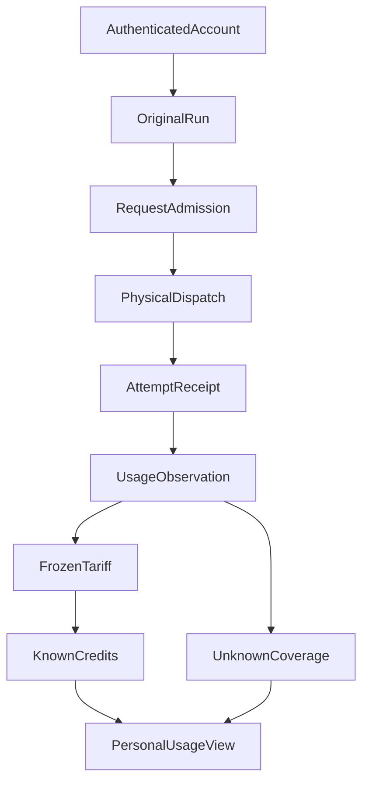

# Agent 究竟花了多少资源：为什么请求数、Token 和 Credits 不是一回事

用户看到研究 Agent 生成了一份报告，后台却可能经历多轮模型调用、工具执行、某次请求重试，以及一次没有返回完整用量的中断。页面显示“请求成功”之后，系统能回答这份报告到底消耗了多少资源吗？

在实际系统里，至少存在三本容易被误认为同一本的账：**Run 预算**约束还能做多少工作，**模型物理尝试**记录真实发起的请求及可观察 Token，**个人 Credits**按约定规则分配与展示已知用量。这三者有关联，却不能拿其中一项填补另一项的缺口。

我们最近在 ETF Agent 中加入了一个 P0 **Shadow（影子）Credits** 用量视图。它观察而不拦截现有研究，目标先是把身份、未知和可复核口径做对，而不是推出支付、计费或新额度门。

## 一、三种数字回答不同的问题

| 概念 | 真实含义 | 容易发生的误读 |
| --- | --- | --- |
| Run request budget | 对特定 Run 允许多少次准入及阶段消耗 | 把请求准入次数当成 Token |
| Physical model attempt | 一次实际发往模型的物理 dispatch，以及对应的可观察 SDK 用量 | 把逻辑请求或 Langfuse span 当成唯一真实发送 |
| Personal Credits | 当前用户月份下，按冻结费率规则计算的已知内部用量 | 把内部积分当作供应商发票或真实货币 |

一条逻辑模型请求可能因 SDK 重试产生多个物理尝试。一次已保存的 SDK 聚合用量也未必能唯一拆分到这些尝试。若只根据最终返回值填账，既可能漏掉失败调用，也可能把重试合并成一笔不可靠的“精确费用”。

因此，原 Run 预算仍由自己的 Resource/Recovery owner 决定，个人 Credits 只被动观察其已确认的请求/尝试身份。个人页面上出现余额数字，并不授予额外研究权；Shadow 也不会因为用量超出计划额度就拒绝本次请求。

## 二、先知道是谁、哪次尝试，再谈价格

一次记账要能沿可信账户、原 Run、原 request debit 和物理 dispatch receipt 找回。这里最重要的区别是：**请求预留与一次实际发送，不是同一个身份。**



模型 Gateway 的实际物理发送回调才可以产生对应 receipt。恢复读取旧调用、查询历史或展开观测结果，不会因为“重新看到一次数据”就造一个新的物理发送。一个原请求出现多个可证实的重试，则需要多条各自具有身份的尝试记录；无法证明物理重试身份的路径，宁可保持未覆盖也不分配虚构的序号。

账户身份同样不能从浏览器传入的 `userId` 直接信任。实际 self-view 读取已验证 session 对应的 owner scope，拒绝外部 owner filter；断开登录、账号禁用、session 变更或其他用户请求都不能继续展示前一个人的用量。

## 三、已知用量和 unknown 都是结果

Shadow 账本采用有版本的内部 tariff：收到 SDK 正式报告的输入与输出 Token 后，按当时冻结规则计算 Credits。不同调用的实际供应商价格、缓存折扣、未报告的隐藏用量，都不能靠产品 UI 猜出来。

下面是**合成记账示例**，不是实际账单，也不代表供应商费率：

```json
{
  "period": "2026-10",
  "accountScope": "current-authenticated-user",
  "mode": "shadow",
  "knownCredits": "4.000",
  "observedAttempts": 1,
  "coverage": "partial",
  "unknownReasons": ["unreported-retry"],
  "wouldDeny": false
}
```

`knownCredits` 只能表示已知和已归因部分；`coverage=partial` 告诉读者还有未覆盖路径。金额采用十进制字符串，避免浏览器浮点四舍五入扭曲用量。如果诊断存储不可用，界面应写 unavailable，而不是展示 0 费用。

最容易误算的分支有三种：网络已经尝试发送但没有完整 usage；一段 SDK 聚合 usage 跨越多个物理重试，无法安全拆账；进程崩溃发生在发送之后、被动观察落库之前。它们都不能自动记为免费，也不能因未知费用就阻止原研究交付。

## 四、Shadow 和强制额度是刻意不同的阶段

在这个阶段，管理员通过受控本地操作为已有、已验证用户配置月份 allowance revision；重复相同操作意图返回原版本，参数冲突拒绝。用户可在原设置区查看自己的月份、已知 Credits、Token 和未覆盖情况。它没有公开充值、订阅、后台管理或者支付入口。

已知用量超过当前配置允许值时，系统可以计算一个 **wouldDeny** 模拟信号，但它不会改变 A05 Run 预算、A30 Provider 容量、A10 原模型发送、A09 Task 预算或 A23 Publication 的实际决定。观察数据库失败也不会变成新的研究拦截门。这种非干扰性是 Shadow 的核心用途：先观察真实接缝，而不先押注一套并未证实完整的强制限额规则。

若将来增加真正拒绝发送的 Credits 准入，就必须独立设计原子预留、未知尝试隔离、恢复对账及所有适用路由，且证明失败不会扩大影响范围。不能把现在的 `wouldDeny` 切换成“硬拒绝”便宣称完成了金融级计费。

## 五、交付物成本归因还需要下一步

用户真正可能想知道“这一份周报花了多少”，而不只是“这个月账户用了多少”。这要求把物理请求与原 Run/Action/Child、Publication revision 和 Artifact 身份可回读地关联，再确定共享费用如何归属、重复重试如何去重、Web/API 成本如何定义。**这属于独立 E04 交付物成本证据设计，不是 P0 个人 Credits 已完成的效果。**

现有 Langfuse 追踪可以帮助查一次请求发生在哪里，却不能因为有 Trace 就替代被动记账和完整发票。反过来，Credits 页面知道部分用量，也不能保证某份报告已正确计算或交付。评价研究收益与“这一次花了多少钱”，最终需要两条独立证据。

## 当前实现与验证限制

截至 **2026 年 10 月 24 日**，个人月份 allowance、Shadow 物理尝试观察、自用 API 和原设置页已经进入主干。两用户的认证浏览器路径已有独立验收记录；选定的请求/网关及账号接缝也有针对性工程验证。原 Task/Scheduler 的实际 PostgreSQL 非干扰性和整项 formal close 仍未完成，不把前述通过升级为完整计费资格。

这个阶段没有付款、自动扣款、真实供应商发票，也没有完整覆盖所有模型及嵌入/语义 Memory 等路线。本文不宣称节省 Token、降低成本或提供可对账的生产账单。

我们选择先让 unknown 有自己的位置，是因为**可恢复的用量事实比一个看似完整的零账单更有价值**。只有区分“允许做多少”“真正发出过什么”和“能够可靠计入多少”，长期运行的 Agent 才有机会在不牺牲原交付的前提下逐步建立可信的资源视图。

## 延伸阅读

[Run 预算与约束治理](https://hpoenixf.github.io/eff-agent-article/articles/agent-runtime-constraint-governance-v2)解释研究额度与收尾保护；[Langfuse 观测](https://hpoenixf.github.io/eff-agent-article/articles/025-agent-langfuse-from-trace-to-trustworthy-observability)说明物理尝试与真实追踪的区别。本文聚焦个人 Shadow 账本，不与这两篇重复解释运行阶段。

更多案例见 [ETF Agent Engineering Notes](https://github.com/hpoenixf/eff-agent-article)。欢迎为技术文集点一个 Star。
