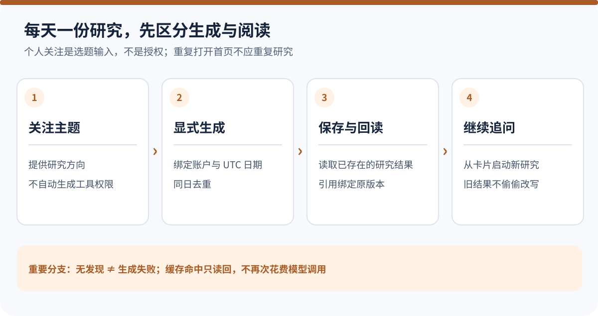
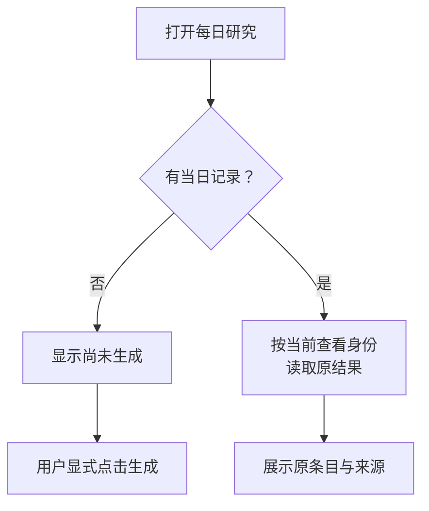
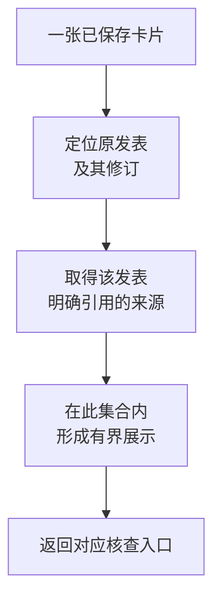

# 每天一份个性化研究，为什么不是重复执行一个 Prompt？

用户早上打开首页，看到几条与自己关注方向有关的研究。午饭后再次打开，内容还在；晚上点进其中一条，准备继续追问。

从界面看，这似乎只是几张卡片。最直接的实现也很诱人：读取用户偏好，拼接“请生成今天值得关注的内容”，把结果放进页面。

但页面刷新算不算再次授权模型花费？两台设备同时打开，会不会生成两份？用户只看到一张卡，它的引用为什么可能来自另一张卡？同一天修改关注主题，先前结果应该保留还是重做？

**每日研究的难点，是把一次有明确归属的研究，变成可以反复阅读的产品结果，而不是让每次阅读都重新启动一轮推理。** 以下先沿首页的一天解释设计，再展开两个在工程验证中出现过的具体问题。

<picture>
  <source media="(max-width: 640px)" srcset="../visuals/agent-personalized-daily-research-cache/overview-mobile.svg" />
  
</picture>

*图：每日研究的生成、去重和回读关系。概览按职责组织，不是某次任务的真实调用记录。*

[放大查看完整图](../visuals/agent-personalized-daily-research-cache/overview.svg)

## 一、关注什么，与允许系统做什么，是两种输入

以一个教学场景开始。用户在“你的关注”中填写“红利基金费用变化”和“基金持仓披露”，也可以从推荐词中选择一个主题。

这些文本首先只是关注字符串。当前实现会修剪空白、限制长度、按精确文本去重，并把它们保存到对应用户范围。它没有因为出现某个基金名，就自动创建一个金融实体；也不会把它们写进长期记忆，或者推导为新增数据权限。

这是一种有意的克制。关注表达的是“我愿意了解什么”，资料授权表达的是“你可以读取什么”，模型研究表达的是“在现有资料里，哪些问题值得今天展开”。把三者合成一个主题系统，反而容易让简单的产品入口承担它不该拥有的职责。

因此，每日研究仍进入原有研究引擎。它使用当次获准的资料和工具，由模型选择问题、读取证据、组织回答，再通过原发布链保存。首页包装层不另外创建一位研究者，也不绕过既有来源、预算和发布规则。

在当前版本中，模型可以选择零到三项问题。上限用于约束展示与工作量，并不意味着每天必须凑出三条“机会”。输出结构合格也只是可呈现，不证明这些内容真正新颖、有用，更不证明它们适合转成投资操作。

## 二、打开首页，是读结果；点击生成，才是启动工作

如果把“没有缓存就生成”放进页面加载逻辑，一次普通刷新就可能启动昂贵且有状态的研究。前端预取、失败重试和多标签页，也可能变成用户没有清楚表达的重复执行。

我们的入口明确分开：`GET .../today` 读取当日已经保存的结果；`POST .../today` 才表示显式生成或重试。页面挂载时使用只读入口，没有结果就显示尚未生成，而不是悄悄补一轮模型调用。

这与 [HTTP 安全方法的语义](https://www.rfc-editor.org/rfc/rfc9110.html#section-9.2.1)相符：客户端读取不应被解释为请求创建另一项研究。这里不是说 GET 不能进行任何服务器计算，而是将用户要阅读的既有结果与要启动的业务工作明确分开。

图中最后一步才会进入生成入口；失败状态的重试同样需要显式动作，而不是由显示请求自动触发。

在生成入口内，系统先检查当日是否已经成功。有成功结果，就复用它；没有成功结果，才尝试取得本次生成资格。即使用户重复点击，也不能因为按钮再次出现就默认另做一份研究。

这一选择还有一个直观的产品后果：用户上午生成成功，下午修改关注主题，原当日结果不会自动重写。当前入口也没有“强制刷新已成功结果”的额外动作。需要立即研究新主题，可以进入一次新的普通研究；下一天显式生成时，再读取当时的关注内容。

## 三、“今天”必须有口径，否则去重本身就不稳定

当日缓存看似只需要一个日期，但日期从哪里来，会直接决定哪些请求属于同一份结果。

**当前每日入口使用服务端 UTC 日期，与用户范围组成保存键。** 它不是按照设备所在地推断日期，也没有自动在每个用户的本地午夜刷新。

例如，在 UTC+8 的凌晨，UTC 日期可能仍属于前一天。前端不能一边按本地日历标记“新的一天”，一边让后端继续返回同一个 UTC 日的研究，却不说明日期口径。

用户拥有时区设置，不代表每项产品功能已经消费了该设置。要改成用户本地日历日，需要把可信时区、日界线和重复生成身份接到同一条链上，同时考虑时区后来被修改时如何解释旧结果。仅把显示日期改一下，会让页面和实际去重键分离。

缓存键也不能只使用日期。不同用户即使关注同一个主题，能够访问的私人背景和资料仍可能不同。系统需要保存的是“这个用户在这一天形成的研究”，而不是“任何人问过相近问题就能共用的答案”。

## 四、空白、没有发现和生成失败，不能只用一个空数组表达

首页没有卡片，至少可能有几种原因：还没生成、生成仍在进行、研究成功但没有选出条目、生成失败，或者原结果目前无法读取。

把它们统一成 `items: []`，页面就很难给出正确操作。

| 状态的含义 | 用户应该理解什么 | 不应发生什么 |
| --- | --- | --- |
| 尚未生成 | 今天还没有启动这项工作 | 暗示已经研究过但没有发现 |
| 正在生成 | 另一个请求已经在处理 | 再开一份并行重复研究 |
| 成功但零条目 | 模型在这次范围内没有选择条目 | 自动重试，直到凑出内容 |
| 失败或未形成可用结果 | 原尝试有缺口，需要明确处理 | 把失败缓存包装成成功的空推荐 |
| 保存结果暂不可读 | 访问或投影链存在实际问题 | 重新生成一份来冒充原结果 |

其中，“成功但零条目”也不等于系统证明了市场今天没有值得关注的事。它只说明这次研究在给定范围内没有选出条目。范围、来源与模型判断的局限仍然存在。

类似地，一个字段完整的卡片，不能自动获得“有价值推荐”的身份。我们把格式解析、执行完成和内容价值分开观察，避免为了填满首页而鼓励模型制造新鲜感。

## 五、真实问题之一：正文没错，卡片为什么引用错了？

在一次合成运行验证中，研究正文与工具签发的引用关系正确，最终卡片却关联到了错误来源。

调查发现，问题发生在读模型的选择顺序：它先从整次研究中截取一批较新的来源记录，再尝试找到某次发表所需的引用。较早发表对应的记录已经被截出候选集合；随后一个过于宽泛的回退，又把同次读取中没有被这张卡引用的相邻内容带了进来。

用一个简化例子理解：上午的研究先为“费用变化”发表了一项结论，后来又读取很多“持仓披露”材料。页面为了控制展示量，取整次研究最后若干条来源。费用卡片的来源因此消失，而相邻来源被错误补位。文本本身没有变，卡片却给了读者错误的核查入口。

问题不在于模型还不够聪明，也不应该通过重新生成摘要解决。

正确顺序是先定位**原研究中的具体发表及其修订**，再从它已经确认的来源关系中形成有界展示。限制展示量仍然必要，但应施加在正确的集合上。

另一个细节是，影响回答生成的私人背景，不一定应该作为公开来源卡片展示。系统可以保留这项依赖事实，但不能为了补齐引用，把用户 Profile 或未明确引用的兄弟片段展示成公开依据。

修复落在来源投影后，已保存结果就可以沿正确绑定重新呈现，无需修改原正文，也无需再次调用模型。这说明缓存并不只有“命中”与“失效”两种状态：**研究结果可以保持不变，而读取它的错误展示逻辑得到修正。**

现行访问规则也要与历史版本区分。每次返回仍核对当前账户与资源归属，并沿原 Run 已记录的授权读取发表；不能拿后来变化的来源配置，任意重写同一次已获准研究的历史授权。新研究则需要自己的准入。

## 六、真实问题之二：为了避免重复生成，反而把查询池占满了

同日去重还需要处理并发。两台设备几乎同时发起生成，仅在应用进程里设置一个 `generating` 变量，挡不住另一进程的相同请求。

当前持久层使用用户与日期的唯一键，并以 PostgreSQL 会话级 advisory lock 协调生成。它是一种由应用约定含义的锁，用于让同一份每日研究的生成相互排斥；不是让数据库理解“哪张研究卡更好”。

[PostgreSQL 文档](https://www.postgresql.org/docs/17/explicit-locking.html#ADVISORY-LOCKS)说明，会话级 advisory lock 在显式释放或会话结束前持续持有。这意味着锁的生命周期与承载它的数据库连接关系密切。

工程反例出现在这里：长时间的研究持锁占用了普通查询池；多个用户同时生成时，连接先被持锁任务拿走。研究过程随后还要从这个池里申请连接，用来读会话、查资料或保存发布结果，却已经没有连接可用。

它们等待的是自己占满的资源池。表现像“模型一直没返回”，根因却是应用资源饥饿，不一定是数据库锁管理器识别出的事务死锁。

继续放大普通池，只是推迟触发条件。当前修复把长时间持锁放到独立、容量有限的连接池，并限制排队与取得锁的等待时间；正常查询继续使用原操作池。

这样做并不让数据库负载凭空消失，代价是多管理一组有限资源及其关闭、失锁和取消行为。它的价值在于让并发控制不再吃掉被控制工作继续完成所必需的全部连接。

更重要的是，旧执行者失去资格以后，不能因为模型响应终于回来了，就继续提交。锁、任务取消和晚到结果需要沿原生成路径结算；一次数据库去重设计，也不能被宣传成所有外部模型调用的通用恰好一次保证。

## 七、定时生成和继续追问，都不应该另造一套研究引擎

每日首页很容易继续长出功能：每天九点自动生成、到时提醒、点击卡片继续研究。每增加一个入口，都复制一遍研究调用与发布，会让同一内容出现多套身份和不同失败语义。

现行设计把它们拆开连接。

基础每日入口负责显式生成和按日回读，不自带一套调度器。需要在每日界面呈现已确认的定时研究时，关联层核对原定时定义的身份、有效修订与内容摘要，再通过原任务历史取得可读结果。选择一个定时任务编号，并不等于再次确认它，更不能凭关联动作重新启动模型。

继续研究也不是“在旧结果后面偷偷追加一轮”。当前卡片入口创建普通的新对话，把主题放进用户看得见的输入框；它不会复制旧 Run 编号、旧权限或自动替用户提交。真正发送时，才按新的问题进入新研究。

这个行为看起来朴素，却有一个好处：用户知道自己接下来讨论什么，也有机会补上新条件。原卡片提供一个研究线索，不是一张跨任务永久通行证。

定时触发的日历、取消与执行绑定，可以在[定时研究专题](https://hpoenixf.com/eff-agent-article/articles/agent-autonomous-scheduled-research)中继续展开；每日首页只需消费其已经形成的事实，不必接管这些职责。

## 八、怎样评估“个性化”，不被卡片数量误导？

这项能力至少有两条不同的验证线。

工程上，要验证同日重复请求没有多启动一份成功研究，页面只读不会派发模型，两位用户的结果不会混用，来源能回到对应发表，失败后的重试仍保留原尝试的事实。这些可以通过请求、数据库与实际发布接缝检查。

内容上，要重新读用户关注和最终条目：选题是否相关？给出的变化是否真的有来源支持？是否解释了为什么值得关注？是否只是把旧材料换一种表述？用户继续研究后有没有获得新的理解？

两条线不能互相借成绩。卡片能显示，不证明推荐有用；来源身份正确，不证明内容新颖；过去做过一次成功研究，也不能把以后每个 UTC 日的结果称作可靠的投资机会筛选。

当前基础能力不应被描述成已经具有实时新颖度比较、未读状态或自动推送。零条目的表达可以保持克制，但“何时值得主动打扰用户”仍需要额外的产品证据与评估。

## 九、公开代码里的相邻机制，不是完整每日产品

公开的 [Open ETF Agent v0.15.2](https://github.com/hpoenixf/open-etf-agent/tree/34124cefc6df289e08518173789210b45a716451)没有实现本文的账户级每日选题、数据库生成锁或定时结果关联。不能把几个 CLI 命令排进 Cron，就称为同一能力。

可以对照的基础是：先通过[固定版本的演示入口](https://github.com/hpoenixf/open-etf-agent/blob/34124cefc6df289e08518173789210b45a716451/README.zh-CN.md)生成一份合成报告，再通过[只读阅读入口](https://github.com/hpoenixf/open-etf-agent/blob/34124cefc6df289e08518173789210b45a716451/src/reader-cli.mjs)重开原结果。后者不调用模型，适合观察“生成”和“再次消费”为什么需要分离。

这个对照只覆盖阅读边界，不证明个性化选题质量，也没有多用户访问资格。公开实现的后续范围，以[当前 main 的实际说明](https://github.com/hpoenixf/open-etf-agent/blob/main/README.zh-CN.md)为准。

## 结语：稳定的每日服务，先从不重复做事开始

用户早上生成一份研究，中午回来，应当能读到原来的内容与正确来源；两台设备同时操作，不应该各自产生一套互不相认的结果；晚上继续追问，应当清楚进入了新的研究，而不是不知不觉继承旧权限。

每日研究的产品感，来自这些连续而明确的行为。模型负责从获准材料中选择值得展开的问题，系统负责让关注、生成、保存和回读各自保留正确身份。

**“每天为你研究”不是每天把同一个 Prompt 再发一次，而是把研究变成一项有节奏、可回读、不越界的服务。** 真正的个性化价值，则需要继续用选题与用户得到的理解来证明。