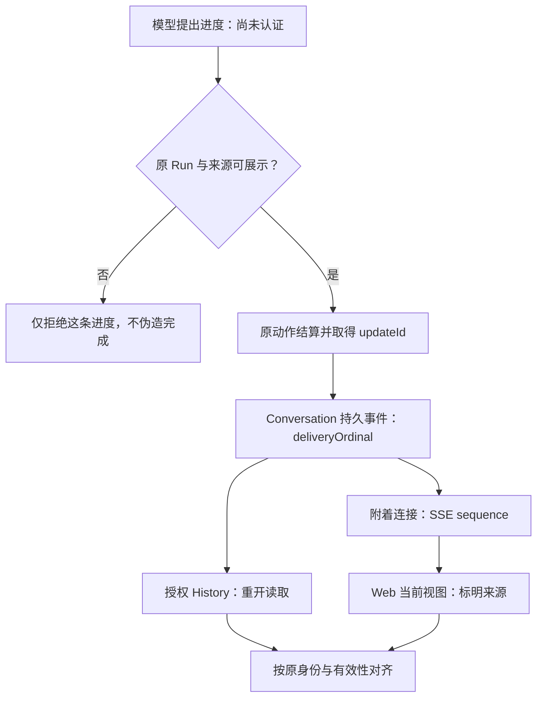

# Agent 研究进度不是日志：如何让进行中的工作可信可见

用户交给 Agent 一项基金比较研究。页面先出现“正在整理披露材料”，接着显示“正在核对费用”。模型还要执行一次缓慢的读取，用户盯着窗口等了一会儿，刷新后却发现其中一条进度消失了。或者，屏幕始终有一条“正在研究”，但其实只有连接还在，服务端当下是否继续执行并无可核对观察。

这两个问题表面上都可以用进度条解决。真正的难点却不是动画：**系统能够依据什么，向用户描述一项尚未完成的工作？哪些信息可以记住，哪些只能在当前连接里展示，哪些根本不该被断言？**

下面的基金场景是教学化示例。工程来路取自 ETF Agent 在 2026 年 10—11 月对时间感知、研究进度、Conversation/Recovery、SSE 和 Web 阅读的多次修订；其中涉及真实浏览器与隔离 PostgreSQL 的验证，使用的是脚本模型与合成资料，不是对生产时延或真实投研质量的认证。

## 一、我们为什么做了许久：问题一路从“没提示”变成“提示是否可信”

最初的需求非常自然：研究可能持续几分钟，模型需要知道时间在流逝，用户也需要知道任务还在推进。2026 年 10 月 10 日的第一轮方案把三种事情分开：Host 的时间提醒进入下一次合法模型请求；模型可通过 `send_research_update` 提出短进度；用户约定的异步交付另由原任务与通知链处理。

这一步解决了**能不能表达**的问题。它没有要求模型为了报平安额外调用一次，也没有把模型的自然语言进度塞进正式回答，更没有让“到时间了”自动变成任务完成。

但当真实链路铺开时，另一个问题逐渐显现。10 月 25 日复核的实现中，同类 `progress` 更新在 Native 暂存、公共事件收集、Memory/PostgreSQL 的事件身份以及 Web 投影中都可能按 `kind` 覆盖；一次较早的更新还可能等到同一模型轮中后续慢工具完成后才送达。HTTP 每十秒发送的 SSE 注释心跳维持的是传输通道，用户看不到，也不能据此知道研究做到了哪一步。

于是第二轮不再只问“有没有 progress”，而问：**模型已经获准的三条独立更新，能否按发生顺序在后续慢操作结束前出现？**

11 月 2—3 日的实现与验收又暴露出第三层问题：能按顺序看到三条，不代表晚到的历史快照不会删除它们；显示过一次，也不能成为重连后永久可读的凭据。浏览器里的竞态、当前权限与历史来源，逼着我们把“实时看到”和“持久可信”再次拆开。

| 阶段 | 当时合理的做法 | 后来的真实约束 | 最终保留的选择 |
| --- | --- | --- | --- |
| 时间感知与模型进度 | 复用现有 Tool、Host 提醒与 SSE | 模型进度可能被同类更新覆盖，且延后显示 | 为每个获准更新保留独立身份并尽早交付 |
| 有序时间线 | 以消息到达顺序追加到界面 | SSE、数据库历史、浏览器读取具有不同时间线 | 实时序号与持久顺序分离 |
| 重开与竞争读取 | 以刚返回的 History 刷新视图 | 旧快照可能缺少刚显示的行；缺少也可能意味着不可读 | 仅在原身份范围内做有界确认，不伪造访问资格 |

重要的是，旧方案并不荒唐。只展示“目前处于哪一阶段”时，按类型覆盖完全合理；需要保存每一次模型声明后，它才不再足够。**状态摘要和事件时间线是不同产品承诺，不能只靠把 Map 改成数组完成升级。**

## 二、一条进度到底是谁说的？先分清三种来源

长研究中最容易误导用户的，是把所有“还没有结束”的信号都染成同一种绿色。

| 信号 | 产生者与含义 | 可以展示什么 | 不能据此宣称什么 |
| --- | --- | --- | --- |
| 模型研究进度 `research-progress` | 模型主动提出，经原 Tool、授权与持久效果接纳 | “AI 进度（未经独立核验）”：它认为正在做什么、关注什么 | 资料已读完、计算正确、研究完成百分比 |
| Host 临时状态 `research-pulse` | 当前 Run 的已知观察或“当前未知” | “系统状态”：上一次观察、等待或无法确认 | 模型此刻仍在思考、未来必然会完成 |
| 浏览器连接状态 | 客户端发现连接延迟、断开或恢复 | “连接状态”：正在重连、暂时无法取得新消息 | 服务端已停止、已经取消、已经完成 |

这是本文第一个可以迁移的判断：**同一句“仍在研究”，如果没有清楚的来源，就没有稳定的含义。**

模型能概括自己的研究意图，却不能通过一句话认证资料真实性。Host 知道某些运行状态，却不拥有金融结论。浏览器知道连接好不好，却无法仅凭连接判断 Worker 是否执行。这些信号可以并列帮助用户理解情况，不应该互相冒名顶替。

因此，真正的研究成果仍走原 Publication：它有正文身份、版本、受控数值与来源限制。进度消息不会创建另一份答案，也不替代需要用户回复的提问。需要显示时可以折叠成“研究过程”，而不是一条条生成假的 assistant 消息。

## 三、从模型提出到屏幕出现，中间有四次不同的事实变化

一次模型进度不是“模型发一句 SSE”这么简单。模型先通过受控工具提出 `kind=progress` 或 `attention` 的有限文本；原 Runtime 检查当前 Run、权限、内容可展示性和终结状态，沿原动作序列结算并留下稳定 `updateId`。之后才交给原 Conversation 的持久事件与 Outbox，分配 `deliveryOrdinal`；附着的 SSE 连接按自己的连续序号输出，Web 再投影成可见行。

*图 1 · 一条可见进度需要经过不同的事实接缝。顺序、身份与可读性仍由既有职责负责，图中没有第二个 Progress Manager。*

这里至少有四种不可互换的结论：模型**提出了**文本，系统**接纳并结算了**动作，Conversation **提交了**可重读的事件，浏览器**显示了**其中一行。任何一步失败，都不能借后一条漂亮的 UI 文案倒推前面的事实已成功。

同类更新也要遵循不同的去重规则。两个 `kind=progress` 但 `updateId` 不同，是两个独立陈述；同一身份的相同封存请求重试，才是同一个效果的幂等读取。若依然按 `runId + kind` 作为唯一槽位，“先查了什么、后发现什么”会被磨成最后一句话。已有历史里曾经被覆盖的部分则无法追补，不能凭新协议补造旧进度。

## 四、两种顺序：实时连接负责“先后看到”，持久历史负责“留下什么”

一个常见捷径是用 SSE `sequence` 作为历史游标：序号大的永远更新。这在单连接里看似顺手，断线重连就会出错——新连接的序号可能重新开始，历史读取也并不按实时事件到达顺序提供全部内容。

因此系统需要两个互不冒充的顺序：

- **当前连接顺序**：由原 Run 事件队列统一分配序号；只有这一条附着流中的事件按它判断先后。Host 临时提示也排进相同队列，不能旁路另起序号。
- **持久事件顺序**：由原 Conversation 给正式接纳的更新分配 `deliveryOrdinal`，重开后用当前仍获准的 History 恢复。临时 Host 提示没有这项顺序，也不写入 Outbox。

重连时先从完整且身份匹配的原始快照建立持久读取截止点，再区分已有更新与恢复后新提交的更新。这个截止点不能从 UI 最后显示的数字猜测，也不能在权限过滤之前就把不该显示的正文送给前端。若快照不完整或身份不匹配，分类就保持未知。

这不是追求抽象的“全局有序”。我们需要的是更窄、更可兑现的语义：**当前连接里的消息不乱序，持久记录不会把不同的动作误当成同一个，重连不会制造没发生过的进度。**

## 五、最难的反例：History 比 SSE 晚回来，却比它更旧

考虑一条真实被针对性测试过的竞态。浏览器发出 History 请求后，SSE 收到一条新的模型进度并显示；稍后 History 返回，但快照里没有这条进度。没有这行，可能因为快照在提交前就开始读取，也可能因为原保存身份与权限现在不允许展示。**缺席不是足够的证据，既不能断言“从未发生”，也不能断言“永远合法”。**

直接用 History 覆盖整个界面，会抹掉刚看见的研究过程；直接相信所有 SSE 文本，又可能让已经撤权的内容在页面里残留。

实际采取的办法更克制：原 SSE 已通过发送权限检查时，为这条确切的 Run、范围、事件和版本提供短暂、仅限进程内的校验回执。若较晚的 History 缺了这条可见行，客户端只向原负责方有界确认这份**已经看见的具体回执**，不允许拿任意文本或任意 ID 查询，更不新增一次权限审批。

| 确认结果 | 当前视图如何处理 |
| --- | --- |
| `current`：原身份与内容仍匹配 | 保留这一行 |
| `not_current` 或回执无效 | 只移除该行；不动独立回答与其他 Run |
| `unknown`、请求失败或超时 | 只在当前 Run、当前阅读代际内暂存已显示行，等待后续真实 History；不能升格为永久授权 |

进程重启后，旧进程签发的短期回执可能无效。这意味着本地回执无法继续认证，不等于旧内容本身一定被撤权；后续合法的持久 History 仍可以独立显示它。晚到的核查响应也不能越过取消、终结、账户变化或更高版本的视图去“复活”旧行。

尤其不能让可选进度核查挡住独立的答案。即使这条进度暂时拿不到确定结论，已经获准的正式回答也应该继续交付。这一细节让 Progress 真正服务研究，而不是变成新的终结权。

## 六、还有一种看不见的缺口：第二轮研究为什么没有进度？

11 月 3 日的双轮对话验证发现另一个更靠后的问题。第一轮结果已保存，第二轮模型确实消费了之前的对话文本，却仍可能因为缺少完整来源绑定而无法发布自己的进度。原始回答和模型看到的历史文字，并不能自动证明第二轮中的所有内容具有相同的展示资格。

尝试只补一个“来源 ID”并不安全；来源版本、实际拟合进请求的历史范围、哪些材料被截断，以及哪些文本属于其他来源，都会改变权限判断。更糟的补丁会为了显示进度而对每个请求额外执行历史读取，或把本应未知的来源当成已经证明。

最后修的是原 History → 实际请求拟合 → 新 Run 来源关联这条接缝。只有原身份、原版本与真正进入下一次请求的材料都可被原负责方证明，才允许相应的进度继续交付；其他来源保持未知。修复后的受控 HTTP/PostgreSQL、浏览器双轮路径显示了新进度，原先那份回答仍能独立读取。

这里的收获比“前端别丢事件”更深：**一个关于研究过程的陈述，也可能携带来源依赖。保存过的历史不等于当前请求完整、合法地使用了那段历史。**

## 七、三十秒没有消息，应该显示“仍在执行”吗？

对于长时间安静的模型请求，我们选择了一个成本更低、但诚实的补充机制：附着的健康观看流没有新的有意义状态时，Host 约每三十秒发一条临时观察；无法确认实时阶段时，明确写“当前执行状态未知”。真实浏览器的受控长等待曾显示相隔约三十秒的两条“未知”状态。

这不是让模型每半分钟再推理一次，不增加模型请求或原研究预算；也不是把数十个“我还在”永久写入 History。页面离开或重新连接以后，能恢复的只有合法持久进度与原 Run 的可读事实，不能补发用户没看到的历史心跳。

因此我们保留了两个不同的东西：HTTP 的 `: heartbeat` 是运输保活，Host `research-pulse` 才是读者可见、带有限来源的临时观察。停止、停放、取消、终结以及附着流失效时，临时提示必须收口。浏览器自身的断线提示只能解释连接，不推断研究已经停止。

## 八、前端真正需要守护的，不是滚动动画，而是阅读连续性

最终浏览器验收没有止步于“能显示三行”。在隔离数据库、合成账号和脚本网关下，两个模型进度先于后续缓慢工作出现，放行后第三行与独立回答继续到达；刷新、冷读与服务切换检查了合法持久事实。另一组测试故意让 History、进度回执与终态互相竞速，验证不会因为等待进度核查而隐藏回答。

对于前端来说，还要守住很容易被忽略的体验：旧回答正在阅读时，新进度不应强制把页面滚到最底部；临时消息 ID 被正式保存 ID 替换时，同一 Run 的“研究过程”展开状态不应突然复位；两个并发 Run 的进度不能因为谁最后到达而串行。

这些验证证明的是受控协议与页面路径。它们不自动证明真实线上浏览器的最大静默间隔、所有物理断网场景、屏幕阅读器体验或用户是否因此更安心。后续若需要讨论进度延迟、可观察间隔或长时间线的渲染成本，应先真实测量，再决定分页和虚拟列表。

## 九、如果从头再做一次，我会先做得更少

回看这段演进，最值得继承的不是一组事件名称，而是一条**按承诺增长复杂度**的路线：

1. **短任务只交付结果。** 不要为了统一界面替每次普通问答制造进度事件。
2. **开始有长等待时，先复用原 Run 与传输。** 需要的只是清楚的工作身份与保守的当前状态；技术心跳不能冒充任务反馈。
3. **需要多条可回查进度时，才建立独立效果身份与持久顺序。** 不要把一个阶段状态槽位硬当成完整历史。
4. **出现真实重连和竞态问题，再做窄范围的回执复核。** 把修复放在原事实负责方，别引入全能 Progress Manager、第二份历史账本或新的否决权。
5. **可选状态必须可以退出。** 即使暂时不知道某条进度的有效性，也不应该拖住另一份已合法完成的正文。

如果把这个经验提炼成一个判断，便是：

**好的 Progress，不是让界面永远有话说，而是让系统知道何时有资格说话、说到了哪一步、失去依据时如何收回，以及什么时候宁可承认不知道。**

这也是 Agent 与普通页面加载提示真正不同的地方：研究策略可以由模型动态生成，但系统对用户的过程描述仍要遵守证据、身份、时间和权限。越是长时间运行，越不能把“看起来在忙”误当作可信进展。

## 延伸阅读

[客户端交互与阅读](agent-client-interaction-and-reading.md)详细讨论 Run 归属、正文修订与操作回执；[异步研究与按时交付](agent-asynchronous-research-time-bound-delivery.md)讨论用户离开后的时间承诺；[可观测全景](025-agent-langfuse-from-trace-to-trustworthy-observability.md)讨论诊断事件为何不能替代原始执行事实。本文聚焦的是尚未完成的研究如何向正在观看的人提供可信过程反馈。

更通用的传输背景可参阅 [MDN: Using server-sent events](https://developer.mozilla.org/en-US/docs/Web/API/Server-sent_events/Using_server-sent_events)。SSE 负责递送事件，本文所需的身份、权限、版本和业务含义仍属于应用协议。

更多文章见 [ETF Agent Engineering Notes](https://github.com/hpoenixf/eff-agent-article)。