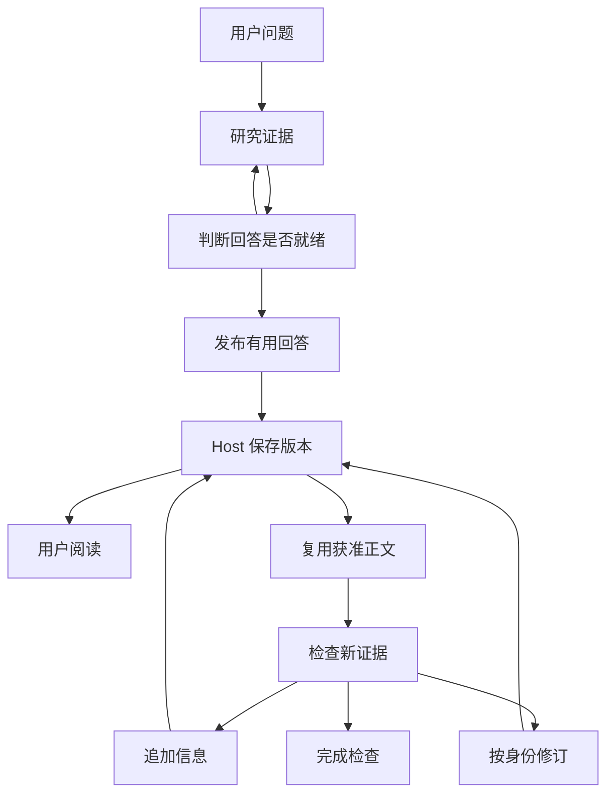

# Agent 的渐进式回答：怎样保持研究过程连贯

用户在问两个指数基金有什么不同。Agent 先读到编制规则，接着取得年度行情，最后补齐费用说明。三批资料陆续返回，用户当然不必一直等到最后才开始阅读。

但如果每批资料都产生一份带背景、分析和小结的“小报告”，越早输出，最后反而越难读。新发现究竟补充了什么？前一段结论还有效吗？用户不得不替 Agent 做最后一次编辑。

我们现在采用的办法是：**持续完善同一篇回答，让新证据决定下一步是追加、纠正，还是结束。** 模型负责这个语义选择；发布系统负责段落身份、版本与持久交付。本文的指数比较是教学示例，实际历史观察会另行说明。

<span id="第一部分-初步研究"></span>
<span id="小结"></span>
<span id="第二部分-补充研究"></span>
<span id="综合结论"></span>
<span id="第三部分-新增发现"></span>
<span id="最终结论"></span>
<span id="一、为什么-progressive-answer-反而容易破坏连贯性"></span>
<span id="_1-1-从一次性交付到渐进式回答"></span>
<span id="_1-2-我们无意中鼓励模型生成-小报告"></span>
<span id="二、第一项改变-让模型始终写同一篇文章"></span>
<span id="_2-1-改造前后-文章结构有什么不同"></span>
<span id="核心差异是什么"></span>
<span id="过去一年表现如何"></span>
<span id="这些差异对配置意味着什么"></span>
<span id="还有哪些问题需要确认"></span>
<span id="_2-2-第一部分必须有用-而不只是-已经输出"></span>

## 一、先交付一个有用判断，而不是先交付一份目录

渐进式回答有一个值得保留的动机：已经有依据的部分，不应被另一项独立而缓慢的查询拖住。

旧的交付说明要求每次提交“完整、自足”的内容。这个要求本来是为了让用户随时能读懂一段话，却也可能诱导模型每次重写引言、风险说明和结论。2026 年 10 月 10 日的历史普查中，一批 149 次运行有 275 条发布记录，只有 2 条的修订版本大于 1。它显示出“追加多、修订少”的行为特征，但仅凭这个分布，不能判定文章质量，更不能证明某条 Prompt 就是根因。

应该保留的是“这部分能独立理解”，而不是“这部分必须独立成文”。

例如，先取得两类指数的编制规则后，可以回答它们覆盖的公司规模、行业和风险来源如何不同。年度收益仍在查询，就留到后面处理，不用先输出“我将先检索规则，再分析收益”的研究计划，也不能根据风格特点猜一个收益率。

```text
用户提问
   ↓
取得第一批有效证据
   ↓
发布第一部分回答 ───→ 用户开始阅读
   ↓
继续搜索和分析
   ↓
发布第二部分回答 ───→ 页面继续更新
   ↓
研究完成
```

这张图描述交付时机。真正的章节应该围绕“核心差异”“相同期间的表现”“配置含义”组织，而不是围绕“第一次搜索”“第二次补充”组织。

第一段已经回答一个重要子问题，才可能成为首次有用回答。非空文字、进度提示和很早出现的 Token 都只是更早的信号。

## 二、新证据来了，先判断它和已有正文的关系

同一条研究主线通常只需要三种选择：

| 新材料改变了什么 | 应怎样处理当前文章 |
| --- | --- |
| 增加一个尚未回答的重要方面 | 接着原论证追加，交代新增信息的作用 |
| 推翻或修正已经写出的判断 | 纠正对应段落，保留它的位置和修订身份 |
| 没有新的有用内容 | 完成必要检查后结束，不再补一遍总结 |

这不是让 Runtime 用关键词做三分类。材料是否改变判断，仍由模型理解；系统只提供能让这些选择真正落地的接口。

假设早期材料只覆盖部分日期，模型却把局部低点写成全年最低点。后来读到了完整年度序列，最省事的输出是再追加一句“更正：其实是另一个数”。但这样把两个相互冲突的答案留给了读者。

现有 `replaces` 机制让模型指定原段落身份和预期版本，提交纠正后的完整段落。原位置呈现新版本，旧版本留作历史，而不是按相似标题猜测要删除哪段。

如果新数据只增加了费用对比，追加一节就够了。没有新信息时，研究也不必为证明“已经做完”再发布一个结语。**追加的门槛是读者得到新内容，修订的对象是受影响的原判断。**

<span id="三、第二项改变-让模型知道自己已经写了什么"></span>
<span id="_3-1-历史对话不等于当前文章"></span>
<span id="_3-2-给模型一份当前文章的真实视图"></span>

## 三、让模型拿到“当前文章”，它才有条件接着写

一句“不要重复”解决不了缺上下文的问题。上一轮写了什么、哪个版本已经替换、哪些内容没放进这一轮输入，都需要明确提供。

我们复用发布模块的当前正文视图，不再创建另一份可编辑文章数据库。概念化表示如下：

```json
{
  "sections": [
    { "id": "section-1", "revision": 2, "text": "这一段的当前正文" }
  ],
  "omittedCount": 0
}
```

正文使模型能够承接论证，身份与修订号使它能精确纠正，遗漏信息则提醒它不能假装读过全文。实际投影还要保持原 Run 的授权、来源身份和容量约束。同一 Run 已授予的权限不会因为外部权限表后来变化而被重新撤回；跨 Run 读取历史内容走自己的新准入，不能把两者混在一起。

### 最意外的问题：屏幕上纠正了，存下来的却仍是旧文章

历史排查中，我们确实遇到过一次比“模型不愿意修改”更隐蔽的问题：某条发布适配路径支持提交，却没有把接受的替换完整接到持久替换上。新内容能预览，恢复后读取的文章仍可能不同。原先基于这两份不一致正文作出的质量归因，因此被撤回。

修复没有增加 Writer，而是补齐原链路：由适配器读取原段落的精确身份、修订和位置，仍由原持久化模块执行带版本检查的原子替换。相关验证覆盖了保存后的新修订、发布事件和下一次实际拟合的模型请求。

这个问题解释了为什么当前文章不能只是“最后一次往页面发过什么”。预览帮助用户早点读，持久回执保证重开后还能读到；后继模型回合也必须和正式提交保持一致。**要检查一项纠正，就一起检查屏幕、保存结果和下一轮输入。**

<span id="四、第三项改变-新证据来了-允许修订-而不是无限追加"></span>
<span id="_4-1-追加不是唯一选择"></span>
<span id="_4-2-整个机制如何协作"></span>

## 四、修订要有边界，阅读仍然是一条连续的线



图中的判断都由模型提出：证据尚不足时继续研究；已有支持时交付；之后按新增信息、必要纠正或没有新增价值分别走向追加、修订或结束。Host 校验并保存实际效果，不为模型认证“已经充分回答”。

当前纠正能力不等于通用编辑器。它以原段落和预期修订为目标，受已有修改额度、授权与持久状态约束；不能把找不到的替换目标悄悄变成一次追加，也不提供无限制的跨段合并、删除和重排。

这项取舍减少了编辑协议和失败处理，但也要求模型第一次就尽量组织好文章。若产品核心是多人协作改稿，文档结构、操作变换或更完整的编辑协议可能值得单独设计。研究型问答没有必要先承担这些复杂度。

<span id="六、我们为什么没有增加一个-writer-agent"></span>
<span id="少一些重复指令-反而可能更好"></span>

## 五、成熟方案解决了哪一层，我们还需要哪一层？

这里有三类经常被混成同一个问题的能力。

[LangGraph 的流式接口](https://docs.langchain.com/oss/python/langgraph/streaming)可以分开输出消息、状态更新和自定义事件。它解决的是运行变化怎样被消费者持续接收。应用仍要决定哪些事件进入报告，哪些只展示为进度。

[Vercel AI SDK 的数据流](https://ai-sdk.dev/docs/ai-sdk-ui/streaming-data)区分进入消息历史的数据块与临时通知，并支持相同 ID 的数据块更新。这是客户端持续更新同一对象的好基础；应用自己的服务端仍需定义谁能修改、预期修订是什么，以及哪次更新已经持久保存。

再往上一层，[Anthropic 介绍的 evaluator–optimizer 模式](https://www.anthropic.com/engineering/building-effective-agents)用生成与评阅循环做迭代改进。它适合有清楚评价标准、反馈确实能带来值得额外调用成本的改进时。它并不会自动补齐丢失的原始来源或错误的持久替换。

我们先选择复用原研究模型、当前正文与发布版本，因为已经具备这些能力，暴露的缺口主要在协作和交接。额外 Writer 会再接一次上下文、来源和当前版本，还增加延迟与失败处理。若之后能证明独立编辑阶段对目标任务有稳定价值，再引入也不迟。

<span id="五、让表达自然-还需要减少不必要的系统噪声"></span>
<span id="_5-1-把必要的限定放在相关判断附近"></span>
<span id="_5-2-来源提示也应服务阅读"></span>
<span id="_5-3-不只是告诉模型规则-还要让规则容易执行"></span>

## 六、减少系统噪声，但不把风险和失败删掉

限定语应解释具体判断成立的条件。例如“两个指数仍共同暴露于 A 股市场风险”，比每节都重复“不构成投资建议”更有信息。真实缺失的年度数据、未完成计算和来源冲突则必须留在相关判断附近。

来源提示也应跟随受影响段落及修订。某段没有绑定引用，不能因此宣布全篇都没有可靠资料；另一段有引用，也不能替前一段作证。精确机制由[发布系统](019-agent-answer-publication.md)负责。

接口同样会影响写作。历史测试出现过模型缩短合法引用 ID 的情况。提供可复制的完整标记，比要求模型自行拼接更容易正确执行：

```text
[[cite:完整的来源引用ID]]
```

一次样本中 37 个引用全部匹配完整 ID，后续另一轮却仍发生截短。这个对照说明接口改进值得做，底层校验仍须保留，不能把一次成功写成已经解决所有引用问题。

我们还曾因不断追加写作指令挤占固定上下文容量。最后采取的是合并、精简已有指导，而不是继续提高容量或新增一套“自然度检查器”。Prompt 与正文一样，需要删去重复。

<span id="七、效果如何-以及哪些问题仍没有解决"></span>

## 七、怎样判断这一设计真的帮助了读者？

要看完整阅读过程，而不只看最后一个返回值：第一份真正有用的内容何时出现，后来是否推进同一论证，错误是否在原处被纠正，重连后是否保持一致。

2026 年 10 月 11 日，用户对当时支持环境的六份回答给出的整体评分为 4、4、3、5、4、4，平均 4.0/5。它是一组有时点的阅读评价，不能写成“六个任务全部完成”，也不是同模型、同来源和同预算的对照实验。历史记录同时保留了未完成任务、理由缺项、数值选错和引用失败；后来的委托评阅属于另外的样本，不能合并成一次整体提升。

尤其要分开两类问题：取得了完整年度价格序列却选错最低值，是模型综合与计算需要检查的地方；接受替换却没有持久保存，是发布链路的问题。两者都可能让最终文章读起来不对，修复却完全不同。

下一次评估时，可以按四个问题检查：

- 首次有用内容是否真正回答了一个重要子问题，而非只有计划？
- 后续正文是否增加了判断依据，还是重复开始？
- 修订后的事实、引用和持久版本是否一致？
- 阅读改善是否以丢掉任务范围、增加大量调用或更长等待为代价？

<span id="结语-好的-agent-不应该让用户阅读它的工作日志"></span>

## 结语：用户阅读的是答案，不是执行轨迹

渐进式交付最值得保留的是及时性，最需要避免的是让执行顺序支配文章结构。

从同一个问题出发，让模型看到当前正文，按证据选择追加、纠正或结束，再让原发布模块把每次变化保存准确。这样，系统可以分很多步工作，读者仍然沿着一条论证读下去。

延伸阅读：[独立发布系统](019-agent-answer-publication.md) · [客户端怎样合并实时消息与历史](agent-client-interaction-and-reading.md)。本文讨论完整研究系统的设计；[Open ETF Agent](https://github.com/hpoenixf/open-etf-agent) 是另一个边界更小的开源教学实现，不代表公开了这里全部能力。
