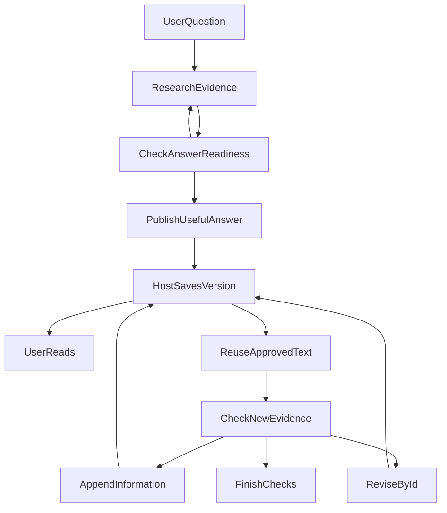

# Agent 的渐进式回答：怎样保持研究过程连贯

我们给金融研究 Agent 加上网页搜索、PDF 阅读和数据分析后，它能在研究过程中先交付一部分结果。新问题随之出现：后续研究怎样接上已有正文，而不是把每轮输出拼成一份日志？

**工具越多，最终回答越容易变成几份研究报告的机械拼接。**

例如，用户询问两个指数基金的差异，Agent 可能这样回答：

> ### 第一部分：初步研究
> 我们首先分析两个指数的基本情况……
>
> ### 小结
> 两者存在一定差异，需要进一步核验。
>
> ### 第二部分：补充研究
> 经过进一步检索，我们发现……
>
> ### 综合结论
> 综上所述……
>
> ### 第三部分：新增发现
> 在前述研究的基础上，补充以下信息……
>
> ### 最终结论
> 综合以上全部分析……

每一部分单独看，都不一定有问题。

但组合起来，用户必须自己判断：哪个才是最终结论？后面的内容是在补充还是纠正前文？为什么已经总结过的事情还需要继续总结？

更极端的情况下，回答会以英文研究计划开头，中间是中文分析，最后又出现一段英文总结。

经过一轮代码检查和真实模型测试，我们发现：**问题不完全在于模型的写作能力，而在于我们设计的交付机制，无意中鼓励模型把每次输出都当作独立报告。**

于是，我们开始了一次有针对性的改造。

没有引入新的 Writer Agent，也没有增加复杂的文章编辑系统，而是重新协调模型写作、上下文管理和已有的发布机制。

## 一、为什么 Progressive Answer 反而容易破坏连贯性？

### 1.1 从一次性交付到渐进式回答

传统 Research Agent 的工作方式很简单：

用户提问 → 搜索资料 → 分析数据 → 整理结论 → 返回完整答案。

它的问题在于等待时间。

一次复杂的金融研究可能包含几十次工具调用。即使 Agent 已经获得了部分有价值的证据，用户也可能需要等待整个流程结束，才能看到结果。

因此，我们引入了 **Progressive Answer（渐进式回答）**。

```text
用户提问
   ↓
取得第一批有效证据
   ↓
发布第一部分回答 ───→ 用户开始阅读
   ↓
继续搜索和分析
   ↓
发布第二部分回答 ───→ 页面继续更新
   ↓
研究完成
```

这种模式改善了交付体验，但它隐含着一个问题：

**对系统来说，回答被拆成了多个 Publication；对用户来说，它仍然应该是一篇完整文章。**

Publication 是工程概念，表示一段经过校验、可以独立发布和持久化的内容。

而文章结构是语义概念。它关心的是：当前的核心判断是什么？新证据与已有判断有什么关系？后续内容应该补充还是修正？

两者并不天然一致。

### 1.2 我们无意中鼓励模型生成“小报告”

回顾原来的工具说明，我们曾经强调：

> 每次提交一段完整、自足的回答。

这个要求本来非常合理。

因为渐进式交付意味着用户随时可能开始阅读，不能给用户展示没有上下文、无法理解的半句话。

但它容易产生一个副作用：

模型把“这一段需要能独立理解”，解释成了“这一段需要拥有完整报告的结构”。

于是，每次调用 `send_answer_part` 都可能重新生成背景、分析、小结和风险说明。

我们在历史运行中也观察到了这种倾向：某批 149 次运行共保留了 275 条 Publication 记录，其中只有 2 条修订版本大于 1。

这个统计并不能直接证明回答质量，但结合实际文本，可以看到一个明显现象：

**Agent 更习惯不断追加新段落，而不是围绕已有文章持续完善判断。**

问题因此变成了：

如何既保留渐进式交付的速度优势，又让最终内容像一篇自然写成的文章？

---

## 二、第一项改变：让模型始终写同一篇文章

我们首先调整的不是 Runtime，而是写作目标。

原来的隐含目标是：

> 每次发布一段相对完整的内容。

现在更强调：

> 尽早回答最重要、已有依据的问题；后续内容围绕同一条论证主线补充或修正。

这里有一个很重要的区别。

**每一部分可以独立理解，但不需要独立成为一份报告。**

### 2.1 改造前后，文章结构有什么不同？

还是以指数基金比较为例。

用户问：

> 中证500和沪深300有什么区别？过去一年的表现和风险又有什么差异？

改造前，回答可能沿着研究执行顺序展开：

```text
第一部分：基本情况
    两个指数分别是什么？
    ↓
初步结论
    存在差异，还要进一步分析。
    ↓
第二部分：补充数据
    两者收益和回撤如何？
    ↓
综合结论
    重新总结基本差异和收益表现。
    ↓
第三部分：新增发现
    补充某项风险或修正此前的判断。
    ↓
最终结论
    再次总结前面所有内容。
```

改造后，我们希望它更接近这样的组织方式：

> ### 核心差异是什么？
>
> 沪深300和中证500主要覆盖不同规模层次的上市公司，因此在行业权重、市场风格和风险暴露上存在差异。这意味着两者可能在不同市场环境下图现不同，但并不代表它们能够完全分散彼此的风险。
>
> ### 过去一年表现如何？
>
> 接下来比较两者在相同起止日期内的收益率、最大回撤和波动情况。
>
> 收益率告诉我们谁表现更好，最大回撤则帮助理解获得收益过程中承受了多大风险。两项指标需要结合观察，不能仅凭收益高低判断优劣。
>
> ### 这些差异对配置意味着什么？
>
> 两者都属于A股权益资产，虽然风格不同，但仍然存在共同的市场风险。组合配置时，除了观察基金数量，更需要判断底层资产和风险来源是否真正分散。
>
> ### 还有哪些问题需要确认？
>
> 具体的年度表现必须以相同区间、相同收益口径的数据为准。没有取得完整数据的指标应保持未确认，不能根据风格特点推断实际收益或回撤。

以上是对两种写作结构的简化示意，不是实际历史回答的逐字回放，也没有虚构任何年度收益数据。

最明显的变化是：

**改造前，章节围绕 Agent 做了什么展开；改造后，章节围绕用户需要理解什么展开。**

后续仍然可以分批交付，但新内容应该自然接在已有论证之后。

### 2.2 第一部分必须有用，而不只是“已经输出”

这也让我们重新思考了渐进式交付的衡量标准。

以前，我们更容易关注：

- First Token：模型什么时候开始输出？
- First Publication：第一段内容什么时候成功发布？

但这两个指标并不等于用户真正获得了答案。

例如，Agent 首先输出：

> 我将先检索指数编制规则，再分析历史收益数据……

即使这段内容很快展示出来，用户依然没有得到实际帮助。

因此，我们现在更关注 **First Useful Answer（首次有用回答）**。

它要求首次交付的内容能够回答至少一个重要子问题，并且拥有足够的证据支持。

当然，这不意味着模型必须在证据不足时强行给出结论。

如果核心事实尚未取得，就应该继续研究；如果一部分已经能够确认，就不必让它等待其他独立部分全部完成。

**尽早交付的应该是有用内容，而不是工作进度。**

---

## 三、第二项改变：让模型知道自己已经写了什么

只靠 Prompt 告诉模型“不要重复”，并不能可靠解决问题。

原因很简单：

模型要想自然地接着写，首先必须知道前面究竟写了什么。

### 3.1 历史对话不等于当前文章

在多轮 Agent 系统中，模型下一次请求看到的上下文未必包含之前的全部输出。

上下文可能经过压缩，工具结果可能按需加载，之前的 Publication 可能已经被修订，某些来源也可能不再允许读取。

如果只提供历史 Publication 的 ID，模型仍然不知道：

- 原段落的具体内容是什么？
- 当前版本是否已经改变？
- 哪些判断已经告诉过用户？
- 哪些内容因为容量或权限限制而不可见？

于是，即使模型想避免重复，也可能无从判断。

### 3.2 给模型一份当前文章的真实视图

因此，我们强化了 Current Publication Context。

它不是一套新的文章存储系统，而是由现有发布模块提供一份**当前仍然获准读取的正文视图**。

简化结构如下：

```json
{
  "sections": [
    {
      "id": "section-1",
      "revision": 2,
      "text": "用户当前看到的正文"
    }
  ],
  "omittedCount": 0
}
```

这里有三个重要设计。

**第一，提供真实正文，而不只是 ID。**

模型能够看到当前文章已经有哪些判断、解释和限制，从而决定新信息应该怎样承接。

**第二，保持版本和授权一致。**

已经撤权或失效的内容，不能因为曾经出现在历史回答里，就再次提供给模型。

**第三，明确说明上下文遗漏。**

如果容量不足，模型会知道某段正文没有被提供，而不是假装自己看过全文。

这也是 Context Engineering 的实际价值：

**不只是控制模型能够看到多少信息，更重要的是确保它看到的信息确实对应当前任务和当前状态。**

---

## 四、第三项改变：新证据来了，允许修订，而不是无限追加

当 Agent 继续研究时，新获得的信息与已有回答通常有三种关系。

| 新信息的情况 | 合理行为 |
|---|---|
| 增加了新的有效信息 | 承接当前论证，补充新的方面 |
| 改变了前面的判断 | 修订受影响的原段落 |
| 没有增加有用信息 | 不再重复，完成必要检查后结束 |

这三个选择看起来简单，却能明显改变最终文章的结构。

### 4.1 追加不是唯一选择

假设 Agent 已经发布：

> 根据目前的数据，沪深300在指定年份的最低收盘价为 X。

后来取得完整年度数据，发现 X 只是局部低点，真正的年度最低收盘价应该是 Y。

过去，模型可能继续追加：

> 补充说明：经过进一步分析，实际最低收盘价应该是 Y。

于是最终文章同时保留了 X 和 Y，读者需要自己判断哪个有效。

而我们原本已经具备 `replaces` 机制，可以让模型指定原段落的 Publication ID，提交纠正后的完整内容。

系统会检查目标版本和相关授权，再更新当前正文。

整个过程不需要通过 Markdown 标题猜测要替换哪一段，也不需要靠文本相似度删除所谓的重复内容。

### 4.2 整个机制如何协作？



**关系或判断条件：**

- **CheckAnswerReadiness → ResearchEvidence**：否。
- **CheckAnswerReadiness → PublishUsefulAnswer**：是。
- **CheckNewEvidence → AppendInformation**：新增信息。
- **CheckNewEvidence → ReviseById**：需要纠正。
- **CheckNewEvidence → FinishChecks**：没有新增价值。

这里最关键的分工是：

**模型决定文章应该怎样发展；Runtime 确保每次交付具有合法的身份、版本和证据。**

我们没有因此引入通用的文章 AST，也没有增加一个必须执行的最终润色阶段。

当前优先支持的是有依据的内容纠错，而不是无限制的跨段合并、删除和重新排序。

这是有意保留的架构取舍。

---

## 五、让表达自然，还需要减少不必要的系统噪声

文章重复只是问题的一部分。

金融研究 Agent 还需要处理大量来源、数字和风险约束。

这些规则非常重要，但如果呈现方式不合理，同样会破坏阅读体验。

### 5.1 把必要的限定放在相关判断附近

过去，我们观察到一些回答反复强调：

> 本回答不构成个人投资建议。  
> 当前没有完整持仓数据。  
> 相关结论仍需进一步验证。

这些话有时必要，但如果用户只是询问指数的一般机制，就未必需要在开头、中间和结尾反复出现。

我们现在更强调：

**限定语应该解释某项判断成立的条件，而不是成为每段报告的固定装饰。**

例如：

> 宽基指数通常覆盖多个行业，但行业覆盖更广不代表市场下跌时就不会发生较大回撤。

这句话直接说明了分散化的有效范围，比重复一段笼统的免责声明更有帮助。

这里不是删除风险，而是让风险说明与实际结论建立联系。

### 5.2 系统不能把“引用缺失”说成“整篇不可靠”

我们还发现，过去的一些回答已经包含有效分析，但最后仍然显示：

> 本回答未能核验可靠信源。

进一步检查发现，这类提示可能来自 Publication 对行内引用绑定情况的检查。

问题在于：

**没有成功绑定行内引用，不等于系统证明整篇文章不可靠。**

因此，我们让来源状态与具体段落及其当前版本关联，并将提示收敛为更准确的描述：

> 本段未记录可核验的行内引用。

或者：

> 本段部分行内引用未能核验。

这样既保留了必要提醒，也避免让系统用一个局部技术状态否定整篇文章。

### 5.3 不只是告诉模型规则，还要让规则容易执行

还有一个很有代表性的案例。

在真实测试中，模型已经获得合法的引用 ID，却经常把它缩短后写入正文，最终导致引用绑定失败。

增加更多“必须完整引用”的提醒，并不总能解决问题。

我们后来直接在模型上下文中提供可复制的完整引用标记：

```text
[[cite:完整的来源引用ID]]
```

模型只需要复制，而不必自行拼接。

修复后的一次真实测试中，37 个模型生成的引用全部匹配 Host 发放的完整 ID，网页也能正确展示引用详情。

不过，后续另一轮测试仍出现了截短引用。说明这种改善并非对所有任务都稳定有效，而底层校验仍然不可替代。

这个案例体现了一个非常实用的工程原则：

**与其不断告诉模型不要犯错，不如调整上下文和工具接口，让正确操作更容易完成。**

---

## 六、我们为什么没有增加一个 Writer Agent？

遇到回答不自然，最直接的想法可能是：

```text
Research Agent
      ↓
Writer Agent
      ↓
Reviewer Agent
      ↓
Final Answer
```

这种设计当然有适用场景，但我们最终没有选择它作为第一步。

原因有三个。

首先，额外的 Writer 需要重新获得研究上下文，而且必须重新保证来源、数字和当前权限一致。

其次，每增加一个模型阶段，都会引入新的调用开销、上下文传递和失败处理。

最后，我们已经拥有 Publication、revision、`replaces` 和当前正文投影。问题不一定是缺少新能力，而可能是已有能力没有正确协作。

我们因此选择让原来的 Research 模型继续负责组织文章。

同时，明确模型与 Runtime 的职责：

| 模型负责 | Runtime 负责 |
|---|---|
| 理解用户真正的问题 | 保留用户约束和授权范围 |
| 判断哪些信息有价值 | 校验来源、数字和权限 |
| 决定追加还是修订 | 检查 Publication 身份及版本 |
| 组织论证和自然表达 | 保证持久化、恢复和交付一致性 |
| 解释不确定性 | 保留真实的证据及失败状态 |

尤其重要的是，我们没有让 Runtime 使用关键词或正则表达式判断“文章是否足够自然”。

系统可以检查一个引用 ID 是否合法，却不能凭借是否包含“综上所述”来判断模型有没有重复总结。

前者是确定性协议问题，后者是语义和写作质量问题。

### 少一些重复指令，反而可能更好

这次改造还有一个实际教训。

我们曾经因为增加写作指导，使固定容量的模型请求超出上下文预算。

最后没有通过提高容量来解决，而是精简和合并已有 Prompt，同时保留必要约束。

这提醒我们：

**Prompt 本身也是一种有限的运行资源。**

不断追加“不要重复”“注意自然”“必须完整”“保持连贯”，未必让模型更聪明，还可能挤占真正重要的用户问题和研究证据。

因此，改造重点是统一写作目标、减少冲突指令，而不是增加更多格式规则。

---

## 七、效果如何？以及哪些问题仍没有解决

经过这轮调整，我们在真实模型测试中获得了一些积极反馈。

其中一组六题测试全部完成，用户给出的整体平均评分为 **4.0/5**，五题达到 4 分或以上。

但我们没有把它宣传成某个确定的质量提升百分比。

因为这批运行并非严格的同模型版本、同数据快照、同预算 A/B 实验，无法单独归因于写作指导或上下文改造。

而且，测试也保留了真实问题：

- 有的回答依然出现英文过程文字。
- 有的回答引用不完整，即使整体内容可读。
- 有的回答已经取得数据，却在综合分析时选错数值。
- 有的回答虽成功交付部分正文，但最终研究并未完成。

例如，一次指数研究中，模型取得了完整的历史序列，却把局部低点错误地写成全年最低收盘价。

后来我们加强了“相同指标、完整期间、极值与日期来自同一行”的指导，并在后续实测中观察到该项数值被正确修正。

但同次运行仍有引用和未完成计算的问题。

这也说明：

**自然度、事实正确性、来源可靠性和任务完成度，是相互关联但不能混为一谈的四件事。**

下一步，我们希望重点衡量的也不只是最终文章评分，还包括：

- 用户何时真正获得第一段有用回答，而不是第一段文字。
- 后续内容是否推进原有论证，还是反复重新开始。
- 是否在减少重复的同时保留了重要证据和限定。
- 修订后是否存在过期结论、错误引用或重复段落。
- 文章变得更自然，是否增加了模型调用和整体延迟。

真正的成功，不应该只是“文章读起来更好”，而应该是**在正确性和成本没有明显退化的前提下，用户能够更早、更轻松地理解研究结果**。

---

## 结语：好的 Agent 不应该让用户阅读它的工作日志

回顾这次实践，最重要的收获并不是一条特殊的 Prompt，也不是某个新框架。

而是我们重新理解了 Agent 的输出目标。

Research Agent 的内部工作可以很复杂：多轮搜索、分析计算、证据核验、失败恢复和阶段性发布。

但这些过程不应该直接决定文章结构。

用户提出的是一个问题，而不是要求阅读一份按工具调用时间排列的研究日志。

我们最终采用的思路，是让 Research 模型始终围绕用户的问题组织同一篇文章；让真实的当前正文帮助它承接前文；让 Publication 负责准确的追加和修订；让 Runtime 继续保证来源、数字和权限的边界。

渐进的是内容交付，而不是一份又一份独立报告。

**让模型自由决定如何表达，让系统严格决定什么具有权威。**

这次改造也让我们更加确信：

有时候，Agent 的持续进化并不需要增加更多角色、状态机或防御性规则。

把已有机制的职责划分清楚，让它们真正围绕用户目标协作，反而可能带来更明显的体验改善。

最终，用户不需要知道 Agent 调用了多少工具、进行了多少轮研究。

用户只应该感受到：

**它理解了我的问题，找到了需要的依据，然后清楚、自然、可靠地告诉了我答案。**
