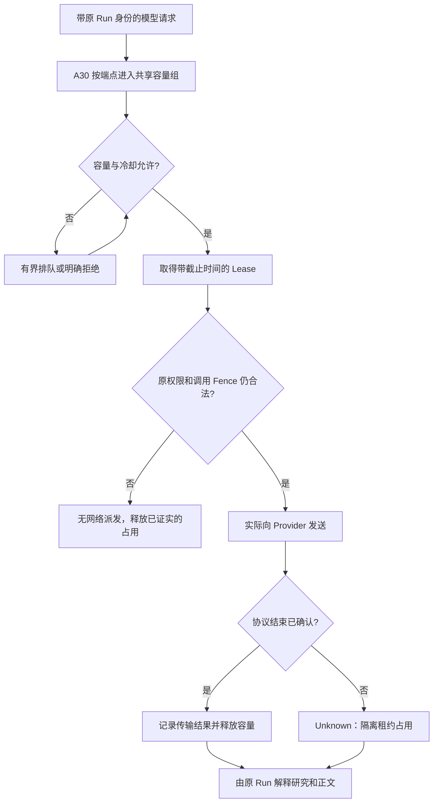

---
readingBrief:
  takeaways:
    - "容量按受管协调域内的规范化端点共享，跨进程保存队列与租约；控制库不可用不能回退内存重置占用。"
    - "排队、模型执行与 Run 预算分别记账；取得租约后仍复查原权限和期限，排队续租不产生第二份额度。"
    - "HTTP 200、取消或心跳中断都不能证明远端结束；未知占用需隔离，释放 ACK 不明只沿原票据对账。"
  appliesTo:
    - "排查跨进程模型排队、取消后容量未释放，或设计能处理失联和事务 ACK 不明的共享准入。"
  notFor:
    - "用租约参数推断供应商 SLA、生产吞吐或故障根因，或让容量层自行重跑研究。"
---
# 模型返回了 HTTP 200，为什么下一次请求还得排队？A30 Provider 容量准入的租约与未知占用

同一时间，主研究正在请求模型，两个 Child 在并行分析，另一进程准备给报告做质量复核。每个进程都认为自己的模型调用“没有超过并发上限”，但它们可能通过同一个外部端点争用同一份容量。

更令人困惑的情况发生在请求结束时：服务端已经收到 HTTP 200 和若干流片段，页面也可能开始渲染文字，下一次请求却仍在排队。是限流器没有释放许可，还是**我们根本无法证明上一次远端调用已经结束**？

ETF Agent 的 A30 Provider Admission 负责的正是这个窄问题：**在同一受管协调域内，一次真实供应商调用能否取得当前容量，以及何时有依据释放或隔离这份占用。** 它不负责模型选型、研究结论、Run 总预算，也不负责重试整个任务。

## 一、先把“用了哪个模型”和“占了哪个资源组”分开

假设两种模型通过同一个服务端代理端点访问。用模型名字当作并发桶的键，会给同一外部资源创建两份看似互不相干的许可。换一个 Profile 或启动另一个 Worker，更不应该把已有占用清零。

当前能力边界分成四层：

| Owner | 负责的事实 | 不负责的事 |
| --- | --- | --- |
| A32 模型目录与路由配置 | 模型 ID、Provider Profile、协议及确定的路由身份 | 不因为登记模型就签发调用许可 |
| A10 模型调用与请求配置 | 本次请求绑定、最终协议表达、物理派发与响应 | 不为每个模型私建一份跨进程容量 |
| **A30 Provider Admission** | 同一容量组的排队、Lease、冷却及释放/隔离 | 不扣 Run 总预算，不决定研究完成 |
| A05 Run 资源管理 | 原 Run 的请求与动作额度、耗用及 unknown | 不把自己的一次准入当成供应商已释放连接 |

A30 从**服务端配置的规范化端点**划分容量组。它提供的是协调域内部的共享上限，不声称发现供应商账号的真实全球额度。不同部署环境如果实际共享外部账号，还可能在厂商侧相互竞争；必须明确配置协调范围，不能把本地 K 冒充供应商 SLA。

## 二、为什么协调状态要跨进程持久保存

单进程信号量的实现很容易：并发数减一，完成后加一。但 API 服务、后台 Runner、Judge 和评测工具一旦在多个进程中共用端点，各自持有的计数就不再代表整体。

当前受管路径要求同一环境中的调用者使用统一 PostgreSQL Provider Control 存储。它与对话/应用业务库分开，持有队列、租约、容量组代际和冷却状态。失去控制库不能临时回退到进程内存，因为这种降级会把看不见的旧占用当成零，恰恰在协调失败时扩大风险。

这里的短事务仅锁住一次容量状态转换。数据库提交以后才开始真正的网络请求，**不把一次长达数十秒的流式生成包在数据库事务里**。这既保留跨进程原子准入，也避免让慢模型堵死控制表的锁。

## 三、排队等待与模型执行是两块不同的时钟

一次请求会先经过 Queue，再取得 Lease。原请求仍需携带可信 `scopeId`、`runId`、`requestDebitId` 和必要的原 owner fence，A30 用它们防止同一个原 debit 再占一份并行许可，但不能替原 Run 生成一笔新预算。

等候可能是因为组已满，也可能是因为故障冷却。排队占用真实墙钟时间，但**不把等待供应商许可的时间误算成模型已经执行了多久**。取得许可之后，Host 在最终网络派发前仍要重新检查当前授权、原执行生命期、取消与 Deadline：排队前有权限，不代表发送当刻仍合法。

下面这条图把“队列、最终派发和释放”分开，也把无法确认结果的支路保留下来。

图中队列满或等候超期会直接拒绝，并不无限回到 `C`；这是一个状态路径示意，不是允许无边界轮询的算法。原实现有有界队列、轮询间隔、租约续期与失效检测。试点默认例如单组并发 3、队列 32、租约 60 秒：它们属于 Host 可配置工程政策，**不是对供应商可用性的测量结论**。

## 四、HTTP 200 与流式终止之间还有一个重要缺口

HTTP 200 表示本次 HTTP 响应开始正常。它不能证明模型的完整输出事件已经结束，更不能证明消费者已经处理全部内容。

以流式模型请求为例，至少有四个独立事实：

| 观察 | A30 能如何使用 | 不能据此推断 |
| --- | --- | --- |
| HTTP 200 和若干 token 片段 | 已派发并收到部分传输信息 | 供应商执行已完成 |
| 协议可确认的完成终止事件 | 按原结束合同释放租约 | 用户满意或正文已经发布 |
| 用户取消、客户端停止读取，未确认远端结束 | 结束本地等待，保留未知占用的隔离保护 | 厂商不再执行或成本为零 |
| Provider Control 事务 ACK 不明 | 只沿原 Ticket/Lease 尝试对账 | 新申请一个许可来“补偿” |

这解释了为什么一个看似“成功返回”的模型请求仍会影响后来的排队。容量槽位属于可能持续的真实外部执行，不属于页面上的 Loading 图标。只有证明安全终止或到达受保护的回收界限，才能释放占用。当前实现把未确认远端停止的请求留到原派发执行截止时间之后的有界隔离窗口，而不是租约心跳丢失时立刻复用位置。

## 五、Lease、续期和代际在保护什么

一个 Lease 既有持有者，也有可验证的续期和截止时间。Worker 如果因调度停顿没有及时续租，无法把“我恢复运行了”当作旧许可自动有效；原请求的硬截止时间始终优先于续期策略。

故障冷却是一种共享的派发协调政策，而不是给供应商永久贴上坏标签。临时失败达到有界阈值时，组可以进入冷却；之后由有限的半开探针判断能否恢复。**代际**把新一轮许可与上一轮尚未回收的未知占用隔开，避免旧完成回执误释放新代际的位置。

一个真实工程背景是，曾观察到请求收到 HTTP 200 与流片段后，约三十余秒的调度间歇又伴随租约中断和研究过期。这提示需要考虑共享调度/存储抖动，因此后来把 Provider 的正常续租默认 TTL 调到 60 秒。但这只能说明防护政策变更的动机，**不能倒推原故障的根因已被证明，也不能宣称修改后真实研究全部成功**。

## 六、取消、重试和容量释放为什么不能被一个布尔值表示

假设用户关闭页面，模型流尚未确认结束。系统必须响应取消，但同时要避免立即把外部容量借给下一个请求。如果某次传输已得到合法协议完成，则可以按原合同释放；如果只是消费者断开，结算通常保持 unknown/隔离。

Provider Admission 的 `release` 还需要区分传输完成、暂态失败与不能证明的外部执行。释放事务的 ACK 如果丢了，重试沿**同一个原 Ticket、同一份 Outcome** 进行有界补偿，不能借失败又申请一次新的容量并假造完整释放。

这也保护了上游预算。原 `requestDebitId` 不因 Provider Queue 排队、租约更新或历史回读发生第二次扣账；新的合法物理重试仍需由原请求/恢复 Owner 决定。A30 可以拒绝新的容量申请，却不拥有“本次研究没有完成、请无限重跑”的权限。

## 七、当前实现到了哪里，下一步应该验证什么

截至 2026 年 10 月 24 日，主干包含基于 PostgreSQL 的共享 Provider Admission、按端点分组、有界队列和租约、冷却/半开、最终派发前的原权限 guard、流式协议结束观察和 unknown 隔离。受管 API、后台研究、自检/评审等在**同一配置的协调域**共享这条准入边界；人工伪造的本地测试协调器不作为生产回退。

相关受控验证证明若干精确事务、控制库连接故障与恢复处理行为，但不能把一个测试环境里的参数升级为供应商承诺，也没有给出真实生产长期吞吐量或延迟 SLA。新的模型目录能力、用户额度产品、实际投资研究价值同样需要独立证据。

我们的目标不是让所有模型调用永远不排队，而是让排队能够解释：**为什么尚未获准派发、哪条请求还持有位置、何时可安全释放，以及什么时候必须承认远端执行未知。**

---

## 延伸阅读

[Provider 统一接口与路由身份](https://hpoenixf.com/eff-agent-article/articles/agent-provider-architecture-and-admission)讲 A32/A10 和总体架构，[Run 预算与约束治理](https://hpoenixf.com/eff-agent-article/articles/agent-runtime-constraint-governance-v2)区分 A05 的任务额度；[故障切换与原任务身份](https://hpoenixf.com/eff-agent-article/articles/agent-provider-failover-without-resetting-the-run)讨论重试为什么仍需原 Run 批准。

更多模块机制见 [ETF Agent Engineering Notes](https://github.com/hpoenixf/eff-agent-article)。欢迎 Star。
