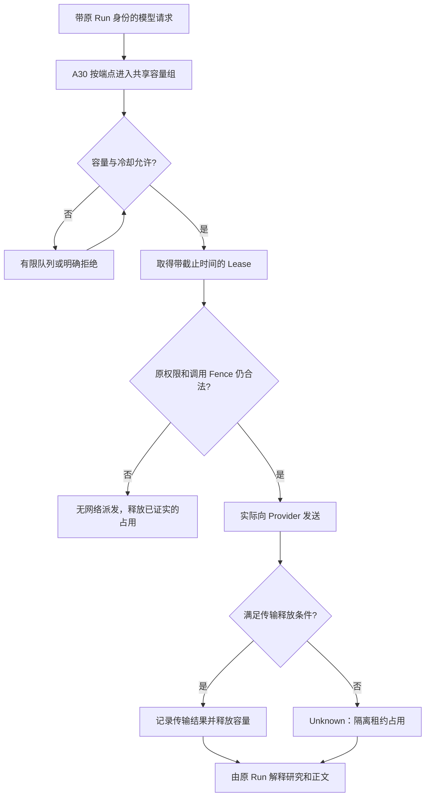

<div><a id="模型返回了-http-200-为什么下一次请求还得排队-a30-provider-容量准入的租约与未知占用"></a><a id="模型返回了-http-200为什么下一次请求还得排队a30-provider-容量准入的租约与未知占用"></a></div>

# 模型返回了 HTTP 200，为什么下一次请求还得排队？Provider 容量准入的租约与未知占用

同一时间，主研究正在请求模型，两个 Child 在并行分析，另一进程准备给报告做质量复核。每个进程都认为自己的模型调用“没有超过并发上限”，但它们可能通过同一个外部端点争用同一份容量。

更令人困惑的情况发生在请求结束时：服务端已经收到 HTTP 200 和若干流片段，页面也可能开始渲染文字，下一次请求却仍在排队。是限流器没有释放许可，还是**我们根本无法证明上一次远端调用已经结束**？

ETF Agent 的 Provider 容量准入负责的正是这个窄问题：**在同一受管协调域内，一次真实供应商调用能否取得当前容量，以及何时有依据释放或隔离这份占用。** 它不负责模型选型、研究结论、Run 总预算，也不负责重试整个任务。

## 一、先把“用了哪个模型”和“占了哪个资源组”分开

假设两种模型通过同一个服务端代理端点访问。用模型名字当作并发桶的键，会给同一外部资源创建两份看似互不相干的许可。换一个 Profile 或启动另一个 Worker，更不应该把已有占用清零。

当前能力边界分成四层：

| Owner | 负责的事实 | 不负责的事 |
| --- | --- | --- |
| 模型目录与路由配置 | 模型 ID、Provider Profile、协议及确定的路由身份 | 不因为登记模型就签发调用许可 |
| 模型调用与请求配置 | 本次请求绑定、最终协议表达、物理派发与响应 | 不为每个模型私建一份跨进程容量 |
| **Provider 容量准入** | 同一容量组的排队、Lease、冷却及释放/隔离 | 不扣 Run 总预算，不决定研究完成 |
| Run 资源管理 | 原 Run 的请求与动作额度、耗用及 unknown | 不把自己的一次准入当成供应商已释放连接 |

Provider 容量准入从**服务端配置的规范化端点**划分容量组。它提供的是协调域内部的共享上限，不声称发现供应商账号的真实全球额度。不同部署环境如果实际共享外部账号，还可能在厂商侧相互竞争；必须明确配置协调范围，不能把本地 K 冒充供应商 SLA。

## 二、为什么协调状态要跨进程持久保存

单进程信号量的实现很容易：可用许可数减一，完成后加一。但 API 服务、后台 Runner、Judge 和评测工具一旦在多个进程中共用端点，各自持有的计数就不再代表整体。

当前受管路径要求同一环境中的调用者使用统一 PostgreSQL Provider Control 存储。它与对话/应用业务库分开，持有队列、租约、容量组代际和冷却状态。失去控制库不能临时回退到进程内存，因为这种降级会把看不见的旧占用当成零，恰恰在协调失败时扩大风险。

为什么不直接用现成信号量或分布式锁？如果所有调用确实经过一个进程，进程内信号量更简单，未必值得引入控制库。已有 Redis 的系统也可以用带唯一 owner 与有效期的共享租约；[Redis 的官方分布式锁说明](https://redis.io/docs/latest/develop/clients/patterns/distributed-locks/)强调按原身份释放，且保护依赖有效时间窗口。它能提供协调基础，但外部模型在本地租约过期后是否仍执行，仍需调用方另作判断。

我们把队列、原票据、占用、冷却代际放进同一控制状态，用 PostgreSQL 短事务原子变更，便于跨进程保留 unknown 并沿原身份回读。这并非 PostgreSQL 天然比其他协调器快；代价是多一次共享存储依赖、连接与锁竞争，以及控制库不可用时宁可拒绝新派发。若统一 Gateway 已完整拥有同样的跨进程边界，也应先复用它，而不是叠加第二套相互不知道的计数器。

这里的短事务仅锁住一次容量状态转换。数据库提交以后才开始真正的网络请求，**不把一次长达数十秒的流式生成包在数据库事务里**。这既保留跨进程原子准入，也避免让慢模型堵死控制表的锁。

## 三、排队等待与模型执行是两块不同的时钟

一次请求会先经过 Queue，再取得 Lease。原请求仍需携带可信 `scopeId`、`runId`、`requestDebitId` 和必要的原 owner fence，Provider 容量准入用它们防止同一个原 debit 再占一份并行许可，但不能替原 Run 生成一笔新预算。

等候可能是因为组已满，也可能是因为故障冷却。排队占用真实墙钟时间，但**不把等待供应商许可的时间误算成模型已经执行了多久**。取得许可之后，Host 在最终网络派发前仍要重新检查当前授权、原执行生命期、取消与 Deadline：排队前有权限，不代表发送当刻仍合法。

下面这条图把“队列、最终派发和释放”分开，也把无法确认结果的支路保留下来。



图中的“有限”首先指队列条目数，不承诺一个固定的排队最长时间。当前受管调用采用派发相对执行额度，排队期间更新原 owner 存活信息，取得许可才建立执行截止时间；没有另一条“等了多久就用完模型执行时间”的规则。队列满、取消、owner 失联或控制库失败仍会停止接纳。显式绝对 deadline 的调用沿自己的期限拒绝，不能把这个分支泛化为所有受管排队都有超时。

轮询、续期与失效检测都有明确政策。试点默认例如单组并发 3、队列 32、租约 60 秒，属于 Host 工程配置，**不是对供应商可用性的测量结论**。较长排队的真实等待时间仍应显示给用户，不能因为不计入 active execution 就写成没有耗时。

## 四、HTTP 200 与流式终止之间还有一个重要缺口

HTTP 200 表示本次 HTTP 响应开始正常。它不能证明模型的完整输出事件已经结束，更不能证明消费者已经处理全部内容。

以流式模型请求为例，至少有四个独立事实：

| 观察 | 容量准入能如何使用 | 不能据此推断 |
| --- | --- | --- |
| HTTP 200 和若干 token 片段 | 已派发并收到部分传输信息 | 供应商执行已完成 |
| 协议可确认的完成终止事件 | 按原结束合同释放租约 | 用户满意或正文已经发布 |
| 用户取消、客户端停止读取，未确认远端结束 | 结束本地等待，保留未知占用的隔离保护 | 厂商不再执行或成本为零 |
| Provider Control 事务 ACK 不明 | 只沿原 Ticket/Lease 尝试对账 | 新申请一个许可来“补偿” |

协议结束不是当前代码唯一的容量释放条件：尚未派发、已识别的协议终止、完整读到 HTTP body EOF，以及原分类认可的某些传输失败，都可能由传输 owner 标记为可释放。特别是 **EOF 可以释放容量，同时因缺少应有的协议终止帧而报告 protocol-incomplete**。释放位置和接纳模型输出解决不同问题，不能把前者当作一次成功回答。

相反，未确认终止的本地取消保留隔离，直到原派发执行截止时间之后的有界回收窗口，不在心跳丢失时立即复用位置。这是本地协调合同的回收政策，不是供应商已经结算成本的证明。页面上的 Loading 图标、Run 终态与这份传输占用也不是同一个状态。

## 五、Lease、续期和代际在保护什么

一个 Lease 既有持有者，也有可验证的续期和截止时间。Worker 如果因调度停顿没有及时续租，无法把“我恢复运行了”当作旧许可自动有效；原请求的硬截止时间始终优先于续期策略。

故障冷却是一种共享的派发协调政策，而不是给供应商永久贴上坏标签。临时失败达到阈值时，组可以进入冷却；之后由有限的半开探针判断能否恢复。这里要分清两种身份：**原 Ticket 与 owner 防止释放别人的租约；generation 防止旧结果错误改变新一代冷却与健康状态。** 旧代的合法完成仍可释放它自己的占用，却不能因此把新一代状态重置为健康。限流有单独规则：旧代返回的 Retry-After 仍是组级等待下界，不能因代际变化而忽略。

续租也不能把“本地没收到 ACK”直接等同于“存储里已过期”。原实现遇到已分类的暂态存储故障时，只对同一个仍合法的 Ticket/owner 作有限重试；开始重试和等待受最后确认的有效期约束。一个先前已经进入原子续租的操作若迟到返回、且新的有效期仍在未来，可以确认这次续租，并不复活已被存储判过期的 owner。这个区别容忍短暂抖动，又不新增模型调用或第二笔额度。

一个真实工程背景是，曾观察到请求收到 HTTP 200 与流片段后，约三十余秒的调度间歇又伴随租约中断和研究过期。这提示需要考虑共享调度/存储抖动，因此后来把 Provider 的正常续租默认 TTL 调到 60 秒。但这只能说明防护政策变更的动机，**不能倒推原故障的根因已被证明，也不能宣称修改后真实研究全部成功**。

## 六、取消、重试和容量释放为什么不能被一个布尔值表示

假设原请求生命周期已经发出取消信号，而模型流尚未确认结束。系统必须响应取消，但同时要避免立即把外部容量借给下一个请求。关闭页面本身是否取消任务，由原会话生命周期决定，容量层不替它判断。如果某次传输已得到合法协议完成，则可以按原合同释放；如果只是消费者断开，结算通常保持 unknown/隔离。

Provider Admission 的 `release` 还需要区分传输完成、暂态失败与不能证明的外部执行。释放事务的 ACK 如果丢了，重试沿**同一个原 Ticket、同一份 Outcome** 进行有界补偿，不能借失败又申请一次新的容量并假造完整释放。

这也保护了上游预算。原 `requestDebitId` 不因 Provider Queue 排队、租约更新或历史回读发生第二次扣账；新的合法物理重试仍需由原请求/恢复 Owner 决定。Provider 容量准入可以拒绝新的容量申请，却不拥有“本次研究没有完成、请无限重跑”的权限。

## 从两个进程、一个位置开始理解共享准入

先用一个位置观察两种结果：[Open ETF Agent v0.17 固定源码快照](https://github.com/hpoenixf/open-etf-agent/tree/8137e592b0a07bcb0dfdd8756409c5bbc7d909ce)使用本地 SQLite、一个容量组和原 Runtime 请求。预算仍由 Runtime 预留，容量层接收其 Run、序号、fence 和输入身份；取得位置后才调用原 Gateway，数据库失败不换无协调入口。

按固定提交 README 安装依赖后，可以先运行[同版说明](https://github.com/hpoenixf/open-etf-agent/blob/8137e592b0a07bcb0dfdd8756409c5bbc7d909ce/docs/shared-admission.md)的两个无模型示例：

```sh
node src/admission-demo.mjs normal output/admission-demo
node src/admission-demo.mjs unknown output/admission-demo
```

normal 让第二个进程等待原槽位释放；unknown 保留未知占用并取消排队者。每次示例建立隔离合成目录，不调用付费模型。不要通过删除未知票据制造空闲，重点看的是**哪个事实使第二次派发合法**。

再用原[双进程场景](https://github.com/hpoenixf/open-etf-agent/blob/8137e592b0a07bcb0dfdd8756409c5bbc7d909ce/test/admission.test.mjs)观察完成 ACK 丢失后的原票据读回：

```sh
node --test --test-concurrency=1 --test-name-pattern='^two original Gateway workers share one slot; settled original ticket survives acknowledgement loss$' test/admission.test.mjs
```

对照[准入模块](https://github.com/hpoenixf/open-etf-agent/blob/8137e592b0a07bcb0dfdd8756409c5bbc7d909ce/src/admission.mjs)与[范围说明](https://github.com/hpoenixf/open-etf-agent/blob/8137e592b0a07bcb0dfdd8756409c5bbc7d909ce/openspec/changes/v017-shared-admission/proposal.md)：它没有 PostgreSQL、多容量组公平调度、冷却或故障切换，unknown 也不因 TTL 自动释放。预算库与容量库不是一个跨库事务，已扣预算但没有票据的事实可能保留，不能靠退款或自动重试抹平。

已有记录分别回答不同问题：[独立无模型回执](https://github.com/hpoenixf/open-etf-agent/blob/187c942b2c43c6da77011bcb2cbab1bfde1bdead/docs/verification/v017-admission-offline.safe.json)覆盖本地竞争与票据回读；[固定真实任务记录](https://github.com/hpoenixf/open-etf-agent/blob/187c942b2c43c6da77011bcb2cbab1bfde1bdead/docs/verification/v017-real-ten.safe.json)覆盖准入、工具结果、Publication 与冷 Reader 原字节回读的正常链路；[较早真实调用记录](https://github.com/hpoenixf/open-etf-agent/blob/8137e592b0a07bcb0dfdd8756409c5bbc7d909ce/docs/verification/v017-release.safe.json)保留独立历史批次，不合成新通过率。

其中环境中断任务的结果与容量仍为 unknown；后来任务在隔离新组完成，不能证明旧组已恢复、跨组全局协调或真实并发竞争已经通过。这些实验也不证明金融研究质量。**后续任务完成，不是释放先前未知占用的依据。**

## 七、当前实现到了哪里，下一步应该验证什么

当前核对的完整 ETF Agent 实现（并非 `open-etf-agent` 公开仓库）包含基于 PostgreSQL 的共享 Provider Admission、按端点分组、有界队列和租约、冷却/半开、最终派发前的原权限 guard、流式协议结束观察和 unknown 隔离。受管 API、后台研究、自检/评审等在**同一配置的协调域**共享这条准入边界；人工伪造的本地测试协调器不作为生产回退。

相关受控验证证明若干精确事务、控制库连接故障与恢复处理行为，但不能把一个测试环境里的参数升级为供应商承诺，也没有给出真实生产长期吞吐量或延迟 SLA。新的模型目录能力、用户额度产品、实际投资研究价值同样需要独立证据。

我们的目标不是让所有模型调用永远不排队，而是让排队能够解释：**为什么尚未获准派发、哪条请求还持有位置、何时可安全释放，以及什么时候必须承认远端执行未知。**

---

## 延伸阅读

[Provider 统一接口与路由身份](https://hpoenixf.com/eff-agent-article/articles/agent-provider-architecture-and-admission)讲模型目录、模型调用和总体架构，[Run 预算与约束治理](https://hpoenixf.com/eff-agent-article/articles/agent-runtime-constraint-governance-v2)区分 Run 资源管理的任务额度；[故障切换与原任务身份](https://hpoenixf.com/eff-agent-article/articles/agent-provider-failover-without-resetting-the-run)讨论重试为什么仍需原 Run 批准。

更多模块机制见 [ETF Agent Engineering Notes](https://github.com/hpoenixf/eff-agent-article)。欢迎 Star。
