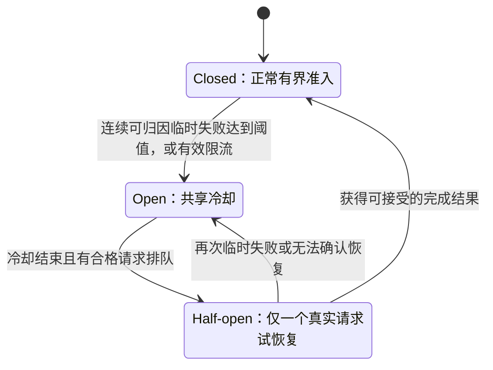
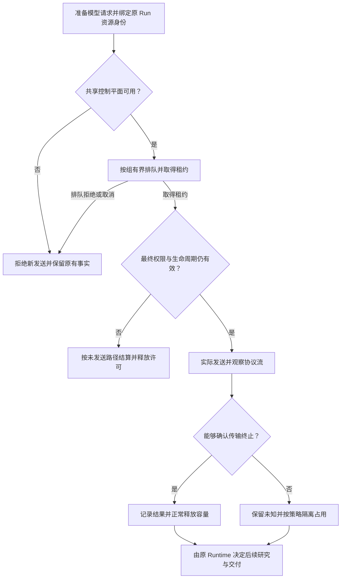

# Agent 供应商模块精讲：为什么统一接口之后，还需要共享准入

> 2026-10-23
>
> 本文讨论大模型供应商，不讨论行情、搜索或基金数据供应商。

给 Agent 接上第二个模型，往往只需要多配一个地址和密钥。但当主研究、子任务、评审与测试进程同时请求模型时，“能调用”很快就不够了：这些调用可能共享同一份外部容量，等待不一定代表模型慢，连接断开也不一定代表远端已经停止。

我们后来把供应商模块的目标重新定义为：**不只是统一调用接口，而是让每一次外部请求都有明确身份、受控入口和可信的结束方式。**

这篇文章从 ETF Agent 的实现出发，解释为什么这样拆分，以及哪些复杂度值得留在这一层。

## 一、先分清四种身份，才谈得上统一接口

用户选择的是一个模型，系统实际使用的却是一条完整路线。两者不能合并成一个字符串。

| 概念 | 回答的问题 | 为什么需要单独存在 |
| --- | --- | --- |
| Model | 想使用哪个模型？ | 保留用户选择和任务起点 |
| Provider Profile | 通过哪组服务端配置访问？ | 绑定供应商、端点、凭据和协议 |
| Route Identity | 这次实际使用了哪条确定路线？ | 把具体模型、协议和适配配置与执行记录绑定 |
| Capacity Group | 哪些调用必须争用同一份容量？ | 避免换模型名、Profile 或进程后重复领取配额 |

模型名称回答不了后面三个问题。一个名字在某个平台的目录里存在，不代表另一个平台也接受它；两个名字完全不同的模型，也可能经过同一个共享网关。

项目曾遇到过前一种情况：把某个精确模型 ID 归到不拥有它的官方路线，调用失败；核对实际目录后，才确认它应该走另一条供应商路线。值得保留的不是那次错误码，而是由此明确的规则：**名称是选择标识，供应商归属是配置事实，实际执行身份是另一份记录。**

这也解释了为什么我们没有把浏览器请求设计成“模型名 + 任意 URL + API Key”。浏览器可以提交允许选择的模型 ID，端点和凭据则由服务端解析。否则，每次调用都可能临时定义一条新路线，能力资格、容量分组和审计就没有稳定的依据。

当前实现还主动拒绝重复的模型映射，不用“后注册覆盖前注册”决定发给谁。这是用一点配置约束，换取运行时的确定性。

### 为什么采用静态 Profile，而不是先做供应商管理平台？

我们的近期问题是：明确的几条路线，能否被稳定调用并解释其行为；不是让用户随时注册任意供应商。

因此，供应商配置在进程启动时解析，重复映射和不完整配置尽早失败。当前 Profile 显式表达协议、是否省略某些参数、特定路线的推理模式等差异。

这样做的收益是，执行中的 Run 不会因为一个配置面板的热更新而悄悄换了模型身份。代价也明确：新增或调整路线需要受控配置和进程更新，不适合直接拿来实现开放式模型交易市场。

这里不是认为动态配置天然不好，而是**尚未出现的灵活性，不值得提前换走当前最需要的可解释性。**

### A32 模型目录：注册、路由与使用资格不是同一个动作

这条链在架构图中归 **A32「模型目录与路由配置」**。目录维护的是服务器允许的模型 ID、默认项、Profile 到 Provider/协议的确定映射、已声明能力与路由资格；它不是供应商容量的执行账本。A25 页面只提交获准选择的模型，A10 对本次请求绑定具体路线和协议，A30 再判断该路线所在容量组何时可发起物理请求。

当模型名称存在但映射重复、不完整或与实际提供方不匹配时，目录必须拒绝配置或不合格选择，而不是让 Gateway 在请求失败时猜另一家供应商。同样，能出现在模型列表中，不代表已完成真实工具调用、长研究或语义质量验收。当前维护主要由服务端配置、启动装配和资格记录支撑，**不应写成已有随时在线编辑并自动迁移旧 Run 的模型管理后台**。

我们保留本篇对“目录身份—协议请求”的讲解，另用 [A30 专文](agent-provider-admission-capacity-lease.md) 展开跨 Run 排队、Lease、Unknown 与安全释放。A32 的模型登记权、A10 的发送事实与 A30 的共享容量资格是三条不同的效果。

## 二、Gateway 统一调用方式，但不承诺所有模型等价

Gateway 是协议适配层：上层用相对稳定的请求和事件接口，下层处理供应商的协议差异。当前注册配置覆盖 Chat Completions 与 Responses 等实际路线，不把协议选择交给浏览器。

一个常见诱惑是把所有供应商都压成同一个“万能配置”：相同的参数、相同的工具能力、相同的结构化输出承诺，剩下的差异等请求失败后再处理。

我们没有这样做。Profile 会明确记录需要省略的参数或特定模式，路线身份也包含这些会影响调用行为的配置。更改协议或关键适配配置，不能继续拿旧路线的验证记录证明新路线可用。

这意味着统一接口有两层含义：

**统一的是上层如何发起调用、接收事件和识别错误；不统一的是供应商实际具备的能力。**

例如，能返回一段文本，不代表能正确结束工具调用；注册进模型列表，也不代表已获得研究角色的使用资格。后者需要 Host——承载 Agent 的应用主机——确认精确路线是否满足该角色要求。

把能力资格留给 Host、把协议差异留给 Gateway，可以避免两个极端：上层到处判断供应商名字，或者 Gateway 自己决定某个模型能承担哪些研究任务。

<!-- open-etf-case:provider@ff5b9273ef0d239e804f61792702cd2e94174be7 -->
### 先检验 Gateway 的编码与配对

固定公开快照的[Gateway 用例](https://github.com/hpoenixf/open-etf-agent/blob/ff5b9273ef0d239e804f61792702cd2e94174be7/test/gateway.test.mjs)可以先检查协议适配的最小责任，而不把共享准入系统一起带入实验。

在所链固定快照按 README 安装依赖后，运行：

```bash
node --test --test-concurrency=1 --test-name-pattern='^1\.4 injected offline transport verifies request encoding and matched tool results$' test/gateway.test.mjs
```

它注入离线 transport，捕获实际构造的请求，核对原问题、工具调用 ID 与对应结果 ID，并要求重定向策略为拒绝。通过时终端显示这一精确测试成功；不需要真实 API 凭据。

这个切片没有发起外部 HTTP 请求，不验证真实供应商兼容性，也不实现本文的跨进程队列、容量租约或 PostgreSQL 准入库。
<!-- /open-etf-case -->

## 三、为什么限流不能写在每个 Gateway 实例里？

假设 API 服务、研究子任务和独立评审进程都连接到同一个模型端点。每个进程都维护一个“最多同时调用 K 次”的本地计数器，那么它们限制的只是自己的视角，而不是共同消耗的外部资源。

即使每个局部实现都没有 Bug，整体仍可能超出预期容量。

因此，我们把并发准入下沉到一个共享协调层：Provider Admission。它负责回答一个很窄的问题：

> 在当前协调域内，这次请求现在能否占用该供应商组的一个执行位置？

当前容量组从服务端配置的规范化端点派生，而不是从模型名、SDK 实例或 Profile 别名派生。经过同一端点的不同模型，会进入同一个容量组。

这里有一个重要适用范围：**容量限制覆盖的是被配置到同一协调域、经过这条受管路径的请求。** 两个独立环境若共用供应商账号，仍可能在外部竞争账号总配额；应用侧端点分组不等于掌握了供应商所有内部限额。

所以，我们不会把某个本地并发设置写成“供应商已证明支持的吞吐量”，也不会假设不同端点必然对应完全独立的底层基础设施。

### 共享容量，不等于共享会话内容

同一环境内的运行服务、真实模型测试和评审进程共用控制库，但它们不必共用会话数据库。

控制库保存的是组状态、排队票据、尝试身份、租约、截止时间和有限的资源绑定，而不是 Prompt、回答、用户持仓或供应商密钥。

这种分离解决的是生命周期差异：测试可以清理自己的会话数据，却不能顺便把仍被其他进程使用的供应商冷却和占用状态清空。

**需要共同认识“谁正在占用资源”，不意味着需要共同读取“谁正在研究什么”。**

## 四、为什么用 PostgreSQL 短事务，而不是锁住一次完整模型调用？

共享协调真正需要原子化的是一个短决策：读取当前组状态，检查是否轮到当前请求，修改队列或租约，再提交。

当前 PostgreSQL 后端对容量组记录使用行锁，在短事务内完成这次状态变化；跨进程竞争因此会在同一份状态上串行决策。决定时间相关状态时，后端读取数据库时钟，不让每个进程自行发明一份组时间。

下面是机制示意，不是可直接运行的源码：

```text
BEGIN
读取容量组并加行锁
按当前时间处理状态，检查队列与租约
写入本次准入决定
COMMIT
结束事务后，才允许进入后续发送步骤
```

网络请求不在这个事务里。一个模型可能长时间流式输出，但不应因此长时间占着数据库事务与组锁。

这使两种生命周期分开：数据库负责原子地承诺“现在给谁一个位置”，租约负责持续表达“这个位置仍被谁持有”。

选择 PostgreSQL 的可解释性在于，现有实现需要的是跨进程、可持久恢复的短状态协调，并不需要先建设通用分布式调度平台。这里也没有证据支持“它比 Redis 更快”这样的结论；换存储引擎并不会自动消除租约和未知执行语义。

它的代价同样真实：共享控制库成为新发送的依赖，同组状态变更要串行协调，并存在轮询与心跳开销。若未来并发规模、隔离要求或热点组压力显著变化，就需要重新评估这个实现，而不是把它当成无限扩展的答案。

### 控制库失败时，为什么不退回内存限流？

因为退回后，多个进程会失去共同视角。它们各自认为还有空位，却不知道持久记录里仍有哪些在飞请求。

当前生产路径因此拒绝新的受管发送，不把内存协调器当可用性兜底。内存后端保留给明确的离线测试。

这是一次明确取舍：**宁可暂停无法确认资格的新请求，也不把“控制面失联”解释成“共享容量归零”。** 已有结果仍由原有恢复和交付链路处理，不必因为新调用被拒绝就一并消失。

## 五、队列、预算和时钟，为什么要分开？

供应商队列解决“现在有没有位置”，Run 预算解决“这项任务还允不允许继续花资源”。两者相关，但不能合并。

Run 是一次用户任务的执行实例。它可能已经为下一次模型调用持久预留额度，但请求仍在供应商队列中等待。此时，“已有预留”和“尚未发送”可以同时为真。

Admission 接收原 Host 签发的资源绑定，关联 Run、请求扣账身份和执行身份。同一原始扣账身份不能重复排队或重复持有租约。它不会因为多创建一个模型对象，就替任务增加预算。

以下是教学用的输入与决定摘要，字段为解释机制而简化：

```json
{
  "request": { "runId": "example-run", "debitId": "example-debit", "group": "shared-gateway" },
  "decision": "queued",
  "reason": "capacity",
  "dispatched": false,
  "budget": "original-reservation-preserved"
}
```

队列是有界的，正常按排队顺序争取容量。队列已满时，返回准入拒绝；不继续建立无限待办，也不把本地拥挤伪装成供应商宕机。

时间也要按实际阶段记录。当前受管调用将排队和共享冷却从派发后的执行计时中区分出来，但这些等待依然是用户真实经历的墙钟时间；取消、所有者存活检查和适用的截止条件仍然有效。

否则，只看一个总耗时数字，就无法分辨“模型执行慢”“等不到容量”还是“在遵守供应商冷却”。这些情况需要不同的工程处理。

## 六、租约证明的是本地持有权，不是远端已经停止

容量位置通过租约、心跳和执行截止时间维持，但必须回答两个不同问题：**本地进程是否仍有权操作，远端模型请求是否真正结束？** 取消、断网、进程崩溃或租约到期只能证明部分本地事实，不足以把未知远端执行记成已停止或零成本。

因此，只有已确认结束的调用才能立即释放；终止未知时按保守隔离窗口有界回收，接受可能暂时少用容量的代价。控制库提交后若缺少可靠 ACK，也不能把新发送写成获准成功。这些状态的 Claim、Lease、代际和续期细节集中在[A30 共享容量租约专文](agent-provider-admission-capacity-lease.md)；本篇只用它解释为何统一模型接口仍需要独立 Provider Admission。

## 七、熔断不是给供应商永久贴标签，而是协调下一次尝试

我们使用三种组状态：正常放行、暂停新调用、有限恢复尝试。常见名称分别是 Closed、Open、Half-open。



这不是独立的巡检机器人。冷却结束后，由一个已有资格的真实排队请求尝试恢复，不额外生成付费探针。

选择这种需求驱动方式，是因为我们需要的是恢复业务调用，而不是持续购买“供应商此刻好不好”的信息。它减少了额外调用和另一套调度责任；代价是空闲时不会主动测出恢复时间，下一次业务请求可能承担半开尝试。

故障归因也必须克制。临时传输失败、供应商限流可以影响组状态；模型输出格式不对、回答质量不好、用户取消或本地队列满，不应都累加为“供应商故障”。

否则，一个模型没按要求输出 JSON，就可能让其他正常任务一起进入冷却。

### 为什么组状态还需要“代际”？

假设请求甲发出后，请求乙观察到限流，开启了新一轮冷却。随后甲返回成功。这个较早请求的迟到成功，能否取消刚刚建立的冷却？

不能。它不属于新一轮恢复判断。

当前状态记录因此带有代际，旧代结果不能随意清除新代冷却；有效的 Retry-After 则仍可建立更晚的共享等待下限。这不是为了让状态机复杂，而是为了让并发返回的结果按正确时序产生作用。

## 八、HTTP 200、流结束和任务完成，是三种不同的事实

供应商模块如果只在收到 HTTP 200 时记录“成功”，就无法解释后续断流；如果只看到连接 EOF 就接受工具提议，又可能把尚未结束的参数当成完整调用。

当前传输层会按选定协议观察有界的流帧，并识别协议终止。例如，Chat Completions 的处理会结合结束原因与终止标记；Responses 的处理会核对完成事件及对应状态，而不是匹配任意文本中的“完成”。

这层观察只回答“协议是否确认结束”。长度受限的结束仍可能意味着内容未完成；合法的 Tool proposal 也仍需 Host 校验并决定是否执行。

因此，传输完成、工具执行、答案提交各有各的事实来源，不应该被压成一个 `success: true`。

一次完整调用可以概括为下面的路径。图中任何“允许”都只覆盖自己负责的那一步：



最终权限检查放在取得容量之后也有原因：排队期间，用户可能取消任务，来源权限可能变化，原执行者也可能失去持有权。排队前有效，不代表真正发送的那一刻仍有效。

## 九、用三个场景理解这套分工

**场景一：不同模型经过同一个网关。** 主研究已占满该组容量，评审换了一个模型名发起请求。正确行为仍然是排队，而不是因为模型不同再获得一份配额。与此同时，独立容量组中的合法请求不必一起停住。

**场景二：模型返回了不合格的 JSON。** 如果传输按协议正常结束，供应商容量可以依规则释放；内容错误交给原协议处理或任务恢复逻辑。不能为了修回答格式，先把整组供应商判成不健康。

**场景三：用户取消了流式研究。** 本地立即响应取消，但如果不能确认远端结束，就保留相应隔离占用和未知事实。用户不再等待，与系统可以宣称请求没发生，不是一回事。

三个场景分别对应身份、故障归因和生命周期。它们说明供应商模块的价值，不在于把所有异常都吞掉，而在于把外部不确定性转成上层能够正确处理的事实。

## 十、为什么不把重试、选模和研究状态都收进来？

因为 Admission 只知道某个资源组的占用和局部传输结果，不知道这项研究是否还允许继续、已经给用户交付了什么、哪些工具产生了效果。

让它顺手重试，会把一个容量许可扩展成一次新的任务授权；让 Gateway 顺手换模型，也可能跳过来源权限和既有预算。

我们保留的分工是：配置和 Gateway 管“路线是什么、协议怎么说”；Admission 管“现在能否占用位置”；Run 管“是否允许继续尝试”；恢复与发布模块管“过去发生了什么、哪些结果已经提交”。

这也为故障切换留下了一个清楚的扩展点：它可以使用已有容量事实，帮助原 Run 选择下一条合格路线，但不需要重新拥有这些事实。

另一篇[《模型失败之后，Agent 怎么继续？》](agent-provider-failover-without-resetting-the-run.md)展开这个问题；本文的供应商生命周期并不依赖自动切换才能成立。

## 结语：好抽象统一的是责任，不是把差异藏起来

对于一个单进程演示项目，一层 SDK 封装可能足够；当多个任务和进程开始共享昂贵且不完全可控的外部资源时，统一接口才只是起点。

我们的选择不是建设一个包办一切的 Provider Manager，而是让配置、协议、容量和生命周期各自拥有明确职责，再通过原请求身份连接起来。

这样做增加了控制库、租约和显式错误处理的成本，换来的则是更重要的能力：**知道请求究竟发给了谁，为什么允许发出，为什么仍在等待，以及何时可以诚实地说它已经结束。**

---

### 实现范围与资料说明

本文按 2026-10-23 读取的主干快照核对配置、准入后端、流式终止观察和相关历史记录，描述的是已有实现及其设计取舍；不把运行配置当供应商 SLA，也不据此承诺跨环境全局容量或长期可用率。自动跨供应商切换的单独验证范围，在第二篇中说明。

---

**延伸阅读：** [模型失败之后，Agent 怎么继续？](agent-provider-failover-without-resetting-the-run.md)。

本文收录于 [ETF Agent 工程手记](https://github.com/hpoenixf/eff-agent-article)。欢迎 Star，持续阅读 Agent 架构与工程实践。
