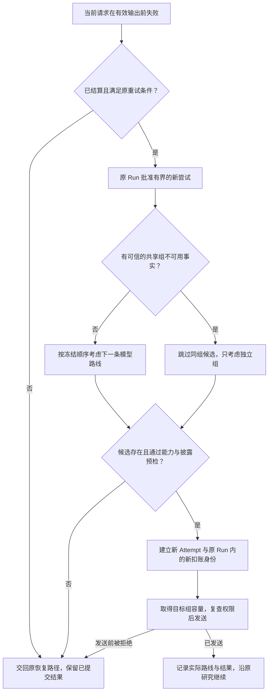

# 模型失败之后，Agent 怎么继续？一次故障域感知的安全切换设计

> 2026-10-23 · 故障切换的设计与限定验证，不是生产无感高可用公告。

**Agent 的故障切换，首先是一次新的执行与数据接收资格判断，而不只是备用模型列表。** 可以换路线，但不能重新授予原任务没有的权限、抹掉已经发生的调用，也不能让一次未知效果被免费重试。

ETF Agent 曾面对三条候选路线：不同模型可能共用同一容量组，独立供应商则改变数据接收方。**多一个模型名字并不等于多一个真正可用的备份。** 一次 503 不一定说明整个入口故障；同组限流时换模型也不一定有用；即使备用接口健康，原任务带着的私人资料未必允许被送过去。

因此我们选择：原 Run 保持任务身份、预算和重试资格，候选选择器只排除不合格路线，实际新请求重新做能力、授权、额度和结果记录。下面保留设计中的必要机制，重点解释为什么这些决定权不能藏在 Gateway 的一次 `catch` 里。

## 一、首先明确：我们想恢复的是哪一层？

在讨论备选模型前，需要把“研究失败”拆开。

供应商可能拒绝了一次请求；模型可能在收到资料后生成了无效输出；某个工具可能执行失败；答案也可能已经写入，只是客户端没有收到最新状态。

这些现象都可能让用户觉得“卡住了”，但只有一部分适合通过模型故障切换处理。

我们的这一轮设计聚焦于：**当前模型请求尚未产生有效输出，已有可信事实表明它属于可重试的有限失败，并且原 Run 仍有继续尝试的权限。**

它不负责修复答案质量，不把工具报错自动变成换模型，也不借重试清空已经完成的研究。

这里的 Run 指一次用户任务的执行实例；Attempt 则指其中一次具体的模型请求尝试。两者分开，才能允许一个任务经过不同路线继续，同时保留每次实际调用的事实。

项目此前已经明确过“故障分类”和“重试调度”的区别：传输失败的类别应由实际观察决定，不能因为某条运行路径允许或不允许重试，就给同一个故障换一个名字。故障切换延续了这条分工。

## 二、为什么三条路线，不是一条固定的三级重试链？

我们的候选方案包含两类冗余：模型多样性和端点多样性。

| 候选路线 | 提供的变化 | 没有消除的共同风险 |
| --- | --- | --- |
| Go DeepSeek | 原始主路线 | 依赖 Go 的共享端点与当前模型路线 |
| Go GLM | 在同一入口下换一种模型 | 仍然共用 Go 端点和容量组 |
| 官方 DeepSeek | 换到单独配置的供应商端点 | 不能据此证明底层模型或基础设施完全独立 |

这不是三个等价的备份。Go DeepSeek 与 Go GLM 的差异主要在模型；官方路线的差异主要在访问端点和供应商配置。

因此，我们不能只写：

```text
主模型失败 → 备用一失败 → 备用二
```

因为下一条路线值不值得尝试，取决于失败影响的范围。这个范围就是故障域：究竟是一次请求、一条模型路线，还是多个模型共用的入口都受到了影响。

单次 503 不足以证明整个共享入口已经不可用。在组状态没有显示共享故障时，Go GLM 仍可能是合理候选。

但如果已有可信的 Go 组限流或冷却事实，再换成同一入口的 GLM，并没有离开受影响的资源组。此时应考虑独立官方路线；只有同组候选的策略，则没有跨组出路，应该保留真实失败。



图中的“考虑”不是“保证调用”。候选排序只给出方向，后面还要通过能力、预算、数据披露和实际容量检查。

### 为什么先采用静态顺序，而不是智能路由？

这次要解决的是明确故障后的可用路径，不是每个问题都实时比较模型的能力、成本和延迟。

静态候选让一个 Run 开始时就能冻结允许的路线和顺序。正常成功路径不需要额外探测；出错后，也能解释为什么选择某条备选，而不是追查一套随时变化的模型评分。

代价是它不会自动寻找最便宜或最聪明的模型，也不会利用所有临时空闲的服务。对当前阶段而言，这种约束让故障恢复可以先成立，而不必同时建设质量评测、成本优化和动态选模系统。

## 三、什么样的失败事实，才足以改变路线？

供应商错误消息往往很自然语言化。如果依据“繁忙”“不可用”“重试”几个词来决定切换，供应商文案变化就会变成运行政策变化。

我们采用结构化的失败类别、实际 HTTP 状态、供应商准入组状态和原请求回执，不用错误正文猜故障范围。

| 观察到的情况 | 当前处理方向 | 架构理由 |
| --- | --- | --- |
| 有效输出前的可重试 500/502/503/504，组未被证实不可用 | 考虑下一条候选模型路线 | 一次请求失败不代表整个入口失效 |
| 可信供应商 429 已建立组冷却，或组已处于不可用状态 | 跳过该组内的候选 | 换模型名不能绕过同组限流 |
| 与原请求及组绑定的、受支持的前响应 DNS 失败 | 考虑独立组 | 有具体的共享端点失败证据 |
| 本地调用预算返回的 429、401/403、参数或协议不兼容 | 不按供应商瞬时故障切换 | 额度与资格问题不能靠换入口绕开 |
| 当前尝试已有有效输出，或执行结果仍未知 | 不重新从头发送该尝试 | 防止覆盖输出或重放未知行为 |

这张表刻意没有写成“所有网络错误都能切换”。当前实现支持的端点证据是有限的，包含明确的前响应 DNS 失败代码和原请求身份绑定，不是通用的网络故障自动诊断器。TLS 安全拒绝等情况不能混入这条自动切换路径。

### 组状态只负责排除候选，不能直接授予容量

切换选择器读取现有 Admission 提供的组状态投影，包括状态、等待下限和采样时间。投影必须足够新，且属于当前路线的容量组。

它是一个保守提示，不是新的健康数据库，也不是一张可直接发送的通行证。

原因很简单：从读取组状态到准备发送之间，其他进程也在活动。先前看起来有空位，不代表实际发送时仍然有；所以最终还要进入目标组的真实准入。

独立组也不必继承旧组的 Retry-After，但仍要遵守自己的容量状态、原 Run 的限制以及适用的截止时间。跨组是改变资源归属，不是取消限流。

## 四、为什么不把 fallback 写进 Gateway？

Gateway 知道如何调用供应商，却不知道足够多的任务事实。

它通常不能独立判断：这次失败是否已经持久结算？有没有剩余重试许可？上一轮工具是否完成？这份上下文能否交给另一个供应商？

若 Gateway 在内部隐藏一次备用调用，上层看到的仍像同一次请求。实际供应商、成本和数据接收方却变了，原 Run 的账就可能解释不了这次执行。

因此，我们让原 Retry Owner——负责该 Run 重试授权的运行逻辑——继续决定能否发起新尝试。切换选择器只决定“在已有许可下，下一条可以考虑的路线是谁”。Gateway 不另设一套自动重试额度，SDK 的隐式重试也不替 Host 发明新尝试。

实际顺序可以概括为：

```text
确认上次失败与原持久回执一致
→ 原 Run 保留一次有界重试许可
→ 选择下一条合格路线
→ 为目标路线重新准备并检查请求
→ 预留新请求额度，记录新 Attempt
→ 通过目标供应商准入与最终发送检查
→ 保存这次实际发生的结果
```

“有三条候选”不等于“免费多送两次请求”。重试资格和模型调用额度仍受原任务约束，备选路线不带一份新的预算。

一个很具体的实现细节是，Entry 的切换会核对最近请求是否已结算，HTTP 拒绝或端点失败是否与持久回执相符，执行身份是否仍有效，再向原 Run 申请重试。不是看到一个异常对象，就直接调用备用 SDK。

## 五、换供应商之前，为什么必须重新检查整个请求？

因为“备选模型能回答”和“这一次请求可以发给它”是两回事。

首先是能力匹配。目标路线有自己的协议、上下文容量、工具支持和参数约束。源路线接受的请求，不应原样假定为目标路线也接受；必要参数无法满足时，应拒绝候选，而不是先发过去等一次 400。

其次是角色资格。模型已经注册进配置目录，并不意味着它已获准承担 Native Research。当前资格必须绑定精确路线，不能把旧模型、旧协议或另一个 Profile 的观察结果借给新路线。

最后，也是投研 Agent 更敏感的一层：**谁有权接收哪些数据。**

一次模型请求可能包含当前用户输入，也可能包含持仓、私有文档、历史记忆、工具结果和前面模型生成的中间内容。换供应商可能改变这些资料的接收方。

因此，不能把“两个供应商都支持同一种 API”当作数据可转交的依据。

### 同意接收方，不等于覆盖本次 payload

当前实现区分三个条件：目标路线是谁、原 Run 确认了哪些数据类、这次实际准备发送的完整请求是否被相应证明覆盖。它们必须同时成立。

这里的完整请求不只是用户输入那一句话，还包括随后装配进去的工具描述、上下文和派生内容。证明要跟随原生产者及保持不变的请求封装；任意复制一个对象、补一个“已授权”标记，并不能取得同样的来源证明。

这也解释了为什么我们的第一版覆盖范围很保守：当前输入及有限、来源明确的模型派生内容可以在对应确认下进入支持路径；非空 Memory、私有资料、动态来源等没有完整证明的输入，不会因为模型能处理就自动变得可跨供应商发送。

不是承诺“用户点一次同意，所有资料以后都能切”；而是把支持范围限制在当前能证明的请求组合内。

### 一个关键例子：前一轮模型生成的内容，还是需要授权的数据

假设 Child 已经产生一段中间分析，下一轮准备把它发给独立官方路线继续研究。

即使这段文字是模型生成的，也不能凭来源是模型就推断它不敏感。它可能承载了前一轮输入或资料的内容。

原 Run 仅确认“当前用户输入”时，不能据此转交这段派生内容；只有确认包含相应数据类、且这段有限 transcript 的来源与完整性证明匹配时，才进入允许路径。

这个约束看起来限制了恢复能力，却让“安全继续”有了明确含义：恢复不能扩大原来没有的披露权限。

## 六、任务身份不变，为什么请求身份必须变化？

想象一次用户选择 Go DeepSeek 的研究，在故障后实际由 Go GLM 完成了下一次调用。

系统不能把原始选择改成 GLM，仿佛用户一开始就选了它；也不能把实际请求仍记作 DeepSeek，仿佛没有发生切换。

我们保留原始选择，同时记录每次实际路线。以下是解释概念的合成摘要，不是线上 wire schema：

```json
{
  "runId": "example-run",
  "selectedModel": "Go DeepSeek",
  "attempts": [
    { "id": "a1", "route": "Go DeepSeek", "debit": "d1", "outcome": "http-rejected-503" },
    { "id": "a2", "route": "Go GLM", "debit": "d2", "outcome": "completed" }
  ],
  "authorization": "original-run-grant",
  "budget": "original-run-budget"
}
```

不变的是任务身份、原始用户选择、已授能力和已经发生的业务事实。变化的是新请求的 Attempt、实际路线及原任务账本中的新扣账身份。

逻辑上的一个模型回合，也可能经历多个物理请求。不能用同一个逻辑回合 ID，把这些请求压成一条可被反复覆盖的记录。

### 恢复为什么不能直接使用“最新配置”？

进程重启后，系统需要知道原 Run 当时获准了哪些候选、实际上已经走到哪条路线，以及哪些请求仍未结算。

如果恢复时直接套用最新候选列表，运营配置变化就可能替旧任务增加供应商、改掉接收方或重新解释历史回执。

因此，原候选计划与授权要跟随 Run 固定保存；历史请求按原路线读回。要发起新尝试，还需通过当前可用性、资格和安全开关检查。

**历史事实不能随配置漂移，新请求也不能借历史许可绕过当前拒绝。**

同样，旧执行者失去 fence——防止过期执行者继续提交的隔离凭证——之后，不能凭手里的旧请求覆盖新状态。重复确认或内容变化，也不能改写第一次已接受的提交身份。

这套约束由原恢复与提交链路承接，而不是再建立一份 Failover Ledger。

## 七、已有结果和部分输出，应该怎么保留？

“有输出就不能切换”这句话过于粗糙，需要区分两种情况。

**一种是此前回合已经完成并保存了结果。** 这些结果属于原 Run。之后某个新模型请求失败，不应把它们撤回或重新执行；是否能在另一条路线继续，还要看新的请求准入和披露证明。

**另一种是当前失败尝试已经产生有效文本或合法工具提议。** 这时不能假装本次请求从未产生内容，再把整次尝试原样交给备用模型重来。

后者应交回原有的部分结果、修复或受限交付路径。故障切换不能决定哪些已提交正文可以抹掉，也不能决定某个效果未知的工具“应该再执行一次”。

尤其是没有收到回执的情况：本地看不到成功，不代表远端没有执行。只有“没有有效输出”还不够，还需要可信的失败和结算事实。

这也是为什么本次方案没有追求“任何阶段都能无感切换”。缺少这些事实时，坦诚保留未知或交付已有结果，比重新跑一遍制造表面成功更可靠。

## 八、Child 可以继承什么，哪些角色不应该自动继承？

Child 是父研究派生的子执行，不是新开一项没有约束的任务。它能继承的是父 Run 已批准的候选范围与相应授权，而不是无限次数的备用调用。

当前实现沿 Child 自己的请求、重试、结果与恢复链路，保存实际路线和独立 Attempt；已经完成的兄弟任务，不因某个 Child 切换而重跑。

后续回合也需要延续已发生的路线事实，不能第一轮切到备用模型，下一轮又因默认配置悄悄跳回主模型。

但这不意味着所有角色自动获得同一策略。独立 Reviewer、固定模型评测、诊断调用、定时任务和上下文压缩，不属于本次可以随意扩大的默认切换范围。

特别是评测：问题是“模型甲表现如何”时，失败后偷偷换成模型乙，得到的答案即使不错，也已经不能回答原来的评测问题。

这再次体现相同原则：**技术上能发出去，不等于当前任务允许这样继续。**

## 九、三个故障场景，决定是否真正值得切换

| 观察到的事实 | 合理的下一步 | 不能偷换的判断 |
| --- | --- | --- |
| 单次 503、尚无共享入口故障证据 | 在原 Run 允许的前提下考虑另一合格模型，每次尝试有新身份和记账 | 一次请求失败不代表整组已死 |
| Go 容量组已有可信冷却事实 | 跳过同组候选；若有独立供应商，还要审查它的能力、容量与数据接收资格 | 换模型名称不能绕过同一资源组 |
| 备用供应商能用，但请求含未获准转交的上下文 | 拒绝这次跨供应商请求，保留已经合法提交的研究成果 | 技术可调用不等于私有材料可披露 |

这三类情形各自成立的条件不同，不是一个固定的“主模型 → 备份一 → 备份二”队列；出现部分有效输出或未知执行效果时，不能把原尝试当成从未发生。

## 十、为什么不另建一个万能 Router？

因为配置、共享容量、Run 预算、原始来源授权、请求派发与恢复事实已经由各自的责任方维护。一个集中掌管它们的 Router 看似省事，却可能形成第二份健康状态、重试账本和权限结论。

**切换选择器只决定哪些路线不合格，不能给任务创造额外请求、授权或预算。** 原 Run 负责能否继续，Admission 负责容量，原来源与确认机制负责披露资格，Gateway 只发送已获准的新请求，Recovery 保留真实发生的结果。

## 结语：备选模型可用，不等于这次研究可以切换

下次评审模型故障切换，我会先查三个问题：**失败属于哪一层和哪一个共享故障域？原 Run 是否仍有合法重试机会？完整请求是否能交给新的接收方？** 任何一个答案不成立，都不应该为完成“高可用”指标而强行换路。

还有第四个始终成立的保护：**已经发生的工具、正文与未知效果不能因重新派发而被抹除或重演。** 这就是为什么原任务不重启、新请求身份需要独立记账。

**换路线，不换任务；增加尝试，不增加权限；恢复执行，不改写过去。** 这套设计的工程限定证据和默认关闭状态见下文，不能据此宣称完整自然入口或生产高可用已经验收。

---

### 当前实现与验证边界

截至本次核对，相关代码已有 Root 与 Native Child 的切换接线、固定授权和请求回执支持；历史记录包含受控主路失败后的真实备用模型调用，以及分别进行的持久化与权限验证。

这组验证分别覆盖不同路线，并非一次完整的自然入口端到端运行。策略仍默认关闭、变更保留为非发布历史；正式路线资格、正常应用验收和部署启用仍须独立完成。

---

**延伸阅读：** [Agent 供应商模块精讲：为什么统一接口之后，还需要共享准入](agent-provider-architecture-and-admission.md)。

本文收录于 [ETF Agent 工程手记](https://github.com/hpoenixf/eff-agent-article)。欢迎 Star，持续阅读 Agent 架构与工程实践。
