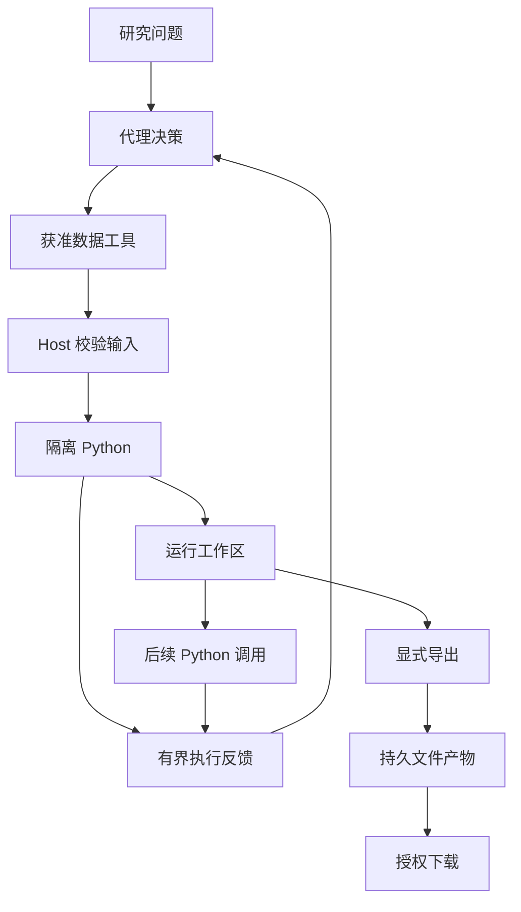
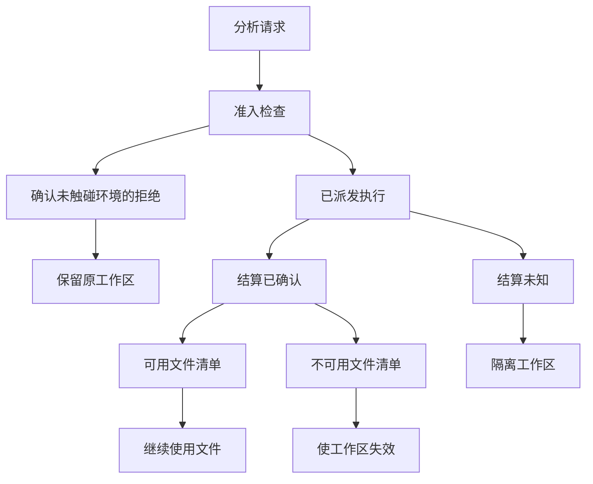

# 让 Agent 真正学会计算：从 Python 工具到计算工作台的架构演进

假设你问 AI：

> 帮我比较三只 ETF 过去一年的收益、最大回撤和波动率，最好再画几张图，看看各自有什么特点。

对于今天的大模型来说，编写一段 Python 代码并不困难。用 pandas 整理数据，用 NumPy 计算指标，再用 Matplotlib 画图，都是成熟的技术。[OpenAI Code Interpreter](https://developers.openai.com/api/docs/guides/tools-code-interpreter) 和 [Anthropic Code Execution](https://platform.claude.com/docs/en/agents-and-tools/tool-use/code-execution-tool) 也已经提供了代码执行、迭代与文件产出的能力。

既然如此，**给 Agent 增加一个 Python 执行工具，不就能让它拥有灵活的数据分析能力了吗？**

我们最初为 ETF Agent 引入 Python，动机也很朴素。系统已经有了行情查询、基金分析和预先实现的研究方法，但用户的问题千变万化。比较窗口可能临时变化，数据需要重新组合，分析方法也未必在现有工具里。与其为每一种需求增加专用工具，不如让 Agent 自己编写代码，解决那些没有提前定义的问题。

但第一个绕不过去的问题，是安全。

模型生成的代码，能直接放到应用服务器上执行吗？一段本来用于计算收益率的程序，是否也能读取服务器上的文件、访问内部网络，或者因为错误的循环耗尽资源？

对于可能接触持仓和私人研究资料的 Agent，我们不能把这些问题交给一句“请安全地运行代码”。必须先明确：它能接触哪些数据，可以修改哪里，又能使用多少资源。

于是，我们先为 Python 建立了隔离执行环境。但随着研究任务变长，又出现了新的问题：第一次整理的数据，第二次还能不能使用？代码报错后，哪些中间结果仍然有效？多个 Agent 同时计算，会不会碰到彼此的文件？算出了结果，又怎样真正交到用户手里？

这些问题推动我们做了几次重要的架构调整。有些是为了扩大模型的自由，有些是为了限制执行风险，还有一些恰恰相反——为了收窄过度保护，保住原本可以继续完成的工作。

这篇文章讲的，就是这段从 Python 工具走向计算工作台的过程。

## 一、可以复用计算方法，不能直接复用执行权限

最初，我们并不是完全没有运行 Python 的能力。

ETF Agent 已经有 `run_skill_script`，可以执行可信 Skill 包里维护好的脚本。因此，一个看似省事的办法，是让模型生成新的 Python 文件，再交给现有运行器执行。

但我们没有沿着这条路走。

现有运行器的前提，是执行已经纳入可信包管理的代码。模型临时生成的程序不满足这个前提。把它写进 Skill 目录，只是改变了文件的位置，并没有改变代码的可信程度。

这不是对 Python 语言的区别对待，而是对代码来源的区别对待。

我们最终增加了独立的 `run_analysis_python`。模型可以提交临时代码，但代码只能进入受控的分析环境，不能顺带获得应用服务器的文件、凭据和网络权限。运行环境与依赖预先准备，执行资源由宿主限制，而不是让模型自行安装软件、申请无限运行时间。

另一个重要决定是：**Python 负责计算，外部数据仍通过原来的工具获取。**

回到三只 ETF 的例子，Agent 先通过已授权的工具取得数据，再把选定结果交给 Python。如果计算发现缺少某个时间段，就由 Agent 回到原来的工具链补查，而不是让 Python 自己连接行情服务、读取数据库或者调用 MCP。

**图 1：数据获取、隔离计算与成果交付之间的接力**

这张图展示的是职责关系，不是一条强制执行的流水线。Agent 可以根据反馈继续查资料、再次计算或直接形成有边界的回答。下一次 Python 调用依然要重新经过宿主的准入和来源检查；保存在工作区的文件，也不会因为存在就自动成为可下载产物。

这样的设计确实少了一些便利。模型不能把取数、计算、调用外部服务全部塞进一个脚本，一口气运行到底。但我们接受这个代价，因为它避免了另一种复杂度：同一份业务数据出现两套访问路径、两套授权逻辑和两套错误处理。

**我们需要增加的是计算自由度，不是一套新的数据访问系统。**

## 二、有了自由计算，也不必每次重新发明公式

通用 Python 解决了“没有现成工具怎么办”，随后我们又遇到一个反方向的问题：已经有现成方法时，为什么还要让模型重新写一遍？

当时，基金研究包已经包含一些风险、归因和情景计算方法，但独立分析环境不能直接导入同源研究库。继续发展下去，很容易出现两份实现：一份由 Skill 调用，另一份为沙箱单独维护。

短期看，复制几个函数并不难。长期看，我们更担心的是口径漂移：一个地方修正了缺失值处理，另一个地方仍然使用旧逻辑；一个入口调整了参数含义，另一个入口的说明没有同步。工具都能返回数字，但相同方法已经不再产生相同含义的结果。

因此，我们选择让可信 Skill 与独立分析环境复用同一份研究库，通过已有构建流程生成两个环境需要的产物，而不是维护两套公式。

这并没有把通用 Python 重新变成固定工具箱。模型仍然可以编写临时逻辑，完成数据整理、组合和新的分析；只是遇到已经维护好的方法时，不必重新实现。

与此同时，计算方法的复用也不等于业务权威的迁移。Python 可以分析假设配置的风险，但账户金额、持仓状态和投资执行，仍然沿用原有确定性业务模块的结果。不能因为某段程序算出了一个数字，就让它自动覆盖系统已经确认的事实。

对我们而言，这次调整形成了一个更清楚的分工：**稳定方法尽量复用，临时分析允许生成，业务事实继续由原来的生产者负责。**

## 三、让计算接得上，不等于保留整个 Notebook

接下来需要解决的是连续计算。

比较三只 ETF，不一定是一段代码从头跑到尾。模型可能先整理日期和字段，检查后发现其中一份数据口径不同，再补充材料，最后重新计算。

完全丢弃每次执行的状态，会让后续步骤不断重复工作；保留一个永久运行的 Python 解释器，又意味着需要管理越来越多隐含状态。

我们最初选择了一个中间方案：

**工作区文件可以延续，但每次执行都启动新的 Python 解释器。**

第一次执行把整理后的数据保存下来，第二次可以重新读取；但第一次创建的变量、导入后的模块状态和内存对象，不会自动带到第二次。服务或分析会话失效时，也不承诺通过重跑代码恢复原来的临时工作区。

这个选择并不是因为 Notebook 的方式不好，而是我们当时需要的主要是中间成果接续，还没有足够的需求支撑完整的持久内核和工作区恢复机制。

例如，第一轮生成一份日期对齐后的表，第二轮读取这份表继续计算，就已经能完成不少研究任务。没有必要为了保留几个变量，同时引入解释器快照、对象恢复和跨重启一致性等问题。

代价也很明确：模型必须显式保存需要复用的结果，下一轮重新读取；解释器初始化和库导入也会重复发生。我们用这些代价，换取了更容易描述的状态边界。

但文件并不会因为落到磁盘上，就自动变得可靠。谁拥有它、谁能修改它、什么时候失效，仍然必须说清楚。

### 多个 Agent 出现后，原来的归属不够细了

早期，我们按整个研究任务建立分析会话。一个主要执行者在同一任务里反复计算，共用工作区很自然。

后来引入 Python 子代理后，这个前提发生了变化：主 Agent 与多个计算子任务拥有不同的模型上下文，底层却仍可能共用同一个分析会话，连带共享中间文件和来源依赖。

这时，隔离模型对话已经不够了。

设想两个子任务分别整理不同的数据，却都把结果保存为 `normalized.csv`。这是一个用于解释问题的假设例子：即使尚未发生文件覆盖，也能看出它们不应该仅仅因为属于同一个总任务，就默认拥有彼此的可变状态。

我们于是把工作区的归属，从整个根任务细化到了宿主确认的实际执行身份。一个执行者可以继续修正自己的代码、复用自己的文件；主 Agent 和兄弟子任务则不能直接读取或导出它的工作区。结果需要通过明确的交接返回。

这是一次随着系统使用方式变化而发生的架构调整。原来的单执行者假设，不再适合多执行者协作。

它也提醒我们：**上下文分开，不代表执行状态已经分开；逻辑上可以创建更多任务，也不代表物理资源足够同时运行它们。**

## 四、失败以后，最重要的是知道哪些东西仍然有效

有了文件接续，代码错误就不再只是一个退出码。

假如程序先写出一张表，随后在绘图时失败，那么失败发生前的文件是否仍然存在？是否完整？下一次执行能不能继续使用？

我们的初始设计没有把每次 Python 调用做成文件系统事务，也没有承诺异常后自动回滚。普通代码错误可能留下已经发生的文件变化；只有确认执行已经结束、工作区状态可用，后续才允许继续。无法确定执行是否结束时，则不能盲目信任原工作区。

这个方向本身没有问题。但后来我们发现，“保守处理”也可能做得过头。

### 一次没有执行的请求，为什么会毁掉旧结果？

10 月 18 日的一次回归复现了这样的过程：

任务 A 已经完成计算，保存着一个可导出的文件。随后，任务 B 和 C 占满了计算名额。A 再次申请执行时，底层适配器在真正准备、执行代码之前就拒绝了请求，但上层会话把这个异常解释成“执行状态不确定”，进而销毁了 A 原本健康的工作区。

新代码没有运行，旧结果却没法导出了。

问题不在于资源限制太严格。容量满了，拒绝新的计算本来就是正确行为。问题在于，这个拒绝被赋予了不属于它的后果。

我们因此没有简单地改成“异常都保留工作区”，也没有通过匹配错误文字来放行。真正知道“尚未触碰工作区”的执行适配器，需要提供与本次调用、当前工作区绑定的证明；会话管理者据此保留已有成果。取消、期限耗尽、调用身份不匹配，以及已经开始执行后的不确定状态，仍然走各自的保护路径。

**图 2：不同的执行事实，决定工作区能否继续使用**

图中的分支是不同结果，不表示一项请求会依次经过所有节点。只有确切证明未派发、未触碰原工作区的拒绝，才允许保留既有成果；已派发的代码如果明确结束，还要检查是否所有写入都已停止、文件清单是否可信。确认可用时可以继续；状态不确定时则失效或隔离，不能盲目重跑代码来“恢复”文件。

这次修复有针对性的适配器与会话回归证据，使用了替代的命令传输层。后续真实模型样本没有自然触发容量拒绝，因此我们没有把它写成该故障分支已经通过真实容器和模型联合验收。

真正值得记住的判断是：

**拒绝一次新的工作，不应该自动否定之前已经完成的工作。**

### 来源检查也遇到过类似问题

为了避免受限数据经过计算后失去来源约束，我们会保留分析所依赖的数据来源。模型把已经看过的私有数值写进代码常量，也不能因此把这次计算声明成“没有外部数据”。

但后来，某些失败结果和上下文投影又让原本已知的来源丢失了。后续 Python 看到“来源未知”，便拒绝继续分析。问题来自事实传递不完整，而不一定是缺少权限。

我们没有通过删除来源依赖来换取成功，也没有为每种错误增加一条豁免名单。调整方向是让原始结果的生产者保留它已经知道的事实，计算侧复用同一次研究中已有的授权与来源记录。

这和工作区误清理是相通的：**需要补齐的是事实和责任归属，而不是不断增加重试，或者不断放宽检查。**

## 五、给模型看的摘要，不能决定整个计算能做到哪里

连续分析还会遇到一个容易忽略的问题：程序生成的结果，与模型看到的结果，未必一样大。

如果每次计算都把全部表格、数组和日志塞回对话，上下文很快就会被中间结果占满。但如果为了缩短模型输入，直接把程序输出上限设得很小，又会让正常计算受到不必要的限制。

我们后来把输出预览与实际输出硬上限分开，并在结果中保留各个输出流的观察字节、保留字节和完整性状态。模型看到的可以是一份有限预览，但预览不能冒充完整结果。

这里最危险的情况，并不一定是明显缺了一半的文本。

有时候，截下来的内容恰好还能被解析为合法 JSON，看起来也像一张完整表格。如果后续计算直接消费它，得到的数字可能完全符合公式，却已经换了计算对象。

因此，我们不能用“能够解析”推断“数据完整”。同样，也不能让模型为了继续分析，把被省略的数据凭记忆补回来。

| 产物 | 主要用途 | 不能替代什么 |
| --- | --- | --- |
| 有界执行反馈 | 帮模型判断下一步、理解报错 | 完整计算数据 |
| 健康工作区中的中间文件 | 同一执行身份下继续加工 | 已提交、可下载的产物 |
| 显式导出的文件 | 供获准用户读取与下载 | 原始数据来源与研究结论的正确性 |

我们希望不同消费者拿到适合自己用途的结果，而不是所有内容都挤在一次工具返回里。

## 六、提前检查代码有用，但不能顺手变成另一套审批系统

面对模型生成的代码，一个很自然的想法是：正式运行前，先做静态检查。

我们也引入了这项能力，使用 CPython、Ruff 和 Pyright 提供执行前反馈。但在设计时，我们刻意把两件事分开：发现可疑问题，与证明本次代码不应执行。

Python 有动态、延迟执行和异常捕获等行为。静态分析器报告的问题，不一定会成为这次运行的实际失败。把全部诊断升级为阻断，就可能迫使模型反复修改本来可以工作的代码。

因此，这轮实现只允许编译错误和经过独立证明的极窄名称错误阻止当前执行。其他诊断作为局部建议；可选分析器不可用时，也不会因此关闭已经具备资格的计算沙箱。执行安全仍由原来的隔离和授权机制负责。

检查还有时间成本。在当时两组合成冷、热运行样本中，预检增加了约 **1.5—1.7 秒**的开销。对于短代码，这并不可以忽略。因此，这轮交付仍然保留默认关闭的选择，尚未用这些样本宣称真实模型修复次数、整体时延或任务质量得到改善。

与此同时，我们对长期维护的研究库采用了另一种策略：在开发阶段维护可审查的静态诊断基线，限制新增问题。这类代码会长期复用，治理方式不必与一次性的模型代码完全相同。

这次取舍让我们更清楚：**安全边界、运行前提示和代码库质量治理，虽然都叫“检查”，却不应该拥有相同的权力。**

## 七、计算、解释与交付，最终要重新分开

当基础执行逐渐走通，我们开始验证更完整的任务，随后遇到了另一类失败。

一次早期样本已经完成计算，并生成了 HTML 文件，但最后给用户的只有代码块，没有正常附件。后续样本才沿着子任务交接、导出、下载和历史读取，完成了可核对的文件交付。

如果只看“Python 成功运行”，这两次任务很容易被算成同一种成功。但对用户来说，它们显然不同。

后来的合成金融分析样本又进一步说明，数值正确、解释正确和文件交付可以分别出问题。有的计算通过了独立指标对照，却没有成功导出；有的正文保存了，解释仍然存在遗漏或错误。

这让我们开始按实际需要分别核对：代码产生了什么结果，计算采用了什么口径，模型怎样解释，以及用户最终得到什么。

例如，公式准确执行并不意味着输入窗口符合用户要求；一张图生成成功，也不意味着模型正确理解了它。生成文件可以承载分析，但文件本身不能自动变成原始证据，更不能成为投资结论的自我证明。

### Python 也不应该成为所有展示任务的必经之路

这段演进还带来一个反向调整。

起初，生成 HTML 常常和“先写一段 Python，再由 Python 拼接页面”绑定在一起。后来我们重新拆开了这两个需求：数据计算与页面组织，不必总由同一种方式完成。

在 10 月 19 日的调整中，固定标准报告继续使用原来的渲染器；对于自定义静态页面，模型可以直接生成 HTML，也可以按任务需要使用已经获准的 Python。已有数值沿用原来的生产结果，不因为画图和排版再算一遍。系统也没有另建一个根据页面长度或复杂度强制选路的路由器。

但直接生成 HTML 文本，仍然不等于已经生成可下载文件。保存和交付必须有真实的执行结果。这项调整有局部工程验证，尚不能据此判断模型在真实任务里总能选对路线，或页面视觉质量已经得到改善。

这个决定很能代表我们对 Python 的定位：

**它应该是 Agent 可以选择的能力，而不是所有研究和展示任务必须经过的关口。**

需要计算时，它让模型能够处理原本难以完成的问题；不需要计算时，它也不应该成为额外负担。

## 八、我们真正想保留下来的，是计算自由与清晰边界

回头看，这段过程并不是单纯地给一个 Python Tool 不断增加功能。

我们先把临时代码与可信脚本分开，避免错误复用权限；再让成熟方法共享同源实现，避免重复维护公式。为了连续分析，我们保留必要的文件状态，而没有一开始就建设持久化 Notebook；多执行者出现后，再把工作区归属细化到实际执行身份。

遇到失败时，我们逐渐学会先问：新代码到底有没有运行，原来的文件和来源事实是否仍然有效？遇到新的检查手段时，也不再默认它应该拥有阻断权。

其中一些机制已经有受支持容器环境下的工程验证，也观察到了模型修正代码、生成并交付文件的真实路径；但复杂任务的解释、完整性和交付仍有失败记录。这些结果允许我们讨论具体设计，却不足以宣称复杂投研任务已经稳定解决。

对我们而言，Python 工作台的价值，是为模型保留一段足够自由的工作空间：它能够选择方法、编写代码、观察结果，再决定修改、补查还是结束。

而支撑这段自由的，不是把所有判断都下沉到运行时。运行时需要管好的是实际发生的事情：哪些数据获准进入，代码在哪里执行，产生了哪些文件，以及哪些状态还可以继续使用。

这也是这段架构演进留给我们的主要经验：

**让 Agent 学会计算，不只是让代码能够运行，还要让正确的工作能够继续，让必要的限制只影响它应该限制的部分。**

能力变强，不一定要靠更多入口、更多规则和更多自动修复。有时，更重要的调整是复用已有方法、保存已有事实，或者移除一个不必要的前置条件。

我们希望最终得到的，是一个该计算时有能力计算、出错后有依据继续、不需要计算时也能顺利完成任务的 Agent。
