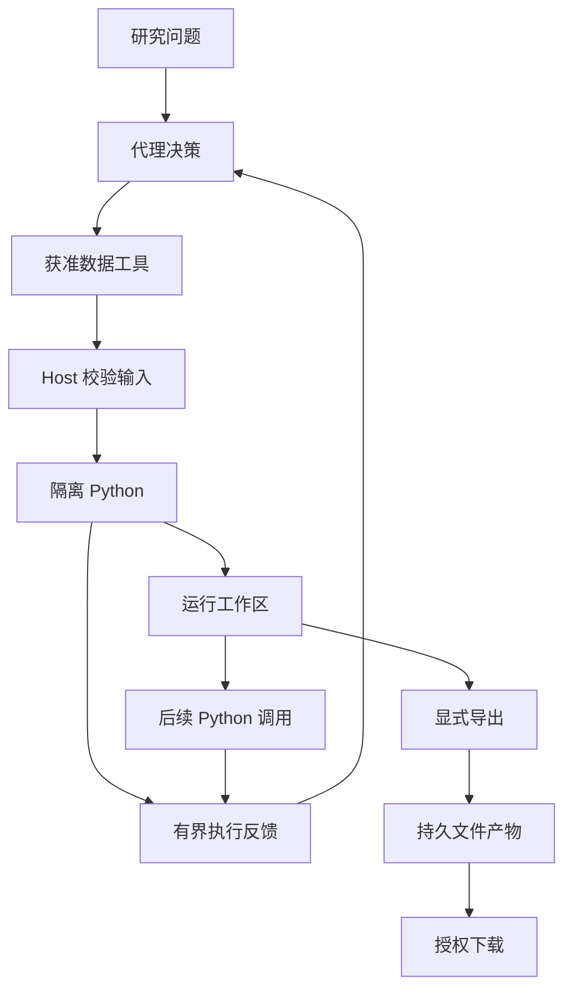
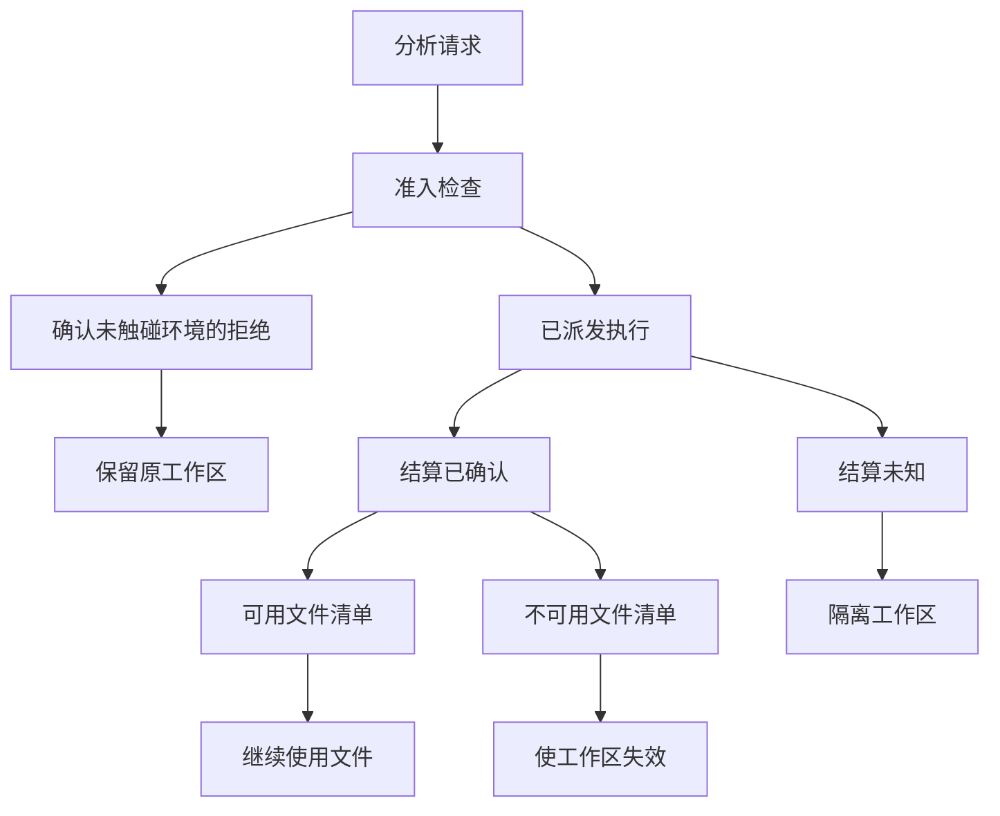

# Python 工作台：让多轮计算接得上，也让旧成果活下来

比较三只 ETF 的一年收益、最大回撤和波动率，再画图。第一轮可能只是对齐日期；第二轮发现一份数据的口径不同，需要补查；第三轮才形成结果。给模型一个能运行 Python 的工具，只解决了其中一小步。

真正影响任务能否继续的是：补查材料怎样进入计算、前一轮的文件由谁保管、一次报错会不会毁掉旧成果，以及图和表最后有没有变成用户能下载的文件。

当前工作台选择了一条清楚的路径：**原工具取数，Host 验证输入，实际执行者使用自己的文件工作区，每轮启动新的 Python 进程，最后显式导出。** 下面用三只 ETF 的比较作为教学场景；有日期的故障与受控样本另保留其真实范围，不把这个例子当作一次已完成的基金研究验收。

## 1. 把数据送进计算，不把业务权限搬进脚本

模型提交临时代码与命名输入引用。Host 负责确认输入所属的 Run、scope、来源、内容身份与完整性，再把选定数据交给隔离环境；模型不能自报一个 sandbox ID 或权限字段来扩大范围。

输入可以来自原工具调用的精确可见投影，也可以来自获准的结果引用及明确 selection。后一种方式不要求整份数据先塞进模型上下文。两条路都不能把因为容量截断的前缀当成完整数据，也不能用另一项 Run 的引用来取得权限。

同一 Run 的后续分析沿 Host 已记录的 grant，Child 继承原准入的子集，不重新查询当前 ACL。文件是否还在、hash 是否匹配、Reader 是否有效以及预算、取消是否允许继续，则仍然分别检查。**已有授权不会把丢失字节变回来，可用性失败也不应伪装成授权撤销。**

回到 ETF 比较：缺一段行情，就由 Agent 回原工具补查；Python 不直接连接业务数据库、行情服务或 MCP。模型可以自由整理和计算，却不会顺带取得应用服务器文件、凭据、内部网络或无限资源。依赖与受支持执行环境由 Host 预先准备。

图中是可选的接力关系，不是每题必须走完的流水线。后续调用仍须核对原授权范围、输入事实与执行条件；工作区里存在一个文件，也不表示它已经可供用户下载。

这比把取数、计算和外部 API 全写进一个脚本少些便利。我们接受这项代价，因为业务数据仍只有原来那套取得与授权路径，不需要在 Python 内再维护一套。

### 复用现成运行器与方法库，为什么是两种不同选择？

已有 `run_skill_script` 执行的是可信包内维护的脚本。把模型新写的程序放进 Skill 目录，不会改变其可信程度，因此临时代码使用独立的 `run_analysis_python`。这项分离针对代码来源，不针对 Python 语言。

方法源码却可以复用。当前构建从同一份研究库生成 Skill 与分析镜像需要的产物，避免一个入口修改缺失值处理、另一个仍沿旧口径。模型可以直接使用已经维护的风险、归因、情景方法，也可以编写临时计算；标准科学计算不必依赖每个可选基金 helper 都存在。

可选方法库的可用性与漂移也不等于基础 Runner 不安全。当前实现区分基础环境资格与可选方法状态，不把后者的差异一概升级为关闭通用计算。无论调用哪种方法，账户份额、金额、持仓状态和投资执行仍以原业务模块为准，派生研究数字不反过来改写账本。

## 2. 连续分析保留文件，不保留隐藏的解释器状态

三只 ETF 的日期对齐完成后，可以把表写入工作区。下一轮重新读取它，再计算指标。**每次运行都是新的 Python 进程，只有健康工作区中的文件延续。** 变量、内存对象和导入状态不会隐式保留；只读输入区每次重新准备。

原设计比较过三个合理选择：

| 方案 | 什么时候合适 | 在本任务中的代价 |
| --- | --- | --- |
| 每次完全无状态 | 小型一次计算，重做成本低 | 多轮反复整理同一数据 |
| 持久解释器或 Notebook kernel | 交互探索依赖大量内存对象，愿意管理 kernel 生命周期 | 隐含状态、检查点与跨重启恢复更复杂 |
| 文件延续，每次新进程 | 中间产物可以明确保存与重读 | 重复初始化和导入，模型必须显式保存需要复用的结果 |

这不是说持久状态不可取。[OpenAI Code Interpreter](https://developers.openai.com/api/docs/guides/tools-code-interpreter)提供沙箱容器、容器复用与文件下载；[Anthropic Code Execution](https://platform.claude.com/docs/en/agents-and-tools/tool-use/code-execution-tool)也支持文件接续，适用版本与配置还可保留解释器状态。只需要托管分析时，直接采用这类能力通常更省事。这里自有工作台承担的是已有 Run、来源与 Artifact 路径的接续，不据此声称托管产品缺少隔离或文件能力。

选择文件接续，是因为当时主要需要中间成果，而不是完整 Notebook。服务重启或分析会话失效后，不承诺通过自动重跑旧代码恢复临时工作区；要长期保留的结果，应当走显式导出。

### 文件属于执行者，而不是整棵任务树

单一执行者时期，按整个 Root 建立会话是合理的。引入 Child 后，模型对话分开了，scratch 文件、generation 和来源却可能仍共用。这是职责变了，不是给同一目录换个名字就能隔离。

假设两个子任务都写 `normalized.csv`，它们就不该只因属于同一根任务而共享可变状态。这个文件名冲突是教学反例，不是已发生的覆盖事故。

当前会话按 Host 已封存调用记录里的实际 executionId 选择。一个执行者可以修正自己的程序、重读自己的文件；Main 与兄弟 Child 不能直接读取或导出它的工作区，需要明确交接结果。逻辑上能创建多个 Child，也不代表物理计算名额跟着增加。

## 3. 新请求失败，先问它到底有没有碰旧文件

程序先写出对齐表，再在绘图时抛异常，文件可能已经改变。工作台没有把每次调用做成文件系统事务，也不承诺自动回滚。只有执行确已结束、写入停止且完整文件清单有效，才允许继续；不确定执行状态会使原工作区失效，而不是靠重跑来猜测恢复。

但另一个看似保守的行为曾毁掉有效工作。10 月 18 日的回归中，A 已算好一个可导出文件，B、C 占满计算名额。A 的下一次请求在 prepare 和执行之前被适配器拒绝，会话却把它当成“可能还在运行”，销毁了 A 的健康工作区。

**新代码没有运行，旧成果却丢了。** 容量拒绝本身正确，错误在于给它附加了“旧状态也不可信”的含义。

当前不是看到 `unavailable` 就保留工作区，而是由真正知道派发事实的适配器证明未触碰：

- 先验证输入与目标工作区；目标自身 busy 时不能给这种证明。
- 只有目标空闲、其他执行已占满全局名额，且尚未 prepare 时，才签发这次拒绝。
- 私有身份映射绑定异常、本次 dispatch input 的对象身份和原工作区。复制对象、同名错误或重放上一次异常不成立。
- 会话还核对当前工作区未变、未关闭、取消和期限仍允许，才恢复旧 lineage，保留 generation 与文件清单。拒绝的新输入不会污染旧文件的来源。

图中是不同结果，不是按顺序必经的节点。后续导出依旧要验证旧文件的实际字节、hash 与来源；未触碰证明不等于导出成功。当前 Docker 适配器遇到 timeout、cancel 或输出硬限终止时，不走正常完整清单回读，会销毁工作区并报告未正常结算，不能套用上述保留例外。

这次回归使用真实会话与生产适配器，但命令传输由受控替代实现提供，未证明真实 Docker 与模型联合走过该拒绝分支。后来真实模型样本成功计算并导出文件，却没有自然触发容量拒绝，而且叙述仍有错误。二者不能互相借用成功状态。

## 4. 来源与完整数据都要接续，短预览不能冒充计算对象

文件连续使用时，来源也必须连续。模型把看过的私有数值写成代码常量，不会令计算变成“无外部数据”；普通失败也可能已经产生文件，因此来源不能因为退出码非零就清空。

历史上，某些失败结果与上下文投影丢了已经知道的来源，后续 Python 只看到“来源未知”而拒绝继续。解决办法是让原结果生产者在精确回执与投影中保存已知事实，复用本 Run 的授权和来源记录，不是删依赖或按错误文案加白名单。与误清理一样，缺少事实传递不能靠更多重试解决。

输出完整性则是另一条独立边界。当前 stdout/stderr 合计预览上限为 64 KiB，其中 stderr 最多 16 KiB；执行输出硬上限为合计 2 MiB。超过预览可以继续计算，超过硬限则终止。**2 MiB 不是完整 stdout 留存承诺**，被省略的内容可能只继续计数；最终 Native 工具信封还有自己的容量，metadata 和 JSON 转义也占空间，不能承诺模型一定看到 64 KiB 正文。

每个流保留实际观察字节、保留字节、截断与完整状态。缺少旧版 metadata 时，完整性是未知，不能因为结果短或 `JSON.parse` 成功就补成完整。只有正常完成、工作区可用且输出完整的结果，才有资格登记成可再读计算输出。

这尤其影响 ETF 的数据表：截断前缀可能恰好仍是合法 JSON，公式在它上面算得完全正确，却已经换了一组输入。大表应显式存文件再读，不能让模型凭记忆补行。

| 产物 | 主要用途 | 不能替代什么 |
| --- | --- | --- |
| 有界执行反馈 | 帮模型判断下一步、理解报错 | 完整计算数据 |
| 健康工作区中的中间文件 | 同一执行身份下继续加工 | 已提交、可下载的产物 |
| 显式导出的文件 | 供获准用户读取与下载 | 原始数据来源与研究结论的正确性 |

## 5. 静态检查可以给建议，却不自动获得阻断权

当前可选预检复用 CPython、Ruff 和 Pyright，但把“发现可疑代码”与“证明本次不能执行”分开。Python 的动态绑定、未调用函数与异常捕获，使一般静态诊断不等于本次运行必然失败。

除了编译错误，名称错误的阻断证明非常窄：整段代码必须只是一个顶层裸名称读取，且该名称不是内建名称。例如单独的 `mystery` 可能满足；`print(mystery)` 已不属于这项证明，不能把 Ruff 的 F821 或两个分析器同意直接当作阻断依据。它们仍可以给模型修正建议，实际隔离与授权另由原运行环境负责。

如果预检确实阻断，结果说明没有尝试执行，不伪造 stdout、文件变化或运行耗时。可选分析器自身不可用，也不会因此关闭本来已具备资格的沙箱；原取消与期限仍然有效。

预检不是没有成本。10 月 17 日两组合成冷、热样本观察到约 **1.5—1.7 秒**新增开销，这是旧受控样本，不是当前 SLA 或复杂任务时延结论。当前预检仍默认关闭；不能据此宣称模型修复次数、总时延或研究质量已经改善。计算能力本身也要满足自己的启用与环境资格，不因检查器存在而自动可用。

长期维护的研究库则在开发阶段维护可审查的静态诊断基线，约束新增问题。长期源码与一次性模型程序用途不同，治理强度无需相同；基线通过也不是金融公式正确的证明。

## 6. 算对了、解释对了、文件交到了，要分别确认

三只 ETF 的指标算完，只是产生了一份派生结果。公式准确不代表窗口符合用户要求，图表渲染成功不代表模型理解正确；文件也不能作为自己金融结论的独立证据。

早期一个样本已生成 HTML，用户却只得到代码块，没有附件。后续样本才沿 Child 交接、导出、下载和历史读取完成真实文件交付。另一些合成金融样本数值通过独立对照，仍未导出成功；有的正文保存了，解释却有遗漏。把这些都记成“Python 成功”会掩盖不同问题。

当前工作区导出先读取实际文件并验证大小、hash 与 lineage，再交给原 Artifact owner 保存。HTML 还可能经受控准备改变最终字节，因此最终产物的 hash 对应保存结果，不必等于 scratch 文件的原 hash。保存、下载与浏览器打开仍是不同事实。

### 不需要新计算时，不必先运行 Python

10 月 19 日的选择是把计算和页面组织分开：固定标准报告保留原渲染器，自定义页面可直接写 HTML，也可在需要编程时使用获准 Python；已有数值直接展示，不为排版再算一遍。模型按任务判断，没有另造一个按行数或图数强制选路的路由器。

今天这不止是生成指导：具备原 Artifact 与 HTML 准备能力时，`export_analysis_artifact` 的直接 HTML 路径可以接收正文，核对来源、完成受控准备并保存文件，不依赖 Python 工作区健康。它仍复用同一个产物负责人，没有让模型用文本声明或虚构 URL 代替保存回执。

因此，缺少新计算会影响依赖它的图表；Python 不可用，却不应阻断基于已有可靠数值的合法静态展示。工程路径存在也不说明模型总能选对路线，或实际页面视觉质量已经提高。

## 7. 按真正需要延续的状态，选择工作台的复杂度

一次小计算，用无状态工具可能已经足够。依赖大量活跃对象的交互探索，持久 kernel 可能更合适。这里选择文件工作区，是为了让多轮研究接续，同时把来源、实际执行身份与显式交付留在原系统中；代价是宿主维护隔离环境与清单，模型显式保存和重读，失效后不保证自动恢复。

遇到报错时，可以按三个问题做判断：

1. 新请求到底有没有触碰工作区？只有原执行适配器能提供与本次调用绑定的未触碰事实。
2. 若已经执行，是否确认结束，文件清单与来源是否仍然有效？不要把普通代码失败、取消和未知状态混成一个分支。
3. 需要的是给模型看的反馈、下一轮计算的数据，还是用户可下载的产物？三者不是一种输出。

受支持容器环境已有工程验证，也有真实模型改代码并完成文件交付的样本；复杂研究的解释、完整性和交付仍有失败记录。当前方案保留的是可判断、可继续的计算路径，而不是“接上 Python 就稳定解决投研”的结论。
