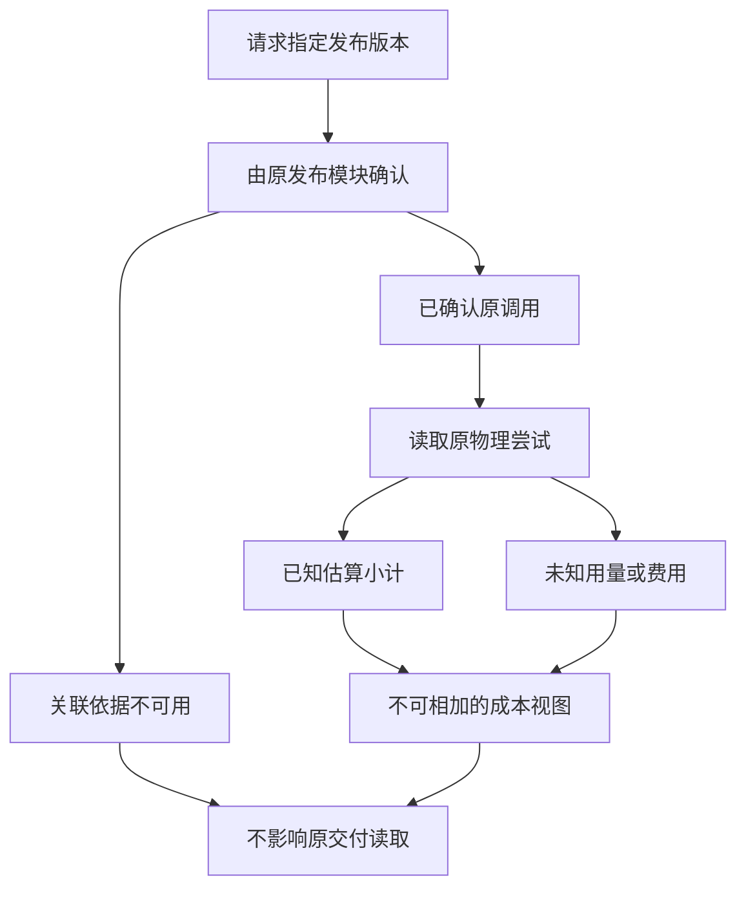

---
evidence:
  implementation: "原请求与发布版本关联已实现"
  scoped: "持久交付读取与观察器失败的受控验证"
  live: "共享分摊、完整因果成本与供应商对账未完成"
readingBrief:
  takeaways:
    - "计量从真实物理尝试身份开始；同一请求在网关、Trace 和汇总出现多次不能重复收费，失败尝试也不能被合并抹掉。"
    - "当前报告成本视图建立的是发布版本到请求的关联，不是完整因果归因；共享视图不可相加，未选规则的费用保留未分摊。"
    - "已知估算、未知费用和供应商账单分别表达；成本观察失败不应破坏原报告读取，也不能为了补账重新调用模型。"
  appliesTo:
    - "设计报告级成本展示，核对请求关联、共享工作、未知用量与可选成本读取的失败边界。"
  notFor:
    - "据发布请求小计报完整报告成本，或把响应扣款为零称为免费；完整分摊、因果成本与最终对账尚未完成。"
---

# Agent 生成一份报告，到底应该怎么算成本？

一份研究报告已经保存，后台也记录了 Token。把这次 Run 的费用加起来，填到报告旁边，是不是就完成了成本统计？

只有在一个非常强的前提下才可能这样做：这次运行只服务这一份报告，所有调用都被完整记录，价格口径一致，没有共享工作，也没有未知费用。

真实 Agent 往往不满足这些条件。一次请求可能同时生成正文和图表；Child 查到的材料可能被多个输出复用；重试可能发生在没有返回完整用量之前。**能找到报告相关的请求，不等于知道报告独占了多少钱。**

## 一、先分清我们在算哪本账

讨论 Agent 成本时，最容易把四个不同问题混在一起。

| 视角 | 回答什么 | 不能代替什么 |
| --- | --- | --- |
| 运行预算 | 这项任务还允许做多少工作？ | 已发生的 Token 和供应商扣款 |
| 物理尝试 | 哪一次请求实际发送，留下了什么用量？ | 整份报告的完整成本 |
| 账户用量或 Credits | 已知资源按内部规则如何累计？ | 供应商最终发票 |
| 交付物归因 | 哪些工作与这份正文或文件有关，如何分摊？ | 单纯的调用费用求和 |

其中“物理尝试”尤其重要。一个逻辑请求可能触发多次真实发送；同一次发送又可能同时出现在网关回执、追踪平台和运行汇总里。

前一种情况不能合并掉失败尝试，后一种情况不能重复加钱。因此，计量要从原物理尝试身份开始，而不是从报表行数开始。

## 二、一次研究，两份产物，为什么不能各收一遍钱

下面是完全合成的教学例子，不代表真实费率或用户账单。

某次研究有三个可确认的物理尝试：A 的已知估算费用为 0.01 美元，B 为 0.04 美元，C 没有足够用量信息，费用未知。A、B 共同服务一个逻辑请求，这个请求既发布了报告正文，也生成了一个图表文件。

如果在“报告成本”里显示 0.05 美元，又在“图表成本”里显示 0.05 美元，再把两项相加，读者会得到 0.10 美元。但目前可确认的已知请求费用仍然只有 0.05 美元，而且 C 的缺口没有消失。

错误不在加法，而在集合关系：报告视图和图表视图引用了同一批尝试，它们不是两组互不相交的费用。

所以系统需要明确标记：**这是关联视图，不可相加；这是已知估算小计，不是完整总额；共享部分尚未分配。**

平均分摊也不是天然正确。把 0.05 美元各分一半，可以是一项事先声明的管理会计规则，却不是从请求回执中发现的客观事实。没有选定规则时，应当保留“未分摊”，而不是用一个漂亮的小数掩盖缺失的决策。

## 三、我们先实现的是关联，不是替用户决定分摊

在这次实现里，报告正文与文件各自沿原有持久身份读取。正文使用发布块及其版本；文件使用产物身份、内容哈希等原始记录，而不是页面临时显示的名称。

对正文，读取器先请原发布模块确认当前已结算版本，以及绑定的原 Main 请求。确认后，再关联这个请求已观察到的物理尝试。旧版本、不存在的版本或没有足够绑定的记录，不能靠时间接近补配。

对文件，则核对原产物身份和导出回执。文件保存成功、被登记进历史、语义上属于哪份周报，是不同的事实，不由成本读取器顺手认证。



图中只有原发布模块确认了指定版本与原调用，才进入尝试关联。关联不可用时，缺失的是这份成本视图的依据，不是已经独立保存的正文。已知估算与未知用量可以同时存在。

这条链能回答“发布这一块正文的原请求有哪些已观察尝试”，却不能回答“为了写这块正文，所有必要工作是什么”。此前的资料读取、Child 工作、共享研究都可能参与，单个发布请求并不包含整个因果链。

因此当前视图明确保留 `requestMayServeOtherOutputs`、`viewsAreAdditive=false` 和 `sharedCostAllocation=unallocated`。完整报告归属金额仍然未知。这不是忘了做求和，而是拒绝把请求关联冒充完整归因。

## 四、未知不是零，供应商报告零也不是总成本为零

某次请求没有返回用量，可能是中断发生在回执之前，也可能是记录链路缺失。无论哪一种，都不能因为金额字段为空就改成零。

另一个方向也一样：供应商在响应里报告余额扣款为零，可能描述的是当前响应的特定计费维度。订阅价格、额度消耗、标价和其他外部服务成本，仍是不同概念。

我们因此分别保留供应商报告的余额扣款、BYOK 费用、标价与额度观察，不合成一个来源不明的 `cost`。这些是响应时的观测，不是经过最终对账的发票。

下面是对前述合成案例的展示建议，不是生产接口的原样复制：

```json
{
  "knownRequestEstimateUsd": "0.05",
  "completeRequestCostUsd": null,
  "reportExclusiveCostUsd": null,
  "unknownAttempts": 1,
  "sharedCostAllocation": "unallocated",
  "viewsAreAdditive": false
}
```

金额保留十进制口径，未知总额保留 `null`。如果前端一定要显示一句话，可以写：“已观察请求估算 0.05 美元；另有一次费用未知，共享部分未分摊。”这比“本报告花费 0.05 美元”更接近实际证据。

同样，不应该把每页成本索引的小计直接累加成 Run 总账。分页覆盖、重复身份和各视图之间的重叠关系，都需要先核对。

## 五、成本系统坏了，不应把已经交付的报告一起弄坏

成本观察通常是辅助功能，却很容易在组合时变成新的全局失败点：正文已经保存，读取报告时附带查询费用，费用查询抛错，整个接口于是返回失败。

这样一来，用户无法取得的不是报告，而是“报告加一个可选费用视图”这个组合。辅助功能扩大了自己的失败范围。

这次受控验证特意让成本观察读取失败，再从新的读取进程访问已保存产物。要守住的行为是：费用显示不可用，原正文、文件身份与独立读取仍可保留；不重发模型请求，也不为了补账再次生成报告。

权限失败则不能用这种降级绕过。用户没有权利读取某份报告，成本模块不能靠“只显示金额”透露其存在或内容。可选观察失败与原数据访问授权，是两条不同边界。

## 六、什么时候才能真正比较“这份报告更便宜”

先把比较对象说清楚：是请求级估算、账户级总支出，还是按某项规则分摊后的交付物成本？不同口径可以各有用途，但不能混用。

然后核对三件事：物理尝试与价格覆盖是否一致，共享费用规则是否事先固定，交付内容和质量是否可比。少读一份关键资料、漏掉失败调用，或者把 Child 成本藏在别处，都可能让数字看起来下降，却没有提高效率。

当覆盖不完整时，仍可报告已知部分与缺口，帮助定位资源消耗。只是不能进一步推出“整份报告节省了多少”。完整因果归因和供应商对账，是这条成本链后续需要解决的问题。

## 七、E04 留下了调用证据，为什么还是不能直接算出报告总成本？

2026 年 10 月，我们把研究调用的逻辑输入、可观察输出和来源依赖交给独立的 E04 证据 Store 保存，解决的是**请求与证据副本的身份、保留和回读**，而不是一次模型尝试的真实账单。

| 新增的可观察材料 | 可据此确认 | 仍缺的前提 |
| --- | --- | --- |
| 某 exchange 下的物理 attempt 身份 | 防止不同尝试混为同一次调用 | 是否覆盖所有已派发和未知尝试 |
| 可观察 usage 或余额扣款字段 | 供应商这一响应报告了什么 | 完整价格、订阅账单或最终发票 |
| attempt 到回答 revision 的关联 | 某些工作与某段正文有关系 | Child/资料读取等共享贡献应怎样归因 |
| E04 正文副本 queued 或缺失 | 采集尝试及缺口 | 持久读取成功与完整 HTTP 请求 |

这里尤其不能把 **E04 证据缺失**当成 **请求没有发生**；也不能因为某次供应商响应报告 balance charge 0，就称整份报告“免费”。原执行、被动采集、物理用量、内部 Credits 与最终扣费各有 Owner。

因此，这篇文章继续负责“计量、关联、分摊和对账”这四个不同问题；[E04 研究证据生命周期](/articles/agent-research-evidence-store-lifecycle)专讲一份输入/输出副本为何能或不能保存和重读。两篇合在一起能解释已知数与未知数，但不制造不存在的完整成本因果数据。

## 结语：先把身份和口径做对，再争取一个总数

成本系统不一定要一开始就算出所有答案，但必须让已知与未知分得开，让同一尝试不会因为出现在两张报表上就收费两次。

对 Agent 报告，我更愿意先交付一个能回查的请求关联视图，而不是一个来源不明的精确金额。它能说明哪些调用已被观察、哪些金额只是估算、哪些工作被共享，也不会让辅助记账反过来损害原交付。

**关联回答“这笔工作在哪里”，分摊回答“这笔工作归谁”，对账回答“最终实际付了多少”。** 三个问题分开之后，成本优化才有一个可以信任的起点。

延伸阅读：[请求、Token 与 Credits](agent-personal-credits-shadow-accounting.md) · [多专家贡献如何取证](agent-subagent-contribution-evidence.md) · [Trace 的完整性缺口](agent-trace-complete-observation-gaps.md)

更多工程案例见 [ETF Agent 技术文集](https://github.com/hpoenixf/eff-agent-article)。欢迎为文集点一个 Star。
