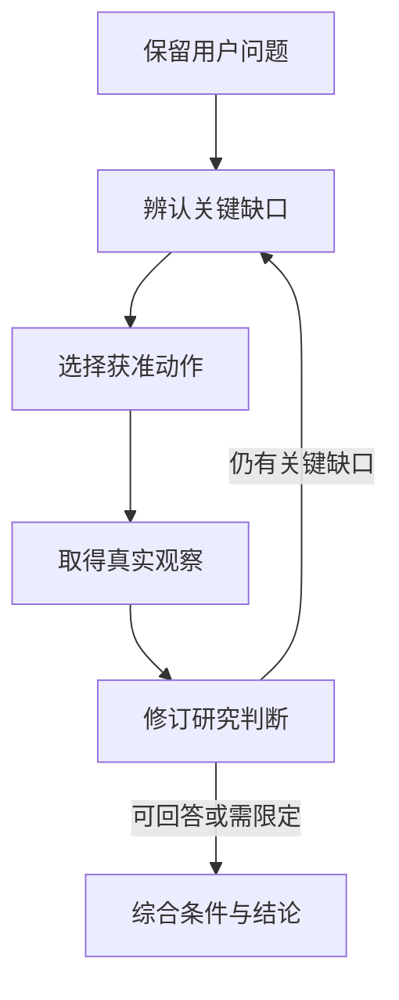

# Agent 什么时候该继续查，什么时候该开始回答？

用户问：“同一只基金的两种份额，新的那个年费率更低，我是不是应该换过去？”

一个只擅长收集信息的 Agent，可以很快找到费率表、基金公告、产品介绍和几篇分析，然后写出一份资料丰富的回答。但它仍可能没有解决最重要的问题：**较低的持续费用，能否在用户打算持有的时间里，抵消这次转换产生的成本？**

另一种失败恰好相反。系统要求“至少查询若干来源、列出所有风险、再经过多个专家”，结果关于费率的事实已经清楚，Agent 仍不断搜索，直到没有时间组织结论。

本文关注的是两者之间的判断：怎样决定下一步还有没有必要，怎样在条件不足时给出有用回答，以及怎样把新证据真正综合成结论。以下费用、份额名称与研究过程均为教学构造，工程机制来自 ETF Agent 的设计与实现。


<picture>
  <source media="(max-width: 640px)" srcset="/eff-agent-article/visuals/agent-research-decisions-evidence-synthesis/overview-mobile.svg" />
  
</picture>

*图：从用户问题到有条件研究结论的决策链。概览按职责组织，不是某次任务的真实调用记录。*

[放大查看完整图](/eff-agent-article/visuals/agent-research-decisions-evidence-synthesis/overview.svg)

## 一、先确定要回答什么，再决定需要多少资料

“哪个费率低”和“我是否值得转换”，不是同一个问题。

前者可能只需核对两份适用的费用条款。后者还涉及份额是否可比、条款何时生效、渠道与持有期条件，以及用户准备继续持有多久。若只围绕关键词搜索“低费率基金”，查得再多，也可能一直绕过真正的问题。

一个有用的起点，是把用户原问题拆成少数**需要证据支持的判断**。它们不是把所有子问题抄成任务列表，而是识别哪些未知会改变结论。

| 想形成的判断 | 必须先知道什么 | 不能用什么替代 |
| --- | --- | --- |
| 两个份额可以直接比较 | 对象、币种、投资范围及适用规则 | 名字相似或属于同一家机构 |
| 新份额持续费用更低 | 同口径费用与生效期间 | 只截取其中一项标称费率 |
| 转换成本可以被节省覆盖 | 一次性成本、比较金额与持有期限 | 长期收益率排名 |
| 这个结论适用于用户 | 用户约束以及实际可选渠道 | 模型猜测的投资偏好 |

这张表是帮助读者理解研究结构的示意，不是要在程序中新增一个“所有格子填满才能发布”的审批器。有些问题经过初步读取就会被证明不适用，有些判断只能在条件下成立。

原始提问和用户限制需要始终保留。研究中的简化便笺有助于安排工作，却不能取代用户真正提出的问题。

## 二、工作问题可以变化，执行事实不能跟着改

ETF Agent 使用可选的研究工作问题记录缺失事实、证据冲突或需要完成的转换。问题具有稳定身份，模型可以把它暂记为未解决、已解决、仍无法解决或不再需要。

关键不在于状态名字，而在于它们的性质：**这是模型对当前研究的判断，不是系统签发的正确性证明。**

例如，模型读到一张费用表后，认为“确认持续费用”已经解决。随后原始公告显示，该表描述的是下个月才生效的调整。它就应该重新打开这个问题，改为分别比较当前规则与未来规则，而不是为了维护清单的完成状态忽略新事实。

与此相对，实际读取了哪个版本、工具是否成功、计算用了哪些输入，属于已经发生的事实。模型不能因为改变观点，就把“没有读到原文”改写成“已经确认”，也不能把一个工作问题标记为已解决，借此生成并不存在的计算结果。



图中“可回答”是模型的语义判断，不是一条固定的来源数量规则。工具执行、权限和预算仍由系统按各自事实处理。

[Anthropic 的《Building effective agents》](https://www.anthropic.com/engineering/building-effective-agents)同样强调从环境反馈中取得真实观察，再调整行动。这提供了一种通用的循环模式；我们在金融研究中的具体难题，是让对象、时点、分母和用户条件真正进入这种调整，而不只是在工具之间循环。

## 三、下一步该做什么：先问它可能改变哪项结论

回到费用比较。假设已经找到了两份正式文件，仍有三个缺口：一份公告的实施日期没有看清、实际转换费用未核实、用户计划持有多久尚未知。

这三个缺口不适合统一交给“再搜索一次”。

实施日期已经在取得的公告中，应该继续读取相关章节；转换费用取决于渠道和具体条件，需要查适用规则；持有期限属于用户条件，资料库里不会自动存在答案。与此同时，Agent 仍可以先解释两种费用结构，而不必因为最后一项未知停止全部工作。

**每次行动前，一个实用的问题是：这次动作的结果，会改变哪句话、哪项比较，或者哪条适用条件？**

它是一条研究组织原则，不是已经实现的精确“信息增益分数”。没有可靠测量时，不应在 Runtime 里伪造一个收益函数，用小数点后两位决定模型是否值得再看一页。

这条原则也能区分三种容易混淆的状态。

“还没有读到”意味着存在可继续读取的线索；“这次读取不可用”意味着工具或来源没有返回所需内容；“没有找到相关规定”只是本次搜索范围内的观察。它们都不能直接升级为“该规定不存在”。

如果原文件已在工作区，就先回读，不必重新搜索同一资料；如果两份来源表达冲突，就先核对范围，不必增加几个同意其中一方的转载；如果缺的是用户条件，就用一个有实质影响的问题澄清，而不是让模型替用户作决定。

## 四、两份材料不一致，先排除“其实在回答不同问题”

仍以这项研究为例：产品说明写持续费用为一个水平，近期公告写了更低水平。立即选择“最新的一份”或“更多网站重复的一份”，都可能过早。

先沿三个方向核对。

**对象是否一致。** 两份材料是否描述同一份额、同一币种、同一销售渠道？名称相近的产品可能不具有相同费用条件。

**时间是否一致。** 公告发布日期、条款生效日和研究比较期间是否匹配？今天发布的调整，可以在未来生效；昨天读取的旧文件，也可能仍是今天适用的规则。

**口径是否一致。** 一个数字是否只包含管理费，另一个是否还包含销售服务费？一次性费用与持续费用能否直接比较？

核对以后，冲突可能消失：两份文件分别描述调整前与调整后。也可能仍然存在：相同对象、相同期间的两个正式说明无法对齐。后一种情况需要进一步找修订说明或承认冲突，不应把两个数字取平均，做成一份看似精确的“综合结果”。

多来源的价值是发现与解释差异，不是投票。委派专家也遵守同样原则：专家必须带回新的依据、计算或反例；两位专家重复同一段资料，不会使结论多一份独立支持。

## 五、算出一个数之后，还要把它放回用户的问题

为了看清研究综合与计算的区别，假设已经确认以下教学条件：比较基数固定为 100,000 元；两种份额的可比年化持续费率分别为 0.60% 和 0.30%；全部一次性转换成本合计 400 元；忽略净值波动、其他差异和实际逐日计费细节。

在这个刻意简化的模型下：

```text
一年理论节省 = 100,000 × (0.60% − 0.30%) = 300 元
六个月理论节省 = 300 × 0.5 = 150 元
十八个月理论节省 = 300 × 1.5 = 450 元
```

这个算式不是基金真实计费公式，只用来说明研究条件怎样影响结论。实际产品的计费基数、持有期间与费用规则，应由对应材料和计算方法决定。

计算工具能确认在这些输入与假设下得到这些数值，但“值得转换吗”还没有自动被回答。

如果用户准备六个月后用钱，这个简化模型中的持续费用节省尚不足以覆盖一次性成本。如果准备持有十八个月，模型中才出现很小的费用净差；它仍没有证明实际转换可行、其他差异可忽略，更没有证明投资收益更好。

所以，综合回答不应停在“新份额费率低一半”。更有用的表达是：

> 在费用口径一致、转换总成本为 400 元且比较基数不变的假设下，持有六个月尚无法靠持续费用节省覆盖转换成本。十八个月的简化费用差额接近临界区域，需要再核对实际费用规则与其他差异。你计划持有多久，会改变这一判断。

这里的每一项限定都有作用。它们说明结论如何随条件变化，而不是在结尾附上一句笼统的“仅供参考”。

## 六、研究怎样结束：按判断收束，而不是等所有资料齐全

我们曾在基金研究方法中遇到一种反向压力：用于限制工作量的参照上限，被理解成应该凑齐的材料数量；可选的复核版报告和模拟展示，又被附加成每次都要完成的工作。

这些做法原本有合理动机：提供比较角度、让输出便于核对。但一旦变成固定配额，就会把“需要哪些证据”改写成“还差几个动作”。后来的调整，是保留有界工作范围，同时允许足够的少量有效参照，以及按需生成额外展示。

这不是鼓励少查，而是把停止条件放回用户问题。

| 当前研究状态 | 合理的下一步 |
| --- | --- |
| 关键事实已能支持有限结论，未发现会推翻它的未解释冲突 | 开始回答，并保留适用条件 |
| 存在会实质改变结论的缺口，且还有获准、可行的取得路径 | 继续读取、计算或澄清 |
| 关键条件暂时无法取得，但部分事实可独立成立 | 交付已支持的部分，指出哪些判断暂不能作出 |
| 达到执行时限、资源上限或收到取消 | 按真实执行状态停止，不声称证据因此充分 |

这张表描述的是判断方式，不是一个新增的生产审批状态机。尤其最后一行，属于执行条件；它不能被包装成“研究已经完成得很好”。

同一份回答也可以包含不同强度的结论。例如，费用差异已经核实，转换条件仍未知，用户期限还未确认。Agent 可以先给出费用结构和条件比较，再说明为什么当前不能给出个人选择。它不需要在“完整结论”和“什么也不说”之间二选一。

研究质量复核同样不能只看执行终态。更值得检查的是：新证据出现后，模型有没有撤回不再成立的前提；最终建议是否仍依赖一个未取得的条件；资料中的关键限制有没有随结论一起保留。

## 七、综合不是把工具结果依次贴到答案里

一份研究可能有十次工具返回、两份专家意见和一项计算。用户不需要按这个执行顺序读十几段摘要。

更适合的组织单位是**用户需要判断的事情**。对于份额比较，可以先回答当前能够成立的差异，再解释转换是否划算由哪些条件决定，最后指出真正会改变结果的下一步核对。

在这个过程中，Main 需要完成三种工作：把同口径事实放在一起，把相互冲突的材料解释清楚，把计算结果和原始用户条件重新连接。子任务摘要提供局部材料，不能代替这一步。

Reviewer 可以指出遗漏和矛盾，但其评价仍是一项供主研究者考虑的意见。它不能因为说“足够充分”，就补出缺失的来源；也不能因为提出某个局部疑问，就自动抹掉一段有独立依据的说明。

一份有用的最终答案，应该让读者分清：哪些是核实到的事实，哪些是基于明确假设的计算，哪些是研究者的判断，以及改变什么条件会使判断不再成立。这比展示整个过程日志更接近研究交付。

## 八、从公开实现看清“工作表示”与“原始证据”的区别

公开的 [Open ETF Agent v0.15.2](https://github.com/hpoenixf/open-etf-agent/tree/34124cefc6df289e08518173789210b45a716451)使用合成文档示例，让开发者观察资料、派生工作便笺和报告如何分开。

其中，[工作便笺实现](https://github.com/hpoenixf/open-etf-agent/blob/34124cefc6df289e08518173789210b45a716451/src/working-note.mjs)明确保留它是派生摘要、语义尚未复核的身份，并绑定对应来源或记忆引用。它不能被重新包装成原始文档。这与本文的判断一致：模型对材料的整理有助于继续工作，但不能借整理动作提高证据等级。

读者可按[固定版本 README](https://github.com/hpoenixf/open-etf-agent/blob/34124cefc6df289e08518173789210b45a716451/README.zh-CN.md)运行 `document-compare`，对照 `report.md`、来源和运行记录。默认传输是脚本化响应；示例能解释事实与派生表示的分工，不能据此声称真实模型已经学会本文的停止判断，更不是上述基金费用任务的实盘实现。后续使用入口是[当前 main](https://github.com/hpoenixf/open-etf-agent/blob/main/README.zh-CN.md)。

## 结语：让下一次动作对结论负责

用户问的是是否值得转换，Agent 最终应该解释的是：在什么依据和条件下，这个选择成立，哪里还不能下结论。

资料数量、专家数量和研究时长，都只能描述过程的一部分。更重要的是，下一次动作能否解决一个有影响的缺口，新观察能否修正旧判断，最终结论能否保留它所依赖的条件。

**该继续时，知道还缺哪项关键依据；该回答时，知道自己能说到哪一步。** 这才是研究决策与综合需要提供的能力。

相关机制可继续阅读[从 Model、Harness 到研究 Loop](https://hpoenixf.com/eff-agent-article/articles/etf-agent-model-harness-research-loop)与[金融数字的时点、口径和复算](https://hpoenixf.com/eff-agent-article/articles/031-fintech-data-time-and-reproducible-numbers)。前者解释执行组织，后者展开数值依据；本文把重点放在两者之间的研究取舍。