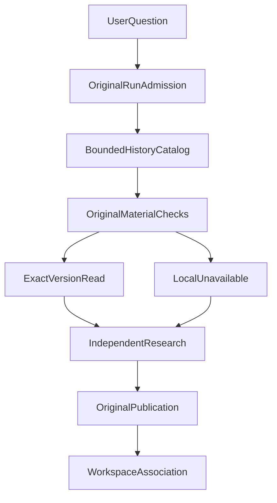

# 为什么 Agent 需要 Workspace？从一次性对话到长期研究

第一周，我们研究某只基金的流动性，留下报告 A。第二周，持有人结构出现新信息，报告 B 给出了不同判断。第四周，一则新公告来了，用户问：“之前的看法还成立吗？”

这个教学场景里，最难的未必是又读一份公告，而是准确找到**当时基于什么作过什么判断**。把所有聊天记录塞回去，容易丢掉版本和时点；只取最新报告，又可能看不到判断怎样改变。

我们的当前设计把长期目标、原成果之间的关系，以及可选研究进展放进 Workspace。每次研究仍创建独立 Run，报告仍由原发布系统保存。**持续的是研究目标，不必是一条永不结束的执行进程。**

本文讨论已经落地、默认关闭的工程机制，不是公开安装教程。

<span id="一、为什么对话历史和-memory-还不够"></span>

## 一、什么时候聊天历史和 Memory 已经不够？

如果用户只在同一对话里追问，Session 与恰当的历史管理通常够用。增加 Workspace 的理由是：目标跨越多次独立任务，用户还要组织旧成果、比较历史判断和决定下次从哪里开始。

这些对象的用途不同：

| 对象 | 长期研究中保留什么 |
| --- | --- |
| Conversation | 那次交流发生了什么 |
| Run | 一次研究的执行身份和结果 |
| Memory | 经自身治理保存的偏好或经历 |
| Publication | 某份回答的确定版本 |
| Workspace | 用户持续关注的目标、相关研究与未决问题 |

原系统已有对话分组、周报历史与精确旧版本读取。对话分组解决组织，周报解决周期性整理，单份历史选择解决一次复用。Workspace 补上的，是一个**以目标为中心、没有固定周期、可以关联多份原成果**的入口。

这也解释了为什么它不直接复制所有旧正文。原发布模块已经拥有报告身份和版本，再存一份“项目里的报告”会产生新的问题：修订该同步到哪里，权限该信哪份，删文件时又该删几次？保存关系比复制内容更小，也更容易沿原对象查证。

<span id="二、workspace-应该成为独立-module-而不是第二个-agent"></span>

## 二、先比较三个合理方案，再决定多加一层什么

[OpenAI Agents SDK 的 Session](https://openai.github.io/openai-agents-python/sessions/)维护多轮运行的对话历史。[LangGraph 的持久化设计](https://docs.langchain.com/oss/python/langgraph/persistence)用 Checkpointer 保存线程内图状态，用 Store 保存跨线程的应用数据。这些能力都可以成为产品的基础，并不要求另外造一个框架。

我们真正需要决定的是应用层的数据模型：

| 方案 | 什么情况下合适 | 对这个场景还需定义什么 |
| --- | --- | --- |
| 一个长 Session | 任务主要沿同一对话继续 | 多个独立报告的关系、精确历史版本、用户目标的独立修订 |
| 跨线程 Store／业务数据库 | 需要跨会话保存数据 | 存储机制之上的对象身份、权限、版本与生命周期 |
| 持续运行的 Project Agent | 产品确实要求自主持续执行 | 谁调度、谁停止、谁付资源成本，以及旧授权能持续多久 |
| Workspace + 原 Run | 目标长期存在，研究按需重新开始 | 一层有界关系与进展管理，复用原执行和读取规则 |

我们选择最后一项，因为 Run、Publication、Artifact 与 Memory 已经有自己的实现。一个 Project Agent 若同时接管调度、历史、权限和结果，就容易把这些能力再做一遍。Workspace 因此只保存三类信息：**目标、关系、进展**。

代价并没有消失。关系需要持久化，读取要跨模块检查，目标和进展要处理并发版本，有界目录还可能漏掉相关候选。若没有跨 Run 研究目标，这些成本通常不值得付。

<span id="三、跨-run-研究的关键-不能把-找到-当成-用过"></span>
<span id="一个具体例子"></span>

## 三、一次新研究怎样实际用上两份旧报告？



图中，用户的新问题先进入原 Run 准入，再从有界历史目录选择材料。材料合格则读取精确版本，不合格则只把该材料标为不可用。新研究经原发布链保存自己的成果，Workspace 关联实际已经提交的对象。打开页面本身不启动研究。

### 先给目录，让模型选择，不把全部历史当上下文

目录来自当前账户下已关联的原 Conversation 和成果。它提供身份、版本与来源线索，而不是把所有报告全文注入 Prompt。候选与扫描范围有上限，所以“这页没有”不能解释成“历史上没有”。

模型选择后，由原读取模块核对对象、修订、正文摘要和来源依赖。新 Run 使用自己的授权和预算，不继承旧 Run 的权限，也不复活已经完成的执行。

### 必须能读非最新版本

回到第一周的报告 A。假设它后来修订到 v2，用户现在想比较的却是“第一周当时的判断”。悄悄换成 v2，会让历史看起来从未犯过错。

因此，读取绑定确切版本，而不是只有报告名：

```json
{
  "goal": "持续评估某基金的流动性风险",
  "goalVersion": 2,
  "question": "新公告是否改变此前判断？",
  "selectedHistory": [
    { "material": "第一周报告 A@v1", "status": "已读取精确版本" },
    { "material": "第二周报告 B@v1", "status": "已读取精确版本" }
  ],
  "currentEvidence": "第四周新增公告",
  "outcome": "产生独立的新研究报告"
}
```

这是教学表示，不是生产 API。旧报告说明过去在何种信息条件下形成了判断，新公告提供新的证据；二者不能合成同一时点的金融事实。

### 看见链接、取得正文和形成判断分别发生

候选出现在目录里，只说明模型可以选择它。读取成功后，还需要确认该内容真的进入新请求，才能说明这次研究消费了它。是否正确理解冲突、选择更有价值的来源，则需要另评模型的研究结果。

已有受控路径覆盖了两个不同的历史 Publication，其中包含非最新版本，实际进入新模型输入，并由原发布机制保存独立结果。这是工程接线的依据，不是长期投资判断质量的结论。

## 四、一个坏候选，为什么曾挡住了整次研究？

在正式工程收尾时，原来源解析器正确拒绝了一份不合格候选，但初次准入和目录投影把这个拒绝扩大成了整条请求失败。保护来源本来是对的，错误在于扩大了影响范围。

假设旧报告 A 已经不可读，报告 B 和新公告仍然合法。合理结果是：A 不被授权、不暴露正文与不该暴露的元数据，B 与新公告仍可供研究；如果缺少 A 使比较无法完成，就在回答里说清具体缺口。

修正因此落在两个消费原解析结果的位置：按候选处理不可用，保留独立合法材料和工具，也允许原发布路径继续。没有把来源检查关掉，没有新增修复模型回合，更没有更新或撤回同一 Run 已冻结的授权。

**关系层可以报告一项材料缺失，却不应顺手获得终止整次研究的权力。** 这也是目录型产品很容易忽视的失败路径：清单里的一项错误，不等于清单整体毫无价值。

<span id="四、为什么-workspace-还要保存研究进展"></span>
<span id="目标修改不能改写正在执行的研究"></span>

## 五、为什么进展还要单独版本化？

只有报告列表，用户仍可能不知道哪些问题没解决。Workspace 因此允许模型提出一份带来源的研究进展记录，也称 Workspace Checkpoint。它记录“新增公告仍未解释持有人集中度，下一步可以查申赎数据”之类的工作判断，不是恢复执行图的检查点。

这份记录可选，不提出就不写。它绑定原 Run、已接受的成果和历史材料，不能覆盖用户目标，也不能把“已解决”当作正式完成或投资决策。

更新使用预期修订检查。两项研究同时返回时，晚到的旧提议不能覆盖较新的进展；这次没提到的旧问题，也不会因为模型省略就自动消失。依赖材料不能再合法读取时，相应进展保留准确的不可用状态。

目标与进展分开还有一个好处：用户修改研究方向后，已准入的 Run 仍使用当时冻结的目标版本，后来的新 Run 才读新目标。否则，几周后回看报告，会无法解释它为何围绕旧问题展开。

自动把 Workspace 进展学进 Memory 仍是后续方向。当前设计不需要为了保存未决问题，再建一套记忆系统。

<span id="五、长期存在的东西-更需要清楚的生命周期"></span>
<span id="归档不等于停止原有-run"></span>
<span id="删除-workspace-不等于删除研究成果"></span>
<span id="文件留存也遵守同样原则"></span>

## 六、归档、删除与文件留存，各自改变哪件事？

长期存在的关系层，必须先想清楚怎样退出。

**归档**阻止新的 Workspace 关联研究，允许之后恢复。它不取消已经获准的 Run，原任务仍由自己的停止与结算机制负责。

**删除 Workspace**移除目标、组织关系和附属进展，阻止后续重新关联。原 Conversation、Publication 和已合法留存的 Artifact 不因此被连带删除；迟到的研究结果也不能重新创建已删除的 Workspace。若产品需要“同时清除所有关联数据”，那是另一项需要明确范围和后果的操作。

**文件留存**调用原 Artifact 的能力。当前受支持的 HTML 报告可以走对应留存与关联路径，但不是任意 PDF、Excel 的永久收藏夹。文件已留存而关联失败时，也须分开报告，不能用一个成功标志吞掉半边结果。

<span id="六、这套设计实际上验证到了哪里"></span>
<span id="七、什么时候值得引入-workspace"></span>

## 七、目前可以采用哪些判断？

截至 2026 年 11 月 5 日的源码核查，Workspace 的目标与版本、关联目录、新 Run 多材料消费、可选进展、支持范围内的 Artifact 关联和 Web 入口已实现，并完成不调用真实模型的工程验收。功能仍默认关闭，真实模型的相关性判断、长期研究质量和产品使用效果需要另外验证。

[Open ETF Agent](https://github.com/hpoenixf/open-etf-agent) 尚未提供这套完整 Workspace 的公开可运行版本。可以迁移的是本篇的数据与职责设计，不能照此假定下载公开教学仓库就获得相同产品。

如果重新设计类似能力，我会先确认三件事：

1. 目标是否真的跨越独立 Run，而不是一个更长的聊天？
2. 旧判断能否按当时版本重读，而不是永远被最新摘要覆盖？
3. 关系层退出时，原成果和任务是否还能按原规则存在？

## 结语

研究连续性既不是让 Agent 永远运行，也不是保存越来越长的历史。

让用户的目标保持清楚，让旧成果能按确切身份回读，让新研究重新获得自己的权限，再把新的判断接回同一个目标。Workspace 最有价值的部分，正是这些关系能够持续，而各次执行仍然独立、可解释。

延伸阅读：[研究资料的身份与版本](agent-research-assets-identity-version-lifecycle.md) · [从投研聊天到持续研究](deepseek-superagent-continuous-research.md) · [跨 Run 历史压缩](agent-conversation-history-compaction-source-boundaries.md)。欢迎关注独立教学实现 [Open ETF Agent](https://github.com/hpoenixf/open-etf-agent)。
