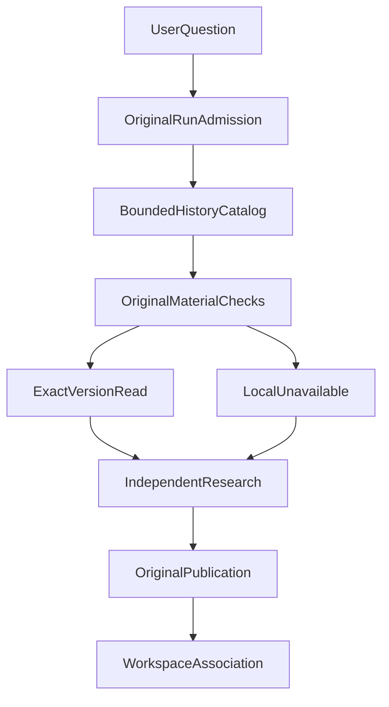

# 为什么 Agent 需要 Workspace？从一次性对话到长期研究

很多 Agent 已经具备了长对话、记忆、工具调用、任务恢复和历史报告保存能力。但当用户希望围绕同一个目标持续研究几个星期，甚至几个月时，这些能力组合起来，仍然可能缺少重要的一环。

**一次研究结束了，研究目标却没有结束。**

我的 ETF Agent 已经能够独立执行研究 Run、保存正式回答、读取历史证据，也能够通过 Memory 保留用户偏好。但这些能力并没有自动构成一个长期研究空间。

这次设计 Research Workspace，我希望解决的不是如何让 Agent 永远运行，而是：**如何让多次独立的研究，共同服务于一个长期目标，同时保留每次研究原本的身份、证据、版本和权限？**

最终选择的方案，是增加一个独立的 Workspace Module，负责组织长期目标与研究成果，却不另建一套研究执行器。

## 一、为什么对话历史和 Memory 还不够？

先看一个教学场景。

假设用户希望持续评估某只基金的流动性风险。

第一周，Agent 根据公开报告分析了基金规模和交易情况，形成报告 A。

第二周，用户发现基金持有人结构发生变化，又生成报告 B。报告 B 提出了与报告 A 不完全一致的判断。

第四周，一份新的基金公告发布。用户希望 Agent 重新评估风险，并解释：此前哪些判断仍然成立，哪些需要调整？

这是一个跨时间、跨证据版本的研究任务。

最简单的做法，是把前两次对话全部交给模型。但这样会遇到三个问题。

首先，历史上下文并不等于历史证据。模型可能看到报告 A 的摘要，却不知道它对应哪个原始版本、何时形成、是否已经有后续修订。

其次，历史信息越积越多，模型不应该每次都读取全部内容。它真正需要的，可能只是报告 A 的某个旧版本、报告 B 的结论，以及最新公告。

最后，长期研究目标也不能被某次模型回答覆盖。用户提出的研究目标，与模型在某次分析中形成的临时判断，本来就不属于同一类状态。

已有能力解决的是不同问题：

| 能力 | 主要职责 |
| --- | --- |
| Conversation | 保存对话及其消息历史 |
| Run | 执行一次具体研究请求 |
| Memory | 保存可复用的偏好或经历等信息 |
| Publication | 保存具有明确身份和版本的研究回答 |
| Workspace | 组织长期目标、原有研究对象及跨次研究进展 |

这也与常见 Agent 框架中的持久化机制有所区别。例如，OpenAI Agents SDK 的 Session 管理跨轮对话历史；LangGraph 的 Checkpointer 保存线程执行状态，Store 则支持跨线程数据。这些机制提供了重要基础，但不自动定义一个金融研究目标如何关联不同报告，以及历史材料何时可以被下一次研究使用。

Workspace 需要回答的是更具体的产品问题：**用户正在研究什么，过去留下了哪些材料，下一次研究究竟复用了什么，以及目前有哪些问题仍未解决？**

## 二、Workspace 应该成为独立 Module，而不是第二个 Agent

一种直觉方案，是创建一个长期运行的 Project Agent。

它负责维护目标、调度任务、记忆结论、检索资料，并控制后续执行。这样似乎能够让系统拥有连续的研究能力。

但在已有成熟 Run、Publication、Memory 和 Artifact 能力的系统中，这个方案容易引入重复职责。

例如，旧 Run 结束后，谁能决定它重新执行？Workspace 保存的历史报告能否绕过原来的权限检查？某个研究结论修改后，究竟由 Publication 还是 Workspace 负责记录正式版本？

如果这些问题没有明确答案，长期研究模块可能逐渐变成另一套运行时。

我的选择是把 Workspace 的职责限定在三个方面：**目标、关系和进展。**

目标是用户持续研究的主题及其版本；关系是 Workspace 与原有 Conversation、Run、Publication、Artifact 之间的关联；进展则是带来源的可选研究摘要和未解决问题。

一次实际研究仍然交给原来的 Run 执行。



这是一张职责关系图，而不是不区分成功与失败的强制流程。原始材料合格时，新 Run 可以读取精确历史版本；不合格时仅把相关材料标记为不可用，并在其他合法证据足够的条件下继续研究，或者诚实说明缺口。实际是否发布答案仍由原有研究与发布机制决定。

这条路径最重要的特点，是 Workspace 不接管执行权。

用户进入 Workspace 并提出新问题时，系统通过原来的 Entry、Host 和 Run 准入路径创建一次独立研究。新的 Run 拥有自己的身份、资源限制和当次授权。

它可以读取合格的旧研究材料，但不能继承旧 Run 的全部权限，也不会因此重新启动已经完成的旧任务。

同样，Workspace 也不需要复制旧报告正文。它保存的是原有研究对象的关联，真正的内容读取、版本确认和发布仍然由原有模块负责。

这样的 Module 有清楚的接口和实现，但不是新的 Agent 进程，更不是额外的模型循环。

## 三、跨 Run 研究的关键：不能把“找到”当成“用过”

Workspace 最值得深入设计的，是历史材料的消费过程。

在一次普通对话中，用户可能主动指定上一份报告。长期研究则不同：用户只会提出新的问题，系统需要让模型发现多个可能相关的旧材料。

这里存在一个容易忽略的差异：

**一份报告出现在历史目录中，不代表模型已经读取它；模型读取了报告，也不代表正确使用了它的结论。**

因此，Workspace 将历史材料的处理分成几个不同阶段。

第一步是发现候选。

Workspace 根据当前所属用户、关联的 Conversation 和原有研究结果，建立有界的历史材料目录。目录提供的是对象身份、版本和相关来源信息，而不是无条件把所有报告正文注入 Prompt。

候选规模受到限制，目录也会保留不完整或不可用的状态。系统不会因为某份材料没有出现在本次结果里，就声称历史上不存在这份材料。

第二步是选择与读取。

模型可以根据当前问题决定读取哪些历史材料。每项读取都必须经过原有权威模块的检查，包括原始对象身份、版本、内容摘要、来源依赖和当前 Run 的访问资格。

第三步才是实际进入模型请求。

只有当历史内容通过校验、被实际读取，并进入相应的模型输入时，系统才有依据说这份历史材料被当前研究消费过。

这比“我们在 Prompt 里写了请参考历史报告”更可验证。

### 一个具体例子

延续前面的基金研究场景。以下 JSON 是教学示意，不是实际 API，也不包含真实金融数据。

```json
{
  "goal": "持续评估某基金的流动性风险",
  "goalVersion": 2,
  "question": "新公告是否改变此前判断？",
  "selectedHistory": [
    {
      "material": "第一周报告 A@v1",
      "status": "已读取精确版本"
    },
    {
      "material": "第二周报告 B@v1",
      "status": "已读取精确版本"
    }
  ],
  "currentEvidence": "第四周新增公告",
  "outcome": "产生独立的新研究报告"
}
```

这里有两个重要细节。

第一，报告 A 的 `v1` 是明确的历史版本。如果后来发布了 `v2`，系统不能为了方便，悄悄用新版本替换用户当时希望重新检查的旧判断。

第二，新公告和历史报告具有不同的时间语义。历史报告说明过去在什么信息条件下形成了某种判断，新公告则可能提供更新证据。二者不能被混为同一时点的事实。

在 ETF Agent 的受控实现验证中，已经覆盖这样的路径：模型读取两个来自既有研究的精确 Publication 版本，其中包含非最新版本；相应内容进入新的模型请求，新的回答再由原 Publication 路径独立保存和读取。

这证明了跨 Run 材料消费的工程路径能够成立，但不等于真实模型必然能够准确判断哪份历史报告更有价值。选择能力和金融判断质量仍然需要独立评估。

## 四、为什么 Workspace 还要保存研究进展？

只有历史报告还不够。

用户可能已经积累十几份研究结果，但仍然不知道当前有哪些问题没解决，下一次应该从哪里继续。

这正是 Workspace Checkpoint 的用途。

它不是执行恢复时保存的运行状态，而是一份**可选的、版本化的研究进展记录**。

例如，在一次研究完成后，模型可以提出：

“此前关于流动性的判断需要重新核实，新增公告尚未解决持有人集中度问题，下一步建议检查最新披露的申赎数据。”

这段内容可以帮助用户理解研究正在向哪里推进，但不能因此变成基金的真实状态，更不能覆盖用户原本的研究目标。

所以 Checkpoint 需要保留产生它的原始 Run、已接受的 Publication、所引用的历史材料和来源依赖，并明确标记为模型建议性质的内容。

在实现中，它还有几个重要约束。

**进展更新是可选的。** 模型没有提出有效的更新，不应该让原本合法的研究回答失败，也不应该凭空生成一份“研究已完成”的记录。

**更新必须遵守版本。** 研究进展采用基于预期修订版本的并发控制（CAS）。如果另一项更新已经发生，旧提议不能覆盖较新的进展。未被明确更新的问题也不能因为一次模型省略就自动消失。

**来源不可用时，旧进展不能冒充仍然有效。** 如果某份派生研究记录依赖的原始资料或历史 Publication 已不再具备读取资格，读取端会返回不可用状态，而不是继续展示缓存的旧判断。

这意味着 Workspace Checkpoint 和 Memory 有不同职责。

Memory 适合保存经过其自身治理的长期偏好与经历；Checkpoint 表示围绕某个研究目标、根据特定来源形成的阶段性建议。它也不是可自动改写的 Investment Thesis，更不是用户确认过的投资决策。

目前 Workspace 自动学习 Memory 仍属于后续方向，没有必要为了实现第一阶段的长期研究，就提前建设第二套记忆系统。

## 五、长期存在的东西，更需要清楚的生命周期

Workspace 既然可以长期保存，就一定会遇到目标修改、并发请求、归档和删除。

这些场景比创建一个文件夹更能检验架构是否合理。

### 目标修改不能改写正在执行的研究

假设用户先提交了一次研究，随后修改了 Workspace 的目标。

已经获准执行的 Run 应继续使用当时被冻结的目标版本和材料选择。之后的新 Run 才使用更新后的目标。

这样，用户回看历史结果时，才能解释为什么某次研究仍然围绕旧目标展开。

如果重试请求带来了与原记录不同的 Workspace 或历史材料选择，系统也不能把它当成相同请求继续执行。

### 归档不等于停止原有 Run

归档的含义是：这个 Workspace 暂时不再接收新的关联研究。

它不应该获得取消全部原始任务的权力。已经获准执行的 Run 仍由自己的执行、停止和恢复机制负责结算；原有报告仍可按自己的权限被读取。

归档是可恢复的组织状态，不是删除操作。

### 删除 Workspace 不等于删除研究成果

如果用户删除 Workspace，系统移除的是这个研究空间本身的组织关系、目标和附属进展，阻止之后的新关联。原有 Conversation、Run、Publication 以及已经由原 Artifact 模块合法保留的文件，并不会因此被连带删除。

即使某个此前获准的 Run 在删除之后才完成，也不能把已经移除的 Workspace 重新创建出来。

这项设计的核心是让不同数据的生命周期仍然由各自的权威模块负责。未来若要支持“清除所有关联数据”，需要另行定义明确的删除范围、权限和后果，而不是把它偷偷绑定到删除 Workspace 的按钮。

### 文件留存也遵守同样原则

Workspace 可以为当前支持的 HTML Artifact 发起留存与关联请求，但真正保存文件内容、确认留存资格、控制下载和处理过期的，仍然是原 Artifact 模块。

Workspace 关联成功不等于它获得了文件的所有权。若原文件留存成功、Workspace 关联却未确认，系统也必须明确区分这两种结果。

不能因为界面出现了一个文件入口，就宣称所有 PDF、Markdown 或任意格式的历史文件都能永久保存。

## 六、这套设计实际上验证到了哪里？

Workspace P0 已经合入 ETF Agent 的主干代码。

目前的实现包括独立的业务接口、持久化记录、研究目标及版本控制、原始 Conversation 关联、历史材料目录、跨 Run 消费、可选 Checkpoint、Artifact 关联及 Web 操作入口。

工程验证中，除了普通的接口测试，还使用了合成研究材料、脚本化模型响应以及原有 HTTP、Runtime、Publication 和 PostgreSQL 路径，检查独立新 Run 如何消费旧版本、保存新结果，并在服务进程重新启动后重新读取。相同请求身份的重试也有对应验证，避免凭重试无意增加一次独立研究。

这些观察支持当前实现的主要机制，而不是仅靠类型定义或界面截图说明能力存在。

与此同时，需要准确区分合入主干与完成正式验收：这次合并保留了完整应用类型检查的超时缺口，正式全量验收尚未结束，功能默认关闭，也没有据此宣称真实用户或真实金融研究质量已通过验证。

公开的 `open-etf-agent` 仓库目前也还没有提供这套 Workspace 模块的独立可运行版本，因此本文是一篇基于已实现工程机制的架构实践文章，而不是公开安装教程。

对于长期研究产品来说，这样的分阶段交付是可以接受的，但不能把工程路径走通直接等同于产品效果已经得到证明。

## 七、什么时候值得引入 Workspace？

并不是所有 Agent 都需要一个 Workspace。

如果用户只是在同一个对话中连续追问，普通 Session、对话历史和适当的上下文管理通常已经足够。

但当任务出现三个特征时，就值得考虑一个独立的长期研究 Module：

- 用户的目标跨越多次独立研究，单个 Run 结束后目标仍然持续存在。
- 历史结论需要按原始身份、版本和时点精确重新消费，不能只依赖最新摘要。
- 用户需要管理研究进展、旧成果和生命周期，同时又不能让新的组织层接管原有权限或执行权。

此时，Workspace 的价值不是替模型记住更多文字，而是让研究对象之间的关系变得可管理、可验证。

它也带来了真实代价：更多持久化关系、版本冲突处理、跨模块读取校验，以及有界目录可能遗漏候选资料的问题。如果业务不需要跨 Run 的目标连续性，这些复杂度就不值得引入。

## 结语

设计 Workspace 之前，我更容易把 Agent 的连续性理解为“保存历史、保留记忆、支持恢复”。

但这次工程实践让我更加明确：**执行连续性、对话连续性和研究目标连续性，是三个不同的问题。**

一次 Run 可以结束，一份报告可以被修订，某份旧材料可以变得不可用，甚至整个研究空间可以被移除。这些变化不应迫使系统复制或重写其他模块原本拥有的事实。

长期研究真正需要的，是一个稳定的用户目标、一组能够追溯到原始对象的关系，以及在每次新研究中重新确认材料资格的机制。

所以我没有选择打造一个永不停止的 Project Agent，而是让 Workspace 成为一个职责足够清楚的独立 Module。

**长期研究并不要求 Agent 一直运行，而是要求每次重新开始时，它都能准确知道：目标是什么，过去有哪些材料，哪些仍然可用，以及这一次究竟依据什么形成了新判断。**

这或许是个人研究 Agent 从聊天工具走向长期工作空间时，更值得优先解决的工程问题。

---

延伸阅读：[跨 Run 历史压缩](agent-conversation-history-compaction-source-boundaries.md) · [从投研聊天到持续研究](deepseek-superagent-continuous-research.md)。[Open ETF Agent](https://github.com/hpoenixf/open-etf-agent) 是独立的开源教学实现，尚未提供本文的 Workspace 模块；如果这些可运行示例对你有帮助，欢迎为仓库点个 Star。
