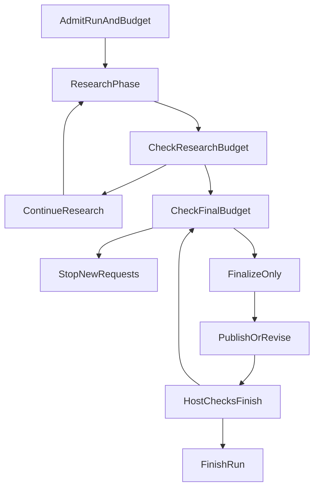

# Agent 查了很多资料，为什么还是交不出答案？

最近做投资研究 Agent，最让我挫败的，并不是模型完全不会调用工具。恰恰相反，搜索在进行，页面也读了，运行记录里有不少动作，但用户要的答案还是没有顺利交出来。

围绕同一条研究用例，我们在不同版本上做了多轮诊断。停下来的理由不断变化：模型服务不可用、搜索额度耗尽、资料入口失效、发布被拒绝。有些运行往前走了一步，交出了部分内容，却仍然没能正常完成。

单看某一次，都像是补一个判断、放宽一个参数就能解决的小问题。放在一起看，问题就严重得多：**系统给模型的工作条件并不总是一致，而错误报告还会把排查带向错误的地方。**

这次复盘从几次具体失败开始：有的运行耗尽本地额度，却被报成模型服务故障；有的任务走到收尾，却没有剩余空间交付答案。修复时，我们重新划分了运行时约束及其错误归属。

## 一道研究题，暴露了几种完全不同的失败

这里的 Agent 负责读取资料、形成研究回答。模型决定下一步查什么、怎样组织结论；宿主运行时负责执行工具、记录结果、校验候选答案，以及结束运行。

下面这些现象来自 2026 年 9 月 25—26 日的开发诊断，不是生产事故统计，也不是同一个版本连续重跑得到的成功率。

### 第一次误导：明明是本地额度用完，却报模型服务不可用

早期一次诊断的最终标签是 `PROVIDER_UNAVAILABLE`。顺着这个名字排查，自然会想到供应商故障、网络问题、上游限流，甚至怀疑是不是应该换模型。

但记录最后指向了另一件事：达到上限的是我们自己的诊断代理。它放行了已批准数量的请求，随后拒绝继续转发；这个本地额度错误，却被沿调用链归进了供应商相关的失败。

后来补的回归测试，也重现了分类问题：带本地限额标记的 HTTP 429 被当成 `rate-limit`，被标记为可重试，还落进了传输瞬时故障分类。

HTTP 状态码在这里不够用。同样是 429，上游真的限流，和本地已经花完本次运行的额度，处理方向不一样。前者可能适合有界等待；后者并不会因为再等一会儿，就自动多出一次合法调用。

如果继续沿着错误标签加重试，排查就可能越走越偏。我们需要先弄清楚是谁拒绝了请求，而不是让所有层都对着“模型服务不可用”做补救。

这条链路还暴露了另一个计数问题：进入研究前，用来理解和路由用户问题的模型请求，也属于总额度。运行时和诊断代理对这次入口调用的口径没有对齐，就会出现一边以为还能调用，另一边已经不再放行的情况。

这时再笼统地说“模型调用次数不够”，会漏掉更重要的问题：两个模块说的根本不是同一笔预算。

### 第二次矛盾：搜索刚给了一个结果，读取时却说它无效

我们的网页读取不是让模型随意提交一个网址。搜索返回结果后，宿主会登记一个属于当前运行的结果句柄，模型再拿这个句柄请求正文。它相当于宿主发出的一个受控资料入口。

有一次诊断里，模型确实拿了此前收到的句柄去读，却得到 `INVALID_SOURCE`。不能简单把这种情况解释成模型编造了 ID：安全记录确认，被拒绝的句柄之前已经出现在返回给模型、并被后续请求消费的搜索结果里。

回到当时的代码快照，我们看到下面这组不匹配。图中配置与运行数字只属于那次历史样本：

| 检查对象 | 当时的记录 | 暴露的问题 |
| --- | --- | --- |
| Web 运行期限与句柄寿命 | 运行允许 90 秒，句柄独立有效期为 60 秒 | 研究仍获准继续时，较早的资料入口可能先过期 |
| 搜索规模与登记容量 | 最多 12 次搜索，每次最多 10 个结果；注册表只能容纳 50 个句柄 | 上层允许产生最多 120 个结果，下层却未必能登记 |
| 登记失败后的返回方式 | 搜索返回结果时没有正确处理注册失败 | 返回给模型的入口不一定已经登记成功 |
| 那次运行的结果 | 12 次应用请求；4 次读取中，2 次可用、2 次 `INVALID_SOURCE`；没有接受任何发布 | 请求已经发生，但没有形成被接受的答案 |

这不是把几个不相关的常量放进同一张表。运行期限、结果数量和句柄生命周期，本来就在描述同一次研究，只是分别由不同模块维护。

必须保留一个限制：现有安全记录无法区分那两个句柄究竟分别因过期还是容量拒绝而失效。后续离线测试重现了这两类缺陷，也重现了注册失败仍被返回的问题；但不能反过来把每一次真实读取失败都归到同一个原因。

同一次运行的发布还出现了另一项问题：候选引用没有对应上成功读取返回的证据 ID。因此，登记缺陷说明了取证链路的矛盾，却不能单独解释整次运行为什么没有交付。

即便如此，问题的严重性已经很明确。模型花了一轮获得资料入口，下一轮围绕它组织读取，宿主却不再承认这个入口。随后模型还要处理拒绝、寻找替代资料，或者收缩回答。额外工作会继续占用剩余资源，却没有补上原本缺少的正文。

对这一类问题，多写一句“请优先阅读官方来源”并不能修复什么。模型需要的是一个仍然有效的入口，不是更强烈的阅读要求。

### 第三次受阻：已经进入收尾，却没有修正答案的机会

还有一种失败离交付更近。

早期实现并非完全没考虑收尾。当时已经留了一次模型请求，用于最后整理和发布。但一次诊断中，模型把这次机会用来提出发布，宿主没有接受；之后，运行里没有第二次修正机会，也没有把收尾耗尽报告成明确的专用终态原因。

这里的“发布”，是把候选答案交给服务端校验并提交，不是模型在文本里说一句“研究完成”。例如引用绑定不成立，候选内容就可能被拒绝。

不过，那一次发布究竟被哪条校验挡住，后来已经无法追溯：诊断程序过滤了具体拒绝码，隔离数据库又被清理了。我们知道发布没有被接受，却不能补写一个具体原因，假装整条因果链已经查清。

这个问题比“预算设小了”更具体：**我们给成功路径留了收尾机会，却没有给一次可修正的发布失败留下余地。**

此前发出的请求、工具调用和候选内容的生成已经产生了工作量，但要将这些工作转成被接受的回答，还需要一次交互。它同样要消耗请求、时间和输出容量，不会因为叫“收尾”就免费。

走到发布环节，并不意味着研究质量已经足够。这里暴露的是一个更具体的限制：系统到了需要修正候选输出的位置，却没有足够的机制继续处理。

## 为什么不能继续只改一个数字

这些问题不是同一次运行里的固定流水线，而是在多轮诊断中分别暴露的。它们也不全是 Runtime 的错：后续记录确实还有模型响应流中断等问题，不能为了讲一个整齐的故事，把所有失败都归到预算。

但它们让我们看清了一件事：只盯着最后的错误码调参数，无法知道自己究竟修好了什么。

这轮工作里，我们确实调整过部分额度和期限。容量不够时，合理放宽是必要手段。问题在于，放宽上层搜索规模，不会自动扩充下层登记容量；延长运行时间，不会自动延长句柄寿命；允许更多探索，也不会自动给发布修正留下空间。

原来那些局部规则，单独看都有理由。限制搜索是为了控制外部调用，限制注册表是为了约束内存，限制句柄寿命是为了控制有效期。缺少的是组合之后的检查：这些规则放在一起，究竟允许 Agent 完成怎样的一段工作？

因此，这次治理的目标没有定成“统一调大上限”，也没有另建一套庞大的预算平台。我们先要求每一项限制回答清楚：谁定义它，计算什么，在哪个范围扣减，耗尽后停止什么，以及如何向下一层解释。

## 先让每项限制有明确的归属

代码层面的第一步，是把约束从循环里的裸数字，变成带身份的定义。以取样版本的收尾预留为例：

```json
{
  "id": "research-runtime/finalization-request-reserve",
  "owner": "research-runtime",
  "version": "research-runtime-policy@3",
  "unit": "requests",
  "defaultValue": 2,
  "hardMaximum": 2
}
```

这个值是该版本的选择，不是通用最佳实践。真正重要的是它能回答几个过去容易含混的问题。

它计量的是请求，不是 token，也不是工具动作。修改它归研究运行时负责。默认值与硬上限分别表达默认选择和不可越过的边界，数值暂时相等，也不应该把两种含义合并。

其他约束继续留在各自的模块。搜索与共享 Web 用量归 Web 网关；网页分片归读取模块；研究运行时引用这些定义，不再另抄一套数值。组合入口检查参与声明的约束，同一 ID 的归属、版本、单位或数值冲突时，拒绝继续构建。这个检查针对显式声明，不会神奇地发现全仓所有硬编码。

运行采用的额度，也不能由模型自己提议扩大。服务端配置、模型传输能力、已授权范围、剩余用量和当前阶段，共同构成约束依据；普通用户文本或工具返回内容没有修改这些事实的权限。部分非法配置会直接被拒绝，不能把整个机制理解成一个到处调用 `Math.min` 的工具函数。

统一归属的价值，在下次修改时才会显现：改搜索规模，需要检查结果登记能力；改运行期限，需要检查句柄、单次调用和外层期限。修改者不必猜还有哪份同名常量，但仍必须检查不同约束之间的关系。

## 搜索不能再用了，不等于所有工作都不能做

接下来处理的，是额度耗尽如何影响模型下一轮拿到的工具。

回归测试曾经重现过这样的问题：宿主记录里的读取余额已经归零，或者一批搜索调用结算后搜索额度已经耗尽，下一轮仍然向模型提供搜索工具。于是“工具可见”和“实际可执行”之间出现了落差。

调整之后，下一轮工具合同根据宿主掌握的事实收缩。只耗尽搜索次数，就移除新的搜索；读取仍要看自己的额度、权限和期限。Web 总期限到了，则停掉新的网页搜索与读取。进入只收尾阶段后，也不再提供新的取证动作和能力申请。

下面用一个教学示例表达输入到工具投影的关系。它不是生产接口，假设读取仍获准、结果句柄有效，且其他预算尚允许；只列相关工具：

```json
{
  "input": {
    "phase": "research",
    "searchCallBudgetExhausted": true,
    "runDeadlineExhausted": false
  },
  "projection": {
    "removedTools": ["search_public_sources"],
    "retainedTools": [
      "read_public_source",
      "publish_answer",
      "finish_research"
    ]
  }
}
```

下一步读哪个结果、是否已有足够资料、怎样解释缺口，仍然由模型判断。运行时只处理已经确定的事实：某种调用的额度用完了，不能再发起这种调用。模型看到的工具集合，也不能取代执行时的宿主校验。

资料入口的问题则在另一层修正：登记寿命与有效 Web 期限对齐，容量覆盖获准搜索规模，注册失败的句柄不再作为可用结果返回。遇到部分注册失败，保留已成功登记的结果并说明覆盖不完整，而不是清空所有结果或返回虚假的可用入口。

这样做保留了局部失败之后继续工作的可能。它没有承诺网页一定读得成功，但至少不能因为一个入口从未登记好，就把后续修复工作丢给模型。

## 收尾要在开始时预算，而且要允许受控修正

工具按局部额度收缩之后，还需要解决整个研究的资源分配。

一次运行在准入时，也就是宿主决定允许它开始时，就从总请求预算中划出收尾预留。探索可用的部分是：

```text
探索请求额度 = 已批准的总请求额度 - 收尾预留
```

入口调用计入总账，后续请求也继续从原有账本扣减。收尾份额没有增加总额，更不是在最后开一个“紧急通道”。它只是不能被正常探索提前用掉。预留超过自身硬上限或本次总额，也不能进入运行。

研究额度或工作期限不再允许继续时，如果预留和硬期限仍允许，运行转入只收尾阶段。模型可以根据已有材料提出发布，在有界范围内修正被拒绝的提议，或者提出结束；不能再用这部分资源开启下一轮资料搜索。

下图只展示预算导致的阶段切换，省略正常研究中的提前完成。授权撤销、取消和不可恢复错误等仍按各自规则处理，不会被送进免费的收尾流程。



**关系或判断条件：**

- **CheckResearchBudget → ContinueResearch**：是。
- **CheckResearchBudget → CheckFinalBudget**：否。
- **CheckFinalBudget → StopNewRequests**：否。
- **CheckFinalBudget → FinalizeOnly**：是。
- **HostChecksFinish → FinishRun**：是。
- **HostChecksFinish → CheckFinalBudget**：否。

这里必须同时考虑次数和时间。内层还留着一次请求，外层期限却已经耗尽，预留就无法发挥作用；输入容量不允许，最后一次调用同样不能发出。这也是为什么验证要检查外层期限与恢复路径，不能只对着内部循环测一个计数器。

对早期只有一次收尾机会的问题，后续版本给一次发布拒绝留下了有界修正空间。但这会压缩探索份额，并不是没有代价。任务究竟该留多少，还需要结合模型行为和诊断样本继续判断。

更重要的是，不能为了用完预留后得到一个漂亮终态，就自动把“有内容”认定为“已完成”。未满足的发布校验仍然有效；结束提议也要经过宿主检查。已经合法提交的内容可以按规则保留，未完成部分则继续如实表达。

## 恢复不能重新发预算，重试也不能绕开原账

如果只处理正常执行，这套机制仍然不完整。运行可能中断、重启，还可能遇到部署后的新配置。

我们把两类事实分开：准入快照说明这次运行当时获准使用什么约束，持久化账本说明实际已经消耗了多少。快照不是第二份余额，也不能因为恢复时读到了更大的部署配置，就扩大旧运行的额度。

举一个纯教学例子：旧运行获准十次请求，已经消耗八次，部署后新任务默认可以用二十次。旧任务恢复时，不能直接切换到新默认值，更不能重新获得一份完整预算。

这里也有实现边界。规范要求保留原限制或收窄；当前恢复适配器对总预算、动作预算、协议等关键合同采取一致性检查，不匹配就拒绝恢复。它不是能自动兼容任意配置变化的迁移系统。

另一种绕开总账的风险来自重试。设计要求同一类可重试失败有明确的负责层，后备尝试仍消耗原有额度，并服从原期限。不能让 SDK、网关和 Runtime 都对同一失败再试一轮，然后各自在自己的日志里说“只重试了一次”。这是要防止的组合风险，不是说本次已经观测到三层重试同时发生。

输入容量采用类似思路：先缩减发给模型的视图，保留当前用户原文和工具调用、结果的配对，不删除持久化事实；投影后仍超限就在派发前拒绝。字节预检与模型 token 计量不同，不能用输入字节变少来宣称费用已经下降。

## 改完之后，答案就一定能交出来了吗？

没有。最能说明边界的，恰恰是后续仍然没有全过的记录。

一次对齐入口计数后的诊断，应用请求没有再被本地代理上限挡住，搜索耗尽后的工具收缩也在起作用。但两次收尾请求分别用于被拒绝的发布和随后被接受的修正，结束前没有提出 `finish_research`，最终仍是部分完成。

这不是一个应该藏掉的反例。它说明“给修正留了机会”和“整个任务一定结束”之间，还隔着模型如何使用这部分机会。至少在那个样本里，预留没有同时覆盖发布修正和后续结束提议。

再往后的一个样本，第一份发布提议就被接受，记录能够把后续模型请求消费过的读取结果与持久化发布关联起来，投递也完成了。但运行仍报告 `PARTIAL_RESULT`；负责评价答案的 Reviewer 又因为输出被截断，无法形成完整判断，结果是 `inconclusive`，不是质量通过，也不能当成质量不合格。

这是多项修正叠加后的观察，不能据此单独证明某一个限额、提示词或代码改动提升了成功率。它能说明的范围更窄：某次读取确实进入后续请求，某份内容确实被接受并投递，而答案质量还没有完成验证。

更扎实的变化，来自针对具体失败补上的回归：本地额度拒绝保留独立分类；耗尽的搜索不再继续出现在下一轮合同；有效窗口内的句柄和注册失败处理有了专门检查；请求耗尽与恢复不清零已消耗用量，仍合法的提交结果不被后续软限制抹掉。

例如，本地代理拒绝现在保留为 `PROVIDER_CALL_BUDGET_EXCEEDED`，分类为 `local_budget_exhausted`。回归检查的不只是换了一个错误名字，还包括它不再被当成上游限流去重试或进入冷却处理。

这比简单写一句“测试全绿”更接近这轮工作的结果。我们修正了一些真实的执行矛盾，也能把部分失败归到更准确的位置，但没有把剩下的问题一并解决。

### 这次能确认的变化

历史诊断显示，本地额度拒绝的归属、耗尽工具的可见性和收尾修正机会都曾出现实际矛盾，其中一些已沿原调用链修正。仍未完成的研究和 Reviewer 判断则保留原状态；单凭这些修复，无法估算整题成功率、费用或时延改善。

<!-- open-etf-case:budget@e442f600891be79625fc78751e2d9f39905920da -->
### 让第二次模型请求在根预算处停下

固定公开快照的[根预算拒绝用例](https://github.com/hpoenixf/open-etf-agent/blob/e442f600891be79625fc78751e2d9f39905920da/test/cooperation-integration.test.mjs)把“额度属于实际调用链”缩成一个明确反例。

在所链固定快照按 README 安装依赖后，运行：

```bash
node --test --test-concurrency=1 --test-name-pattern='^3\.3 root budget refusal stops before a second model request$' test/cooperation-integration.test.mjs
```

模型额度设为 1，第一次请求提出并完成一次读取；第二次请求必须在发出前被拒绝。测试要求实际模型调用仍为 1，Run 返回 `ROOT_BUDGET_EXHAUSTED`，根用量保持 `{ model: 1, tool: 1 }`。

被测 Run 的 `failed` 是这里预期的保护结果，测试通过不表示研究完成。这个切片不包含全文的收尾修正预留、多层约束治理或任务质量评估。
<!-- /open-etf-case -->

## 下次再设计 Agent，我会先检查什么

这次最值得留下的，不是那几个后来采用的上限值。

首先，我会把每一项限制放回实际调用链看。搜索次数对应多少可能的结果，结果需要存活多久，模型在这个窗口里还有多少读取和整理机会。单个数值是否合法只是第一步，不同层允许的工作范围能不能接上，才谈得上整条流程可用。

其次，我会把最终交付当成正常工作负载。写答案、校验、修正、确认结束都有成本。将它们安排在探索之后，不代表可以只分配探索剩下的资源。预留应当覆盖什么，需要用失败样本来校正，而不是凭感觉认定“最后一次应该够了”。

同时，我会继续区分能力限制和答案判断。搜索额度归零是宿主知道的事实；资料是否已足够、下一步最值得查什么，则是模型要处理的问题。把前者做好，不意味着应该再加一套关键词规则，强迫模型按我们预设的研究步骤走。

对简单系统，也没有必要一开始就复制完整的约束目录、快照和恢复机制。先把实际存在的计数和错误来源说清楚；当多个模块开始解释同一件事，或者一次运行必须跨重启继续，才需要把这些关系固化。否则，治理本身又会变成新的复杂度。

以前看到 Agent 一直在调用工具、最后却没有答案，很容易只问：是不是模型不够好，是不是预算还不够大？

现在我会先多查一步：**这条任务从搜索、读取到提交和结束，究竟有没有一条资源安排一致、能够实际走完的路径？**

模型可能仍然走不好。但系统不应该一边允许它继续，一边让资料入口失效；也不应该拒绝了它的候选答案，却没有给已计划的修正留下资源，更不应该把本地拒绝写成供应商故障。
