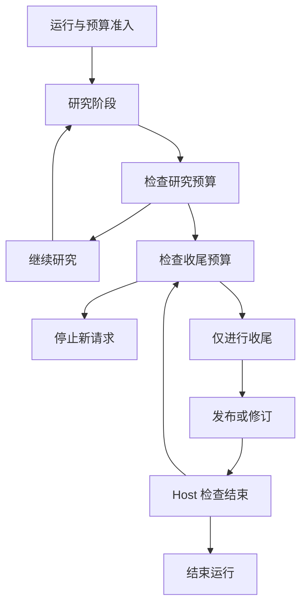

# Agent 查了很多资料，为什么还是交不出答案？

一个 Child 已经查完自己的额度，Main 还需要比较结果；一份答案已经提交，运行却没有确认结束；界面提示“收尾还剩两次”，真实请求总额却已归零。这些情况都不能只问“预算还有多少”，还要问：**谁的预算、什么单位、哪个阶段，以及下一次请求是否真的获准？**

ETF Agent 当前把问题拆成四件事：准入时固定政策与身份，执行时分别核算 Main/Child 的请求，按共享限制收缩能力，最后沿原记录交付或结算。预算提供可走的工作路径，不替模型判断证据是否充分，也不替发布模块宣布正文成功。

<span id="为什么不能继续只改一个数字"></span>

## 1. 同一任务的原账本，不等于所有 Agent 共用一个余额

先分清资源的单位与归属。

| 资源 | 当前主要归属 | 它不能替代什么 |
| --- | --- | --- |
| Main 模型请求与逻辑轮次 | Main 自己的准入和消费记录，包含 Entry 所属请求 | Child 的独立请求余量、供应商 Token 或费用 |
| Child 模型请求与 retry | 每个已提交执行身份自己的额度 | 其他 Child 或 Main 的未用额度 |
| 时间、工具动作、Stop 与生命周期 | 原 Root 及原负责模块 | 独立 Child 额度不能取消这些共同边界 |
| Task、Provider 或诊断器的真实外部总帽 | 其原负责模块，与本地可用量取交集 | 本地显示还有次数不能突破外层限制 |
| 来源句柄、登记容量与输入大小 | 各原工具或传输模块 | 有模型额度不代表资料入口仍有效或请求放得下 |

这里的请求额度计的是 request-admission 单位，不是供应商 Token、真实费用或观测平台里的 span 数。已经准入但尚不能证明发送结果的请求，也可能继续占用额度；后文的 unknown 规则正是为此保留。

这是一项具体取舍。早期共享请求池容易给整题设总量，却允许 Child 的累计探索挤占 Main 的综合机会。当前 fresh admission 明确选择 `independent-execution-budget@3`：Main 与每个 Child 分账，Root 继续观察总消费并管理共享约束。实现仍复用原持久账本和准入事务，没有给每个 Agent 新建一套互不相认的账。

取材代码的 `research-runtime-policy@11` 默认如下；它们是当前实现的政策值，不是通用建议，也不证明某个部署正在采用默认配置：

| 执行者 | 默认逻辑轮次 | 默认模型请求准入额度 |
| --- | --- | --- |
| Main | 30 研究 + 6 收尾 | 基线 57，包含 Entry、阶段 retry、协议修复与保护预留 |
| 每个 Child | 18 研究 + 6 收尾 | 30，包含本执行的 6 次 retry |

同一 Root 最多累计提交 5 个 Child 身份，不是取消一个就无限循环补一个槽位。每个新提交的 Child 给 Main 原基线上增加一轮和一次请求，最多增加 5；这也是普通可消费额度，并不保证一直保留到 Child 回来。独立请求池扩大了理论总调用空间，因此共享时间和真实外部总帽仍可能更早终止任务。

老 Run 不会因恢复而自动获得这份新政策。没有独立政策的历史记录继续按 legacy 共享池解释；已有独立政策的旧版本也保留自己的含义。把“沿原账本扣减”写成“所有执行一直共享同一余额”，会掩盖今天最重要的分工。

还有一个需要公开说明的取材差异：当前代码的默认 active/wall 窗口为 60/120 分钟，约束 Spec 的一处场景仍写 active 15 分钟。本文按当前代码解释，不把这处文档滞后当作新代码缺陷，也不借此推断实际部署时长；真正任务仍受其原准入值与更窄限制约束。

<span id="第一次误导-明明是本地额度用完-却报模型服务不可用"></span>
<span id="搜索不能再用了-不等于所有工作都不能做"></span>

## 2. 工具收缩应当局部发生，不能把一种耗尽扩成全部失效

每次装配下一轮工具面，输入都来自 Host 已知事实：原 grant、当前 phase、本执行余额、共享动作与时间，以及相关工具的结果身份。**工具可见只是投影，不是已经锁定下一份额度。** 多个执行可能竞争最后一单位，真正派发仍须由原准入事务核对。

- 只耗尽搜索次数，就停止新搜索；此前结果的读取还要看自己的动作、句柄与期限。
- 共享 read/action 用完，不能把同一动作改名为“本地”或“收尾”来绕过。
- Main 进入只收尾后，不再开启外部探索、新 Child、范围申请或 Deep 升档；原已获准的本地计算／导出，只有在剩余 action、request 与时间允许时才可继续。
- Child 的收尾面以自己的交接为主，不自动取得 Main 的发布能力。Child 局部请求耗尽也不等于 Root 完成，但 Root Stop、硬期限或终态仍约束全部后代。

下面保留一个只展示局部关系的教学例子。工具名与字段是示意，不是当前 wire schema；假设原读取仍获准、句柄有效，且其他资源充足：

```json
{
  "input": {
    "phase": "research",
    "searchCallBudgetExhausted": true,
    "runDeadlineExhausted": false
  },
  "projection": {
    "removedTools": ["search_public_sources"],
    "retainedTools": [
      "read_public_source",
      "publish_answer",
      "finish_research"
    ]
  }
}
```

模型仍然决定下一步读什么、是否足够、如何解释缺口。Runtime 只落实已知边界，不根据关键词替模型编研究计划。

错误归属也要同样精确。原诊断中，本地代理用完额度后返回带本地标记的 HTTP 429，却被误归为可重试的供应商限流。当前该类拒绝保留 `PROVIDER_CALL_BUDGET_EXCEEDED` / `local_budget_exhausted`，不靠等待、冷却或换供应商产生新额度。同样一个 429，谁拒绝、拒绝什么，决定了下一步是否还有合法重试。

<span id="收尾要在开始时预算-而且要允许受控修正"></span>

## 3. 收尾是一份受保护的工作量，不是一张成功券

收尾需要写答案、修正被拒提议、提交与确认结束。当前政策在开始时保护资源，不能等探索结束才把“剩下的一点”当收尾。

只看 Main 自己的一层请求扣除，可以用这个关系理解：

```text
探索请求额度 = 已批准的总请求额度 - 收尾预留
```

实际可用量还须结合阶段剩余、已占用／未知请求、时间和外部总帽判断。保护预留从原总额中划出，不是最后免费追加的“紧急通道”。工作不再获准继续但输出容量仍合法时，阶段可进入 `finalization-only`；一旦进入，就不能因为后来看到较大额度再回到探索。取消、硬期限和不安全继续也不自动获得收尾机会。

下图只表达 Main 的预算阶段转换，省略正常提前结束与 Child 分支：



**关系或判断条件：**

- **CheckResearchBudget → ContinueResearch**：是。
- **CheckResearchBudget → CheckFinalBudget**：否。
- **CheckFinalBudget → StopNewRequests**：否。
- **CheckFinalBudget → FinalizeOnly**：是。
- **HostChecksFinish → FinishRun**：是。
- **HostChecksFinish → CheckFinalBudget**：否。

这里最容易混淆的是三种“剩余”。2026 年 10 月的两份历史样本，一份已用满物理 42/42，却仍提示收尾预留余 2；另一份是 38/42，但收尾阶段已经用满 3/3。前者没有物理容量，后者没有阶段容量。第二份最后一次发布响应之前看似“总量还剩 4”，也不意味着发布以后还有一次 Main 机会。两条记录不能合并成相同根因，提示修正的受控检查也不证明模型以后一定会提出结束。

当前还明确区分**逻辑 turn 与真实请求**：Main 已封存的提议／回执证明调用了 `send_answer_part` 时，该轮不消耗逻辑 turn 配额，接受、拒绝、失败或 unknown 都不改变这项豁免；实际请求和时间仍然计入。没有精确调用证据就不能享受豁免；尚未封存的未知请求仍占原额度，不能提前当作免费发布回合。这让发布不被误算成又一轮探索，却不会让反复发布获得无限免费调用。

所以，存在正文、正文被接受、Run 正常结束，以及答案质量合格，仍是不同结果。没有合法新请求时，不再额外调用一次模型解释“额度已耗尽”；独立合法的已有正文则沿原 Publication/History 路径保留。

<span id="恢复不能重新发预算-重试也不能绕开原账"></span>

## 4. 唤醒沿原政策继续；重启、取消与 unknown 都不产生退款

**准入快照**保存当时的政策、单位、身份和账本绑定；**持久消费记录**保存已用、保护中与未决占用。快照不是另一份可重置余额。

一个教学例子：旧任务获准十次请求、已经消耗八次，新部署把新任务默认改成二十次。读回旧任务时仍解释原十次合同及原消费，既不换成二十，也不因新默认更小就覆盖原记录。当前实际可用量仍可能受适用的更窄 Host 上限约束，不能把保留快照解释成豁免外部限制。

这里的“恢复”也有范围：普通 abandoned Root 重连当前只结算中断并读回已有结果，不任意恢复旧执行图；真正已接受的 Human/Child control wake，才可沿原 Run、checkpoint、grant 和 fence 接续。显式后续继续可以创建新 Run，但须自己准入，不是给旧 Run 免费续额。当前适配器读取原 budget，并校验协议／执行图身份，不再用当天 Factory 的总额度默认值替换它。

未知发送尤其不能靠推测结算。超时、取消、lease 到期或进程重启，都不证明请求没有发出。只有原 owner 证明 `not-dispatched`，并排除旧执行者继续发送，才能按那本账自己的规则释放；Task 的某项 hold 可释放，也不代表 Root 的保守请求扣账自动退回。已结算回执的重放则不再派发、不再扣一次。

这不是抽象风险。2026 年 10 月的一次诊断只允许四次真实运输，Runtime 却以为还有 38 次；第五次本地拒绝发生在共享准入取得 lease 之后，留下了 unknown。总授权仍有余量不能抹掉这个未决事实。后续额度查询和客户端计时的修改没有再次付费确认，不能把它们合称为整条真实链路已经验证。

重试同样要有明确负责层，并从原请求与期限扣减。SDK、Gateway 和 Runtime 各自“只重试一次”，组合起来仍可能超过预计。这是要防止的设计风险，不是声称历史里已观测到三层同时重试。输入拟合也只缩减发给模型的视图，保留当前用户原文、工具配对与持久事实；仍放不下就在派发前拒绝，不能把字节减少说成已测得费用下降。

<span id="一道研究题-暴露了几种完全不同的失败"></span>
<span id="第二次矛盾-搜索刚给了一个结果-读取时却说它无效"></span>
<span id="第三次受阻-已经进入收尾-却没有修正答案的机会"></span>
<span id="先让每项限制有明确的归属"></span>
<span id="改完之后-答案就一定能交出来了吗"></span>

## 5. 为什么局部上限必须一起检查：保留三个真实反例

以下 2026 年 9 月 25—26 日开发诊断来自不同版本，不是生产事故统计，也不是同版重复试验的成功率。它们解释的是选择理由，不承担当前默认配置的角色。

**资料入口必须活得过合法的使用窗口。** 某次搜索返回的句柄已真正进入后继请求，读取却返回 `INVALID_SOURCE`，不能直接怪模型编造身份。当时的组合是：

| 检查对象 | 当时的记录 | 暴露的问题 |
| --- | --- | --- |
| Web 运行期限与句柄寿命 | 运行允许 90 秒，句柄独立有效期为 60 秒 | 研究仍获准继续时，较早的资料入口可能先过期 |
| 搜索规模与登记容量 | 最多 12 次搜索，每次最多 10 个结果；注册表只能容纳 50 个句柄 | 上层允许产生最多 120 个结果，下层却未必能登记 |
| 登记失败后的返回方式 | 搜索返回结果时没有正确处理注册失败 | 返回给模型的入口不一定已经登记成功 |
| 那次运行的结果 | 12 次应用请求；4 次读取中，2 次可用、2 次 `INVALID_SOURCE`；没有接受任何发布 | 请求已经发生，但没有形成被接受的答案 |

现有安全记录无法把那两次无效读取分别归因于过期或容量；离线能复现两类缺陷，不等于补齐了真实样本的逐次根因。该 Run 还另有引用未匹配成功读取证据 ID 的问题，句柄缺陷也不能独自解释整次未交付。可迁移的检查是：运行允许发现多少结果、入口能登记多少、需要存活多久、登记失败是否仍被当可用结果返回。部分失败应保留已登记结果并说明覆盖，不能把补救全留给模型。

**一次发布机会不一定够修正。** 早期只有一次收尾请求，候选被拒后没有第二次修正机会；诊断过滤了拒绝码、隔离库后来清理，具体拒绝原因已经未知。另一个后续样本用两次收尾完成 rejected→accepted，却没有再提出 `finish_research`，仍只部分完成。不能把第一个未知原因补写成引用错误，也不能从第二个样本推出“预留两次总能完成”。

**接受并投递，不等于质量通过。** 更后一次样本的首份发布被接受，记录能关联后继模型请求消费的读取材料和持久正文，投递也完成；Run 仍为 `PARTIAL_RESULT`，Reviewer 因输出截断得到 `inconclusive`。这既不是质量通过，也不是质量不合格。另有模型流中断的失败，不能为讲一个统一故事全部归到预算。

这些观察促使限制带上身份。下面是当时 `policy@3` 的历史声明，保留它是为了说明为什么版本、单位和归属必须一起存；数值 2 不是今天的默认：

```json
{
  "id": "research-runtime/finalization-request-reserve",
  "owner": "research-runtime",
  "version": "research-runtime-policy@3",
  "unit": "requests",
  "defaultValue": 2,
  "hardMaximum": 2
}
```

相同 ID 若声明了冲突的 owner、版本、单位或数值，组合入口拒绝继续；但显式声明检查不会自动找出全仓所有裸常量。搜索、网页分片和句柄仍归各自模块，Runtime 引用它们，而不是又抄一份“统一常量”。

## 6. 什么时候简单限次足够，什么时候需要这套分工？

| 方案 | 更合适的条件 | 需要接受的代价或补齐的部分 |
| --- | --- | --- |
| 单 Agent step limit + timeout | 短任务，不需要持久唤醒，多数步骤与调用关系简单 | 最轻，但步骤数仍不自动等于真实请求或费用 |
| 所有执行共享模型请求池 | 想给整题一个直观硬总量，Child 很少 | Child 探索会挤占 Main 综合机会，需要另行保护 |
| 各执行独立请求额度 + Root 共同约束 | 多 Child 并行，Main 必须保留综合和交付能力 | 总调用空间更大，需持久身份、旧政策解释及真正外层帽 |
| 持久工作流承载执行 | 长时间等待、跨进程协调与重试是主要需求 | 可承载应用政策，但仍需定义模型请求、turn、动作和发布的资源语义 |

[LangGraph 的 recursion limit](https://docs.langchain.com/oss/python/langgraph/graph-api#recursion-limit)约束图的 super-steps；并行节点可属于同一个 super-step，因此不能直接把这个数当实际模型调用数。[Temporal 的超时文档](https://docs.temporal.io/develop/typescript/workflows/timeouts)则区分 Execution、Run 和 Task 的时间边界。这些是可以利用的能力，不是与本文互斥的“弱方案”；应用仍需决定自己的资源单位和外部效果如何记账。

ETF Agent 选择在既有 Root 事务中保存执行身份与分别扣账，是为了保留原发布、工具和恢复接口，同时减轻 Child 对 Main 的挤占。代价是政策版本和未决占用更复杂，unknown 可能保守地挡住后续工作。这些成本只有在多执行、持续任务或明确外部总帽确实存在时才值得承担。

## 7. 一个可以运行的公开反例

<!-- open-etf-case:budget@e1b8e4edde724548fab16d8ca4b205379bfa7f30 -->
### 让第二次模型请求在根预算处停下

固定公开快照的[根预算拒绝用例](https://github.com/hpoenixf/open-etf-agent/blob/e1b8e4edde724548fab16d8ca4b205379bfa7f30/test/cooperation-integration.test.mjs)把“额度属于实际调用链”缩成一个明确反例。

在所链固定快照按 README 安装依赖后，运行：

```bash
node --test --test-concurrency=1 --test-name-pattern='^3\.3 root budget refusal stops before a second model request$' test/cooperation-integration.test.mjs
```

模型额度设为 1，第一次请求提出并完成一次读取；第二次请求必须在发出前被拒绝。测试要求实际模型调用仍为 1，Run 返回 `ROOT_BUDGET_EXHAUSTED`，根用量保持 `{ model: 1, tool: 1 }`。

被测 Run 的 `failed` 是这里预期的保护结果，测试通过不表示研究完成。这个切片不包含全文的收尾修正预留、多层约束治理或任务质量评估。
<!-- /open-etf-case -->

<span id="这次能确认的变化"></span>
<span id="下次再设计-agent-我会先检查什么"></span>

## 8. 用什么证据判断这套设计是否值得？

当前独立 Child 分账和交接已有原 provider-free、隔离 PostgreSQL及受限定跨进程接缝证据。五个 Child 的材料到达 Main 后继请求，只证明收到，不证明模型已语义采用；正式关闭也不等于部署、真实质量或成本比较完成。本文读核现行代码与既有记录，没有重新跑模型或将阶段结果改写成新的全链路验收。

更有价值的验证要分别看：Child 的局部耗尽是否保留 Main 合法机会，错误是否归到真正拒绝的 owner，最后一次响应是否还需要结束动作，unknown 是否仍留在原账，以及用户最终收到的正文支持了哪些主张。成功率、费用与时延必须在同题、同资料、同预算口径下另行比较。

**预算设计的目标不是保证模型走好，而是给它一条资源含义一致、能交付也能诚实停下的路径。**
