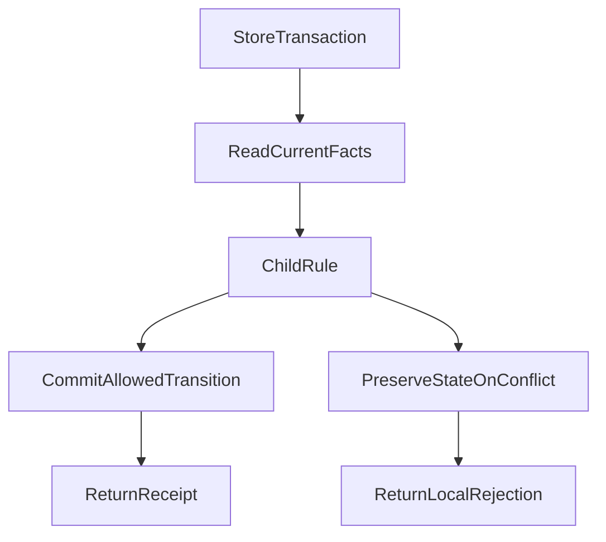

# 一个 Subagent 改动，为什么拖住了我们整整一天？

*一次 Agent Runtime 重构的真实代价，以及我们对职责与历史兼容的重新思考*

> 本篇讲这一天怎样被消耗掉，以及问题如何收拢。配套文章[《Agent 架构如何做到该稳定的稳定，该变化的变化？》](agent-differentiated-evolution-contracts.md)进一步讨论：职责分清之后，不同能力应该承担怎样的演进契约。两篇可以独立阅读。

## 一、本来要改进 Subagent，最后却在修 Runtime

2026 年 10 月 25 日，我们原本准备继续完善投研 Agent 的 Subagent 能力。Subagent 就是主 Agent 分派出去的子任务：有的查资料，有的计算，有的从另一种投资视角检查结论。

系统已经在推进专家协作、人工追问、持久化恢复和研究成果交付。接下来，本应让这些能力更好地配合，让复杂基金研究能够完成分工、汇总与交付。

但维护过程中，一个问题反复出现：**明明只是在修改子任务，为什么总要跟着修改 Memory、Recovery，甚至 PostgreSQL？**

最近两次提交就提供了具体证据。当天 08:07 的一次修复，同时修改了恢复编解码、内存存储和 PostgreSQL 存储。09:46 的后续提交再次触及这三个位置，还涉及 Main 请求与 Child 执行逻辑。本文时间统一为北京时间。

多处修改本身未必是问题。新增一种真正需要保存的事实，当然可能同时影响执行与存储。值得警惕的是：**没有新增持久化事实，只改一条业务规则，也需要几个模块分别修改同义条件。**

### 代码规模只是报警器，不是判决书

当时的静态评审记录了这些数据：

| 检查对象 | 当时的规模 |
| --- | ---: |
| Research Runtime 的 TypeScript 文件 | 130 个 |
| Runtime 物理行数，包含空行与注释 | 57,786 行 |
| 单个 Recovery Codec | 5,247 行 |
| Recovery Store 直接方法 | 75 个，另有继承接口 |

五千多行的文件不一定设计不好。如果它通过简单接口隐藏了必要复杂度，仍然可能是一个有价值的深模块。

但这个 Codec——本来应该主要处理状态编码与读取的模块——还参与子任务准入、研究者快照、请求规划、结果交接和部分终态规则。内存与数据库两种 Store，又各自编排了一些子任务和人工回复的条件。

另一边，共享 Run Context 汇集八组可变状态；不同模块收到整个对象后，可以读写彼此的内部字段。Factory 本来负责组装能力，却逐渐管理起用户 Memory 的缓存、等待、去重与使用记录。

**文件已经拆开，知识和决定权却仍然混在一起。**

## 二、真正惨痛的，是这一天怎样被消耗掉

我们决定先处理耦合，再继续增加相关子任务功能。真正开始之后，才发现“把几段代码移回正确位置”远不足以完成这项工作。

几个时间点可以概括当天的推进：

| 时间 | 发生了什么 | 对研发意味着什么 |
| --- | --- | --- |
| 08:07、09:46 | 两次相关提交反复触及编解码与两种存储 | 一条子任务规则已经牵动共同底座 |
| 12:31—12:37 | 固定当时版本，核对现有实现和测试 | 先证明自己在改哪一版，而不是直接搬代码 |
| 午后 | 划定 Runtime 与共享契约的协作范围 | 其他执行者转向独立工作，相关功能修改需要交接 |
| 17:34 | PostgreSQL 定向验证 6 个场景中 1 个失败 | 重新判断是生产回归，还是测试装配问题 |
| 17:55 | 修正测试辅助逻辑后，原 6 个场景全部通过 | 可以推进首批交付，但不代表完整重构完成 |
| 18:14 | 首批子任务／人工交互责任收口进入主干 | 只交付已核实的切片，剩余工作继续分开处理 |
| 23:38 | 夜间交接仍在明确次日继续开发的基线 | “能否继续做新功能”仍需专门协调 |

这不是一次线上停服，也不是整个仓库一天没有产出。独立研究、界面和文档工作仍在推进。被拖住的是原本希望继续演进的共享 Runtime 与 Subagent 开发主线。

### 1. 为了不互相覆盖，先限制并行修改

这轮重构同时涉及子任务交接、恢复存储、共享运行状态和用户记忆。而这些位置，也正是其他开发任务会碰到的地方。

午后的协作计划一度将整个 Research Runtime 及相关共享接口划给同一个负责方，另一个开发 Agent 转向独立的基金研究质量、账户配置和界面工作。需要修改共同底座时，先停止那部分改动，交出最小复现与接口需求。

这种安排有现实理由：同一份状态不能由几个执行者各改各的，再期待合并时自然正确。

但代价也很直接。**耦合不仅扩大了代码修改范围，还压缩了团队与多个 Agent 的并行开发空间。**

到了晚间，交接又明确收窄了这个限制：不能把“整项重构尚未关闭”变成新功能的总禁令。已稳定的接口可以继续使用；真正交叠的改动，按具体文件片段协调。

这也是复盘的一部分：保护共享代码是必要措施，但范围过大的协作禁区，同样会放大阻塞。

### 2. 想验证新结构，却先被旧测试入口挡住

一批 Child 测试还在使用旧的创建参数，例如 `type: "web"`，而新的创建入口已经改用 `agentId`。

旧字段并非处处失效：历史任务读取仍可能需要识别它。但“创建一个新子任务”和“读取一条旧记录”，已经是两个不同入口。

结果，一些测试在创建子任务的前置步骤就失败了，根本没有走到它们想验证的通知、恢复或交接行为。

处置记录提到，同一组选集中有 **33 个共有的 Fixture 前置症状**。Fixture 是测试准备输入和依赖的装配代码。这里不能写成“发现 33 个生产 Bug”，也不能说这 33 个场景都已经逐个完成修改前后的验证。

正确的修复是让测试加载当前真实的专家定义和任务绑定，保留原来的授权、幂等和并发断言。仅仅把字段换个名字，或者手写一个能通过校验的身份，都不够。

这笔时间没有直接改善研究结果，却必须花：不先恢复测试与真实入口的关系，后面的红灯与绿灯都很难解释。

### 3. 一个 1.5 秒限制，把验证重新拉回故障定位

17:34 的 PostgreSQL 验证，6 个场景通过了 5 个。失败的是：子任务请求仍在执行时，系统接收了用户回复。

面对这个结果，几种怀疑都很合理：是不是锁竞争？是不是回复丢失？是不是重构改变了任务结束条件？

继续看实际轨迹，发现测试辅助代码额外套了一条 **1.5 秒的整轮等待限制**。测试还没进入最终断言，这条限制先触发了。记录中子任务已经派发，相关请求没有记录执行失败，后续步骤尚未完成。

随后只修改测试辅助逻辑：去掉这条额外的短等待，直接等待真实执行 Promise；原来的阶段屏障、业务断言，以及每个 PostgreSQL 用例 **20 秒**的超时设置都保留。

生产代码、SQL 和数据库配置没有为这次修正而改变。重新执行原来的 6 个场景，结果全部通过；受影响的人工交互／Factory 离线文件，也有 9 个场景通过。

这组结果的价值，不是又增加了一串通过数字，而是把问题定位到了具体层次：**这次失败需要修的是测试装配，不是往 Runtime 再加一套等待或重试。**

如果只盯着红灯，我们很可能为了一个测试自己制造的限制，给生产系统增加永久复杂度。

### 4. 检查没有结论，分支又在继续变化

当天还有两次全量类型检查没能给出可用结论：一次没有保留完整退出结果，另一次退出码为 **137**，输出 `Killed`，没有编译诊断。

这只能说明检查未完成。记录不足以将原因直接归为内存不足，更不能把它说成类型通过，或已经发现生产错误。

后续我们改为核对受影响源码及其依赖的限定范围检查，保留未完成的全量检查边界，而不是反复尝试参数直到出现绿灯。

并行分支也在增加整合成本。固定快照比较中，完整 Runtime 重构与首批 Child／人工交互工作有 **18 个相同路径**；与轻量恢复工作有 **3 个相同路径**。

相同路径不等于已经发生 Git 冲突。前一个数字还包含“大分支原本就含有首批工作”的关系，不能相加成返工次数。

但它说明，直接依次合入整份旧分支会有覆盖风险。必须在最新集成基线上挑出剩余增量，保留前一批已经修好的行为。

**到这里，写代码只占工作的一部分。更多时间花在辨认当前事实、修复验证前提、核对消费者和安全整合上。**

## 三、这不是一个根因，而是三层问题叠在一起

把一天的阻塞全部归咎于“可靠性做太多”，并不准确。至少有三层问题需要分别处理。

第一层是职责耦合。子任务规则散落在 Codec 与不同 Store；Memory 的内部生命周期又漏进 Factory。它让局部变化不断扩散，需要通过责任收口解决。

第二层是历史兼容承诺。为了继续执行旧任务，运行时保留了旧工具协议和恢复匹配逻辑。当时新协议已经到 `@45`，仍需判断 `@39`、`@44` 等旧格式的哪些读取或执行路径应该保留。它需要产品取舍和消费者核对，而不只是搬代码。

第三层是验证与协作。过期的测试入口、额外等待限制、没有结论的检查以及重叠分支，使前两层问题更难快速交付。它需要修正装配、明确影响范围和分批整合。

它们相互放大，但不能混成一句“系统太复杂了”。更不能把权限、并发保护或真实请求对账当成可以一删了之的负担。

## 四、首批重构：同一条规则，只让一个地方解释

以人工回复与子任务阶段交接为例，我们把职责拆成四件事：人工交互模块确认回复是否被接受；Child 模块解释这份回复对任务交接意味着什么；Store 保证状态在正确事务中提交；Run 生命周期模块决定整项研究如何继续或结束。

这里的关键，不是先在外面算好结论，再进数据库写入。**读取当前事实、规划转换和提交，仍然必须处在原有事务与并发保护中。**

图中的两条结果分支由当前任务状态、回复身份和并发事实决定：允许时提交并返回真实回执；冲突时保持原状态，拒绝这次交接。局部拒绝不自动终止其他合法研究。

下面是机制示例，不是新增的生产接口：

| 输入事实 | 结构化判断 | 后续行为 |
| --- | --- | --- |
| 原任务仍可交接，回复身份与当前修订相符 | 允许转换 | 在原事务中提交一次 |
| 相同结果已提交 | 返回原回执 | 不再重复执行或记账 |
| 任务已取消，或回复／写入身份已经过期 | 拒绝这次效果 | 保持原状态，不复活旧任务 |

10 月 25 日合入的首批切片涉及 **6 个生产文件、5 个测试或辅助文件**。原 Codec 移除了 **145 行**相关逻辑，由 Child 和人工交互模块承接职责。新的领域代码也有所增加，因此不能把 145 行写成整个系统的净删行数。

首批证明的是这一段责任收拢与指定场景的行为。更广泛的恢复、旧读取器处置和整体重构，仍然需要继续完成。

真正的后续检验应当是：下次修改同一条交接规则时，在没有新增持久事实的前提下，是否还需要到两种 Store 和 Codec 分别修改同义条件？

## 五、另一个决定：哪些历史承诺可以退出？

职责收拢之后，旧格式是否继续支持，仍然要单独回答。

最初的重构设计明确允许退役没有当前消费者依赖的、尚未发布的旧开发格式。同时继续保护当前版本所承诺的恢复正确性、权限隔离、真实回执和已有正文。

后来，轻量恢复方案才进一步提出：对于普通研究，服务故障后是否可以明确中断，用户选择继续时，由一次新研究使用仍然合法的已保存成果，而不再重建全部旧执行现场？

这是两个不同决定。前者缩减旧开发版本兼容；后者调整普通研究的恢复承诺。后者不能被写成首批职责重构已经交付的成果。

而且，仍有人使用的读取器不能因为被命名为 legacy 就删除。已经接受的用户回复仍需唤醒任务时，要保留相应状态；没有明确结果的外部请求，也必须继续保留未知状态和原有对账身份。

我们需要退出的是没有必要的执行承诺，而不是把真实发生过的事情一起抹掉。

## 六、一天之后，留下了什么？

那天并非毫无产出。首批交接规则进入主干，部分运行状态私有化也在晚间形成独立交付；但到夜间，我们仍在协调“明天怎样继续开发子任务功能”。

对我们来说，这就是被卡住整整一天的具体含义：没有一次轰动的线上事故，却把本应投入新能力的时间，花在了底座治理、测试修复和并行协作上。

其中也有值得改进的执行方式。共享代码需要协调，但不能长期锁住整个目录；旧测试要分类处理，但不能用“过时”解释所有失败；复杂重构可以分批交付，不必等所有阶段关闭后才恢复其他研发。

这次之后，我会先问三个问题：**这条规则究竟由谁解释？这份兼容承诺现在还有谁需要？这次验证到底到达了哪个真实行为？**

这三个问题分别对应职责、产品承诺和证据，少一个都容易继续绕圈。

至于不同模块中的哪些内容应长期稳定，哪些应快速演进，那是下一步的架构问题。我们把它整理在[配套原则文章](agent-differentiated-evolution-contracts.md)中，不用这次故障把所有模块都判成“应该少做可靠性”。

**好的架构，既要让必要的复杂度有明确归属，也要让不再必要的历史机制能够退出。**

---

*工程范围：本文复盘 2026 年 10 月 25 日的开发事件。规模、提交与验证数字来自当时的工程记录；“一天”描述共享研发主线的受阻经历，不是精确工时或线上停机统计。定向测试属于特定版本，不证明整仓、真实模型质量或生产验收。后续进度不倒写为当天已经完成，维护效率改善尚未量化。*

## 2026-10-26 进度附记：职责在收口，整项尚未关闭

本文复盘的仍是 **10 月 25 日当天**的阻塞与证据，不把后续进展倒写成当日已完成。随后主干已合入 Run 级 Access/Exposure 首个纵向切片，Skill 会话状态收回 Access，Memory 的 Run-local 生命周期有其独立证据；10 月 26 日完成八组 Run 可变状态的实际写者/Owner 对账，原变更任务 **1.1、2.1、3.1、3.2** 已分别标记限定完成；Factory 内重复的 Memory Map/Set 与内部记账/摘要状态已由原 Memory Owner 接管或删除。

原任务 **1.2、1.3、2.2、4.1、E.1** 仍开放，涉及 Memory/PostgreSQL 恢复矩阵、Codec/Store 重复规则退役、剩余状态私有化及整个变更的正式关闭。此前局部检查不能代替整体代码/真实模型验收；维护成本是否减少，也尚无前后量化对照。最新状态见[架构图册的 10 月 26 日补记](/gallery#daily-status-20261026)。

## 延伸阅读

[Agent 架构如何做到该稳定的稳定，该变化的变化？](agent-differentiated-evolution-contracts.md)讨论这次重构引出的差异化演进契约；[测试也会过期](test-lifecycle-refactoring-retirement-and-spec.md)讨论有效保护与旧实现断言怎样分别处理。

本文收录于 [ETF Agent 工程手记](https://hpoenixf.github.io/eff-agent-article/articles/agent-runtime-refactor-one-day-blocked)。如果这些真实工程案例对你有帮助，欢迎在[公开文集仓库](https://github.com/hpoenixf/eff-agent-article)点一个 Star。

与本次职责收拢相对应的思考，可回到[核心原则 3：复杂度归属正确的 Owner](/principles#principle-3)。
