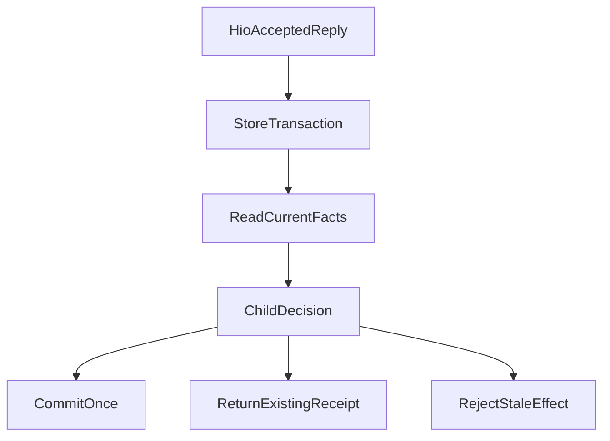

# 一个 Subagent 改动，为什么拖住了我们整整一天？

*一次 Agent Runtime 重构的真实经历：代码为何牵一发而动全身，我们后来又改掉了什么。*

2026 年 10 月 25 日，我们本来打算继续改进投研 Agent 的 Subagent（子代理）能力，让主 Agent 更好地把资料检索、计算和观点检查交给不同专家。

结果，工作很快偏离了原计划。

每次动到子任务的执行或交接规则，都可能需要跟着改 Memory、Recovery，甚至 PostgreSQL 存储。到了晚上，第一批修复虽然已经合入主干，团队却仍在讨论：**明天想继续开发 Subagent，到底能碰哪些代码？**

这不是线上停机，也不是其他工作整天停摆。被卡住的是共享 Runtime 和 Subagent 这条研发主线。真正麻烦的也不是某一个特别难的 Bug，而是**一条规则分散在太多地方，导致修改、验证和多人协作都要一起付出代价**。

## 一、改的是子任务，为什么总要碰存储？

当天 08:07 和 09:46 的两次相关提交，反复改到了同一批位置：恢复编解码、内存存储、PostgreSQL 存储，随后又牵涉 Main 请求和 Child 执行。

按理说，它们有不同分工。

子代理模块应该决定某项子任务能否继续、何时交接；恢复模块负责在进程重启后找回原来的状态；存储模块负责把这些状态可靠地写入和读取。新增一种需要持久化的事实时，它们共同改动很正常。可如果**只是改“这次交接是否合法”的判断，却要在几个地方同步修改同义条件**，那就不只是一次正常的跨模块协作。

问题恰好出在这里。

当时一个恢复编解码文件已有五千多行。文件大不是原罪，但它不仅处理历史状态的编解码，还涉及子任务准入、请求规划和结果交接。内存与 PostgreSQL 两套存储又分别保留了一部分判断。修改者需要同时理解这些实现，才能确认没有漏掉另一条路径。

相似的问题也出现在运行状态上：共享的 `ProductionRunContext` 装着多组可变数据，其他模块可以拿到整份对象；本来只负责装配能力的 Factory，还管理起用户 Memory 的缓存、等待、使用去重和摘要。

**代码已经按文件拆开，决定权却没有真正拆开。** 这比“文件太长”更值得修。

## 二、一天是怎么被耗掉的？

回看 10 月 25 日，几个时间点已经足以还原事情的走向（以下为北京时间）：

| 时间 | 实际发生的事 |
| --- | --- |
| 08:07、09:46 | 两次子任务相关修改反复碰到恢复编解码和两种存储 |
| 12:31—12:37 | 固定当前代码版本，重新核对真正的调用者与测试 |
| 午后 | 为避免互相覆盖，暂时限制多人同时修改共享 Runtime |
| 17:34—17:55 | PostgreSQL 定向测试失败，最终定位并修复了测试辅助代码 |
| 18:14 | 首批 Child／人工交互责任收拢合入主干 |
| 23:38 | 仍需交接第二天可以继续开发的代码范围 |

最直接的损失，是**本来可以并行的开发被迫串行**。

为了避免几个开发 Agent 同时改写同一份运行状态，午后的计划一度把整个 Research Runtime 及相关接口交给一个负责方，其他人转去处理研究质量、账户配置和界面。这个决定有其必要性，但保护范围太大，又让并不真正冲突的工作也不得不停下来。

后来交接规则才收窄：已经稳定的接口可以继续使用；真的改到相同代码位置，再按具体改动协调。我们由此看到，耦合带来的不只是代码成本，还有协作成本。

### 一个测试失败，差点指向错误的修复方向

17:34 的一次 PostgreSQL 测试中，六个场景有一个失败。场景恰好很敏感：子任务还在执行，用户的回复已经到达。直觉上可能怀疑锁竞争、回复丢失，或者重构破坏了状态切换。

继续查才发现，测试辅助代码额外设置了 **1.5 秒的整轮等待限制**。它先于真正的业务断言触发，导致测试还没验证交接行为就结束了。

后续只调整了测试的等待方式，让它等待真实执行完成；原有的阶段控制、业务断言和每个用例 20 秒的超时仍保留。重新执行原来的六个场景后，结果全部通过。这次没有为此修改生产代码、SQL 或数据库配置。

如果把这个红灯直接当成生产缺陷，我们很可能会为了一个测试自己加上的时间限制，再给 Runtime 添一层没有必要的重试。

同一天，其他测试还暴露了另一种过期：新建子任务的入口已经使用 `agentId`，旧测试仍传入 `type: "web"`。测试甚至没走到想检查的恢复与交接逻辑。修好它不仅要换字段，还要加载当前真实的专家定义和任务绑定，而不是临时编造一个能通过校验的身份。

这两件事改变了我们看待测试失败的方式：**先确认测试有没有走到它声称要验证的行为，再判断生产代码是否出错。**

当天还有全量类型检查退出 137、未返回完整诊断，以及多个并行分支重叠的问题。退出 137 只说明检查中断，不能据此断言内存不足；分支改到相同文件，也不等于已经产生同样数量的 Git 冲突。但它们确实增加了继续推进所需的核对和整合工作。

## 三、第一步修复：同一条交接规则，只解释一次

我们没有继续给 Codec、Memory 和 PostgreSQL 各补一段判断，而是先回答一个更基础的问题：**用户回复已经被接受之后，究竟由谁判断子任务能否继续？**

新的分工很明确：人工交互模块（HIO）确认回复是否被接受；Child 模块根据当前任务、回复修订和终止状态判断是否合法交接；存储模块负责在原来的锁或事务内落实结果；整项研究是否继续或结束，仍由 Run 生命周期模块决定。

核心流程可以概括为：

这里有三个不同结果，而不是三个步骤依次发生。

如果任务还允许交接、回复也属于当前版本，就提交一次状态转换；如果同样的结果已经提交，返回原有回执，不重复执行；如果任务已取消或回复已经过期，就拒绝本次效果，保持原状态。**业务解释集中到 Child，并不意味着可以拿掉存储里的事务、租约、并发版本与幂等保护。**

10 月 25 日合入的首批改动，就从原恢复编解码文件移走了 145 行相关逻辑，让 Child 和人工交互模块承接。这是原文件移走的代码量，不是整个系统净减少的行数。

接下来一天，团队继续让内存和 PostgreSQL 两种适配器消费同一份转换判断，核对接受回复、重复回复、迟到的部分结果、取消和恢复等情况。跨进程的 PostgreSQL 冷恢复也留下了受控验证：回复与子任务状态能够从持久记录中恢复，相同回复重试不会凭空制造第二份效果。

这一步完成后，修改交接规则不再需要分别改动几个存储实现中的同义业务判断。至于长期能节省多少维护时间，我们还没有可比较的数据。

## 四、第二步修复：让状态回到真正负责它的模块

仅收拢 Child 规则还不够。即使业务规则只有一份，其他模块如果仍能直接修改彼此的内部状态，下一次重构照样会牵动大片代码。

因此后续工作把涉及的 Run 可变状态交回 Access、Exposure、Requests、Native、Lifecycle、Publication、Report 等原有模块。调用者改用较窄的操作获取需要的结果，而不是拿着整个 Run 对象任意读写。

Factory 中重复保存的用户 Memory 状态也迁回原 Memory 会话模块。Factory 继续负责组装依赖、传递真实的派发事实，但不再自己维护第二份读取理由、使用去重和摘要账本。我们没有为了整理这些责任再造一个新的通用 Manager。

真正有价值的教训，发生在迁移过程中。

一次回归发现，发布模块虽然私有化了候选内容，返回的对象仍与内部状态共享引用；外部修改预览对象，就可能影响存储中的候选内容。另一次改造使回调失去了原对象的接收者，触发私有字段读取错误。还有一次，Skill 需要的来源读取操作在初始化时就被捕获，而它原本应该等真正执行时再取，导致后续接线无法正确生效。

这些问题分别通过隔离对外对象、保留回调绑定、推迟依赖读取得到修正。它们说明，**把字段挪回正确模块只是开始；谁可以改、何时读取、返回后是否还能被外部修改，同样决定封装是否有效。**

## 五、旧协议能删，但不能把真实历史一起删掉

另一部分时间花在历史兼容上。

系统尚未正式上线，我们决定不为所有开发阶段的旧协议长期付出维护成本。没有当前消费者需要的旧 pending Main `@39`、`@44` 读取路径，因此得以退役。

但不能见到旧版本号就删除。仍需读取的原始 HIO `@41` 和组合 Child `@43` 封存请求，必须沿原身份、原参数和原工具描述恢复；如果这些绑定已经变化，就应拒绝，而不能用当前协议重新签一份“看起来合法”的历史。

后来还有一个相邻修复进一步说明了这一点：恢复待完成的 Main 请求时，物理模型路由要根据原来封存的请求与已批准的故障转移计划确认，而不是用此刻的 Gateway 默认路由重新解释。这个问题由 Requests 原负责模块独立修复，并有跨进程 PostgreSQL 定向验证；它不属于首批 Child 规则迁移本身。

此外，“删掉无人使用的开发协议”与“普通研究中断后改用新研究继续”也是两种不同的产品决定。后者属于另行设计的轻量恢复方案，不能算作这次重构已经实现的结果。

要退出的是不再需要的兼容代码，不是已经发生过的回复、外部请求和真实回执。

## 六、两天后，算是修完了吗？

从 10 月 25 日晚间首批交付，到 10 月 26 日后续改造和独立复核，Child/HIO 规则收拢、两种存储的共同解释、Run 状态私有化、Factory 的 Memory 清理、旧读取器取舍和收尾证据准备，已经分别落实到主干。相关 OpenSpec 的实施与准备任务也已逐项标记完成。

不过，**任务勾选不等于整个变更已经正式归档**。

截至 10 月 27 日这次修稿所核对的记录，正式验收流程在全量 TypeScript 检查阶段以退出码 137 中断，后续完整离线与 PostgreSQL 检查没有在那轮流程中执行。另一轮保持完整检查范围的诊断同样中断。此前通过的定向测试有价值，却不能替代未完成的整体验收；中断原因也没有足够证据确诊。

因此我们能说的是：重复业务判断已经收敛，跨模块写入的范围收窄，关键恢复与拒绝路径有了相应的验证。还不能说“整体验收已经通过”，更不能说“研发效率提升了多少”。

回头看，被拖住一天的不只是代码修改，而是**找到真正负责规则的模块、辨认仍有效的历史承诺、修正失真的测试入口，再让彼此依赖的开发工作重新并行**。

下次遇到类似重构，我会先问三个问题：这条规则由谁解释？这份历史兼容现在还有谁使用？测试真正验证到哪一步？先把这些回答清楚，比在最后一个报错旁边继续叠加保护，更可能让系统保持可维护。

## 延伸阅读

[《Agent 架构如何做到该稳定的稳定，该变化的变化？》](agent-differentiated-evolution-contracts.md)讨论不同模块应承担怎样的演进契约；[《测试也会过期》](test-lifecycle-refactoring-retirement-and-spec.md)进一步讨论旧测试怎样保留有效保护、退出过期断言。

本文收录于 [ETF Agent 工程手记](https://hpoenixf.github.io/eff-agent-article/articles/agent-runtime-refactor-one-day-blocked)。如果这些工程经历对你有帮助，也欢迎在[公开文集仓库](https://github.com/hpoenixf/eff-agent-article)点一个 Star。

相应的架构思考见[核心原则 3：复杂度应归属正确的 Owner](/principles#principle-3)。
