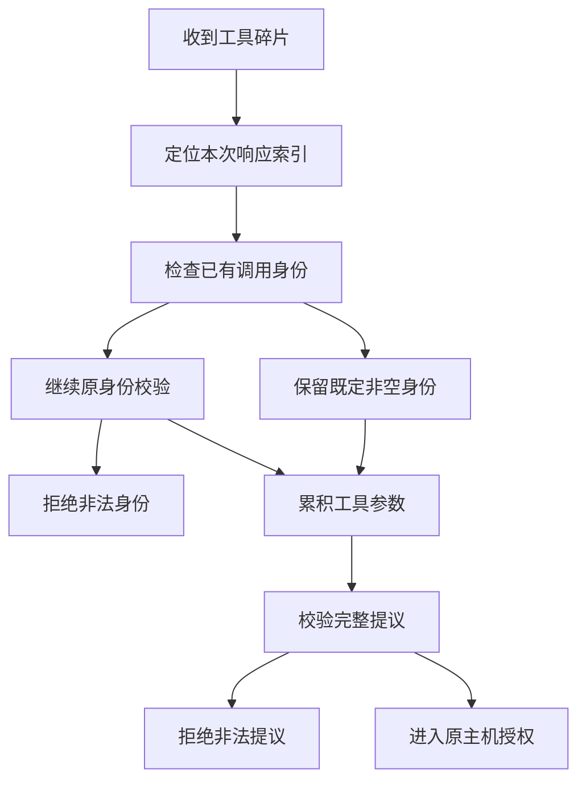

---
evidence:
  implementation: "公开 v0.15.2 保留既定身份的窄兼容"
  scoped: "原运行时合成流回归与拒绝分支"
  live: "独立真实任务验证集成，不证明该批出现 null 续片"
---

# 一个 null 如何让 Agent 工具调用失败：流式协议兼容性实战

模型已经开始生成工具参数，流也在继续返回，Agent 却在真正调用工具之前失败了。排查到最后，触发拒绝的不是错误工具名，也不是非法参数，而是后续碎片里一个 `id: null`。

这类修复很容易走向两个极端：继续拒绝所有 null，或者看到 null 就宽松放行。我们最后采用的是第三种办法：**只在同一索引已经建立非空调用身份时，把后续 null 解释为“不更新身份”。**

这是 open-etf-agent v0.15.2 的一个窄范围兼容修复。它没有发明工具 ID，没有改变工具授权，也没有跳过完整调用的最终校验。

## 一、工具调用是增量事件，不是每帧一个完整对象

对流式 Chat Completions，一次工具调用可能分散在多个事件中。应用按本次响应里的 `index` 找到正在组装的调用，再拼接函数名和参数字符串，最后把完整提议交给校验与执行链。

下面是简化的合成碎片，省略了外层 SSE、`choices` 和结束事件，不是原供应商载荷：

```jsonl
{"index":0,"id":"call-a","function":{"name":"read_page","arguments":"{\"page\":"}}
{"index":0,"id":null,"function":{"arguments":"1}"}}
```

第二片段仍然属于索引 0。函数参数从 `{"page":` 继续变成 `{"page":1}`；真正需要决定的是，后面的 null 是否应该推翻前面已经确定的 `call-a`。

旧实现的判断接近“只要提供了 id 字段，就必须是字符串，且不能冲突”。这对完整对象校验很直观，却把增量事件中的“没有身份更新”也当成了新的身份值。

关键不在 null 本身，而在 **输入值与已有状态的组合**。

## 二、先画清允许的状态转移

修复的前提是相同响应内的同一工具索引，而不是碰巧工具名相同，也不是上一轮请求曾经用过某个 ID。

| 已有状态与新片段 | 本次处理 |
| --- | --- |
| 已有非空 ID，后续省略 id | 保留原 ID |
| 已有非空 ID，后续 id 为 null | 保留原 ID，这是本次新增兼容 |
| 已有非空 ID，后续给出相同字符串 | 保留原 ID |
| 已有非空 ID，后续给出不同字符串或空字符串 | 拒绝身份冲突 |
| 首片段或新索引没有既定非空 ID，却给出 null | 拒绝，不能凭空创建身份 |
| id 为数字、布尔值、数组或对象 | 继续拒绝 |

原实现允许早期空字符串在后续被有效字符串补齐，这条既有行为不因本次修复改变。但空字符串不算“已建立的非空身份”，不能拿它为 null 续片开绿灯；完整提议仍须通过最终验证。

把新增例外单独表达，判断就很小：

```js
const hasEstablishedId = typeof call.id === 'string' && call.id.length > 0;
const keepsEstablishedId = part.id === null && hasEstablishedId;
if (part.id !== undefined && !keepsEstablishedId) {
  validateOriginalIdRules(call.id, part.id);
  call.id = part.id;
}
```

这是提炼后的教学伪代码，`validateOriginalIdRules` 代表原有的类型和冲突检查。它不是可单独替换整个流解析器的实现，也没有承担参数、权限或执行验证。

## 三、兼容发生在组装层，信任不能跟着扩大

如果把“允许 null”写成通用清洗规则，例如给缺失 ID 自动补随机值，程序可能不再报错，却会制造一个供应商没有提供过的调用身份。后续结果关联、去重和诊断就失去了原始依据。

另一个危险做法是拿上一条调用的 ID 填补当前片段。并行工具可能交错返回，这会把不同索引的参数拼到错误调用上。

正确的位置是本次响应、当前索引对应的组装状态：只保留已建立的那个 ID，不跨索引借用，不跨请求继承，也不在冲突时选择一个“看起来更合理”的值。



只有后续 null 且已有非空 ID，才走保留身份分支；其余情况继续原检查。最终校验仍检查组装后的参数与调用身份，随后由原 Host 决定工具是否获准执行。兼容片段不是执行许可。

流是否完整结束，也是另一条条件。这个修复没有把半段响应、异常结束或超出支持范围的协议伪装成一个可执行调用。

## 四、怎样证明修好的是问题，而不是删掉了保护

最小单元测试可以直接喂两个片段，断言 ID 仍为 `call-a`。但这样还不够：我们真正关心的是，这条调用能不能通过原网关进入运行时，并完成原本的用户任务。

因此，回归使用一条合成的完整链路：读取资料，保存报告，再通过原运行时结束任务。对照组的续片省略 ID，目标组的续片携带 null；两边最终保留相同调用身份，并得到相同的报告内容。

同时要覆盖拒绝分支：首次 null、新索引 null、不同字符串、非法类型，不能因为正例修好了就开始被接受。即使 ID 续片合法，参数拼接后不是有效 JSON，或者最终出现重复调用 ID，也仍然必须失败。

这是一类非常适合用状态转移测试的兼容问题。单测输入不只是“字段有哪些值”，还要包含“这一值到达时已经积累了什么状态”。

后续独立的真实模型任务验证了集成后的正常读取、发布与恢复路径，但不能据此证明那一批流里实际出现过 null 续片。**目标边界由受控的 null 反例与正例证明，真实任务验证的是集成没有破坏其他行为。** 两种证据不能互相冒充。

## 五、错误诊断不必保留原始参数

之前多个身份问题都可能被归到一个复合错误里。只看到 `TOOL_FRAGMENT_ID`，还无法分清是首片段没有身份、后续 ID 冲突，还是类型不受支持。

但为了区分这些情况，并不需要把真实工具参数、用户资料或完整模型输出写进日志。受限诊断可以只保留错误类别、输入 ID 类型、此前是否已有非空 ID，以及字符串是否为空等有限信息。

例如，“输入类型为 null，已有身份为真”有助于定位本次兼容问题；“输入为字符串，已有身份为真且冲突”则应继续走原拒绝路径。它们不是同一个修复理由。

诊断越能描述状态关系，越不需要依赖泄露原始内容来还原现场。

## 六、一个修复不能包办所有历史故障

这次调查拿到了一次真实资格验证中“已有 ID 后出现 null”的受限诊断证据，足以提出并验证这个具体修复。

更早的复合身份错误没有同样完整的分类信息，不能回头宣布它们也都是 null 引起的。旧失败仍是旧失败，不因为新版本任务通过就改写记录。

同样，某个供应商出现过这种流形态，不等于所有供应商的协议都承诺 null 续片合法。这里实现的是一个有前置条件、保持既有身份的兼容规则，不是对任意响应的普遍放行。

## 结语：好的兼容修复，增加的是一个有条件的解释

这次源码变更很小，真正需要想清楚的是哪种状态转移可以保留不变量：已有身份不被清除，不同调用不被混合，缺失身份不被伪造，完整提议仍要校验。

遇到下一次协议差异，可以先问：它是完整对象字段，还是增量更新？什么已有状态使它安全？在哪一层解释它，才不会把权限、执行或恢复规则一起放宽？

**兼容不是把校验关掉，而是在不改变原事实的前提下，准确接受一种原先未覆盖的表示。**

实现与回归可阅读公开仓库中的[流组装代码](https://github.com/hpoenixf/open-etf-agent/blob/34124cefc6df289e08518173789210b45a716451/src/stream.mjs)、[null 续片回归](https://github.com/hpoenixf/open-etf-agent/blob/34124cefc6df289e08518173789210b45a716451/test/stream-null-continuation.test.mjs)及[版本验证说明](https://github.com/hpoenixf/open-etf-agent/blob/34124cefc6df289e08518173789210b45a716451/docs/verification/v0152-stream-null-continuation.md)。

延伸阅读：[从工具调用到模型输入](agent-tool-lifecycle-and-model-input.md) · [Trace 的完整性缺口](agent-trace-complete-observation-gaps.md)

欢迎为 [open-etf-agent](https://github.com/hpoenixf/open-etf-agent) 点一个 Star，结合源码阅读这些边界。
