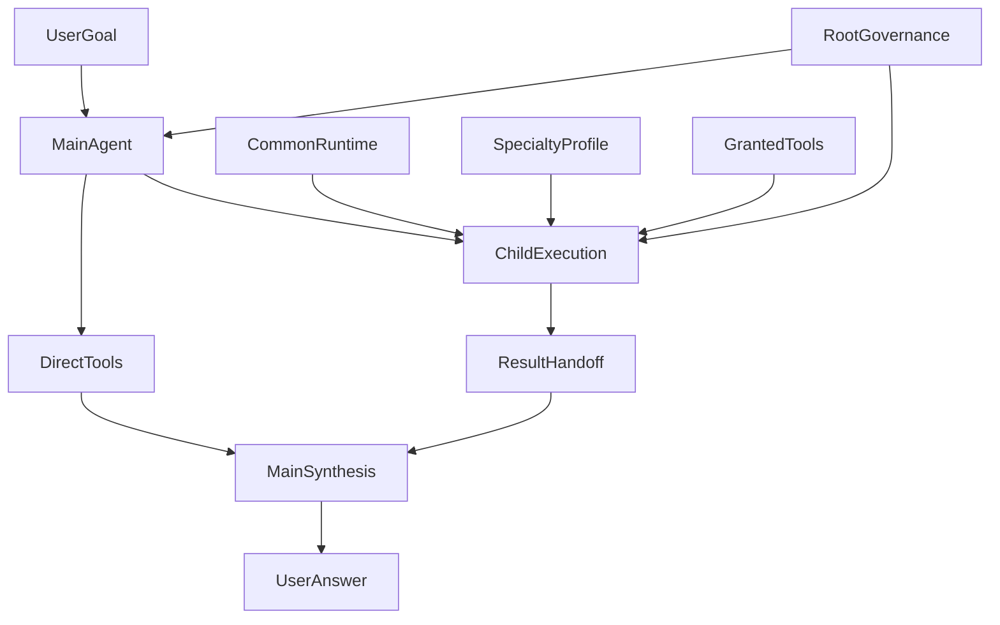
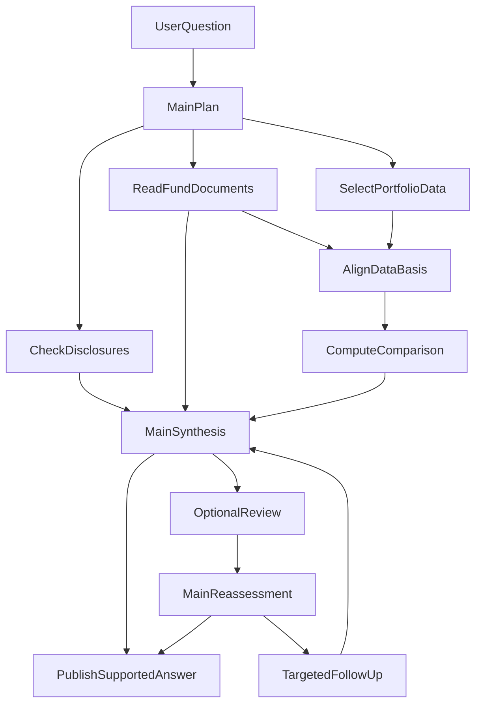
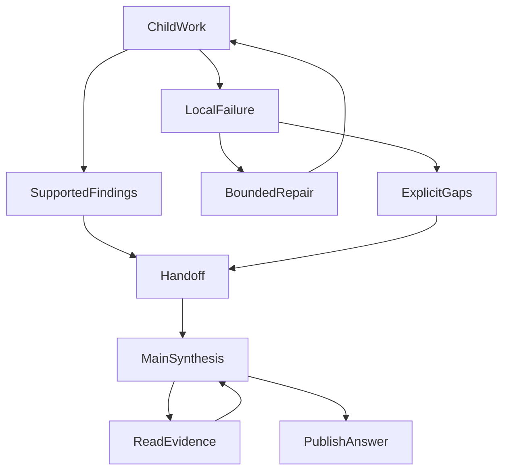

# 我们为什么给投研 Agent 配上 Subagent：从上下文隔离到专业化协作

最开始给 ETF Agent 引入子代理（Subagent）时，我们的目标很克制：**少让局部工作污染主 Agent 的上下文，顺便争取一点提效。**

我们没有打算把投资研究拆成一条固定的“专家流水线”，也不认为多调用几个模型，就自然能得到更好的答案。

更贴近我们想法的，是几位专长不同的工程师：有人更擅长查资料，有人更熟悉复杂文档，有人擅长计算和调试，但他们都有理解任务、选择工具、处理问题的完整工作能力。遇到跨领域问题，不必因为超出了自己的角色名称，就把工作转交一圈。

真正落地以后，我们发现：独立启动一个模型循环并不难。难的是，**局部过程分开了，重要事实不能丢；执行者变多了，整体责任不能散。**

## 一、先隔离过程，而不是把 Agent 的能力切碎

设想一个简化的投研问题：用户想比较某只 ETF 与现有组合的关系，需要核对产品材料，再计算持仓重叠或历史表现。

主 Agent 应该持续关注的是用户目标、比较口径、已有结论和未解决问题。但完成某个局部计算，可能要检查数据字段、修复代码、重新执行；阅读一份 PDF，也可能要多次定位章节、查看表格和核对脚注。

这些过程对当下的工作很重要，却不一定需要进入主 Agent 后面的每一次请求。

计算完成以后，Main 需要知道采用了什么数据、怎样计算、结果与限制是什么，不必继续背着几版错误脚本。条款已经核对以后，它需要保留原文依据和适用条件，不必反复携带所有文档搜索记录。

这就是这里所说的“上下文污染”：**局部试错和全局研究混在一起，已经完成使命的过程信息，继续占据后续思考的空间。**

这种动机与 Anthropic 在[《Effective context engineering for AI agents》](https://www.anthropic.com/engineering/effective-context-engineering-for-ai-agents)中介绍的子代理模式相近：让局部执行者在独立上下文中深入工作，再返回提炼后的结果，主代理负责综合。值得借鉴的是这种信息分工，而不是直接借用别人的性能结论。

不过，“独立上下文”不应该被实现为“能力残缺的小工具”。Web 子代理找到相关 PDF，应当能在许可范围内继续读；PDF 子代理遇到需要核实的网页，也不必机械地退回 Main。我们当前的专业配置明确保留了这种跨工具工作的空间。

**我们隔离的是工作过程，不是解决问题的能力。**

## 二、一个通用执行底座，配上不同专长

因此，我们没有为 Web、PDF、Python 分别开发三套 Agent。

核心结构是：**一套通用的子代理运行时，加上不同的专业配置（Profile），每次委派产生独立执行体。** 专业配置提供工作方法；实际工具和资料访问范围由宿主决定；父子执行继续受同一个根任务的资源约束。

### 图 1：共享执行机制，不共享一团上下文



图中的 `ChildExecution` 代表每次创建的独立执行体，不是一份所有子代理共用的聊天记录。`CommonRuntime` 是复用的执行机制，`SpecialtyProfile` 是方法侧重点，`GrantedTools` 是本次实际可用的工具，`RootGovernance` 则是共享的预算、授权和生命周期约束。

Main 仍然保留直接调用工具的路径。它可以自己解决简单问题，也可以委派复杂局部工作；子代理交回成果，Main 再综合成用户需要的回答。

这与 [OpenAI Agents SDK 的 manager／agents-as-tools 模式](https://openai.github.io/openai-agents-python/multi_agent/)在职责上相近：主代理调用其他代理处理子任务，但继续拥有用户对话与最终回答。它不同于把对话控制权直接交给另一个代理的 handoff 模式。本文说的“成果交接”，不意味着转移用户对话。

“能力完整”也不是要求每个 Child 都拿到所有工具、所有数据和所有控制权限。我们的意思是，它能在获准范围内自主完成多步工作，而不是只能执行一个预设动作。最终发布和继续创建子代理等控制能力，仍有明确边界。

[Claude Code 的子代理文档](https://code.claude.com/docs/en/sub-agents)也体现了类似的区分：通用子代理可以处理需要探索与行动的复杂任务，同时存在只读等受限配置。**独立上下文、专业方法和工具权限是不同的设计维度，不必绑定成一件事。**

## 三、Web、PDF、Python、Reviewer，到底有什么不同？

我们的差异主要放在工作方法和关注重点上，而不是按文件格式划出不可跨越的边界。

| 方向 | 更关注什么 | 金融场景中的典型任务 |
| --- | --- | --- |
| **Web Explorer** | 来源选择、公开信息变化、交叉核验 | 核对基金公告、发行人披露及相关更新 |
| **PDF Reader** | 章节、表格、脚注、页码与阅读覆盖 | 检查产品条款、费用定义和风险披露 |
| **Python Analyst** | 输入口径、计算、错误修复和产物 | 计算收益回撤、持仓重叠，生成附表 |
| **Research Reviewer** | 遗漏、冲突、反例和脆弱假设 | 检查结论依据、是否还需要补查 |
| **投资研究视角** | 从不同投资方法挑战同一组事实与假设 | 用资产配置、尾部风险与风险分散视角复查同一项决策 |
| **Remind，非子代理** | 已发生的资源与执行事实 | 提醒剩余预算、时间与复盘时机 |

Web、PDF、Python、Reviewer 和投资研究视角都复用子代理执行机制，Remind 则是配套的运行时提醒。专业配置与投资方法本身不会授予额外工具或资料权限。

### Web 与 PDF：专长不同，但不按材料格式反复转派

Web 更重视“应该去哪找，以及不同来源是否一致”；PDF 更重视“这份材料实际写了什么，哪些部分真正读到了”。

例如，一段费用核查从发行人网页开始，最后落到 PDF 脚注，这仍然可以是同一个子代理的完整任务。我们没有要求它先把 PDF 地址交回 Main，再启动另一个 Child。反方向的网页核查也一样，相关交叉读取路径已有受控工程验证。

专业化的作用，是让执行者采用更合适的方法，不是制造更多交接。

### Python：接手一段计算工作，而不是接手一次函数调用

Python 子代理不只是运行代码。它需要理解计算目标，检查实际输入，处理报错，再解释结果与限制。

我们给这类配置的指导会强调日期对齐、单位、缺失值和输入来源，也明确区分“脚本执行成功”与“计算口径正确”。没有真实执行能力时，应当说明未执行，不能根据角色名称编造一个计算结果。

这种多轮局部工作，才是值得从 Main 上下文中隔离出去的部分。一次稳定的简单计算，Main 直接调用工具就够了。

### Reviewer：独立复核，不是最终审批

Reviewer 更像擅长 Review 的工程师。它可以检查原始依据、寻找重要反例，并在有价值时使用获准工具补查，而不是只能点评 Main 的摘要。

但它不能因为给出一个判断，就直接改写研究事实、要求 Main 必须采纳，或者阻断最终回答。独立执行与建议交接已经有工程证据；Reviewer 的作用是提供反例和复核材料，最后仍由 Main 综合。

### Remind：不是每个提醒都值得调用另一个模型

预算用了多少、时间还剩多少，可以从执行记录得到，不需要再请一个模型判断。

Remind 把这些事实和适当指导放进既有模型请求；Reviewer 则需要独立模型调用，提供另一种分析视角。提醒出现，不等于自动获得一次 Reviewer 调用资格，更不等于应该新增研究任务。

可以用一句话区分：**Remind 帮助 Main 注意执行事实，Reviewer 帮助 Main 检查判断，Runtime 决定哪些动作仍然允许执行。**

## 四、放进一项金融研究，协作应该怎样展开？

下面用一个教学案例贯穿这些设计，不把它当作一次已通过的真实金融研究验收：

> 我想增加一只 ETF。请比较它与现有组合的重叠，核对费用与主要风险，并给出适合或不适合加入的条件。

Main 首先需要确认用户目标与材料范围。随后，它可以把“近期披露有什么变化”“文件里的规则和风险如何解释”“已有数据下的组合重叠是多少”拆成不同的局部问题。

委派内容不能只有“帮我研究这只基金”。更清楚的任务是：核对指定产品的持续费用与一次性费用，保留份额类别、适用日期和原文依据，不需要重新做整份投资分析。

### 图 2：按问题与依赖协作，不按角色排固定流水线



这里，公开披露核查和文档阅读可以独立推进；依赖日期、单位等口径的计算，要等必要输入明确。数据已经齐备时，也可以直接计算，不需要等其他子任务全部结束。

`OptionalReview` 是可选复核，不是发布的必经审批。Main 可以直接交付已有充分支持的分析，也可以先处理关键疑点。材料缺失时，则缩小相应结论的范围，不把缺口补写成事实。

**Main 综合的不是几篇报告，而是对原问题有用的发现。** 费用、重叠与风险应当共同回答“是否增加了用户需要的暴露”，而不是让每个执行者分别写一段正确却互不关联的文字。

最终的回答还需要讲清楚：哪些判断来自已取得的事实，哪些依赖用户目标与假设，哪些资料仍然缺失。这是上述教学场景的交付要求，不是让每次研究都强制执行同一套步骤。

## 五、成果交接：压缩过程，不能压掉依据

如果 Child 把完整搜索和调试历史交回来，上下文隔离就失去了意义；如果只交回一句结论，Main 又很难判断能否使用。

我们把交接看作一份可继续使用的工作成果，而不是一句“任务完成”。现有机制保留摘要、证据与产物引用、缺口，并允许阶段性成果先交回。Main 可以按需查看依据，不默认复制完整 Child 历史。

| 交回的信息 | 在金融案例中的作用 |
| --- | --- |
| **结论摘要** | 说明发现了什么，以及它回答哪个子问题 |
| **证据与口径** | 保留来源、日期、单位、范围，支持后续核对 |
| **计算或报告产物** | 让 Main 能使用真实结果，而不只是相信“已经生成” |
| **缺口与执行状态** | 区分已完成、部分可用、未执行和结果未知 |

这些是交接职责的概括，不是要求每次都填满固定格式。没有生成文件，就不应该为了完整而补一个产物地址。

### 图 3：局部失败不吞掉成果，也不自动变成成功



可修复、且仍有预算与授权的错误，才进入 `BoundedRepair`。不能修复的部分进入明确缺口，已有合法发现仍可交回；已经取消或效果未知的操作，不能沿这条线被当作免费重试。

Main 取得摘要不等于读过全部原文。需要核实关键结论时，再走 `ReadEvidence`；能够独立使用的阶段性成果，也不必等整个 Child 结束才出现。

[LangChain Deep Agents 的 Subagents 文档](https://docs.langchain.com/oss/python/deepagents/subagents)同样建议返回凝练结果，不把原始数据和详细工具输出全部搬回主代理。我们在金融场景里尤其强调另一半：**精简的是过程，不是影响判断的口径和限制。**

## 六、几个真正改变了设计的坑

### 1. Web：真实引用，也可能用错地方

一次 Web 诊断中，Child 把工具结果引用和答案中的引用标记放进同一个证据字段。它们用途不同，系统拒绝混合提交是正确的。

问题在于，旧反馈没有解释清楚区别，却突出建议使用空数组。模型下一次把原本合法的引用也删掉了。

我们修的是反馈，不是放宽校验：说明不同引用的用途，保留合法结果后重新提交。后续真实模型样本确实完成了带有效引用的正式交接，但整题仍因其他问题没有完成，不能把这项局部修复写成整个 Web 研究已经成功。

**教训是：错误反馈应该帮助执行者修好交接，而不是诱导它删掉成果。**

### 2. PDF：图片送到了，仍然可能看错

在一次真实 PDF 研究中，页面图像已经进入 Main 和 Child 的模型请求，任务也正常结束，但图表中部分颜色与形状的解释仍有问题，要求的跨材料阅读也没有全部完成。

这让我们把问题拆开：没有拿到图像，是资料与输入链路的问题；图像已经到达却解释错误，是需要另外核验的理解问题。不能看到一次工具成功，就认为后面的研究判断也成立。

对投研而言，这个区别直接影响结论范围。模型可以说“取得了这页材料”，却不能仅凭这个事实宣称“相关风险已经完整核实”。

### 3. Python：上下文分开了，文件也要分开

Python 隔离不仅是消息隔离，还包括工作区归属。我们将工作区绑定到具体执行体，局部修错继续使用自己的文件；Main 和兄弟 Child 通过受控产物交接，而不是直接猜测并读取对方路径。相关工程验证覆盖了自身合法产物、跨执行拒绝与清理。

2026 年 10 月 16 日，一次合成数据的真实模型验证走通了完整的局部工作：Child 先修正字段不匹配导致的计算错误，又修复 HTML 模板错误，随后正常导出报告。Main 消费结果并发布下载地址，后续 History 读回也保留了交付记录。

这条样本最有价值的地方，不是“模型修了两个 Bug”，而是**局部计算、修错、导出成为一个完整工作单元，Main 不必接管每一步。**

它证明了这条能力路径，不证明相对单代理更快，也不代表所有金融计算口径已经正确。

### 4. 并发：全局第三条记录，可能只是 Main 的第二轮

加入 Child 后，执行顺序可能是“Main 第一轮 → Child 第一轮 → Main 第二轮”。最后一条在全局记录里排第三，但在 Main 自己的执行中仍是第二轮。

我们曾经用错这两个序号，导致合法的子任务输入绑定被拒绝。修复使用已有的执行内进度，保留原身份校验；交错执行的回归验证了这一点。

这个坑的可迁移经验是：**独立执行体需要自己的进度坐标，不能只分开消息数组，却继续共用隐含的“当前轮次”。**

### 5. Reviewer 与 Remind：别为了收敛，再增加一轮无效工作

这一项更多是我们必须防范的设计风险，而不是已经证明 Reviewer 导致了某次失败。

独立复核需要消耗资源，不能因为时间到了、提示发过了，就自动再叫一个模型。我们的 Reviewer 有去重、单次在运行检查和冷却等约束，并支持关闭、影子和建议模式。影子模式不把自动建议交给 Main，但仍然消耗原预算，不能当成免费观察。

Remind 则处理不同类型的提醒与送达记录：没有进入实际请求的提醒，不能提前当作已送达；不同资源事实可以同时提示，但不应反复表达同一件事。相关协调已经有实现，整体迁移和效果仍需按各自范围验证。

**提醒不是复核，复核不是审批，二者都不能替代原有预算与收尾机制。**

### 投资研究视角：方法不同，不必再造三套专家 Runtime

2026 年 10 月，我们进一步给 Child 增加三种固定的投资研究方法：Markowitz、Taleb 和 Bernstein。这里引用的是公开的金融研究思想及分析侧重点，不是假装由历史人物本人提供建议，也不是把他们做成能够独立授权、执行和发布的三位“数字投资顾问”。

例如，面对同一份组合资料，资产配置方法可以追问相关性与权重，尾部风险方法可以追问极端情景，风险分散方法可以追问长期持有能否承受的损失。真正重要的是**三种方法能否沿同一份已取得、已授权的输入提出不同问题**，而不是给每一种方法新建一套工具、预算、记忆和恢复栈。

实现没有新增专家专属 Runtime。原 Child 准入会将可信的方法 ID、版本与内容哈希冻结到执行身份；重新派发或冷恢复时读取原绑定，不能在同一个 Child 中悄悄换一套方法。方法不改变现有工具授权，缺少某条资料也不阻断正常补查；不选择专家时，普通 Child 路径仍存在。Reviewer 属于独立复核角色，不能伪装成其中一种投资方法。

工程验证留下了具体结果：两个不同方法的 Child 可以共享同一个原始结果引用，而不强迫 Main 再取两份数据；冻结的方法内容在恢复后的实际 Child 请求中保持一致。2026 年 10 月 21 日的一次真实模型、合成投资题里，三种方法的成果交接都进入 Main，最终正文获得保存。其间模型仍出现过错选类型与重复委派，局部执行拒绝和取消处理没有把独立合法内容一起吞掉。

这些观察支持“**方法绑定与结果交接可复用原 Subagent**”的工程判断。视角数量本身不是质量指标；比较不同方法的收益，需要检查同一投资问题的事实、反例与最终回答。


## 七、收益在哪里，又为什么不承诺“多 Agent 一定更快”？

目前最明确的能力收益，是一段复杂局部工作可以拥有独立上下文、自己的工具过程和可消费的成果。主 Agent 不必默认接收整个调试现场，又保留了核对重要依据的路径。

有限并行提供了另一个机会，但它依赖任务关系。两个相互独立的子问题可以重叠执行；如果计算必须等待资料确认，多创建一个代理不会消除这条依赖。

用一个理想化关系表示：

```text
串行耗时 ≈ 工作 A + 工作 B
并行耗时 ≈ max(工作 A, 工作 B) + 委派、等待和汇总开销
```

这只是取舍模型，不是 ETF Agent 的实测曲线。实际还受到模型与工具并发、重试和任务依赖影响。

总 token 也一样。Main 少携带局部历史，不意味着系统总量更少：Child 的输入输出、重复背景、交接和必要回读都要计算进去。

Anthropic 在[《How we built our multi-agent research system》](https://www.anthropic.com/engineering/multi-agent-research-system)中同样指出，多代理研究会增加 token 消耗；大量共享上下文、依赖密集的任务，并不天然适合多代理。我们借鉴的是这种适用条件判断，不把他们的效果数字移植为自己的收益。

我们也有真实反例：Child 完成了有效引用交接，但 Main 反复查看状态、取消后重新委派，最后到达轮次上限，没有发布答案。该次还伴随供应商流中断，不能把全部失败归到协作策略，却足以说明局部成功不保证整体交付。

完整任务的评价维度包括：Main 上下文减少了多少、总开销增加了多少、结果是否真正被消费，以及用户的问题有没有得到回答。

## 八、读者可以怎样借鉴这套设计？

不必从四种角色一起开工。更合理的起点，是选一个局部过程较长、成果容易检查的任务，先跑通一条完整链路。

**先做一个通用 Child。** 它应有独立上下文、执行身份和多步工具循环，能提交成果，也能被取消和在支持的边界恢复。不要先复制四套只有名字不同的 Agent。

**再增加专业方法。** 区分“什么时候值得委派给它”“它处理问题时应关注什么”“本次实际能调用什么”。这些信息可以分别落在角色描述、方法指导和工具授权中，不必把全部规则塞进角色名称。

**然后把交接做实。** 不只测试 Child 有没有返回文本，还要测试 Main 能否读回依据、使用计算结果或打开实际产物。合法部分成果与失败、未知状态都要有表达方式。

**最后复用已有治理。** 我们已有预算、收尾、授权与恢复模块，Subagent 接入这些机制，而不是各领一份新资源。多个 Child 争用剩余额度、Main 结束后仍有任务在运行、结果已提交但尚未消费时发生中断，都是需要检查的具体路径。

完整能力不意味着每件事都要委派。简单查询、一次工具调用，或者高度依赖整段对话的工作，留在 Main 可能更合适。**是否使用 Subagent，应由任务能否从隔离与自主工作中受益决定，而不是由系统里已经有多少种角色决定。**

## 结语

我们最初只是想让主 Agent 少背一些局部上下文，顺便争取一点效率。

沿着这个目标，最终形成的并不是一条按角色名称转交工作的流水线，而是：**通用的执行能力、不同的专业方法、独立的局部过程，以及统一的交付责任。**

Web、PDF、Python 和 Reviewer 的价值，在于它们能按各自专长把一个问题做深，而不是只能使用某一种工具。Remind 和既有运行时治理，则帮助这些工作关注资源与执行边界。

对我们而言，一个好的 Subagent 设计，应当同时做到两件事：

**让局部工作能够独立完成，让重要成果能够顺利回到主线。**

真正值得追求的，不是让更多 Agent 忙起来，而是让主 Agent 更专注于用户的问题，让局部探索最终变成用户拿得到、看得懂、用得上的结果。

---

<!-- agent-article-sync:guidance:start -->
## 延伸阅读与交流

[在个人博客阅读本篇](https://hpoenixf.com/blog/agent-subagent-context-specialization) · [公开工程文章文集](https://github.com/hpoenixf/eff-agent-article)（欢迎 Star）。
<!-- agent-article-sync:guidance:end -->
