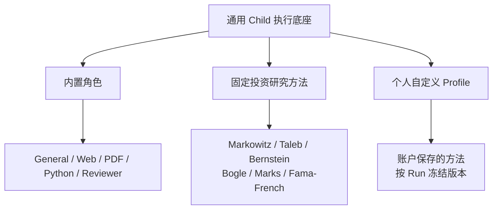
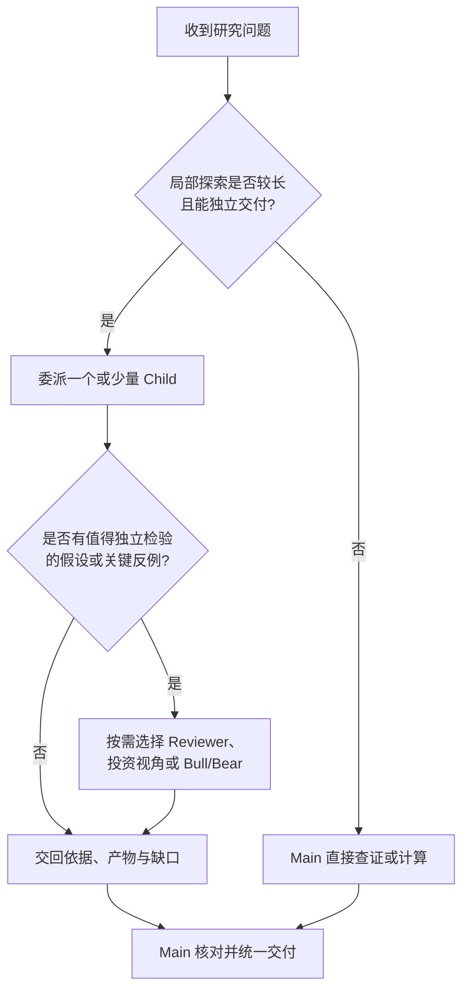

# Subagent 全景：独立上下文、专业协作与真实成果交接


ETF Agent 已经不只是“Main 调用一个子代理”。我们现在有**通用 Child、内置专业角色、六种投资研究方法、个人自定义专家**，还支持按需让两个 Child 进行有界的 Bull/Bear 质询。它们并不是几套互不相干的 Agent：**执行底座相同，工作方法可以不同，授权与最终交付仍归原有系统管理。**

这套设计起于一个朴素问题：读 PDF、查资料、调试计算会占据大量上下文，Main 没必要背着全部过程继续思考。但实践很快表明，比隔离过程更难的是**把真实依据、可用结果和未解决的问题带回来**。下面介绍我们目前支持什么、为什么这样设计，以及实际开发改变了哪些判断。

## 一、我们现在支持哪些 Subagent？

先分清**执行体、专家方法和协作形式**。一次 Child 是独立的工作实例；Web、PDF 或投资视角描述它怎样研究；Bull/Bear 则是两个 Child 在特定条件下的一种协作方式。

### 图 1：同一执行底座上的三类专家来源



这是一张**能力分类图，不是每次都同时启动所有角色**。实际派发时，Main 根据任务选择适合的方法，Child 仍需获得本次真实的工具和来源许可。

| 类别 | 当前提供的能力 | 与其他角色的区别 |
| --- | --- | --- |
| **General Child** | 不绑定特定研究领域的通用局部任务 | 有独立上下文，可在授权内自主使用多步工具 |
| **Web / PDF / Python** | 检索与交叉核查、文档证据阅读、计算调试与产物导出 | 是研究侧重点，**不是只能调用一种工具** |
| **Research Reviewer** | 检查遗漏、反例、来源与论证缺口 | 给 Main 建议，不是最终审批人 |
| **六种投资方法** | Markowitz、Taleb、Bernstein、Bogle、Marks、Fama–French | 对同一组事实提出不同研究问题，不是六位有交易权的顾问 |
| **个人自定义专家** | 账户保存 Profile，精确选择、版本冻结与历史归属 | 用户定义方法，不增加工具、数据或交易权限 |

此外，**Bull/Bear 是有界双 Child 对话**：一方提出主张，另一方用证据质疑，再要求真实回应；它不是第七种投资方法，也不是投票机制。**Remind 不是 Subagent**，只把预算、时限等已有运行事实送进适当的模型请求，不另起一次模型研究。

Web、PDF、Python 的专门实现已分别写在[网页深读](021-agent-web-research-from-search-to-deep-reading.md)、[PDF 证据阅读](024-agent-pdf-from-text-to-evidence.md)与[Python 工作台](agent-python-compute-workbench-evolution.md)中。这里更重要的是它们**可以跨工具完成一段工作**：查公告时发现 PDF 脚注，不必机械地返回 Main 再转派一次。

六种投资方法如何比较，以及为什么需要真正的反证，另见[多视角投资研究](investment-perspectives-and-thesis-falsification.md)和[有界 Bull/Bear 协作](bounded-bull-bear-peer-dialogue.md)。个人专家从保存到实际选用、恢复和贡献回读的细节见[自定义专家专文](agent-custom-expert-from-prompt-to-recovery.md)。

## 二、共同特点：运行时复用，工作过程独立

我们没有为每个角色再建一套模型循环、预算、文件空间和恢复系统。**每次委派产生自己的 Child 执行身份与上下文，却复用通用 Runtime。** 专业 Profile 决定关注哪些问题，Host 决定能用哪些工具和资料；Main 负责用户目标和最终回答。

### 图 2：独立上下文与统一治理如何同时成立


这带来四个实际特点：**独立探索**，局部搜索和修错不持续污染 Main；**多步自主**，Child 可以在本次授权内连续读资料、计算和修正；**方法可替换**，内置或个人 Profile 不要求复制 Runtime；**结果可追溯**，恢复时沿原执行身份、冻结方法和来源回执继续，而不是按最新角色名称重写历史。

尤其需要把“专家更擅长什么”和“专家获准做什么”分开。一个个人 Profile 即使写了“访问所有账户”，也不会自动得到数据访问权；Reviewer 即使指出严重缺口，也不能代替 Main 批准最终答案。受管理的 PDF 专家可以通过已有 Skill 和沙箱脚本辅助检查，但这也不意味着用户可以上传任意可执行专家包。

## 三、一次 ETF 研究如何真正分工？

用一个**教学场景**说明协作关系：用户考虑增加一只 ETF，希望比较它与已有组合的持仓重叠、费用和风险。

Main 可以直接处理简单查询，也可以把披露核查、条款阅读和需要较长调试的计算交给独立 Child。**任务按问题与数据依赖拆分，不按“Web → PDF → Python”排固定流水线。**

### 图 3：不同研究问题如何回到同一份回答


例如，费用核对可以从发行人网页进入 PDF 附注，由同一 Child 继续读取。组合重叠计算则必须先有同日期、同单位、覆盖范围清楚的持仓数据；若只有前十大披露，就应说明无法推算精确全量重叠，而不是继续输出一个漂亮的百分比。

如果同一研究出现“基金数量增加就更分散”的假设，Main 才可能选择投资视角、Reviewer 或 Bull/Bear 进行反证。多个专家最好复用**同一组获准事实**，而不是各自找不同日期的数字后再投票。

我们支持对子任务关系写出 `relationHint`，也允许 Child 在读到新证据后修订后续研究描述；但提示不是调度器。真正的先后依赖仍需要原任务回执、合法的 `inputRefs` 和实际消费证据。**提出“请参考上一位专家”，不等于下一位已经读到了材料。**

## 四、交回什么，才能算完成一段工作？

Child 不应把完整工具日志和错误脚本灌给 Main，也不能只说一句“研究完成”。我们的交接保留**发现摘要、原始来源或计算口径、实际产物、未解决缺口**，有意义的部分结果可以先交回。

### 图 4：局部失败时，保留合法成果与明确缺口


可修复的错误在原授权与预算内处理；不可修复的缺口如实保留。Child 生成了报告链接，要确认文件真的存在且 Main 能读取；取得 PDF 图片，要检查它是否真的进入模型请求，还要另行判断模型是否理解正确。

这里有一条尤其重要的经验：**提交成功、进入 Main 的实际输入、被 Main 采纳、最终交付给用户，是不同的事实。** 我们曾观察到 Child 已交回有效引用，Main 却反复轮询与重派，直到轮次耗尽仍没有回答；也观察到 Python Child 在合成数据下修复代码、导出 HTML 报告，Main 实际消费并给出下载入口。局部成功不自动等于完整任务成功。

研究贡献的送模证据与局限，我们单独放在[多专家贡献如何验证](agent-subagent-contribution-evidence.md)中；不在这篇总览重复内部验收记录。

## 五、真正改变设计的三点经验

**第一，隔离的不只是消息，还包括身份和工作区。** Main 与几个 Child 交错执行时，全局第三条事件可能只是 Main 的第二轮；如果拿全局序号绑定局部输入，会错误拒绝合法资料。Python 文件同样要按执行体隔离，不能让兄弟 Child 猜路径读取。

**第二，拿到证据与理解证据是两道关。** 一次真实 PDF 研究中，页面图像已经进入请求，模型仍错读部分图形并遗漏跨文档覆盖。历史报告也出现过 Main 拥有全文、Child 却没有实际选取对应输入的接缝。我们因此分别检查来源授权、真实送模和研究判断，不用“工具成功”替代正确性。

**第三，增加角色不应增加另一套权力。** 投资方法和个人 Profile 必须冻结到本次 Child 身份，恢复时不能悄悄换新版；Reviewer 只提供复核意见；Remind 不用额外模型去推测预算。新建 Child 之前，要先看任务是否真的需要第二份上下文，以及额外委派、等待与回读成本是否值得。

这些经验主要来自实现、受控测试和有限真实模型样本。我们已能展示局部计算、方法绑定、部分证据交接等实际路径，但不能据此宣称多专家比单 Main 更快、更准，或已经在真实基金研究中获得稳定净收益。

## 六、什么时候使用 Subagent，什么时候不必？

### 图 5：先看是否值得委派，再决定是否增加视角



一次查费率、一次稳定计算，通常不值得单独启动 Child。跨多份文件的长阅读、反复调试以及能够各自交付依据的独立子问题，才更适合隔离与有限并行。若每一步都依赖上一轮结论，更多并行也消除不了关键路径。

**我们的现状是：有一套统一的 Child 执行机制，已经装配多种专家方法与有界协作；下一步需要持续验证的是，额外视角是否真正改变用户得到的研究质量。** 对读者最可迁移的判断也一样：先定义可核查的子任务和交付物，再决定是否值得使用 Subagent，而不是先堆角色。

<!-- open-etf-case:child@e1b8e4edde724548fab16d8ca4b205379bfa7f30 -->
想看一条最小的公开交接路径，可以参考 [Open ETF Agent 的只读 Child 示例](https://github.com/hpoenixf/open-etf-agent/blob/e1b8e4edde724548fab16d8ca4b205379bfa7f30/src/cli.mjs)；它是**离线脚本示例**，不是上述多专家能力的公开完整版。具体运行步骤与支持边界以链接版本为准。
固定只读示例的最短运行命令为：

```bash
node src/cli.mjs --case fixture-child --output runs/article-child
```
<!-- /open-etf-case -->

---

<!-- agent-article-sync:guidance:start -->
## 延伸阅读与交流

[全景系列](/panorama) · [完整英文版](/en/articles/agent-subagent-context-specialization) · [公开工程文章文集](https://github.com/hpoenixf/eff-agent-article)（欢迎 Star）。
<!-- agent-article-sync:guidance:end -->
