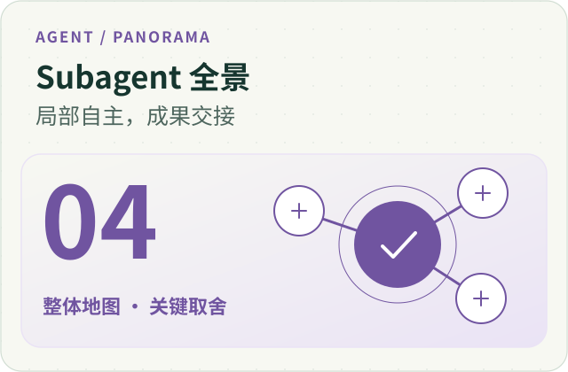
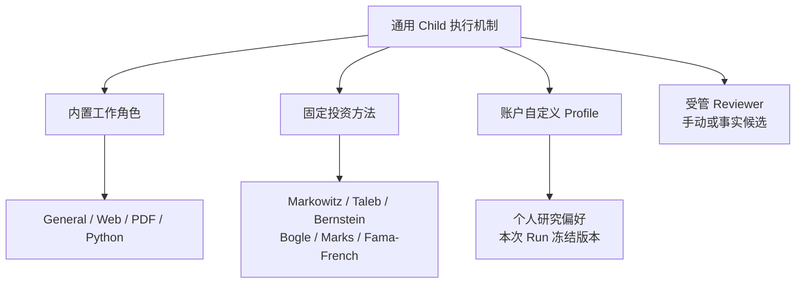
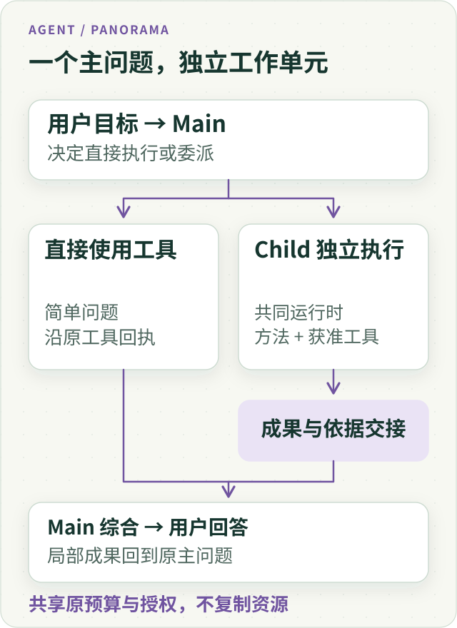
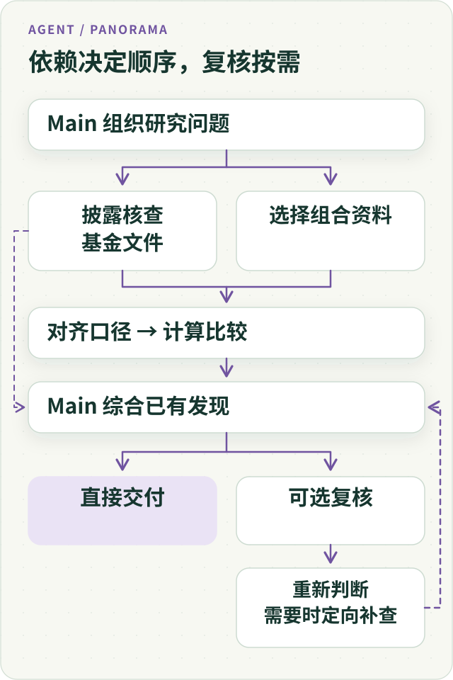
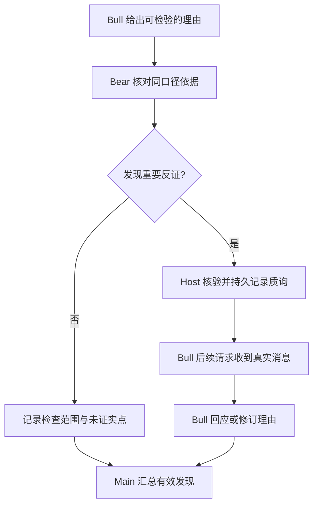
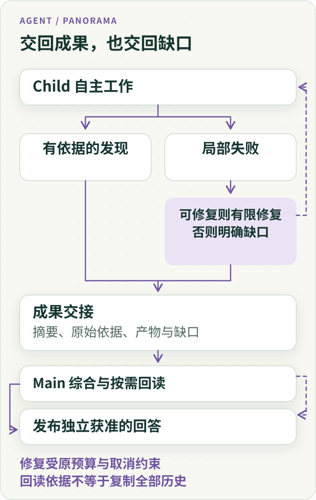
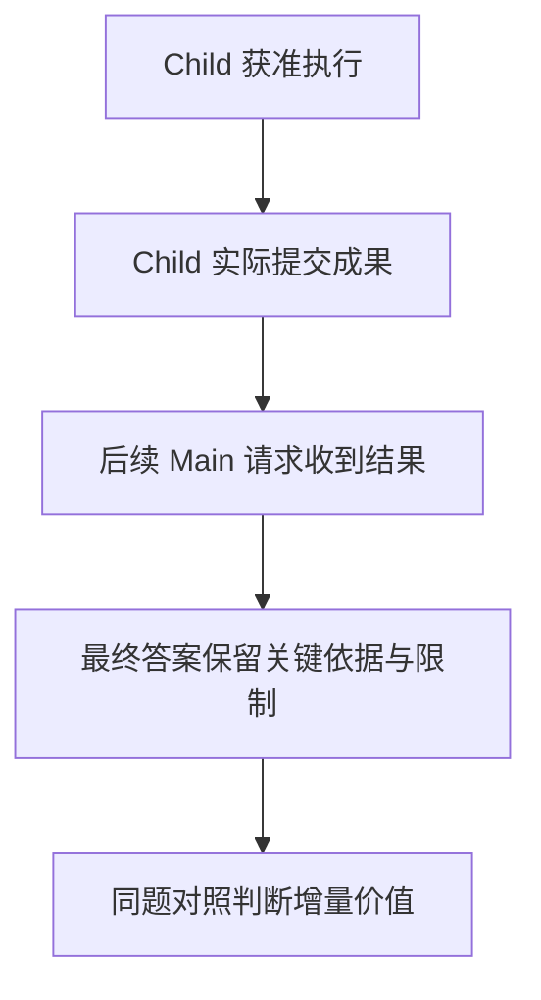
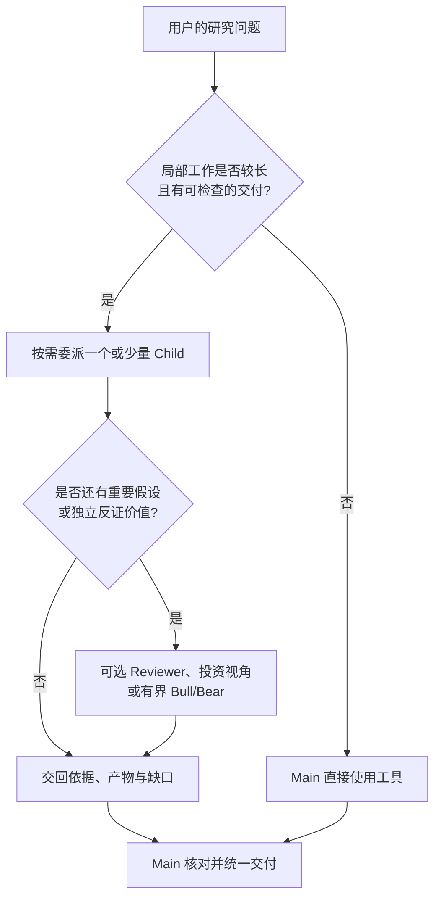

# Subagent 全景：独立上下文、专业协作与真实成果交接



**ETF Agent 的 Subagent 已经不止 Web、PDF、Python 三种“工具专家”。** 目前我们有通用 Child、内置专业角色、六种投资研究方法、账户自定义专家，以及按需参与的 Research Reviewer 和有界 Bull/Bear 质询。它们复用同一套执行机制，却不共享一团对话历史；专业方法可以不同，访问权限和最终回答责任并不会随角色名称转移。

这套体系最初只是为了减轻 Main 的上下文压力。一次 PDF 深读可能反复定位页码，一段 Python 研究可能多次修错。把局部过程隔离后，我们却碰到了更难的问题：**专家真的看到了原始资料吗？成果真的进入了 Main 吗？多一个视角究竟改变了哪条研究结论？**

本文想回答三个问题：我们现在具体支持哪些 Subagent，它们怎样在一项基金研究中工作；这些选择与业界框架有什么异同；哪些经验已经有工程证据，哪些收益仍值得继续验证。Web、PDF 和 Python 的具体实现留给专题文章，这里重点讲协作体系本身。

## 一、为什么需要 Subagent：隔离工作过程，不拆碎解决问题的能力

用户问“加入一只科技 ETF，组合会不会更分散”，Main 要关注的是用户目标、原组合、可用资金、数据口径与最终判断。至于某份招募说明书需要翻多少页、哪个网页找不到原公告、哪一段脚本因字段不匹配而重跑，这些细节对局部执行必要，却不需要在 Main 后面的每一轮里重复出现。

子代理的第一层价值因此是**上下文隔离**：Main 交出边界清楚的任务，Child 在自己的模型上下文里使用获准工具，最后返回可核查的发现。Anthropic 对 [Subagent 上下文工程](https://www.anthropic.com/research/effective-context-engineering-for-ai-agents)的解释，与这个出发点一致。

但“隔离”不是把工具能力切成彼此不能越界的碎片。Web Child 找到 PDF 脚注后，应能在原授权内继续阅读；PDF Child 发现发行人新公告，也不必先把任务退回 Main 再申请另一个角色。我们希望**委派的是一段可以独立完成的工作，而不是一串固定函数调用**。

这一层还有一个容易忽略的代价：Child 虽然少污染了 Main，但它自己也要重新读取背景。把所有任务都拆给新上下文，可能只是把原有 Token 消耗变成重复准备与交接成本。是否值得委派，要结合任务长度、输入共享量和可检查的产物判断。

## 二、我们的 Subagent 家族：一套执行底座，几种不同的“专业”

先把三个概念分开：**Child 是一次执行实例；Profile 是一次执行采用的方法；Bull/Bear 是多个执行实例之间的特定协作关系**。它们不应被画成一条人人都要经过的“专家流水线”。

### 图 1：同一个 Child 底座承载不同的研究方法



| 能力 | 它解决的具体问题 | 重要特点 |
| --- | --- | --- |
| **General Child** | 局部研究任务不需要专属方法时，直接深入执行 | 是普通任务的基线，不必强行选择专家 |
| **Web Explorer / PDF Reader / Python Analyst** | 找可靠来源、读清文档、完成计算与产物 | 不按材料格式限制所有后续步骤 |
| **Research Reviewer** | 已有研究是否漏掉反例、来源或重要条件 | 给出补查或收尾建议，不审批最终答案 |
| **六种投资方法** | 用不同分析标准质询同一项投资理由 | 方法侧重点不同，使用同一套获准事实 |
| **个人自定义 Profile** | 保存用户自己的检查顺序、领域习惯和约束 | 版本固定到本次 Run，更新不改写旧研究 |
| **Bull/Bear 协作** | 让一条可证伪的理由受到真实质询并得到回应 | 有界通信关系，不是一个新的万能专家 |
| **Remind（非 Child）** | 把预算、时间与执行事实提醒给模型 | 不为已有计数再调用一个模型 |

这一分类很重要。**专业角色不是权限角色，研究视角也不是独立投资顾问。** “善于读 PDF”不代表它只能读 PDF；“按某位投资思想家的方法分析”不代表获得那个人的实时观点，更不意味着允许下单。

### Web、PDF、Python：把一段局部工作做完

Web 的强项是来源发现与交叉核验；PDF 强调章节、脚注、图表和实际阅读覆盖；Python 强调输入对齐、代码修正、计算与文件导出。我们在受管理的 PDF 专家中还使用了按需 Skill、参考材料与受控脚本，不因此另造 PDF Runtime 或给个人 Profile 开放任意可执行包。

例如核对某基金的费率，从发行人网页跳到招募说明书的 PDF 脚注，完全可以留在一个 Child 内。Python 的独立价值也不在于执行一行公式，而在于把“检查输入—修复错误—重算—导出—说明限制”作为一个工作单元。各自机制见[Web 连续阅读](021-agent-web-research-from-search-to-deep-reading.md)、[PDF 证据阅读](024-agent-pdf-from-text-to-evidence.md)和[Python 工作台](agent-python-compute-workbench-evolution.md)。

### 六种投资方法：同一事实，六种检查问题

这不是让六个专家轮流给出“买／不买”的票。我们希望它们在同一组**授权且口径一致**的事实面前，提出不同的反证问题：

| 方法 | 优先追问的事情 |
| --- | --- |
| **Markowitz** | 新仓位怎样改变相关性、权重和边际风险？ |
| **Taleb** | 尾部事件、流动性与脆弱性是否被低估？ |
| **Bernstein** | 投资期限、现金需求与持有纪律是否一致？ |
| **Bogle** | 跟踪、重叠和完整持有成本是否合理？ |
| **Marks** | 当前价格是否为承担的风险提供补偿？ |
| **Fama–French** | 可比收益差异能否由风险因子解释？ |

比如某组合缺乏足够长的同口径收益序列，Markowitz 不能凭“行业更分散”就写出精确的最优权重；没有真实费率，Bogle 也不能断言哪只产品总成本最低。**方法的价值在于增加检查角度，同时知道自己哪些结论无从成立。** [六种方法及假设证伪专题](investment-perspectives-and-thesis-falsification.md)有更完整的对照。

### Reviewer：检查研究质量，不接管主研究者

Research Reviewer 是另一类 Child，却不走普通专家的任意 `spawn_subagent(agentId="builtin/reviewer")` 入口：Main 主动咨询与 Runtime 根据执行事实提出的自动候选，都由同一个受管 Reviewer 准入与结果 Owner 处理。它可以读取获准的原始材料，检查遗漏、冲突和薄弱假设；必要时提出继续、转向、收尾或暂停等建议，但不能审批最终答案。

**独立上下文不保证真正读到原材料。** 10 月 18 日的一次原生产接缝排查发现，Reviewer 的原始 reader 已成功取回资料，Child 输入装配却丢掉材料化结果，只把省略了比较日期的压缩摘要送入模型。我们修的是这次真实输入交接，而不是再给 Reviewer 添一套搜索工具。材料缺失应表现为证据不足，不能被解释为“独立审查没有发现问题”。

## 三、我们怎样组织它们：Main 始终对用户问题负责

我们没有为每个专家复制模型循环、执行身份、预算、授权、工作区与恢复模块。**Main 决定是否委派并综合回答；Child 在独立上下文中工作；Host 约束工具与来源；共享的根任务治理约束所有执行。**

### 图 2：共同 Runtime、不同方法与实际授权



这套分工至少有四层彼此不能替代的事实。

**其一是“为何选择它”。** Main 可以按需求使用 General、内置专家或个人 Profile。新建普通专家任务已逐步统一到 `agentId` 入口，一次 Child 选用一份完整专家定义，不再让调用方任意叠加多个旧类型字段。Reviewer 另走受管咨询或自动候选，不以一个普通目录 ID 绕过冷却、去重和资源准入。目录说明“适合做什么”，并不保证模型一定选得对。

**其二是“它获得了什么输入”。** Main 理解了任务，不代表 Child 已收到 Main 见过的全部资料。实际继承哪些结果，取决于被选取且获准的 `inputRefs` 和对应来源身份。通过一个 URL、摘要或描述来传递关系，不能当作原始证据已送达。

这一点来自真实排障：一次 Child Python 输入明明在 Main 的历史中有合法结果引用，脚本入口却读取了 Main 共享的结果消息，而非**本次 Child 真正拟合、封存并送模的输入**，导致合法引用被拒。修复是让生产者按照调用轮次的实际消息视图确定输入归属，同时拒绝外来、遗漏或重复的引用；绝不能因为 Main 曾读过它就扩大 Child 的资料权限。

**其三是“它能做什么”。** Profile 是工作方法，不是新权限。数据读取、沙箱、脚本执行、交易和发布仍由既有 Host 与原责任模块判断；专业化不会自动升级这些权力。Child 独立上下文也有自己的轮次与工作区归属，而不是共享一个隐含的全局“当前步骤”。

**预算同样有版本身份。** 早期父子执行共用模型请求与重试额度，局部任务可能被别的执行挤占。后续代码已经引入按执行身份冻结的独立请求／重试额度，恢复时仍必须遵守原 Run 采用的策略，不给旧任务补发新额度。它也不是让 Child 获得无限资源：原 Root 的时间、工具调用、供应商硬上限、Stop 与终结事实依然约束整棵执行树。相关预算改造的部分后续任务与真实质量对照仍未闭合，不能把定向接缝通过写成整套研究已提速。

**其四是“结果由谁负责”。** Child 返回阶段性成果或最终交接；Main 读取必要证据、处理冲突并完成用户可见的正文。Reviewer 可以独立质疑，但不成为新的终审机关。Remind 则处理确定性的资源提示，不能借提醒自动派出下一轮 Reviewer。

这里更接近 [OpenAI Agents SDK 的 agents-as-tools / manager 模式](https://developers.openai.com/api/docs/guides/agents/orchestration)，而非把用户会话直接 handoff 给另一个专家。我们借鉴的是**交互控制权的归属**，不是把两个实现称为同一套协议。

## 四、让一项基金研究贯穿整条协作链

以下用**合成教学数据**，不代表某只真实基金，也不是现有多专家金融质量已通过的运行记录。

用户问：“我想用 10% 现金买入一只科技 ETF。基金更多了，是不是组合更分散？”

假设原组合为宽基股票基金 50%、债券 30%、现金 20%；宽基内部科技行业占比为 30%，候选科技 ETF 内科技行业占比为 80%。在披露日期、覆盖范围与行业分类都相同且完整的教学前提下：

| 方案 | 股票宽基 / 科技 ETF | 债券 / 现金 | 科技行业暴露 |
| --- | --- | --- | --- |
| 原方案 A | 50% / 0% | 30% / 20% | 15% |
| 用现金买入 B | 50% / 10% | 30% / 10% | 23% |
| 从宽基换入 C | 40% / 10% | 30% / 20% | 20% |

这里的算式是组合权重乘以基金内科技行业比例后求和。它只是**科技行业暴露**，不能替代完整重叠率、协方差或组合总波动率。真实研究还要逐份确认份额类别、持仓披露时点、费用适用条件和输入覆盖。

### 图 3：根据问题与依赖分工，而不是按专家名称排队



Main 可以先自己完成确定性计算，或者让一个 Child 核对原披露资料，另一个专门处理长篇产品说明。只有当前数据齐备并且任务独立时，有限并行才有意义；如果需要先等 PDF 给出日期和份额类别，就先把依赖解决。

接下来几种专家会产生**不同类型的增量**。Markowitz 关心缺少波动与相关性数据，不能从 15% 到 23% 直接推出整体风险变化；Bernstein 会追问半年内是否需要动用那 10% 现金；Bogle 检查是否有持有成本更合适、暴露更接近目标的基金。Reviewer 进一步问：我们是不是把“科技行业占比”误写成了“完整风险分散程度”？

对 Main 最有价值的答案可能是：“**基金数量增加本身不证明分散改善；按教学口径，方案 B 的科技行业暴露反而提高了。** 如果用户的真实目标是主动增加科技敞口，应另行比较估值、费用和现金约束。”这里没有让专家投票，也没有把三种不完整意见平均成一个买入比例。

## 五、Bull/Bear 的精华：反证必须被真正收到并回应

普通多视角研究仍可能只产生三篇彼此并列的文章。我们给 Bull/Bear 增加的是更强的一种关系：**Bear 必须挑战某条可检验的主张，Bull 必须能在自己的后续执行中收到它，必要时撤回或修订原理由。**

### 图 4：有界质询与真实回应



在上面的教学题里，Bear 不应泛泛地说“科技估值可能高”；它应该指向 H1：“多买一只科技 ETF 就能改善分散”，并展示同口径下科技暴露由 15% 提至 23% 的反例。Bull 可以承认 H1 不成立，同时保留“主动增加科技敞口是否值得”的开放问题。**撤回一条错误理由，比制造一个双方都满意的折中结论更有价值。**

实现上我们把“模型提出消息”“Host 接纳并持久保存”“对方后续模型请求实际收到”分成不同事实；配对有明确的身份、轮次、预算和安全停放／唤醒规则。原结果回执与发送来源要可检查，不能靠聊天摘要补一段实际没发生的辩论。**两边的来源许可并不因为互发消息就自动合并**，更不能因为双方一致就授权交易。

这不是纸面上的区分：一次真实 PostgreSQL 接续中，通知和唤醒已发生，第二个执行进程却没能继续；另一次消息正文确实到达，来源身份却因投影与原回执不一致被误判为未知。我们回到原 checkpoint、身份比较和消息投影修复，而非补一套新的 Peer 消息账本。**通知到达、执行恢复、消息进入实际模型输入，必须分别留证。**

相比之下，Microsoft Agent Framework 提供了面向共享对话的 [Group Chat 编排](https://learn.microsoft.com/en-us/agent-framework/workflows/orchestrations/group-chat)。它的文档描述编排者将发言广播给其他参与者以同步上下文；我们的 Bull/Bear 则有意围绕**一条关键假设**做有界、来源受限的质询，而不建设常开的全员讨论室。这是任务与复杂度的选择，不是说通用 Group Chat 不能处理审批或证据。

完整的配对、消息、恢复和失败机制放在[有界 Bull/Bear 对话专题](bounded-bull-bear-peer-dialogue.md)。

## 六、自定义专家的精华：方法可迭代，旧执行不能变脸

我们也希望用户保存自己的研究习惯：有的人先检查基金费率，有的人先看底层重叠，有的人要求每条配置理由都有证伪条件。最简办法是存一段 Prompt；真正难的却是**它如何被选中、按哪一版执行、后来怎样回读**。

ETF Agent 的个人专家是有账户归属、修订号和内容指纹的 Profile。Main 先看到有界目录，不必加载所有人的完整指引；精确选中后，方法以正确来源进入对应 Child。运行开始时冻结快照，后续用户修改只影响新研究；旧 Run 恢复仍沿原版本。普通专家目录、常用组合和 `@` 显式选择只是发现或偏好信息，不能自动证明那些 Child 已经派发。

另一个很有价值的取舍是：**冻结方法，不冻结错误的任务描述**。Main 最初让 Child “计算精确持仓重叠”，Child 发现只有前十大披露时，可以提交有界 `update`，把后续任务改为“计算已披露部分，保留未覆盖范围”，而不改写用户原话、原始派发回执或工具权限。软性的 `relationHint` 可以表达“结果供下一位专家检查”，却不会凭一段文字自动生成依赖调度和真实读取。

用户中途纠正研究时也有类似约束：提问已发出，不等于原 Child 已收到回复；回复真正进入正确执行实例的后续输入，才构成消费。持久人机交互的具体路径见[原研究如何采用用户回复](agent-durable-human-interaction-response-adoption.md)。

这套 Profile 当前主要保存**文本方法**。受管理的内置专家包还可以引用 Skill、脚本和事先准备的依赖环境；环境身份也要随原包冻结。缺少匹配环境时，只限制受影响的新执行，不能现场任意安装依赖，也不能撤销已合法保存的旧结果。个人专家并未因此获得任意可执行包上传权限。

与支持独立长期 Workspace 的专家产品相比，我们有意不为每个个人配置复制长寿命模型、记忆和预算。好处是复用原有身份与恢复，代价是个人专家暂不等于一个独立、永久在线的数字员工。更完整的选择与版本机制见[自定义专家专文](agent-custom-expert-from-prompt-to-recovery.md)。

## 七、交接的真正难题：专家做过、Main 看到、答案采用是三件事

我们把成果交接当作**可再次消费的研究结果**，而不是“子任务成功”的布尔值。必要信息包括发现、原始来源与日期口径、计算或文件产物、仍未解决的缺口；不要求把所有搜索历史或调试日志复制给 Main。

### 图 5：局部失败可保留合法成果，不能掩盖缺口



最能说明问题的，是几类真实工程观察。

**一次 Web 交接**曾因混用两类引用而被拒绝，旧反馈诱导 Child 删掉本来合法的引用。修复目标不是放宽来源校验，而是解释清楚引用类型，让模型有机会保留合法成果后重交。

**一次 PDF 研究**确实把页图送进了模型请求，模型仍错误解释部分颜色和形状，还没有完成全部跨材料核查。这说明“资料已抵达”和“证据已被正确理解”是两件不同的事。

**一次 Python 研究**在合成数据下出现字段与 HTML 模板错误，Child 在隔离工作区修复、重算并导出报告，Main 取得实际产物并提供下载入口。它证明这段局部工作与交接可用，不等于真实金融计算都正确，也不证明比单 Main 更快。更深一层，Host 即使把指定输入放进 Sandbox，也只能证明**交付了输入**；没有可信的具体读写／产物回执，不能自动推出某个输出确实消费了那份输入，更不能凭工作区文件变化建立精确的数据血缘。

**一次历史报告接力**则出现反方向问题：Main 的请求中已有用户选定的旧报告全文，但 Child 并未实际选取相应的合法 `inputRefs`，不能由“Main 看过”推断“Child 也读过”。恢复时，未知效果、旧提交和已确认的真实结果也不能因丢失内存状态而重新制造。

**一次收尾与恢复的教训**是，Root 停止新增工作不等于可以丢弃已实际发出的 Child 响应；Child 局部失败也不能直接推导整题失败。类似地，一份先前独立获准的正文，不应仅因当前方法包不可用而被取消读取。新执行资格、既有结果可读性、当前 Root 终态分别由原 Owner 决定。

### 图 6：从专家出现到真实贡献，有五道不同的证据



2026 年 10 月末我们做过有限的实际提交与后续 Main 输入片段对应检查。这能说明**部分专家文字确实送达**，但没有自动证明 Main 采纳了整篇结论，或用户得到的研究比单 Agent 更好。具体分母、抽样方法与边界见[多专家贡献证据](agent-subagent-contribution-evidence.md)。

这五层也能指导排障：有产物但没送到 Main，查输入与回读；送到了却丢失重要限制，查综合与引用；专家只是重复已有材料，回到委派策略，而不是再增加一个总控代理。

## 八、放到 2026 年的业界看：大家在解决同一个问题，但选择不同

截至 **2026 年 11 月**，Subagent 早已不是单一模式。业界公开文档提供的选择，至少可以沿**控制权、上下文、协作结构、任务成本**四个问题比较。下表对比的是官方文档展示的代表能力和侧重点，**不是横向基准测试，也不能据未提及之处推断某框架不支持某功能**。

| 代表路线 | 官方文档强调的机制 | 放到我们系统里的启发 |
| --- | --- | --- |
| **OpenAI Agents SDK** | [Agents as tools 与 handoffs](https://developers.openai.com/api/docs/guides/agents/orchestration)：Manager 保留回答权，或将会话控制权交给专家 | 金融研究默认让 Main 综合，避免角色切换悄悄变成发布权转移 |
| **Claude Code / Anthropic** | [独立上下文、定制权限和方法](https://code.claude.com/docs/en/sub-agents)，另区分 agent teams；[研究系统](https://www.anthropic.com/research/multi-agent-research-system)强调并行发现与精简交接 | 选择清晰任务、保留原依据；多 Agent 适合可并行的高价值探索 |
| **LangChain Deep Agents** | [通用及自定义 Subagent](https://docs.langchain.com/oss/python/deepagents/subagents)、[独立与 fork 上下文](https://www.langchain.com/blog/organizing-context-in-a-multi-agent-harness)、异步工作模式 | 干净上下文有重复准备成本；需要在隔离与继承上下文之间有意识地取舍 |
| **Google ADK** | [Sequential / Parallel 与自定义工作流](https://adk.dev/agents/custom-agents/)，[协作模式](https://adk.dev/workflows/collaboration/)区分 Task、Chat、Single-turn 与返回控制 | 固定流程适合明确依赖，动态研究不必强制走专家流水线 |
| **Microsoft Agent Framework** | [Sequential、Concurrent、Handoff、Group Chat、Magentic](https://learn.microsoft.com/en-us/agent-framework/workflows/orchestrations/) 等编排 | 通用群聊适合共同迭代；金融质询可先收窄为有限命题和可检查消息 |
| **CrewAI** | [Sequential / Hierarchical](https://docs.crewai.com/en/concepts/processes) 进程，Manager 负责分配任务与检查输出 | 把职责写清楚有价值，但不是每个研究都需要新增一层专职 Manager |

真正值得深入比较的，是三类差异。

**第一，Manager 与 handoff 决定谁拥有用户对话。** 我们选择 Main 负责统一投研结论，不是因为 handoff 天生不安全，而是投资研究很容易把一份局部看法误认为完整建议。若业务需要专家直接接待用户，handoff 有其适用位置；当前系统的普通专家不是这种角色。

**第二，隔离与继承上下文是一笔权衡。** Deep Agents 2026 年的 forked-subagent 讨论提醒了我们：Child 重新收集 Main 已有资料，并不总是最省；继承更多上下文有可能省去重复读取，却也会扩大输入、增加上下文噪声。ETF Agent 目前偏向显式挑选获准的结果引用，重点检查“到底送进了什么”，不能把它描述成已实现 Deep Agents 的 fork 模式。

**第三，并发、群聊和有界质询不是同一件事。** 并发解决独立子问题的时间重叠；Reviewer 解决遗漏与反例；Bull/Bear 解决一条理由有没有真正遭到挑战、得到回应。固定流程适合步骤确定的工作，动态研究则需要允许证据改变后续描述。把这些都笼统叫“多 Agent 协作”，会掩盖为何多付了一次模型成本。

Anthropic 的多 Agent 研究文章也指出，相较普通对话，多代理研究可能消耗更多 Token；其内部效果数据依赖特定模型、任务和评估条件，不能直接当作 ETF Agent 的提速或准确率。**目前业界拥有的是越来越多的协作选择，并不是一条已被证明对所有任务最优的专家数量公式。**

### 我们的实际取舍：什么时候值得再增加一个 Child？

### 图 7：把“要不要多一位专家”放回真实任务



我们的起点仍然是**单 Main + 获准工具**。一个明确费率查询、一项稳定计算，通常不需要新 Child；长篇资料核查、反复局部调试、彼此独立且可验证的子问题，才更值得隔离。新信息可能改变研究描述，但不应自动改变方法身份和授权。

实践中，**不做**也是重要设计成果：不为 Web、PDF、Python 分别造 Runtime；不因六种投资思想存在就每次全员派发；不把 Reviewer 提升为终审；不让 Remind 消耗额外模型；不拿 `relationHint` 冒充依赖调度器；不为个人 Prompt 默认创建长期数字员工工作区。

要评价实际净收益，应以同一个用户问题、同一批来源和可比总预算，对照单 Main、一个 Child、多个专家的端到端结果。重点看**有没有回答原问题、数字能否复算、是否保留关键限制、反证是否改变有效理由**，再计算总 Token、等待、物理尝试和失败成本。没有这种对照，隔离、版本冻结与可靠交接是成立的工程能力，**“多专家更懂投资”仍是待验证的业务命题**。

## 结语：专业化的终点仍是 Main 的一份可信回答

我们最初想让 Main 少背局部过程，最后真正重视的却是：**专业方法可以分开，来源与执行身份不能含糊，用户问题不能因为出现更多专家而失去负责人。**

通用 Child 让局部工作足够自主；投资方法与自定义 Profile 带来可替换的研究角度；Reviewer 和 Bull/Bear 让重要假设有机会被复查；原结果和来源身份让这些过程可以交接与回读。

如果增加一位专家，只是多了一份看似专业的文字，就不值得把系统变复杂。**只有它补上关键资料、纠正重要理由，或完成 Main 不该背负的局部工作，并且结果真正回到用户答案里，多一个 Subagent 才有意义。**

<!-- open-etf-case:child@e1b8e4edde724548fab16d8ca4b205379bfa7f30 -->
公开代码中有一条最小的[只读 Child 交接示例](https://github.com/hpoenixf/open-etf-agent/blob/e1b8e4edde724548fab16d8ca4b205379bfa7f30/src/cli.mjs)，用于观察独立局部任务和 Main 回读；它是离线脚本示例，不代表本文全部专家机制已经作为公开完整版发布。

```bash
node src/cli.mjs --case fixture-child --output runs/article-child
```
<!-- /open-etf-case -->

---

<!-- agent-article-sync:guidance:start -->
## 延伸阅读与交流

[全景系列](/panorama) · [完整英文版](/en/articles/agent-subagent-context-specialization) · [公开工程文章文集](https://github.com/hpoenixf/eff-agent-article)（欢迎 Star）。
<!-- agent-article-sync:guidance:end -->
