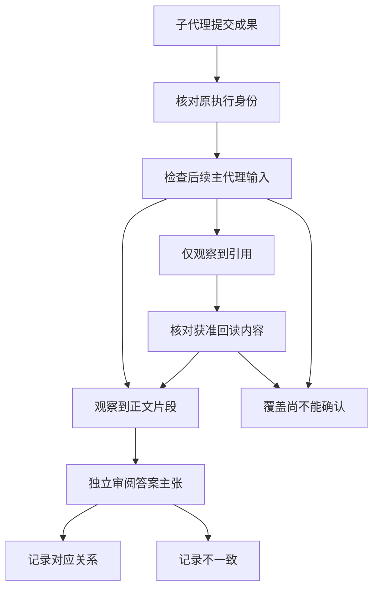

---
evidence:
  implementation: "已有执行身份与成果交接可回查"
  scoped: "真实提交与后续主代理输入的片段对应"
  live: "语义采纳与多专家增量质量尚未独立对照"
---

# 多专家 Agent：怎么证明专家的结论真的被主 Agent 用到了？

启动了三个专家，收到了三份报告，最后的答案却仍然像主 Agent 自己写的。此时说“多 Agent 协作成功”，到底成功在哪里？

困难不只是专家有没有运行。我们还需要知道：交回的是什么，主 Agent 实际拿到了什么，答案中的哪些判断与这些发现对应，以及多出来的工作是否值得。

**专家被启动、成果被提交、文字进入主 Agent、判断被采用、最终答案变好，是五个不同的问题。** 本文讨论怎样逐层取证，而不是再设计一套专家编排框架。

## 一、先别用“参与次数”回答“贡献多少”

在 2026 年 10 月 30—31 日的一组研究测评中，前 59 次已经结束的运行里，53 次至少有一次带执行身份的 Reviewer 准入，12 次至少有一次普通专家准入。

这两个集合可以重叠，不能相加得到“65 次专家研究”。Reviewer 是复核角色，普通专家承担其他局部工作；准入记录说明某个执行体获准进入流程，不代表它已经完成任务。

继续查最终成果，48 次运行中有至少一份可读最终提交，共 75 份。按同一执行身份关联，其中 62 份来自 Reviewer，13 份来自普通专家。

到这里，我们可以说“哪些专家留下了可读成果”，还不能说“哪些成果被采用”。一个子代理完全可能认真研究并提交，但 Main 没有读到、没有继续读原文，或者有理由不采纳。

因此，统计协作时，**运行、执行体、提交和模型请求必须各有自己的分母**。否则，几个好看的数字会把同一次工作算成多份贡献。

## 二、把贡献拆成可核对的交接

这里把主代理称为 Main，把承担局部工作的子代理称为 Child。实际关联应从它们已有的执行身份和结果引用出发，而不是先拿两段文字算相似度。

| 层次 | 最小证据 | 可以回答的问题 |
| --- | --- | --- |
| 执行准入 | 运行身份、Child 身份与原准入回执 | 谁被允许执行了哪项工作？ |
| 成果提交 | 同一 Child 的最终提交及可读内容 | 它实际交回了什么？ |
| 请求输入 | 后续 Main 请求中出现的正文、选区或结果引用 | Main 的这次调用实际收到了什么？ |
| 主张对应 | 最终答案与来源、专家发现之间的逐项核对 | 哪些判断与专家成果对应，限制是否保留？ |
| 增量效果 | 同题可比的单 Main 与多专家结果及成本 | 多出来的协作是否改善了用户任务？ |

它不是一张必须逐格通过才能展示正文的审批表。专家没有被采用，可能是合理的研究判断；某项证据无法采集，也不能因此隐藏其他已合法交付的内容。

这张表的用途，是限制我们能作出的结论，并把下一步调查落到正确位置。

## 三、文字匹配能证明到哪一步

为了检查交接，我们对每份可读最终摘要最多抽取 20 个、每个至少 40 字符的片段，再到该提交之后捕获的 Main 输入中查找。

75 份最终提交里，70 份至少有一个候选片段匹配，涉及 45 次运行。这个观察有价值：至少一些专家文字确实进入了主 Agent 的后续输入，而不是只留在子代理自己的历史中。

但把它叫作“93% 专家采纳率”就错了。

首先，一段文字进入上下文，不代表模型据此改变了判断。其次，命中一个片段不代表整份摘要、证据和限制全部到达。最后，文字没有匹配也不能证明没有交接：结果可能以引用形式进入，或者经过了未被该方法覆盖的改写和选区。

更稳妥的说法是：**这是一项有明确采样方法的输入覆盖观察，不是语义采纳或答案质量评分。**

还要防止另一个误归因：Main 可能在专家提交前就见过同一来源。即使后来答案和专家措辞一致，也不能据此认定这句话是专家独立贡献的。关联身份与请求先后可以缩小范围，不能自动识别模型内部的因果。

## 四、用一个费用核查问题说明差别

下面是教学案例，不是上述测评的原始用户资料。

Main 要比较两只基金的持续费用。Child 查到某个费率只适用于特定份额类别，而且不包含一次性交易费用，交回了费率、适用日期、原文引用和这两项限制。

**情形一：Main 只拿到结果引用。** 这证明材料有一个可继续读取的入口，不能证明本轮已收到费率正文。应继续核对是否发生了获准的读取，以及读取覆盖了什么。

**情形二：费率和限制进入了 Main 输入，但答案只保留费率。** 传输链路可能成立，答案表达却扩大了适用范围。需要修的是研究综合或表达，而不是再给 Child 增加一个重试。

**情形三：答案按份额类别比较，并保留费用范围。** 可以建立特定专家发现与最终主张之间的可读对应。但 Main 也可能从相同原始材料独立得出这个判断；要宣称专家带来了质量增益，仍需要可比实验。

三种情形不该被一个 `used=true` 覆盖。

## 五、一个不越权的贡献记录应该长什么样

下面是建议用于人工审阅的诊断记录，字段是教学设计，不代表系统已经实现了自动语义贡献判定：

```json
{
  "childExecution": "synthetic-child-1",
  "submission": "readable-final",
  "mainInput": "observed-excerpt",
  "claimReview": "not-assessed",
  "incrementalBenefit": "not-measured"
}
```

记录应优先引用已有的运行、执行体、提交和请求身份，不另建一套能改写业务事实的“贡献账本”。内容关联可以帮助审阅，但不能签发权限，也不能代替最终答案评估。



图中的三个输入分支分别表示已观察到正文片段、只观察到引用、或证据不足。只有取得实际读取内容后，才把引用分支推进到正文覆盖。最后的主张审阅仍是独立工作；发现不一致要记录，不反向篡改专家原提交。

这种拆分也能减少错误修复。如果 Child 已经交付而 Main 请求没有携带材料，查交接与投影；材料已经到达但结论没有保留限制，查综合和引用；专家做了大量重复劳动，查委派策略与增量价值。

## 六、怎样比较“多专家是否值得”

到了收益层，不能再用启动数和片段命中率代替对照。

一个可行的后续方案，是固定用户问题、来源版本、研究时点、模型配置与总预算，分别运行单 Main 和多专家方式，对最终交付答案做盲评。记录事实支持、关键遗漏、口径错误，以及端到端时间、全部物理尝试和未知费用。

这里比较的不是哪边专家更多，也不是哪边输出更长。它应该回答：用户真正关心的错误是否减少，重要限制是否保留，多出来的资源是否换来了有价值的信息。

总预算要事先说明。相同每代理预算会让多专家自然获得更多总资源；相同总预算则更接近“同样成本下怎样分工”。两种研究问题都可以成立，但不能把前者结果包装成后者的效率优势。

失败和未完成样本也要保留。只挑顺利完成的多专家案例，再与普通 Main 的全部任务比较，会把运行选择偏差当成架构收益。本文所依据的观察尚未完成这种质量与成本对照。

## 结语：先证明交接，再讨论贡献

子代理最先提供的是工作过程的隔离，以及局部成果回到主代理的能力。它是否提供了额外判断价值，需要更细的证据。

下一次评审多 Agent 系统，与其问“用了几个专家”，不如选一条关键结论，沿着 **原提交 → 后续 Main 输入 → 最终主张 → 原始来源** 回查一遍。链路在哪一层断了，就在哪一层改；链路已经成立，也不要急着把它写成收益证明。

**输入覆盖是工程事实，语义采用是内容判断，增量价值是比较问题。** 把三者分开，才可能判断哪些协作值得保留，哪些只是增加了成本和篇幅。

延伸阅读：[Subagent 的上下文隔离与专业化](agent-subagent-context-specialization.md) · [Trace 的完整性缺口](agent-trace-complete-observation-gaps.md) · [一份报告的成本归属](agent-report-cost-attribution.md)

更多案例见 [ETF Agent 技术文集](https://github.com/hpoenixf/eff-agent-article)。欢迎为文集点一个 Star。
