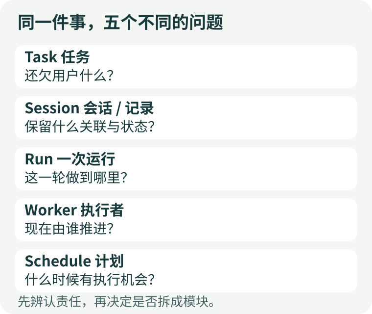
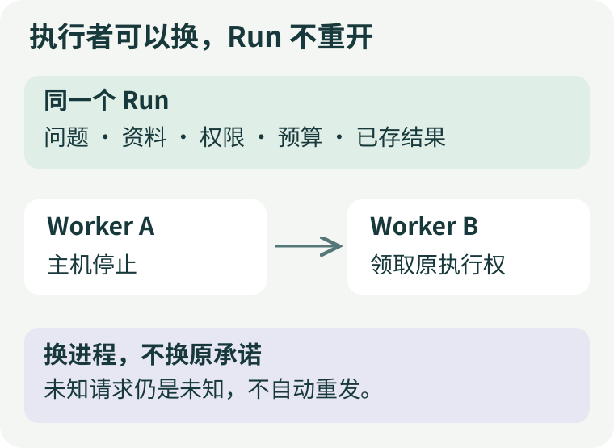
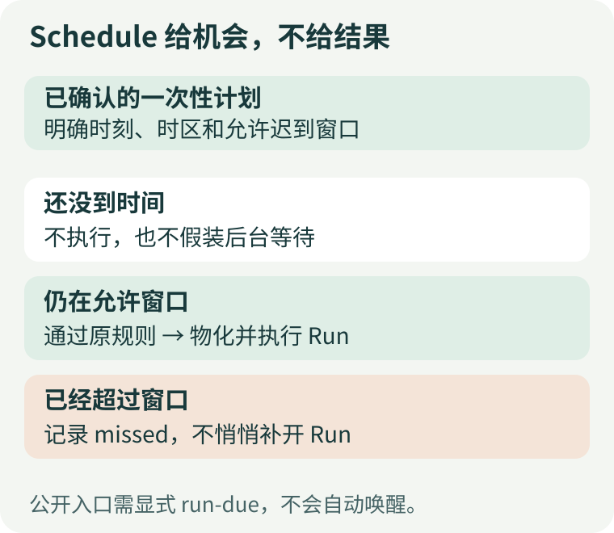
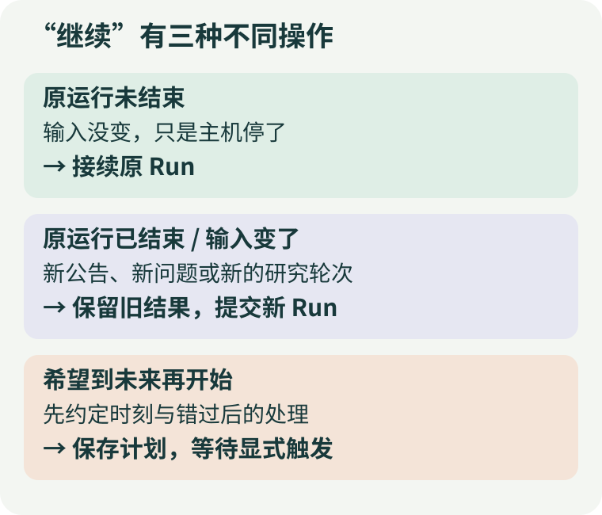

# 任务、会话、Run、Worker、Schedule：Agent 到底在继续哪件事？

“今天先读到这里，明天继续研究这份资料。”

这句话对人很自然，对程序却留下了好几个问题：明天接着读今天没有读完的部分，还是用新资料再做一次判断？聊天窗口关了，研究是否还在进行？机器重启后，应该找回哪个进度？如果今天已经写完报告，“继续”是不是意味着重写它？

这些问题都用了“继续”，对应的动作却不同。把 Task、Session、Run、Worker、Schedule 都翻译成“任务”，代码看起来简洁，故障发生时反而很难说清：**什么应该延续，什么可以替换，什么必须重新确认。**

本文用一份基金研究作为教学场景，建立一张概念地图。它不是某个框架的统一命名规范；不同系统会复用相同名字，我们要识别的是名字后面的责任。

## 一、同一件研究，可以有不止一次运行

假设你正在比较两只基金。今天读年报，明天补充费率公告，最后决定哪些差异值得进一步核实。

从使用者的角度，这是同一个研究任务：完成比较。从执行角度，它可能经历三轮：提取年报事实、加入新公告、复核报告。每轮都需要明确的输入、可用工具、执行上限和结果。

**任务（Task）回答“还欠用户什么”，运行（Run）回答“这一轮允许做什么、做到了哪里”。** 一个任务可以由一个 Run 完成，也可以跨多轮推进。反过来，一个 Run 结束，也不代表用户的整个目标已经实现。例如运行正常交付了一份“资料不足”的报告，程序完成了本轮工作，研究目标却仍可能没有达成。

这里的 Task 是业务层含义，不意味着每个应用都必须建一张 Task 表。Open ETF Agent 的本地项目将单次研究定义放在 `tasks/<id>.json` 中，绑定问题、配置和资料快照；它不是一个通用的、多阶段项目管理器。理解责任之后，再决定是否需要额外的数据模型，比先铺满抽象更重要。

[](../visuals/three-articles/continuity-five-questions.svg)

图一：这五个概念是不同问题的答案，不是五层必须逐级调用的架构。

## 二、Session 保存关联，不保证“模型记得一切”

用户常把会话理解为聊天窗口。工程里的 Session 可能表示对话历史，也可能表示持久执行容器；不能只根据字段名判断。

这里至少有三份不同的东西：

- **界面中的记录**：用户能够回看什么。
- **本次发给模型的上下文**：经过选择、压缩或检索后，模型实际看到什么。
- **持久执行记录**：哪些步骤已经提交、谁可以继续执行、有什么尚未确认。

三者可以相互关联，但不能互相代替。页面上显示了上次的报告，不代表这次模型请求一定包含它；模型看到了一段旧摘要，也不代表它拥有原始文件的读取权限。进程把聊天历史读回来了，更不代表可以安全重做一个已经发送出去的外部动作。

Open ETF Agent 的 `Session` 偏向第三种责任：保存 Run 状态、检查点、执行租约及结果相关记录。把它直接当作“把所有聊天消息塞回模型”的容器，会误解恢复过程。项目资料与持久报告也各有自己的保存位置，不必都挤进聊天历史。

这类区分在其他系统同样有价值。[LangGraph 的持久化文档](https://docs.langchain.com/oss/python/langgraph/persistence)把线程内的图状态检查点与跨线程的应用数据存储分开。它提示我们的不是要采用同样的类名，而是：**保留一段交互的状态，与保留长期知识，是两种不同的存储需求。**

## 三、换了 Worker，不应该换掉承诺

现在把场景改一下：年报读到一半，执行进程退出了。没有新资料，问题没改，用户也没有取消。

此时可以由新的执行进程接手。Worker 的责任是领取工作、进入原有执行器、观察执行结果；它不应该因为“我是新进程”就重新发一份同样的任务、再领一份完整预算。

公开版 Worker 的设计来路很具体。早期执行器将外部停止与取消联系在一起，但后台进程退出不总是用户取消。引入独立 Worker 时，需要区分“这个主机停下”与“这个任务被撤销”。因此，新的 Worker 仍进入原来的 Runtime，并沿用 Session 中的 Run 身份和执行权，而不是复制另一套模型循环。[公开设计记录](https://github.com/hpoenixf/open-etf-agent/blob/v0.28.0/docs/evolution/v09-worker-lineage.md)

[](../visuals/three-articles/continuity-worker-handoff.svg)

图二：替换的是执行者，不是已经确认的工作定义。图示为教学简化。

多个进程同时看到一项工作时，不能靠“我先读到了记录”取得执行权。公开实现由原 Session 租约和写入代次校验决定谁能推进。旧执行者即使晚一些返回，也不能冒充当前持有者继续写入。

[Temporal 对 Worker 的说明](https://docs.temporal.io/workers)也区分 Worker 程序、实体与进程，并让执行进程从任务队列领取工作。它提供了更完整的持久工作流基础设施；公开版的单 Run Worker 则刻意没有引入通用队列或第二套任务状态机。单机教学项目不一定需要完整平台，跨机器编排、长期运维和复杂调度成为主要需求时，复用成熟系统更合适。

还有一个容易忽略的界限：主机不再等待，不等于服务商已经停止处理请求。一次请求已发出、结果未收到时，新 Worker 必须保留“未知”，不能直接把它改成“没执行”。身份延续的价值，正是在这种不确定时刻仍能说清之前发生过什么。

## 四、Schedule 保存约定，不替你研究

“明天继续”还有另一种含义：今天不用执行，明早九点再开始。

这需要保存未来触发的约定。Schedule 关心时刻、时区、定义版本，以及错过时刻后还允许等待多久。到点后，它给出执行机会，再由任务的授权、额度与执行规则决定能否开始。

**时间到了，不等于模型已经调用；模型调用了，不等于报告已经交付。**

[](../visuals/three-articles/continuity-schedule-window.svg)

图三：一次执行机会有边界。错过之后是否补跑，必须由明确规则决定。

Open ETF Agent 的公开一次性计划要求显式调用 `run-due`，没有常驻守护进程。它不会因为保存了一个未来日期就自动唤醒电脑，也没有由这个模块提供周期任务或通知。到期物化与 Run 的关联由原有持久机制处理；重复扫描不会自动为已完成的计划创造新一轮研究。[一次性计划说明](https://github.com/hpoenixf/open-etf-agent/blob/v0.28.0/docs/scheduled-tasks.zh-CN.md)

这不是定时功能做得越多越好。一次性的、人工可控制的练习适合把边界保留得很小。需要长期自动运行时，还得选择和运维真正的外部唤醒机制，并明确取消、迟到和重复触发策略。

[Kubernetes CronJob 文档](https://kubernetes.io/docs/concepts/workloads/controllers/cron-jobs/)把按日程创建 Job 与实际执行分开，也明确说明调度可能漏建或重复创建，因此工作本身应具备幂等性。成熟调度器并不会免除业务端识别“这是不是同一次工作”的责任。

## 五、明天的“继续”，先回答一个选择题

把前面的区别合起来，可以用三个问题决定下一步，而不用先猜应该调用哪个 API。

**原来的 Run 还没有结束，而且问题与资料没有改变吗？**

如果只是主机中断，先检查原状态，再由 Worker 接续同一个 Run。原授权、执行截止时间、预算和未知效果都延续，恢复不是重置。过期或已终结的运行不能靠换进程重新获得资格。

**原来的 Run 已经结束，或者现在要加入新资料吗？**

这是新的研究轮次。保留旧报告和旧资料版本，把新输入明确地交给新 Run；业务上可以继续同一任务，但不要悄悄覆盖昨天的依据。基金报告尤其如此：新获取时间不等于新的披露时点，重新运行也不代表来源已经更新。

**只是希望未来某时刻开始吗？**

那就保存经确认的计划。计划可以关联将来要做的工作，但不要让一个模型请求一直睡到明天。先决定谁负责准时唤醒，再确认本次触发是否仍有资格执行。

[](../visuals/three-articles/continuity-three-continues.svg)

图四：同一句自然语言，需要依据输入和状态选择不同动作。

公开项目中，已经存在且获准执行的非定时任务可以用下面的命令观察这些区别。`PROJECT` 和 `RUN_ID` 需要替换成原项目与原运行身份：

```bash
node src/research-cli.mjs run inspect --project PROJECT --run RUN_ID
node src/research-cli.mjs run work --project PROJECT --run RUN_ID
node src/research-cli.mjs run report --project PROJECT --run RUN_ID
```

`inspect` 看状态，`work` 尝试推进原 Run，`report` 读取持久结果。这里没有“重新给它一次机会”的隐含预算。真实 `work` 需要先完成提供方、资料与费用授权；完整初始化和输入条件见[本地研究项目指南](https://github.com/hpoenixf/open-etf-agent/blob/v0.28.0/docs/research-project.zh-CN.md)。命令展示的是接口含义，不是本文替读者执行过真实模型任务。

## 六、不必把五个名词都做成五个模块

一个只回答单次问题的应用，可以由请求直接触发 Run；不需要为了架构完整就增加 Task 管理器。一个不会跨进程恢复的小脚本，也不必复制工作流平台。只有当“同一件事”的寿命开始超过一次调用、一个进程或一次对话时，才值得把相应责任分出来。

判断是否拆分，可以看谁的变化不该影响谁：

- 用户换个窗口，不应让已提交的研究消失。
- Worker 换个进程，不应改变原来的权限和预算。
- 新计划改了时间，不应偷偷改写旧 Run 的输入。
- 一轮报告完成，不应自动宣称整个业务目标达成。

真正需要稳定保存的，是用户确认过的工作及其进展；进程、页面、模型调用都可以是围绕它工作的临时参与者。下次再说“让 Agent 继续”，先问一句：**继续目标、继续上下文、继续原执行，还是安排下一次机会？** 答案清楚了，恢复和调度的接口通常也就清楚了。

## 延伸阅读

- [专家、Subagent、Review、Judge：都是另一个模型，为什么不是同一回事？](./agent-expert-subagent-review-judge.md)：区分一轮研究内部的协作责任。
- [Agent 不必一直在线思考](https://hpoenixf.com/eff-agent-article/articles/agent-autonomous-scheduled-research)：进一步讨论定时与条件触发的完整系统设计，注意其中私有系统与公开示例的范围不同。
- [练手篇](https://hpoenixf.com/eff-agent-article/articles/open-etf-agent-research-project-workshop)：从明确选择的资料开始建立自己的本地研究项目。
